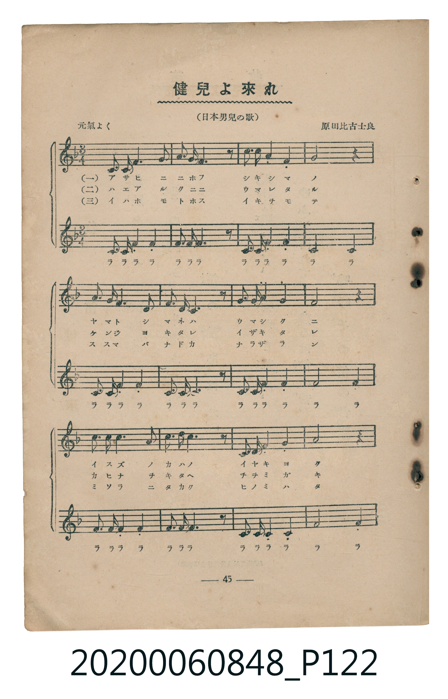
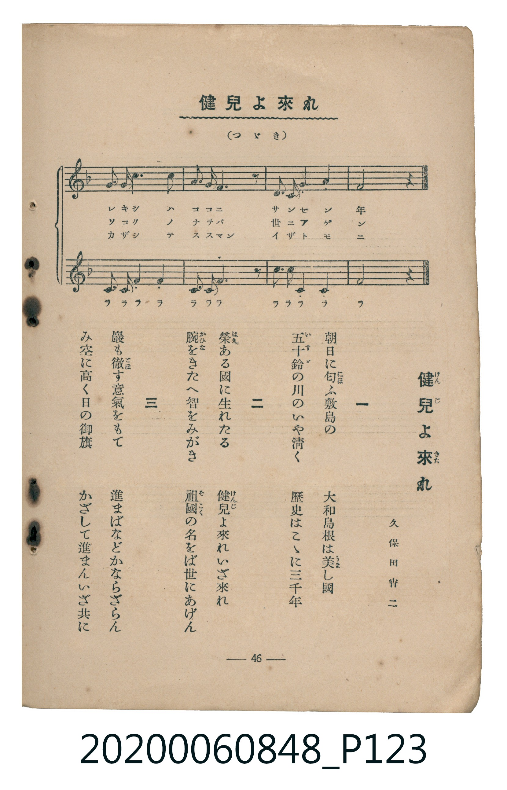

# 健兒よ來れ

<audio controls src="kenji_yo_kitare.mp3"></audio>

- 詞：久保田宵二
- 曲：原田比古士良
- （日本男兒の歌）
- 臺灣教育會公認《新定兒童唱歌》高等科男子用（2020.006.0848）

## 說明

原書資訊與歌詞全文（對應 P122.jpg – P123.jpg，書頁 pp. 45–46，高二重音第 4 首）：
調性與拍號：ヘ長調（1 降記號）、3/4 拍（元氣よく，二部重音合唱，第二部唱「ラララ…」伴唱）

## 歌詞

```text
一　朝日に匂（にほ）ふ敷島の　大和島根は美（うま）し國
五十鈴（いすゞ）の川のいや清く　歷史はこゝに三千年

二　榮（はえ）ある國に生れたる　健兒（けんじ）よ來（きた）れいざ來れ
腕（かひな）をきたへ智をみがき　祖國（そこく）の名をば世にあげん

三　巖も徹（とほ）す意氣をもて　進まばなどかならざらん
み空に高く日の御旗　かざして進まんいざ共に
```

## 原書掃描頁





## 分析

```text
================================================================================
📊 TMD Song Profile: [ 健兒よ來れ ]
================================================================================
⏱  Duration:       0:25 (25.7s), 16 measures total
🎼 Key & Tempo:    首調基準 F, != 112.0 BPM, <3/4>
   - 分析範圍：      由實際發聲的音符與和弦推測調性；播放脈絡另行呈現
🎤 人聲音域:    C4 (MIDI 60) – D5 (MIDI 74) [跨度: 14 個半音 / 1.2 個八度, 難度: moderate]
   - 最低音:  C4 in [Main #1 @ m.1, 0:00]
   - 最高音: D5 in [Main #1 @ m.3, 0:03]
   - 適合: soprano, mezzo-soprano, contralto, tenor, baritone, bass
🏛  結構:      Main (25.7s)
⚡ 編曲密度:        Peak 2 軌道同時演奏
🗝  調性診斷：       F 大調（純淨自然大調，未偵測到可信轉調）
   - 風格氣質:    純淨自然大調（陽光明朗、易唱易記，無明顯調外色彩）
   - 轉調歷程:    全曲維持單一推測調性（未偵測到可信轉調）
   - 核心骨幹音:  F, C, D, E, A
   - 調性數值:    F 大調 [相關度: 0.91, 穩定度: High, 自然音純度: 100.0%]
   - 候選調性 (K-S): F 大調 (0.91), C 大調 (0.74), F 小調 (0.57)
   - 五度圈歷程:   -1
   - 各段落調性細節:
     • [Main #1]: F 大調 (r: 0.91, 自然音純度: 100.0%)

  [ 五度圈游移軌跡 ]
               C  
        [F ]*          G  
      Bb               D  
      Eb               A  
         Ab           E  
            Db       B  
               F# 
     (* = active key center)

  [ 十二半音累積音高分佈 ]
     C  : ██████████████████████    28.7%
     C# :                            0.0%
     D  : ██████████                13.2%
     D# :                            0.0%
     E  : ██████                     8.0%
     F  : ████████████████████████  31.6%
     F# :                            0.0%
     G  : ██████                     7.5%
     G# :                            0.0%
     A  : ██████                     8.0%
     A# : ██                         2.9%
     B  :                            0.0%
--------------------------------------------------------------------------------
Assignment 軌道音域：
  - Part1         : C4 – D5 (14 個半音 / 1.2 個八度, 48 個音符)
  - Part2         : C4 – F4 (5 個半音 / 0.4 個八度, 51 個音符)
================================================================================
```

## ABC

```abc
X:1
T:健兒よ來れ
C:曲：原田比古士良
M:3/4
L:1/16
Q:1/4=112
K:F
V:V1 name="Part1" snm="Par"
V:V2 name="Part2" snm="Par"
[V:V1]
!f! f3 c f4 a4 | b3 a g6 z2 | c3 c d4 c4 | a8 z4 |
f3 c f4 a4 | g3 f e6 z2 | g3 a b4 e4 | f8 z4 |
d3 d d4 c4 | d3 d d6 z2 | e3 f g4 a4 | c8 z4 |
f3 c f4 a4 | b3 a g6 z2 | c3 a f4 g4 | f8 z4 |
[V:V2]
!mp! c3 c c4 f4 | e3 f e6 z2 | c3 c d4 c4 | c8 c4 |
c3 c c4 f4 | d3 d c6 z2 | c3 c c4 c4 | f8 f4 |
f3 f f4 f4 | f3 f f6 z2 | c3 c c4 c4 | f8 f4 |
d3 d d4 d4 | d3 d e6 z2 | f3 f c4 c4 | f8 z4 |
```

- [主旋律 TMD 檔案](kenji_yo_kitare.tmd)
- [鋼琴伴奏 TMD 檔案](kenji_yo_kitare_piano.tmd)
