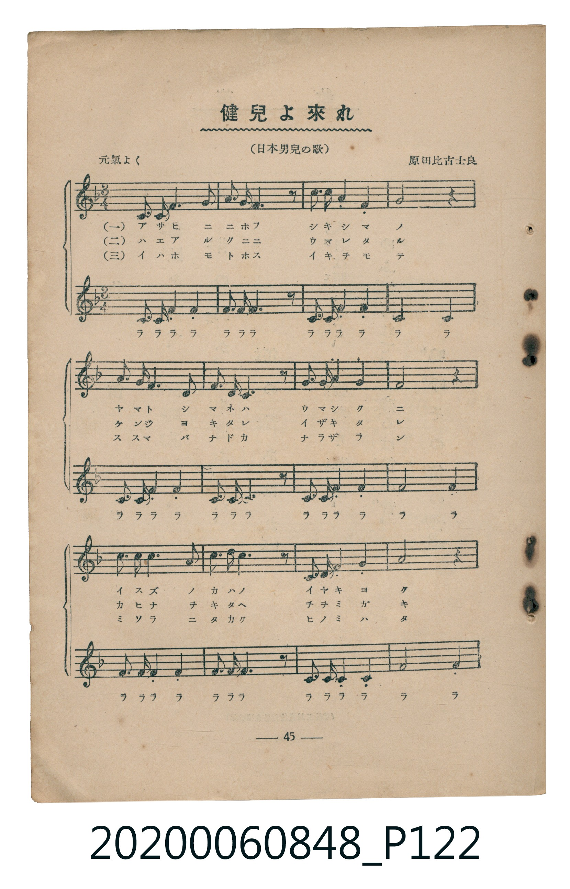
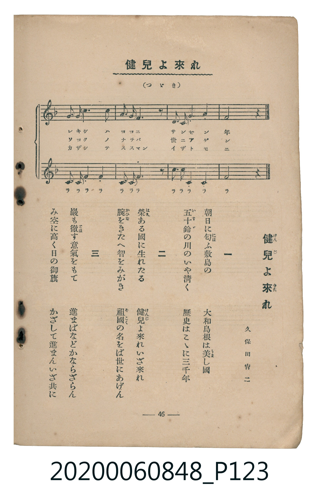

# 健兒よ來れ

> Re:Shōka 使用 AI 協助辨識與重建樂譜，可能會有錯誤。歡迎回報。

- **鋼琴伴奏版**：<br><audio controls src="kenji_yo_kitare.mp3"></audio>

- 詞：久保田宵二
- 曲：原田比古士良
- （日本男兒の歌）
- 臺灣教育會公認《新定兒童唱歌》高等科男子用（2020.006.0848）

## 說明

原書資訊與歌詞全文（對應 P122.jpg – P123.jpg，書頁 pp. 45–46，高二重音第 4 首）：
調性與拍號：ヘ長調（1 降記號）、3/4 拍（元氣よく，二部重音合唱，第二部唱「ラララ…」伴唱）


## 歌詞

```text
一　朝日に匂（にほ）ふ敷島の　大和島根は美（うま）し國
五十鈴（いすゞ）の川のいや清く　歷史はこゝに三千年

二　榮（はえ）ある國に生れたる　健兒（けんじ）よ來（きた）れいざ來れ
腕（かひな）をきたへ智をみがき　祖國（そこく）の名をば世にあげん

三　巖も徹（とほ）す意氣をもて　進まばなどかならざらん
み空に高く日の御旗　かざして進まんいざ共に
```

## ABC

<div class="abc-score" data-abc-src="kenji_yo_kitare.abc" aria-label="五線譜載入中"></div>

[下載 ABC 原始檔](kenji_yo_kitare.abc)

## TMD 檔案連結

- [主旋律 TMD 檔案](kenji_yo_kitare.tmd) [[在 TMD Studio 編輯](https://tmdlang.github.io/Tmd-TS/#tmd=s7IKdvYPcrWy4qpTUCpJTLdSSM7PyUlNLsnMz7MqzsjMK0nNjM_KTMmPL87Iz05Ugisry88pzU21ys4vyY9Pyq8sjjcyMDKINzAwizewMLFAqCvOLy1KTrUqTs7Iz8-JL0mtKEnKz89Gl48vSExPtQowNDKKBxLGCOmCovyy1LzEPKARBUUg16SAzUAoSC3LTEkFSRcnJ-bFl6UWZaZlpqYguTO1qBjsF4g9JUWJecXJRZkFIA8iVOUXlWTkpxclFmRUWmVkFpfkF2UmJ-bEZyfmIXm5JCMV6OPczJzMksSiSmTNmemZeVYliZnAMAKFU3lifG5iZl5OYh7QIVpaCk8blz5tnfS4qePJvrbHTT0KWlpcirYKhoZGXPa2Cm5cNsb6JnYg016snPd-z6wnO1uf7J_7fMqGp-u2PtnVA7bn2exNQJmnffOBws_WT3nav-Tp4tUvOteDJd_v6Xg2femzOWueT9kOsqdx3bO1Pe_3dIIlX7Tvet64-NnUmS-aNj2b0_y0dc2LVb2PG7qeTQOaPwuo_PnqpU-nbATqeNzQ_XL1jOdrO58vnwgyae2E51NWAM0GRaweMGL1QBELNpZLX0vBllqAS0FBAeixZ7N3vNjc_mJF14uOdqBjgEHxtHXFs2ntQAc83dD7rL1TAZQ69LIK0hUeNUwGcYxBnPd7eoA6Xy5oVCgo0FMwMQXKmZgBBYE-AYbdy_bel_M3P1-zRsFE4eWyaUDHA0MRZOGLVfufNSwHWdXd-2LmfKDo4-YZL6duB4oDLTRUeDmz98WKGWCZzscNjcAIUgCqBLmltfnZhsXAqHzc2A-0BmRH8wqINU8ndAADEigItA8iDuQ-buh53LwSgh41LHvc0Ptkzxawsk4ukEOe7Gh43NDwbM5cYAw-blz9tKcJaAmQ8bhxN8jqxq3Ppm5_unkbME6Byp4uWf50Ug-Q-2zBzseN65_v6wMrbnvcuA-sePrTOd1gQ3dNedrb-LJjC1i65XHjzMdNwJQFVLHu6fa5ILOAgk0tz3a0An0Bsn7t9qf9m4AmPm6c_LgJqGD1kx2dT3ubn-7cAnHkLmDiaHi2bB3YPKCqDrBhTY-buoE2ApU_nzIfmK4fNwLJbpA7wekdrHji46bJjxtngNSDkz9YsBeoEiwC1AJ03TRItgDHS-tUsAqgoUD3rAIrAiZokIbHjTuezdwF5u5_3AjUCUzFDc-XTgO6AKwF6GygTcBIAXtzQi9Y5YYnO6aBQ7PpcSMwA06GhjkwThuebp_2uKnp6b6dYN0rYAE-81lLPziGgcqBmoAx1vCyAeiWfUDDgC563LgS7LpVj5uAioEmAB04GWQo0FXPV-4C2gVMeUBngKNz3dN9C59Nnw40AqwH6JLpQBOhxoHCBeT5p60bgbpARlCel6BAQUufi8s7NS8rMzLfG1RYAYvWzMS8fEOHGoOaapBVCjaGZlp2YBYwL4MS7I6GZ-u2KmiYKDzd0P98fYMmKEs0LVJ43LRV4XHzJCDuVqgBk4-bZwPxVBCvaTsQr4XQzfPA8n0gu0HG1ihUp9UqmMYr6AIhkDIEMyDQCIhrFIyhbGQZA7CMKUQTVIUuXEUNWCcyBKkHy4Dt9DEEOqGxCSzyuHEqEG9CUgsMZbAZEBrE3w3EW5FUgBwLkp8Ole-Fs0G8fXBXAGMWzR0Qb8LdYQRSsx6qrwPuJqhJTd1QU_rh7oK5CdUdbXCbQbUGzB3zEe4Am4THHcYgU1qg-taDfYzsDpCrQCpWQFWAwmMmFnfATACGR9MkFN2w8FiG0x3IaWxXD2Yaa14CTjuPm4HBBExHoDQE4gGtau4He3EZRASc1jZA0yA8jWFLQ2YQZ0OEgBxoGoRASAKDJCMjeAKDJSuYLlT1SAEKSmBNsOAARgs06GBRA0osoOCAJJXHjcC8AU0GqAGKFLFICWwC3BWoyQE1QBEJbCJEX9NkIHsGsjuaOqCm9EJNno-UgJDdAfPJNLha9ASGrAuLO8AJDJJkQDQik0BENkDtWQXlrwRi5CQLcwdUvqkT7BaYLzqR3DEZpztQCrFOLIUYMIE17QTiXeDiCWQYML8BExeMB0qAIDXAyGpeARZZj0hgsKIIQkMgKNXAZMxQZKDFF8RxwKQHS02I9AVLccg6kMITXIDBYgUUnrOQ1EKKHZAKSBhCsjRyUYQWr8CUihSv4FQBDU9o0YMtPBHpC2bLJngMwUwCFQJo6atxBxZ3LISrB1aPcF_A0hTCBJzuAKcviE5gDY-UJiAisAIdkmJBLkb1GcwdkGoAFFbI7oDlTIQJ2NyBlL6ezp6NpQBbg1QJQoqszRAMqTLBFShIZA-YrlEAtqoQ6QtWEpkg2Q1i46sewQUcuFKFpStYqiKu_IKEP2r1hggRUGhAchuIxl4xTYXIg0ueOTDd8DwKUrEWX5ZFJLG5SBYhRxwiqcOKBlASAhUnaE6BJmpIHQqrkYBtPYRTCLkDnMRgSR1UEKIGCahmwyjkUA3FVprC6gXUahJ3qV6LtcFmRGKDrRlYwCJhUGWJi4cqgmi05RZga7UhWmAQliG2VhseXSh1MFQVSiyAEyYkc4OrAXhGR60GsKlAigKiTUCKYYQsIl0ODpeAUuaAu4Rg-43iJEdEugFSWFpxhJMpAsJlRpMbLpcMuuSGrTVHeXJDL8BIK9rgyRBRgI2mNdJdMtjSGvaWHTlpjcRiDffgBzEpDVvrbiBCFUvTbjC4Y8BSGUq7TtdOAaVppwAUUOYCAA)]
- [鋼琴伴奏 TMD 檔案](kenji_yo_kitare_piano.tmd) [[在 TMD Studio 編輯](https://tmdlang.github.io/Tmd-TS/#tmd=s7IKdvYPcrWy4qpTUCpJTLdSSM7PyUlNLsnMz7MqzsjMK0nNjM_KTMmPL87Iz05Ugisry88pzU21ys4vyY9Pyq8sjjcyMDKINzAwizewMLFAqCvOLy1KTrUqTs7Iz8-JL0mtKEnKz89Gl48vSExPtQowNDKKBxLGCOmCovyy1LzEPKARBUUg16SAzUAoSC3LTEkFSRcnJ-bFl6UWZaZlpqYguTO1qBjsF4g9JUWJecXJRZkFIA8iVOUXlWTkpxclFmRUWmVkFpfkF2UmJ-bEZyfmIXk5sQioOT01NzWvxKogMzEvPz4xOTk_tyAxLxMkhlBYkgFUZJWbmZNZklhUiWxLZnpmnlVJYiYwMEEBWp4Yn5uYmZeTmAd0sZaWwtPGpU9bJz1u6niyr-1xU8_7PR0vu_c8n7DlyZ4tT5f2P-_seL-nU0FLi0vRVsHQ0IjL3lbBjcvGWN_EDmTFi5Xz3u-Z9WRn65P9c59P2fB03dYnu3rAlj-bvQko87RvPlD42fopT_uXPF28-kXnerAk0JJn05c-m7Pm-ZTtIMsb1z1bC7S5Eyz5on3X88bFz6bOfNG06dmc5qeta16s6n3c0PVsGtD8WUDlz1cvfTplI1DH44bul6tnPF_b-Xz5RJBJayc8n7ICaDYoWegBk4UeKFmAjeXyTs3LyozM9waFDjDSQSFp6FBjUFPNpQAENoZmWnZglr6WwvM1a57saHi2bquClj5YrEahOq1WwTReQRcIgZQhmAGBRkBco2AMZSPLGIBlTCGaoCp04SpqwDqRIUg9WAZsp49hjcLjxiawyOPGqUC8CUnt48bVYDMgNIi_G4i3IqkAORYkPx0q3wtng3j74K4ABj2aOyDehLvDCKRmPVRfB9xNUJOauqGm9MPdBXMTqjva4DYD0xjcHfMR7gCbhMcdxiBTWqD61oN9jOwOkKtAKlZAVYDCYyYWd8BMAIZH0yQU3bDwWIbTHcgJZFcPSgLBlgDMIHZChIAcaAKCQEjqgKQBI3jqgKUJmC5U9UihAUodTTC_AMMU6m9YuIJiGuQXSDw_blwLj0PU0ECKFaTUMQHuCtS4RA0NROqYCNHXNBnInoHsjqYOqCm9UJPnI8U-sjtgPpkGV4ueOpB1YXEHOHVA4htEI1I4RGQD1J5VUP5KIEZObzB3QOWbOsFugfmiE8kdk3G6A6X46ERJHbBCAEJDICjKYTJmKDLQggNiMjDdwJICInHAkguyDqTAABcdsCAFBcYsJLWQDA9SAQkASGZCLgTQIgWYzJAiBRyl0MCAZnpsgYFIHDBbNsGDF2YSKPuhJY7GHVjcsRCu_nHjfrgvYAkCYQJOd4ATB0Tn48a5SBEKEYEVpZDkBnIxqs9g7oAUwKCwQnYHLFshTMDmDqTE8XT2bJTEASsDTJA0gtj4ahVw0QKui2CJApYkiCs5IIGHWisgvAPyCiSdg2js5flUiDw4z8-B6YbnDpCKtfgyCyJ9zEWyCDnUEekUlilB8Q_KyGhOgaZISNUDK8gfN8IKd_yZFpE-YOkUVAShBgmoQsAoXlANxVaOwUpk1NoFd3lai7WRYkRCIyW3AFsrBdHigLAMsbVS8OhCqbagqlCCD5yiIFkKXHLCsxdqyYlNBVLYEW0CUtQgZBEJanC4BJSkBtwleNorREQ4kMLSYiGcvhAQLjOaTnC5ZNClE7SWC3qRQVphAk8_iCJjNJGQ7pLBlkjQWzDEFSa4-8bEJBNsrZiBCBIsTZjB4I4BSyKE2i8-HkgNGBNo-wXaVjGMVzCO1wZGOoQERjqMaYDMgcmaxgObu2A2iAXxOF5lIFMQPAiJpAHIwGkIikuIM8MoXsEkXhvYMoeQxJsBlAYFnq6dAkr4RfsYxipgChphEzQGCypzAQA)]

## 分析

```text
================================================================================
📊 TMD Song Profile: [ 健兒よ來れ ]
================================================================================
⏱  Duration:       0:25 (25.7s), 16 measures total
🎼 Key & Tempo:    首調基準 F, != 112.0 BPM, <3/4>
   - 分析範圍：      由實際發聲的音符與和弦推測調性；播放脈絡另行呈現
🎤 人聲音域:    C4 (MIDI 60) – D5 (MIDI 74) [跨度: 14 個半音 / 1.2 個八度, 難度: moderate]
   - 最低音:  C4 in [KenjiYoKitare #1 @ m.1, 0:00]
   - 最高音: D5 in [KenjiYoKitare #1 @ m.10, 0:14]
   - 適合: soprano, mezzo-soprano, contralto, tenor, baritone, bass
🏛  結構:      KenjiYoKitare (25.7s)
⚡ 編曲密度:        Peak 2 軌道同時演奏
🗝  調性診斷：       F 大調（純淨自然大調，未偵測到可信轉調）
   - 風格氣質:    純淨自然大調（陽光明朗、易唱易記，無明顯調外色彩）
   - 轉調歷程:    全曲維持單一推測調性（未偵測到可信轉調）
   - 核心骨幹音:  F, C, G, A, D
   - 調性數值:    F 大調 [相關度: 0.90, 穩定度: High, 自然音純度: 100.0%]
   - 候選調性 (K-S): F 大調 (0.90), F 小調 (0.70), C 大調 (0.61)
   - 五度圈歷程:   -1
   - 各段落調性細節:
     • [KenjiYoKitare #1]: F 大調 (r: 0.90, 自然音純度: 100.0%)

  [ 五度圈游移軌跡 ]
               C  
        [F ]*          G  
      Bb               D  
      Eb               A  
         Ab           E  
            Db       B  
               F# 
     (* = active key center)

  [ 十二半音累積音高分佈 ]
     C  : ████████████████          30.7%
     C# :                            0.0%
     D  : █                          2.3%
     D# :                            0.0%
     E  :                            0.0%
     F  : ████████████████████████  46.3%
     F# :                            0.0%
     G  : █████                      9.5%
     G# :                            0.0%
     A  : █████                      8.9%
     A# : █                          2.3%
     B  :                            0.0%
--------------------------------------------------------------------------------
Assignment 軌道音域：
  - Piano1        : C4 – D5 (14 個半音 / 1.2 個八度, 48 個音符)
  - Piano2        : C4 – C5 (12 個半音 / 1.0 個八度, 51 個音符)
================================================================================
```


## 原書掃描頁






