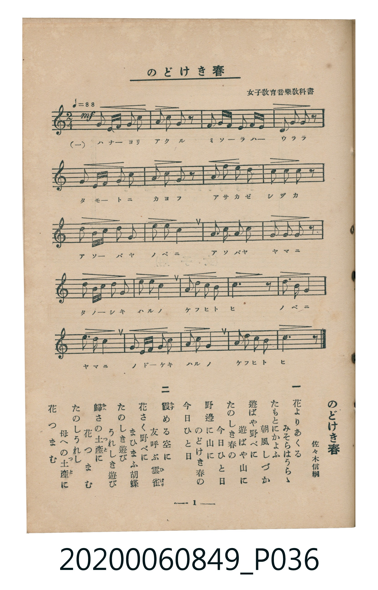

# のどけき春

> Re:Shōka 使用 AI 協助辨識與重建樂譜，可能會有錯誤。歡迎回報。

- **鋼琴伴奏版**：<br><audio controls src="nodokeki_haru.mp3"></audio>

- 詞：佐々木信綱
- 出處：女子教育音樂教科書
- 臺灣教育會公認《新定兒童唱歌》高等科女子用（2020.006.0849）

## 說明

原書資訊與歌詞全文（對應 P036.jpg，書頁 p. 1，高一第一學期第 1 首）：
調性與拍號：ハ長調（無升降記號）、2/4 拍（♩=88）
出處註記：女子教育音樂教科書


## 歌詞

```text
一
花よりあくる　みそらはうらゝ
たもとにかよふ　朝風しづか
遊ばや野べに　遊ばや山に
たのしき春の　今日ひと日
野邊に山に　のどけき春の　今日ひと日

二
霞（かす）める空に　友呼ぶ雲雀（ひばり）
花さく野べに　まひまふ胡蝶
たのしき遊び　うれしき遊び
歸（かへ）さの土産（つと）に　花つまむ
たのしうれし　母への土産（つと）に　花つまむ
```

## ABC

<div class="abc-score" data-abc-src="nodokeki_haru.abc" aria-label="五線譜載入中"></div>

[下載 ABC 原始檔](nodokeki_haru.abc)

## TMD 檔案連結

- [主旋律 TMD 檔案](nodokeki_haru.tmd) [[在 TMD Studio 編輯](https://tmdlang.github.io/Tmd-TS/#tmd=s7IKdvYPcrWy4qpTUCpJTLdSSM7PyUlNLsnMz7MqzsjMK0nNjM_KTMmPL87Iz05Ugisry88pzU21ys4vyY9PzyzKKY43MjAyiDcwMIs3sDCxRCgszi8tSk61Kk7OyM_PiS9JrShJys_PRpePL0hMT7UKMDA2Q8gUFOWXpeYl5gF1FxSBXJIC1o5QkFqWmZIKki5OTsyLL0stykzLTE1BcmNqUTHYHxArSooS84qTizILQJ5DqMovKsnITy9KLMiotMrILC7JL8pMTsyJz07MQ_JuSUYq0LfFqYnF-XnFyHoz0zPzrHJTM7MysfgNKl2SmAkMPVAIlifG5yZm5uUk5gGdqaWl8Lhx3ePGlY8bJz5u7H02Y6mClhaXoq2ChQWXva2CM5eNkb6JHciwFyvnvd8z68neCY8bWp_NWfFk_8Ln2zaCrXnavuvFzKlAyadLNz9dO-HZ1Jkvmja9nL_52YomIPv58onPZu8AK3zRvut542KI_LM5zU9b17xY1fu4oevZtA1P18162jrp-eqlT6dsfLa253FD98vVM56v7QTqhpj6fMqK93s6QPGrB4xfPVD8vt_TqcTFpa-lYEstwKWgoPC0bz7QvS82t79Y0fWiox3oGKDPn7aueDatHeiApxt6n7V3KoASiV5WQfr7PT1AxS8XNCoU6CkYAnlAVz_Z0fB8zRog-XTtjmdz5gPZCoYKL5dNAzoXGEYgK16s2v-sYTnI8O7eFzPnA0UfN_e_nLodKA604nnLwqe97S9n9r5YMQMs2_m4oREYCwpA1UDpRzNX2lpYAEXBjgUH_YsVu4Fq8UcAF0g50FFg-7s2Pm7qeNzU9bix6XFj_-Om7scNDY8b9z9unPu4qfNx4_rHjW0gRtNckOrHjfMfNwHVrXjcuPpxYzdIZ-NWoIZnc-a-XAQUnP64cSlQHKT0ZSPQyA2Pm1petvc9btwJ0tDQABd8unEjUARmJCjVAbWCkhyI3dDwZHfXs-lA9iagVUAG2Lz2vpcgV66GaAW7EiWxYtcJ9uquHrAJc4CpFujg7seNM0Eh2dQI9O3zlbsgpj3t7346cc_jxm0vZ296ObsBrBJoCNCxXdAABgVV41RgICH76HHjPrA6ILn1RfPCF3O3oXsK7OfNYKXAkOxBFgQpfbZ2B8xVQAYwxIE2rHsKTCtTFoPFlwA9AhYH2QZ2AlBk3-MmcOwh2QMzGxgZ63uBZpFgCuWZBQoUtPS5uPzyU_KzU7MzPRKLSq0CMhPz8h1qDGqqQRYp2BiaadmBWdiyqgIkr7xY2KOgYaLwdEP_8_UNOvD8pYlFA9A-kGE1CtW5abUKpgq6CsYKJmDaMA5I1CiYwZggMQOwkAmYZwJUqQsmaxSMoPJwNWBDfQxrFIB5Ech_3NwFxHuAeAWYtwpszuOmRSBe03qw2GogGQ8Rb54PFt8L1bMSLN8P5oF0LQPzIaIgEqwLYqMRSB5k0uOmnVDdC-Gmg-T2IuntRrKxAyyyCMWV02A2Nk8C8yfA3Q6xEX807OohJxqIiwGQkAlIyBhEGEHUgdUgCLR4aNqP4kOIf0EhAA8xqK-nIkIFGj9bwSQkVPdAZbaD1bbCZdDiADXWoSaA4hkk1weWm4kRB_PAIpCwhrBBbgHZthnMa0N1H4Hw39FJTviDw9IcFIJgFijIayChDCbAIQuCSNECZ0BiD0c-gIYlLE1D0tISHCECsQGhB5H6YDpANCyU4GGIlAcgsd0HDX9wbDWtxWLqZCTbIPlqDVgWvw4iwv_p7Nng8DelZfiD1YDFzMFicGkQhGQVsBKQPMgosE6MPIE1lKApGJIzQPEDC6WNYBFQKoSlVVBegpUSMAhL0xCdoLhFiln0sqp5BnI-AesB6W2Bm46SKuB5C0RC1IDSAUhmAaYLwH6E-hLsQ4gLCJRdU8iJO3AMgSMFKZoIFWikRCZSrQJK_xCfo4YNJCd1QsMTHFfUjFGkmAPlFkh-QQpXuC2Q2goUs1SOUa5aLi5dOwXkNoICkK_MBQA)]
- [鋼琴伴奏 TMD 檔案](nodokeki_haru_piano.tmd) [[在 TMD Studio 編輯](https://tmdlang.github.io/Tmd-TS/#tmd=s7IKdvYPcrWy4qpTUCpJTLdSSM7PyUlNLsnMz7MqzsjMK0nNjM_KTMmPL87Iz05Ugisry88pzU21ys4vyY9PzyzKKY43MjAyiDcwMIs3sDCxRCgszi8tSk61Kk7OyM_PiS9JrShJys_PRpePL0hMT7UKMDA2Q8gUFOWXpeYl5gF1FxSBXJIC1o5QkFqWmZIKki5OTsyLL0stykzLTE1BcmNqUTHYHxArSooS84qTizILQJ5DqMovKsnITy9KLMiotMrILC7JL8pMTsyJz07MQ_JuYhFQc3pqbmpeiVVBZmJefnxicnJ-bkFiXiZIDKGwJAOoyKo4NbE4P68Y2ZLM9Mw8q9zUzKxMLIEAlS5JzAQGMyioyxPjcxMz83IS84D-0dJSeNy47nHjyseNEx839j6bsfT9no6X3XueT9jyZM-Wp0v7n3d2vN_TqaClxaVoq2BhwWVvq-DMZWOkb2IHsuHFynnv98x6snfC44bWZ3NWPNm_8Pm2jWC7n7bvejFzKlDy6dLNT9dOeDZ15oumTS_nb362ognIfr584rPZO8AKX7Tvet64GCL_bE7z09Y1L1b1Pm7oejZtw9N1s562Tnq-eunTKRufre153ND9cvWM52s7gbohpj6fsgLoXFDq0AOmDj1Q6gA6VomLyy8_JT87NTvTI7Go1CoAFKhBHg41BjXVXApAYGNopmUHZulrKdiiA4Xna9Y82dHwYmGPgoaJwtMN_c_XN-gogNKPXlZBuiYWDVr6YMNqFKpz02oVTBV0FYwVTMC0YRyQqFEwgzFBYgZgIRMwzwSoUhdM1igYQeXhasCG-hjWKDxu7gfyHzd3AfEeIF4B5q0Cm_O4aRGI17QeLLYaSMZDxJvng8X3QvWsBMv3g3kgXcvAfIgoiATrgthoBJIHmfS4aSdU90K46SC5vUh6u5Fs7ACLLEJx5TSYjc2TwPwJcLdDbMQfDbt6yIkG4mIAJGQCEjIGEUYQdWA1CAItHpr2o_gQ4l9QCMBDDOrrqYhQgcbPVjAJCdU9UJntYLWtcBm0OECNdagJoHgGyfWB5WZixME8sAgkrCFskFtAtm0G89pQ3Ucg_Hd0khP-4LA0B4UgmAUK8hpIKIMJcMiCIFK0wBmQ2MORD6BhCUvTkLS0BEeIQGxA6EGkPpgOEA0LJXgYIuUBSGz3QcMfHFtNa7GYOhnJNki-WgOWxa-DiPB_Ons2OPxNaRn-YDVgMXOwGFwaBCFZBawEJA8yCqwTI09gDSVoCobkDFD8wEJpI1gElAphaRWUl2ClBAzC0jREJyhukWIWvaxqnoGcT8B6QHpb4KajpAp43gKREDWgdACSWYDpArAfob4E-xDiAgJl1xRy4g4cQ-BIQYomQgUaKZGJVKuA0j_E56hhA8lJndDwBMcVNWMUKeZAuQWSX5DCFW4LpLYCxSyVY5SrFlsTwQe5iWCBaCEg2gPwWDKMVzCNjwdR0YaxoNocyIk2iY8FiRiAIgzINwLLg1gQfrQpUB7EACqAJx1EJUe02XA-3FCwHpBiiAoUwyElOKJqhDgMq1Y06-AM_M6HllHk2IDLA6j2QVSghhg4ayGHGIoF-EKQSCeAUoiunQJyIon2AcpiiBmBxZS5AA)]

## 分析

```text
================================================================================
📊 TMD Song Profile: [ のどけき春 ]
================================================================================
⏱  Duration:       0:30 (30.0s), 22 measures total
🎼 Key & Tempo:    首調基準 C, != 88.0 BPM, <2/4>
   - 分析範圍：      由實際發聲的音符與和弦推測調性；播放脈絡另行呈現
🎤 人聲音域:    D4 (MIDI 62) – F5 (MIDI 77) [跨度: 15 個半音 / 1.2 個八度, 難度: moderate]
   - 最低音:  D4 in [NodokekiHaru #1 @ m.4, 0:04]
   - 最高音: F5 in [NodokekiHaru #1 @ m.7, 0:08]
   - 適合: soprano, mezzo-soprano, contralto, tenor, baritone, bass
🏛  結構:      NodokekiHaru (30.0s)
⚡ 編曲密度:        Peak 1 軌道同時演奏
🗝  調性診斷：       C 大調（純淨自然大調，未偵測到可信轉調）
   - 風格氣質:    純淨自然大調（陽光明朗、易唱易記，無明顯調外色彩）
   - 轉調歷程:    全曲維持單一推測調性（未偵測到可信轉調）
   - 核心骨幹音:  C, G, D, E, A
   - 調性數值:    C 大調 [相關度: 0.96, 穩定度: High, 自然音純度: 100.0%]
   - 候選調性 (K-S): C 大調 (0.96), G 大調 (0.71), A 小調 (0.58)
   - 五度圈歷程:   +0
   - 各段落調性細節:
     • [NodokekiHaru #1]: C 大調 (r: 0.96, 自然音純度: 100.0%)

  [ 五度圈游移軌跡 ]
              [C ]*
         F            G  
      Bb               D  
      Eb               A  
         Ab           E  
            Db       B  
               F# 
     (* = active key center)

  [ 十二半音累積音高分佈 ]
     C  : ████████████████████████  32.1%
     C# :                            0.0%
     D  : █████████                 12.3%
     D# :                            0.0%
     E  : █████████                 11.7%
     F  : ████                       5.6%
     F# :                            0.0%
     G  : ██████████████████        24.1%
     G# :                            0.0%
     A  : ███████                    9.9%
     A# :                            0.0%
     B  : ███                        4.3%
--------------------------------------------------------------------------------
Assignment 軌道音域：
  - Piano         : D4 – F5 (15 個半音 / 1.2 個八度, 79 個音符)
================================================================================
```


## 原書掃描頁




