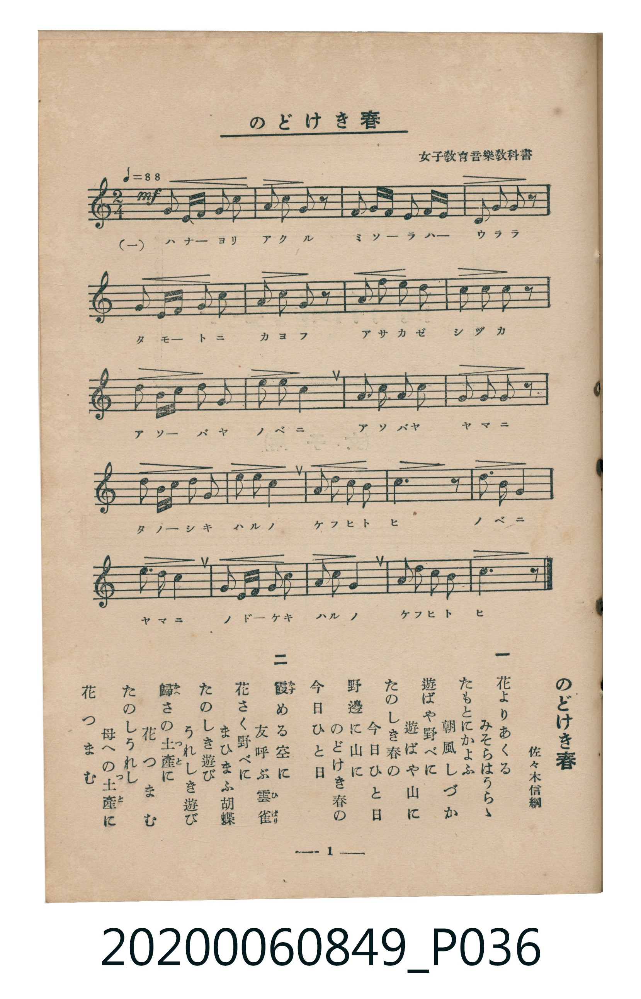

# のどけき春

<audio controls src="nodokeki_haru.mp3"></audio>

- 詞：佐々木信綱（女子教育音樂教科書）
- 臺灣教育會公認《新定兒童唱歌》高等科女子用（2020.006.0849）

## 說明

原書資訊與歌詞全文（對應 P036.jpg，書頁 p. 1，高一第一學期第 1 首）：
調性與拍號：ヘ長調（1 降記號）、2/4 拍（♩=88）

## 歌詞

```text
一
花（はな）よりあくる　みそらはうらゝ
たもとにかよふ　朝風（あさかぜ）しづか
遊（あそ）ばや野邊（のべ）に　遊ばや山（やま）に
たのしき春（はる）の　今日（けふ）ひと日（ひ）
野邊に山に　のどけき春の　今日ひと日

二
霞（かす）める空（そら）に　友呼（ともよ）ぶ雲雀（ひばり）
花さく野べに　まひまふ胡蝶（こてふ）
たのしき遊び　うれしき遊び
歸（かへ）さの土産（つと）に　花つまむ
たのしうれし　母（はは）への土産に　花つまむ
```

## ABC

```abc
X:1
T:のどけき春
M:2/4
L:1/16
Q:1/4=88
K:F
V:V1 name="Piano" snm="Pia"
[V:V1]
!mf! F2 G A c2 A2 | G2 c2 A2 z2 | F2 G A G2 F G | A2 G2 F2 z2 |
F2 G A c2 A2 | G2 c2 A2 z2 | d2 c2 A2 c2 | d2 d2 c2 z2 |
d2 A c d2 d2 | c2 d2 c4 | A3 G A2 c2 | G2 A2 G2 z2 |
F2 G A c2 c2 | d2 d2 c4 | A2 c2 G2 A2 | F6 z2 |
c2 d2 c4 | d2 c2 A4 | F2 G A c2 c2 | d2 c2 A4 |
G2 c2 A2 G2 | F6 z2 | !mf! F2 G A c2 A2 | G2 c2 A2 z2 |
F2 G A G2 F G | A2 G2 F2 z2 | F2 G A c2 A2 | G2 c2 A2 z2 |
d2 c2 A2 c2 | d2 d2 c2 z2 | d2 A c d2 d2 | c2 d2 c4 |
A3 G A2 c2 | G2 A2 G2 z2 | F2 G A c2 c2 | d2 d2 c4 |
A2 c2 G2 A2 | F6 z2 | c2 d2 c4 | d2 c2 A4 |
F2 G A c2 c2 | d2 c2 A4 | G2 c2 A2 G2 | F6 z2 |
```

## TMD 檔案連結

- [主旋律 TMD 檔案](nodokeki_haru.tmd) [[在 TMD Studio 編輯](https://tmdlang.github.io/Tmd-TS/#tmd=s7IKdvYPcrWy4qpTUCpJTLdSSM7PyUlNLsnMz7MqzsjMK0nNjM_KTMmPL87Iz05Ugisry88pzU21ys4vyY9PzyzKKY43MjAyiDcwMIs3sDCxRCgszi8tSk61Kk7OyM_PiS9JrShJys_PRsgXFOWXpeYl5gHVFBSB7EsBK0IoSC3LTEkFSaemZJbkF2Um5iC5IrWoGOxSsCXxJUWJecXJRZkFIOcjVJVkpAKdWpyaWJyfV4xTWEtL4XHjuseNKx83Tnzc2PtsxlIFLS0uRVsFCwsue1sFNy4bI30TO5DuFyvnvd8z68neCY8bWp_NWfFk_8Ln2za-39PxdOnmp2snPJs680XTppfzNz9b0QRkP18-8dnsHe_3dIItftG-63njYoiSZ3Oan7auebGq93FD17NpG56um_W0ddLz1UufTtn4bG3P44bul6tnPF_bCTQAYvDzKSuAloCCWQ8YzHqgYAYby6WvpWBLLcCloKDwtG8-0MkvNre_WNH1oqMd6Bigj5-2rng2rR3kyw29z9o7FQIMjM30sgrS3-_pASp-uaBRoUBPwRDIA7r6yY6G52vWAMmna3c8mzMfyFYwVHi5bBrQucCAA1nxYtX-Zw3LQYZ3976YOR8o-rh5xsup24HiQCuAimf2vlgxAyzT-bihERjyCkCVQKlHM1faWlgARblAxgCtAJvWBQr-x43rHzeuAmlo6njc1PW4selxY__jpu7HDQ2PG_c_bpz7uKkTrKYNxGiaC9L5uHH-4yaguhWPG1c_buwG6WzcCtTwbM7cl4tAwQ02ZSpIqnEOyOjG6Y8blwK5IM0vG7tgKuaC5TY8bmp52d73sgkiDkxMO8Hiq4EmAhVDFDzdCHZsU8vjxn0QWZhDQBqAxoOSHtQ7Td1gFeuA-p_s7no2HSIOTJ5bweKbgA6HCW4ChQnIUWD7gaYC7YHYjJaqkY2DGwEJzV09YBPmAJM30ESgl2eCQ7MR6I7nK3eBBUGBCPfT0_7upxP3gMVXgIKxqQMste3l7E0vZzdAnAX2NDA8wI4DRhQ4NPuBrgQGDsx9-8DqgOTWF80LX8zdBtY5-XHjMohH0cMHHJSbwTqBUdmDLAhS-mwtMLtB3A_Kd2AL1z0FJsMpi8HiS4CuhXsB7CKgyL7HTeCkhGQPzGxgalgPSnrgtLMerHMH3ETsplCeD6FAQUufi8s3MTPPKiAzMS_focagRqEaZIOCjaGZlh2YBcz-kNz2YmEPSD1IDKgqN60WmOt0FYwUjBVMgbQxENcAebpwngFYBKYGJGMIJGvAchAeVA04dcDs2dWDYg8xVpghiYBoiAhMFNOKHZ0oVoAUgiyAaaoBa4NpB0GImyEOgVkBcgbMJxhWPJ09G6cvMF2IsALEgxkM0QWDEJ9iOAw16KZg-AsWLBArsDsDVQ1y8ILYWJzBVcvFpWunAEo3Cki0MhcA)]
- [鋼琴伴奏 TMD 檔案](nodokeki_haru_piano.tmd) [[在 TMD Studio 編輯](https://tmdlang.github.io/Tmd-TS/#tmd=s7IKdvYPcrWy4tLSUnjcuO5x48rHjRMfN_Y-m7H0_Z6Ol917nk_Y8mTPlqdL-593drzf06mgpcWlaKtgYcFlb6vgxmVjpG9ix1WnoPRi5bz3e2Y92TvhcUPrszkrnuxf-HzbRqAJT5dufrp2wrOpM180bXo5f_OzFU1A9vPlE5_N3gE0TQmstX3X88bFECXP5jQ_bV3zYlXv44auZ9M2PF0362nrpOerlz6dsvHZ2p7HDd0vV894vrYTaADE4OdTVgAtMTIwMtAzMDDTM7AwsQQby-WbmJlnFZCZmJcf5OFQY1CjUM2lAAQ2hmZadmCWvpbC8zVrnuxoeLGwR0FLHywGVJWbVqtgqKCrYKRgrGAKpI2BuAbI04XzDMAiMDUgGUMgWQOWg_CgariQ7dnVg2IPMVaYIYmAaIgITBTTih2dKFaAFIIsgGmqAWuDaQdBiJshDoFZAXIGzCcYVjydPRunLzBdiLACxIMZDNEFgxCfYjgMNeimYPgLFiwQK7A7A1UNcvCC2FicwVWLnGx8UJKNBd5UYxivEG0YC6OA_okHskzjkUSgDLgERASqxIBAWiFougmQYYJDAN1w9FQCMswsPjcWiYVpJU4ngBhoNmAkEjS9GI7FHjYQLUCz0Q3AlzZwmY3bchSfYLMelCp07RRACUMBiVbmAgA)]

## 分析

```text
================================================================================
📊 TMD Song Profile: [ のどけき春 ]
================================================================================
⏱  Duration:       1:00 (60.0s), 44 measures total
🎼 Key & Tempo:    首調基準 F, != 88.0 BPM, <2/4>
   - 分析範圍：      由實際發聲的音符與和弦推測調性；播放脈絡另行呈現
🎤 人聲音域:    F4 (MIDI 65) – D5 (MIDI 74) [跨度: 9 個半音 / 0.8 個八度, 難度: easy]
   - 最低音:  F4 in [Main #1 @ m.1, 0:00]
   - 最高音: D5 in [Main #1 @ m.7, 0:08]
   - 適合: soprano, mezzo-soprano, contralto, tenor, baritone, bass
🏛  結構:      Main (30.0s) -> Main (30.0s)
⚡ 編曲密度:        Peak 1 軌道同時演奏
🗝  調性診斷：       C 大調（純淨自然大調，未偵測到可信轉調）
   - 風格氣質:    純淨自然大調（陽光明朗、易唱易記，無明顯調外色彩）
   - 轉調歷程:    全曲維持單一推測調性（未偵測到可信轉調）
   - 核心骨幹音:  C, A, F, G, D
   - 調性數值:    C 大調 [相關度: 0.79, 穩定度: Moderate, 自然音純度: 100.0%]
   - 候選調性 (K-S): C 大調 (0.79), F 大調 (0.75), A 小調 (0.74)
   - 五度圈歷程:   +0 -> +0
   - 各段落調性細節:
     • [Main #1]: C 大調 (r: 0.79, 自然音純度: 100.0%)
     • [Main #2]: C 大調 (r: 0.79, 自然音純度: 100.0%)

  [ 五度圈游移軌跡 ]
              [C ]*
         F            G  
      Bb               D  
      Eb               A  
         Ab           E  
            Db       B  
               F# 
     (* = active key center)

  [ 十二半音累積音高分佈 ]
     C  : ████████████████████████  30.2%
     C# :                            0.0%
     D  : ████████████              14.8%
     D# :                            0.0%
     E  :                            0.0%
     F  : ████████████              15.4%
     F# :                            0.0%
     G  : ████████████              15.4%
     G# :                            0.0%
     A  : ███████████████████       24.1%
     A# :                            0.0%
     B  :                            0.0%
--------------------------------------------------------------------------------
Assignment 軌道音域：
  - Piano         : F4 – D5 (9 個半音 / 0.8 個八度, 158 個音符)
================================================================================
```


## 原書掃描頁




