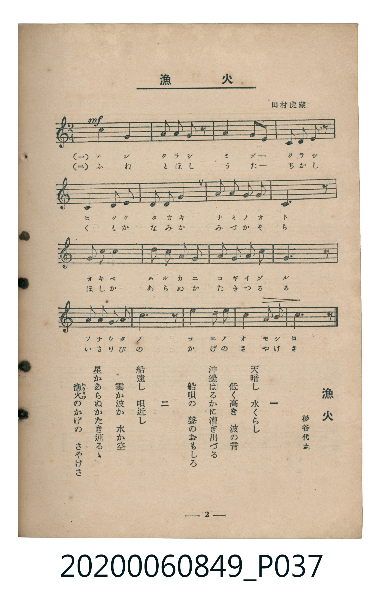

# 漁火

> Re:Shōka 使用 AI 協助辨識與重建樂譜，可能會有錯誤。歡迎回報。

- **鋼琴伴奏版**：<br><audio controls src="isaribi.mp3"></audio>
- **NEUTRINO 歌聲合成版**：<br><audio controls src="isaribi_neutrino.mp3"></audio>

- 詞：杉谷代水
- 曲：田村虎藏
- 臺灣教育會公認《新定兒童唱歌》高等科女子用（2020.006.0849）

## 說明

原書資訊與歌詞全文（對應 P037.jpg，書頁 p. 2，高一第一學期第 2 首）：
調性與拍號：ハ長調（無升降記號）、2/4 拍


## 歌詞

```text
一
天暗し　水くらし
低く高き　波の音
沖邊はるかに漕ぎ出づる
船唄の　聲のおもしろ

二
船遠し　唄近し
雲か波か　水か空
星かあらぬかたき連るゝ
漁火（いさりび）のかげの　さやけさ
```

## ABC

<div class="abc-score" data-abc-src="isaribi.abc" aria-label="五線譜載入中"></div>

[下載 ABC 原始檔](isaribi.abc)

## TMD 檔案連結

- [主旋律 TMD 檔案](isaribi.tmd) [[在 TMD Studio 編輯](https://tmdlang.github.io/Tmd-TS/#tmd=s7IKdvYPcrWy4qpTUCpJTLdSSM7PyUlNLsnMz7MqzsjMK0nNjM_KTMmPL87Iz05Ugisry88pzU21ys4vyY9PzyzKKY43MjAyiDcwMIs3sDCxRCgszi8tSk61Kk7OyM_PiS9JrShJys_PRpePL0hMT7UKMDA2R8gUFOWXpeYl5gF1FxSBXJIC1o5QkFqWmZIKki5OTsyLL0stykzLTE1BcmNqUTHYHxArSooS84qTizILQJ5DqMovKsnITy9KLMiotMrILC7JL8pMTsyJz07MQ_JuSUYq0LfliSWpRRiC-UVI3gHqTs_Ms8pNzczKRPKtlpbCsz2NzxtXK2hpcSnaKlgYcNnbKjhz2Rjpm9iBNL9YOe_9nlnP5na-2LD9ye7FzzZsAZv5bPYmoPDzKRuezZ34Ymbfi-n9YOEX7bueNy5-NnXmi6ZNz-Y0P21d82JV7-OGrmfTNjxdN-tp66Tnq5c-nbLx2dqexw3dL1fPeL628_nyiU-Xbn66dsLzKSve7-kAxZYeMLb0QLH1fk-nEheXvpaCLbUAl4KCwtO--c9m73ixuf3Fiq4XHe1AxwA9-bR1xbNp7UAHPN3Q-6y9UwEU5XpZBenv9_QAFb9c0KhQoKdgBOQBXf1kR8PzNWuA5NO1O57NmQ9kKxgpvFw2DehcYKCArHixav-zhuUgw7t7X8ycDxR93Nz_cup2oDjQiuctC5_2tr-c2ftixQywbOfjhkZggCsAVXOBtAONBjt0ycpns6Y_bpz-uKEBGPCPG_sfN3UCuWAle_uAfKBjHjcCA7jh2eZFjxvXvZy_GST3bNO0l01djxvXP27qftwIRKuf7Zn6uLHvafuux41LgYJgJ3bsfDqlBagJqPtF4yYQo7HrcVMTyLomqDN29UBVvmxcAHEGUMuL_ROhbng5G6itG2x1N8yJ3c9X7gK7YcZ8sNVNYCevAbOBIr0vGxaDXNU0F6wInPSAIfK4EeiSqY9Bjt4MCg6QY4AaJkGcB5YCKgDaOxWkjfJkAAUKWvpcXJ7FiUWZSZlWAZmJefkONQY11SA7FGwstOzADGzJTwES_y8W9ihomCg83dD_fH2DDjzNaGLRALQJZFiNQnVuWq2CYZyCroIpENcomAGhqYIBmAUSMwayDIHpyRgkBtbjY1ij8Li5DSj7uHkzWM_jpvVA9kogvV0hHsRvng-WbQXiPZjyEFOMgOKNW0HqGtdCTGlcAcS7gXg6xJRGsB2N82GmNC4E4m6YPDhJ4A6NXT3khIYh0EaQX2uApBFKiJhCZXXRwmESyI0g_wExyKf7gXg1EEP91NwFDo3HzX1AsVVgkQ6wKajh0A82pQnsPxB_FRADTQLyICEDYi-F-n4u2J5OuCkEUkUnOeFgCkoS4FQBDAkwCxQGoLAwBWIgF6QEIzCAHgR5_HHzTKjn-4EYFBhA3Az2WNNmIF4HxEvAyQOkZjWW4IAkAoT3gQED9DAw38IDCBikjb1ADDSnCWIySC0RAfJ09mxwgJiSFiCQRGAGSgSgUAF7XMEYxAQGD5CGipspmKMoQUooUyGJoWkZOJGARPpgLgaHCygBADMAUBQSkqAMtAicZUBqQckJPZRagBhoahPQ1MbN4FBZhzARHHbAIgssCuJPBdsA0jMRzoeYWMvFpWunAC13FIBMZS4A)]
- [鋼琴伴奏 TMD 檔案](isaribi_piano.tmd) [[在 TMD Studio 編輯](https://tmdlang.github.io/Tmd-TS/#tmd=s7IKdvYPcrWy4qpTUCpJTLdSSM7PyUlNLsnMz7MqzsjMK0nNjM_KTMmPL87Iz05Ugisry88pzU21ys4vyY9PzyzKKY43MjAyiDcwMIs3sDCxRCgszi8tSk61Kk7OyM_PiS9JrShJys_PRpePL0hMT7UKMDA2R8gUFOWXpeYl5gF1FxSBXJIC1o5QkFqWmZIKki5OTsyLL0stykzLTE1BcmNqUTHYHxArSooS84qTizILQJ5DqMovKsnITy9KLMiotMrILC7JL8pMTsyJz07MQ_JuYhFQc3pqbmpeiVVBZmJefnxicnJ-bkFiXiZIDKGwJAOoyKo8sSS1CEMwvwjJ30Br0jPzrHJTM7MykYJFS0vh2Z7G542r3-_peNm95_mELU_2bHm6tP95Z8f7PZ0KWlpcirYKFgZc9rYKzlw2RvomdiATX6yc937PrGdzO19s2P5k9-JnG7aALXo2exNQ-PmUDc_mTnwxs-_F9H6w8Iv2Xc8bFz-bOvNF06Znc5qftq55sar3cUPXs2kbnq6b9bR10vPVS59O2fhsbc_jhu6Xq2c8X9v5fPnEp0s3P1074fmUFUCXgeJaDxjXeqC4BrpLiYvLszixKDMp0yoAFDpBHg41BjXVXApAYGOhZQdm6Gsp2KIDhedr1jzZ0fBiYY-ChonC0w39z9c36CiA0oFeVkG6JhYNWvpgw2oUqnPTahUM4xR0FUyBuEbBDAhNFQzALJCYMZBlqGAEpIFiYD0-hjUKj5vbgLKPmzeD9TxuWg9krwTS2xXiQfzm-WDZViDegykPMcUIKN64FaSucS3ElMYVQLwbiKdDTGkE29E4H2ZK40Ig7obJc-EPjV095ISGIdBGkF9rgKQRSoiYQmV10cJhEsiNIP8BMcin-4F4NRBD_dTcBQ6Nx819QLFVYJEOsCmo4dAPNqUJ7D8QfxUQA00C8iAhA2Ivhfp-LtieTrgpBFJFJznhYApKEuBUAQwJMAsUBqCwMAViIBekBCMwgB4Eefxx80yo5_uBGBQYQNwM9ljTZiBeB8RLwMkDpGY1luCAJAKE94EBA_Tw48Y18AACBmljLxADzWmCmAxSS0SAPJ09GxwgpqQFCCQRmIESAShUwB5XMAYxgcEDpKHiZgrmKEqQEspUSGJoWgZOJCCRPpiLweECSgDADAAUhYQkKAMtAmcZkFpQckIPpRYgBpraBDS1cTM4VNYhTASH3ePGSWBREH8q2AaQnolwPsTEWrRixwdHsYMoZBD5JV7BND4eRtUomEA4QAQKHwQPIotQDQoaZGMhuRWnsSDSCMIBUnCD4XzcBkOSPyGDoebBDYbzkSxGMxmajuAmo-tEcRKMh-5gkGpsQQOMEV07BWikRPsYxiogc43AXGUuAA)]

## 分析

```text
================================================================================
📊 TMD Song Profile: [ 漁火 ]
================================================================================
⏱  Duration:       0:25 (25.5s), 17 measures total
🎼 Key & Tempo:    首調基準 C, != 80.0 BPM, <2/4>
   - 分析範圍：      由實際發聲的音符與和弦推測調性；播放脈絡另行呈現
🎤 人聲音域:    C4 (MIDI 60) – E5 (MIDI 76) [跨度: 16 個半音 / 1.3 個八度, 難度: moderate]
   - 最低音:  C4 in [Isaribi #1 @ m.4, 0:04]
   - 最高音: E5 in [Isaribi #1 @ m.15, 0:21]
   - 適合: soprano, mezzo-soprano, contralto, tenor, baritone, bass
🏛  結構:      Isaribi (25.5s)
⚡ 編曲密度:        Peak 1 軌道同時演奏
🗝  調性診斷：       C 大調（純淨自然大調，未偵測到可信轉調）
   - 風格氣質:    純淨自然大調（陽光明朗、易唱易記，無明顯調外色彩）
   - 轉調歷程:    全曲維持單一推測調性（未偵測到可信轉調）
   - 核心骨幹音:  C, G, A, D, E
   - 調性數值:    C 大調 [相關度: 0.88, 穩定度: High, 自然音純度: 100.0%]
   - 候選調性 (K-S): C 大調 (0.88), A 小調 (0.71), G 大調 (0.64)
   - 五度圈歷程:   +0
   - 各段落調性細節:
     • [Isaribi #1]: C 大調 (r: 0.88, 自然音純度: 100.0%)

  [ 五度圈游移軌跡 ]
              [C ]*
         F            G  
      Bb               D  
      Eb               A  
         Ab           E  
            Db       B  
               F# 
     (* = active key center)

  [ 十二半音累積音高分佈 ]
     C  : ████████████████████████  33.9%
     C# :                            0.0%
     D  : ███████                    9.7%
     D# :                            0.0%
     E  : ███████                    9.7%
     F  :                            0.0%
     F# :                            0.0%
     G  : █████████████████         24.2%
     G# :                            0.0%
     A  : ███████████████           21.0%
     A# :                            0.0%
     B  : █                          1.6%
--------------------------------------------------------------------------------
Assignment 軌道音域：
  - Piano         : C4 – E5 (16 個半音 / 1.3 個八度, 46 個音符)
================================================================================
```


## 原書掃描頁




