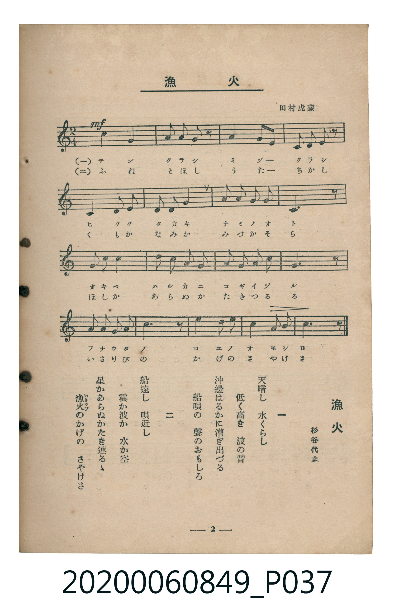

# 漁火

<audio controls src="isaribi.mp3"></audio>

- 詞：杉谷代水
- 曲：田村虎藏
- 臺灣教育會公認《新定兒童唱歌》高等科女子用（2020.006.0849）

## 說明

原書資訊與歌詞全文（對應 P037.jpg，書頁 p. 2，高一第一學期第 2 首）：
調性與拍號：イ短調／都節音階（無升降記號）、2/4 拍

## 歌詞

```text
一
天暗（てんくら）し　水（みづ）くらし
低（ひく）く高（たか）き　波（なみ）の音（おと）
沖邊（おきべ）はるかに　漕（こ）ぎ出（い）づる
船唄（ふなうた）の　聲（こゑ）のおもしろ

二
船遠（ふねとほ）し　唄近（うたちか）し
雲（くも）か波か　水か空（そら）
星（ほし）かあらぬか　たき連（つ）るゝ
漁火（いさりび）のかげの　さやけさ
```

## ABC

```abc
X:1
T:漁火
C:曲：田村虎藏
M:2/4
L:1/16
Q:1/4=80
K:C
V:V1 name="Piano" snm="Pia"
[V:V1]
!mf! A,4 A,4 | B,2 A,2 B,3 z | A,4 A,2 G,2 | E,2 G,2 A,3 z |
A,4 A,2 B,2 | A,2 B,2 C4 | B,2 A,2 B,2 A,2 | E,6 z2 |
C2 D2 E4 | A2 G2 A2 E2 | G2 E2 G2 E2 | A,6 z2 |
C2 D2 C2 A,2 | G6 z2 | A4 G2 A2 | E4 G2 E2 |
A,6 z2 | !mf! A,4 A,4 | B,2 A,2 B,3 z | A,4 A,2 G,2 |
E,2 G,2 A,3 z | A,4 A,2 B,2 | A,2 B,2 C4 | B,2 A,2 B,2 A,2 |
E,6 z2 | C2 D2 E4 | A2 G2 A2 E2 | G2 E2 G2 E2 |
A,6 z2 | C2 D2 C2 A,2 | G6 z2 | A4 G2 A2 |
E4 G2 E2 | A,6 z2 |
```

## TMD 檔案連結

- [主旋律 TMD 檔案](isaribi.tmd) [[在 TMD Studio 編輯](https://tmdlang.github.io/Tmd-TS/#tmd=s7IKdvYPcrWy4qpTUCpJTLdSSM7PyUlNLsnMz7MqzsjMK0nNjM_KTMmPL87Iz05Ugisry88pzU21ys4vyY9PzyzKKY43MjAyiDcwMIs3sDCxRCgszi8tSk61Kk7OyM_PiS9JrShJys_PRsgXFOWXpeYl5gHVFBSB7EsBK0IoSC3LTEkFSaemZJbkF2Um5iC5IrWoGOxSsCXxJUWJecXJRZkFIOcjVJVkpAKdWp5YklqEIZhfBHSLlpbCsz2NzxtXK2hpcSnaKlgYcNnbKjhz2Rjpm9iBdLxYOe_9nlnP5na-2LD9ye7FzzZsARv0bPYmoPDzKRuezZ34Ymbfi-n9YOEX7bueNy5-NnXmi6ZNz-Y0P21d82JV7-OGrmfTNjxdN-tp66Tnq5c-nbLx2dqexw3dL1fPeL628_nyiU-Xbn66dsLzKSve7-kAhaUeMCz1QGH5fk-nEheXvpaCLbUAl4KCwtO--c9m73ixuf3Fiq4XHe1AxwA9-bR1xbNp7UAHPN3Q-6y9UyHAwNhcL6sg_f2eHqDilwsaFQr0FIyAPKCrn-xoeL5mDZB8unbHsznzgWwFI4WXy6YBnQsMFJAVL1btf9awHGR4d--LmfOBoo-bljyfvxYo_n5P_8vmvc_XN7ycv_nlrD6gjc9bFj7tbX85s_fFihlgxZ2PGxqB4a8A1MwFMg1oE9jdS1Y-mzUdqOFx47LHTZMfN_Y_bgJa2Pm4cfrjhgZgzICl9j9uXAoWBMkCpcAG7AXZ87hxE1AUIgf0BVhk_uPGbrAIMJYanm1eBBZcBTQFLLgO6EawSNfjRmDkdILMerZp2sumLpho7-PGnWCl6x83dQPNety4GmTQnqlgBZPBUn1P23eBuS1g7lKgSnAYdex8OgUoBJTYCrazDegciLVAI140AhMYyIjHTROhgkD7mppAnm2CBsuuHqg5LxsXwMxZC3Tp48bd8GABWvFiP9AEoCzI_MeNC2E-BofMS1A6BsoBA6sJLNoNDASQP8ABCmQ8Xwlx-1xIWINDYAbQmUCh3UAzIHoeNzaBA3sNRCfYnt6XDYvBypaA1AADp2kuWDM4t0GC43Hj1MdNwEAEhjHEg0CDJkG8D5YCKpgIZIC0UZ7yoUBBS5-LyzcxM88qIDMxL9-hxqBGoRpkg4KNoZmWHZgFzHCQ9P1iYQ9IPUgMqCo3rVbBLF5BFwzhjBoFcxATzAezdBUMgIKoCk1BRI2CMZwNlQaqBEclzMpdPShWohoCNh0qCGYb4nICmAW1DgYNQEIolu3oRLEMZJoREBvDTTUDuRZkHFS0BswDsWA0khOx2vF09mysdoBoqCNBRqHoB1sHgjCrgR5BEsFpbS0Xl66dAihqFZBoZS4A)]
- [鋼琴伴奏 TMD 檔案](isaribi_piano.tmd) [[在 TMD Studio 編輯](https://tmdlang.github.io/Tmd-TS/#tmd=s7IKdvYPcrWy4tLSUni2p_F54-r3ezpedu95PmHLkz1bni7tf97Z8X5Pp4KWFpeirYKFAZe9rYIzl42RvokdV52C0ouV897vmfVsbueLDduf7F78bMMWJZDws9mbgMLPp2x4Nnfii5l9L6b3g4VftO963rj42dSZL5o2PZvT_LR1zYtVvY8bup5N2_B03aynrZOer176dMrGZ2t7Hjd0v1w94_nazufLJz5duvnp2gnPp6wAuszIwMhAz8DATM_AwsQS6C4lLi7fxMw8q4DMxLz8IA-HGoMahWouBSCwMTTTsgOz9LUUnq9Z82RHw4uFPQpa-mAxoKrctFoFs3gFXTCEM2oUzEFMMB_M0lUwAAqiKjQFETUKxnA2VBqokgvZyl09KFaiGgI2HSoIZhvicgKYBbUOBg1AQiiW7ehEsQxkmhEQG8NNNQO5FmQcVLQGzAOxYDSSE7Ha8XT2bKx2gGioI0FGoegHWweCMKuBHkESwWltLXLM-qDErAXeiDWLjwcFFZQCBVs8MBjBHEhMYpcGCRCMP1StuG2C0Oh244sudLNMgAxDvGYj6UAzGz2aCIQIyVYBo0bXTgEUOwpItDIXAA)]

## 分析

```text
================================================================================
📊 TMD Song Profile: [ 漁火 ]
================================================================================
⏱  Duration:       0:51 (51.0s), 34 measures total
🎼 Key & Tempo:    首調基準 C, != 80.0 BPM, <2/4>
   - 分析範圍：      由實際發聲的音符與和弦推測調性；播放脈絡另行呈現
🎤 人聲音域:    E3 (MIDI 52) – A4 (MIDI 69) [跨度: 17 個半音 / 1.4 個八度, 難度: challenging]
   - 最低音:  E3 in [Main #1 @ m.4, 0:04]
   - 最高音: A4 in [Main #1 @ m.10, 0:13]
   - 適合: contralto, tenor, baritone, bass
🏛  結構:      Main (25.5s) -> Main (25.5s)
⚡ 編曲密度:        Peak 1 軌道同時演奏
🗝  調性診斷：       A 小調（純淨自然小調，未偵測到可信轉調）
   - 風格氣質:    純淨自然小調（陰鬱抒情、旋律集中，無明顯調外色彩）
   - 轉調歷程:    全曲維持單一推測調性（未偵測到可信轉調）
   - 核心骨幹音:  A, E, G, B, C
   - 調性數值:    A 小調 [相關度: 0.80, 穩定度: Moderate, 自然音純度: 100.0%]
   - 候選調性 (K-S): A 小調 (0.80), A 大調 (0.70), E 小調 (0.46)
   - 五度圈歷程:   +3 -> +3
   - 各段落調性細節:
     • [Main #1]: A 小調 (r: 0.80, 自然音純度: 100.0%)
     • [Main #2]: A 小調 (r: 0.80, 自然音純度: 100.0%)

  [ 五度圈游移軌跡 ]
               C  
         F            G  
      Bb               D  
      Eb              [A ]*
         Ab           E  
            Db       B  
               F# 
     (* = active key center)

  [ 十二半音累積音高分佈 ]
     C  : ████                       7.9%
     C# :                            0.0%
     D  : ██                         3.2%
     D# :                            0.0%
     E  : ██████████                19.0%
     F  :                            0.0%
     F# :                            0.0%
     G  : █████████                 15.9%
     G# :                            0.0%
     A  : ████████████████████████  43.7%
     A# :                            0.0%
     B  : ██████                    10.3%
--------------------------------------------------------------------------------
Assignment 軌道音域：
  - Piano         : E3 – A4 (17 個半音 / 1.4 個八度, 92 個音符)
================================================================================
```


## 原書掃描頁




