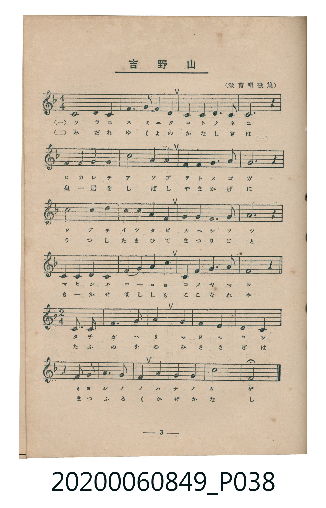
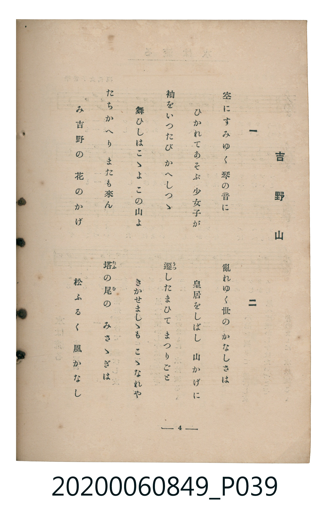

# 吉野山

> Re:Shōka 使用 AI 協助辨識與重建樂譜，可能會有錯誤。歡迎回報。

- **鋼琴伴奏版**：<br><audio controls src="yoshinoyama.mp3"></audio>

- 出處：（教育唱歌集）
- 臺灣教育會公認《新定兒童唱歌》高等科女子用（2020.006.0849）

## 說明

原書資訊與歌詞全文（對應 P038.jpg – P039.jpg，書頁 pp. 3–4，高一第一學期第 3 首）：
調性與拍號：ヘ長調（1 降記號）、前段 4/4 拍，後段轉 2/4 拍
出處註記：（教育唱歌集）


## 歌詞

```text
一
空にすみゆく　琴の音に
ひかれてあそぶ　少女子が
袖をいつたび　かへしつゝ
舞ひしはこゝよ　この山よ
たちかへり　またも來ん
み吉野の　花のかげ

二
亂れゆく世の　かなしさは
皇居をしばし　山かげに
遷（うつ）したまひて　まつりごと
きかせましゝも　こゝなれや
塔（たふ）の尾（を）の　みさゝぎは
松ふるく　風かなし
```

## ABC

<div class="abc-score" data-abc-src="yoshinoyama.abc" aria-label="五線譜載入中"></div>

[下載 ABC 原始檔](yoshinoyama.abc)

## TMD 檔案連結

- [主旋律 TMD 檔案](yoshinoyama.tmd) [[在 TMD Studio 編輯](https://tmdlang.github.io/Tmd-TS/#tmd=s7IKdvYPcrWy4qpTUCpJTLdSSM7PyUlNLsnMz7MqzsjMK0nNjM_KTMmPL87Iz05Ugisry88pzU21ys4vyY9PzyzKKY43MjAyiDcwMIs3sDCxRCgszi8tSk61Kk7OyM_PiS9JrShJys_PRpePL0hMT7UKMDC2wCmDZGZBUX5Zal5iHtDcgiKQG1PABiMUpJZlpqSCpIuTE_Piy1KLMtMyU1OQXJ9aVAz2IcSKkqLEvOLkoswCkLcRqvKLSjLy04sSCzIqrTIyi0vyizKTE3PisxPzkAKiJCMVGA55iSWlRanoogU5iclIgkD96Zl5VrmpmVmZSCGhpaXwdELny_a-pxs3KmhpcSnaKlgacdnbKrhx2Zjom9iB9D9t3_Vi5tT3e2a939PxbOrMF02bnk7Z-Gxtz8vZbe_3dIKteNG-63njYojksznNT1vXvFjV-7ih69m0DU_XzXraOun56qUQTY8bul-unvF8befz5ROfLt38dO2E51NWAA0GxaAeMAb1QDEINpZLX0vBllqAS0FB4Wnf_Gezd7zY3P5iRdeLjnagY16snPe0dcWzae1ABzzd0PusvVMBlAz0sgrSFR41TAZxLEGc93t6gDpfLmhUKCjQUzAGSpkAhYD-eLKj4fmaNUDy6dodz-bMB7IVjBVeLpsG9AAwvECWvli1_1nDcpB13b0vZs4Hij5unvFy6nagONBSQ4WXM3tfrJgBlul83ND4tLP32bqtCsCgVwBqAFrydF8PUODF3k4FI4gY2CfgGHmxYjdQK6544QIpBLoMRD1fuetx4-rHjTMfN-5_3NT2uLH_cUPD8wlbHjeuezl_M1AKpOhx46bHjd2Pm3oeNy573Nj0uHHu48ZtQHVPN0Aj6nFjD9hHi6Y9bpr0uLHlceOSx43zHzduBioC6Wzc8bhxOkiwaS5YXcc8sJFAofWPGycDRR83dYCVTgbaC0xvQC7EXqAZC6EGNHWBVewDCTY1PdnX9rhpMkTRfkg6BWoFqnjRtRHEAOmZBPHoLrDbnuxqAnkA7MUnO6ZBFIOVrQI7ZCrQLeAAmdX-dGMr2BtA0Q0gEuhRoJPAJkID5GXjdmDIPm4EGrYEFDsgpUCnAt0G9NUymDuB3u163DjlceMKiDt7wWbMBstNB3u6CeppIBvoDJDzWsCRuHAK2HigkVvBxq97umEfSKRpEoQL1rYf5GiQTqDPwU5_Nhdo8NbHTUBLQLH4ctEKuP9A0pRnFShQ0NLn4gpILCpxtArITMzLd6gxqKkG2aBgY6FlB2Zgy6AKkPzwYmGPgoaJwtMN_c_XN-jAc5UmFg1Ae0CG1SiYxivogqEZiAHm1SgYgkWMwDRYHKoOTIAFwGwk3SBoAFIINtbHsEbhcdNeqPjj5pVgshts0OOmnVDR-UC8DMRqWg-V2QwW7wCTfVBVvSAZsF4YBDsIYo8RUK5xP8yexgVg03qgprVBRfuBbLCZjesgMo0g04CxByanQ1VNBcuAXIJqD_5A39VDTqCDwhWEjaAYGJBQO42hGFUNSKwGysIa1s2TwD5fDQ6xNWAS5HtQKCyChQ44Ph43T4OIN29CCuuFUBVbwDpA-rGHNTAHg9XvAZLArAzWA7IZFHKQcASF5AZ4uIJMawHz9oFJSCwCMztYB8i1pIT1jk6yEjjUBhBtBg9rEAaFMyiEISELwrB0XwOWI5yuIaEBCkmQ-BIwD-zfJlCafNw8GSoDiZcZYJntUL0t4FgAqcaVriHpFxReYJNhIdo4HylEwbHYCMpFIBmIGFh1UxdU7xSwzArSwvrp7NlkFyaIQgKpNAGFLihMQeEOVYeauCFBjz1xzwMHGCSJg4LvcXM_NGAhBQYoOcLYII8iZECFyONmUICA6HngIMcMCkSQ9yLMgxYSs1GCFhQFULKpCSoDimQYCSpSIEUQLOmj2lQLKd2dSC_dd00BRwhSm0QHGJgkxU61DVCnXS2s0AYX4KgpHlIWgcTMIVGHFI1IGQBS4D5uboQnbkjyBoUuuFAFxxhM5eNmUBGEiBMQiRzmoOQMCrut4NAEFdGQYgXGgxTwIN5UMA9EgnjguAUX2IQSc-tacNiZkRZcoFRoiFQYgFigoIEUz5hFNyINI8IKFHKQim4FOARgmb8PHFaQ1AlNy82gDAsRQ4QqhA3K5EjmAkMNbC4wTYIyOygstkJDrRvMA5kISb8g3hwUHiSFohbZ4HSpa6cAbngoQBlOIIYyFwA)]
- [鋼琴伴奏 TMD 檔案](yoshinoyama_piano.tmd) [[在 TMD Studio 編輯](https://tmdlang.github.io/Tmd-TS/#tmd=s7IKdvYPcrWy4qpTUCpJTLdSSM7PyUlNLsnMz7MqzsjMK0nNjM_KTMmPL87Iz05Ugisry88pzU21ys4vyY9PzyzKKY43MjAyiDcwMIs3sDCxRCgszi8tSk61Kk7OyM_PiS9JrShJys_PRpePL0hMT7UKMDC2wCmDZGZBUX5Zal5iHtDcgiKQG1PABiMUpJZlpqSCpIuTE_Piy1KLMtMyU1OQXJ9aVAz2IcSKkqLEvOLkoswCkLcRqvKLSjLy04sSCzIqrTIyi0vyizKTE3PisxPzkAIisQioOT01NzWvxKogMzEvPz4xOTk_tyAxLxMkhlBYkgFUZJWXWFJalIouWpCTmIwkCLQoPTPPKjc1MysTKci0tBSeTuh82d73dOPG93s6XnbveT5hy5M9W54u7X_e2fF-T6eClhaXoq2CpRGXva2CG5eNib6JHcjQp-27Xsyc-n7PLKCuZ1Nnvmja9HTKxmdre17ObgPqAtv7on3X88bFEMlnc5qftq55sar3cUPXs2kbnq6b9bR10vPVSyGaHjd0v1w94_nazufLJz5duvnp2gnPp6wAGgyKfz1g_OuB4h9sLFdAYlGJo1UAKFSCPBxqDGqquRSAwMZCyw7M0NdSsEUHCs_XrHmyo-HFwh4FDROFpxv6n69v0FEApQy9rIJ0TSwatPTBhtUomMYr6IKhGYgB5tUoGIJFjMA0WByqDkyABcBsJN0gaABSCDbWx7BG4XHTXqj44-aVYLIbbNDjpp1Q0flAvAzEaloPldkMFu8Ak31QVb0gGbBeGAQ7CGKPEVCucT_MnsYFYNN6oKa1QUX7gWywmY3rIDKNINMeN64Ck9OhqqaCZUAuQbUHf6Dv6iEn0EHhCsJGUAwMSKidxlCMqgYkVgNlYQ3r5klgn68Gh9gaMAnyPSgUFsFCBxwfj5unQcSbNyGF9UKoii1gHSD92MP6-ax2sPo9QPLpxlawHpDNoJCDhCMoJDfAwxVkWguYtw9MQmLxceMksA6Qa0kJ6x2dZCVwqA0g2gwe1iAMCmdQCENCFoRh6b4GLEc4XUNCAxSSIPElYB7Yv02gNPm4eTJUBhIvM8Ay26F6W8CxAFKNK11D0i8ovMAmw0K0cT5SiIJjsRGUi0AyEDGw6qYuqN4pYJkVpIX109mzyS5MEIUEUmkCCl1QmILCHaoONXFDgh574p4HDjBIEgcF3-PmfmjAQgoMUHKEsUEeRciACpHHzaAAAdHzwEGOGRSIIO9FmActJGajBC0oCqBkUxNUBhTJMBJUpECKIFjSR7WpFqV890Eu300Q5TuiNEeUGCD90abxsWBLTeLBXBMoF1USwTNAimZEYQU3E2oKqj6z-FwUO2CypgguurGQfInmVFS3wU2FGgOTNYNwwdJoxkKTIP4QMMQWAEihAzITGuZO5NSpu6aAs8GLvZ0KRvomCs-6e3WASZikPFFtA9RpVwurKsHVJmo5A6kBQGLmkAyDlHmQih1INfe4uRFepEAKFVCaBldl4HwCU_m4GVTwI3ICiERO6aBCBJRit4LTMKhihBTmMB6kWgXxpoJ5IBLEA-cocDVJqAhpXQsOOzPSgguU9w2RimAQCxQ0kEoRs8JElByIsAKFHKR5sQIcArAitw8cVpAyAVqCNIOKSYgYIlQhbFDRimQuMNTA5gJLAlARCwqLrdBQ6wbzQCZCSg0Qbw4KD1IuoFaU6CkTX2kASYcYaQqY7sGpHpLmwSkekqeQRY1BmQsYdHBhlFwGiSWUMgGHOeBMCsnBUGFU66E-0rVTABdx0T6gzAnhOCFzgDJGyDIQjjIXAA)]

## 分析

```text
================================================================================
📊 TMD Song Profile: [ 吉野山 ]
================================================================================
⏱  Duration:       0:56 (56.1s), 27 measures total
🎼 Key & Tempo:    首調基準 F, != 92.0 BPM, <4/4>
   - 分析範圍：      由實際發聲的音符與和弦推測調性；播放脈絡另行呈現
🎤 人聲音域:    C4 (MIDI 60) – D5 (MIDI 74) [跨度: 14 個半音 / 1.2 個八度, 難度: moderate]
   - 最低音:  C4 in [PartA #1 @ m.1, 0:00]
   - 最高音: D5 in [PartA #1 @ m.9, 0:22]
   - 適合: soprano, mezzo-soprano, contralto, tenor, baritone, bass
🏛  結構:      PartA (41.7s) -> PartB (14.3s)
⚡ 編曲密度:        Peak 1 軌道同時演奏
🗝  調性診斷：       C 大調（推測轉調經歷 1 次）
   - 風格氣質:    純淨自然大調（陽光明朗、易唱易記，無明顯調外色彩）
   - 轉調歷程:    C 大調起奏 ➔ [PartB] 轉至 F 大調 (+5 半音 / 五度圈 -1 步)
   - 核心骨幹音:  C, F, G, A, D
   - 調性數值:    C 大調 [相關度: 0.86, 穩定度: Moderate, 自然音純度: 100.0%]
   - 候選調性 (K-S): C 大調 (0.86), F 大調 (0.83), A 小調 (0.58)
   - 五度圈歷程:   +0 -> -1
   - 各段落調性細節:
     • [PartA #1]: C 大調 (r: 0.87, 自然音純度: 100.0%)
     • [PartB #1]: F 大調 (r: 0.85, 自然音純度: 100.0%)

  [ 五度圈游移軌跡 ]
              [C ]*
        [F ]*          G  
      Bb               D  
      Eb               A  
         Ab           E  
            Db       B  
               F# 
     (* = active key center)

  [ 十二半音累積音高分佈 ]
     C  : ████████████████████████  31.5%
     C# :                            0.0%
     D  : ██████                     8.0%
     D# :                            0.0%
     E  : █                          1.2%
     F  : ███████████████████       24.7%
     F# :                            0.0%
     G  : ████████████████          20.4%
     G# :                            0.0%
     A  : ███████████               14.2%
     A# :                            0.0%
     B  :                            0.0%
--------------------------------------------------------------------------------
Assignment 軌道音域：
  - Piano         : C4 – D5 (14 個半音 / 1.2 個八度, 69 個音符)
================================================================================
```


## 原書掃描頁






