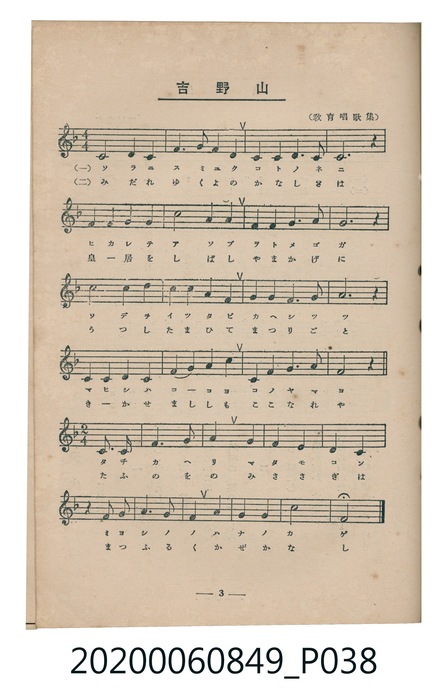
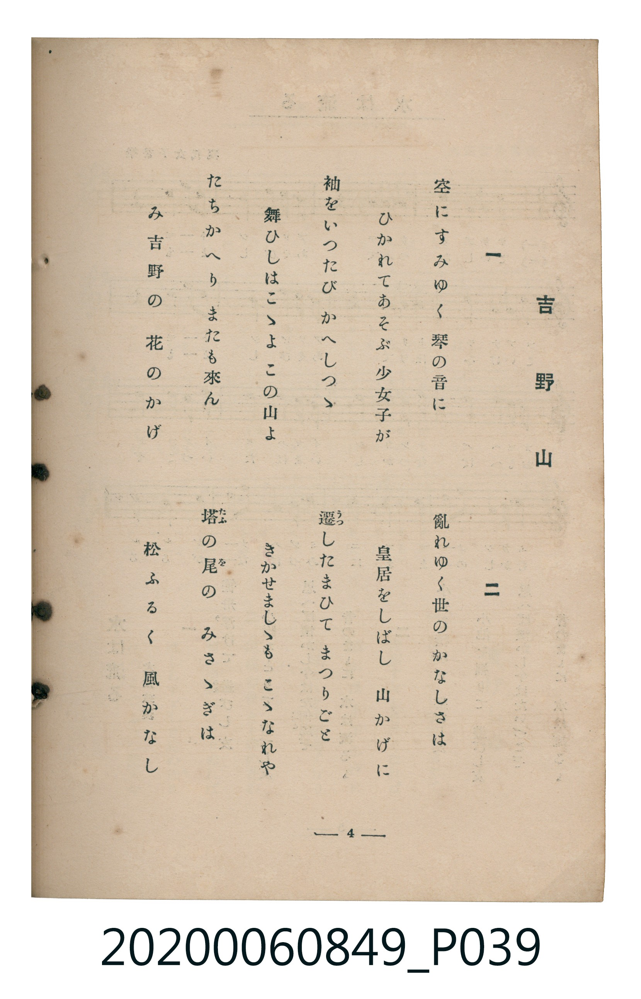

# 吉野山

> Re:Shoka 使用 AI 協助辨識與重建樂譜，可能會有錯誤。歡迎回報。

<audio controls src="yoshinoyama.mp3"></audio>

- （教育唱歌集）
- 臺灣教育會公認《新定兒童唱歌》高等科女子用（2020.006.0849）

## 說明

原書資訊與歌詞全文（對應 P038.jpg – P039.jpg，書頁 pp. 3–4，高一第一學期第 3 首）：
調性與拍號：ニ短調（1 降記號）、前段 4/4 拍，後段轉 2/4 拍

## 歌詞

```text
一
空（そら）にすみゆく　琴（こと）の音（ね）に
ひかれてあそぶ　少女子（をとめご）が
袖（そで）をいつたび　かへしつゝ
舞（ま）ひしはこゝよ　この山（やま）よ
たちかへり　またも來（こ）ん
み吉野（よしの）の　花（はな）のかげ

二
亂（みだ）れゆく世（よ）の　かなしさは
皇居（くわうきよ）をしばし　山かげに
遷（うつ）したまひて　まつりごと
きかせましゝも　こゝなれや
塔（たふ）の尾（を）の　みさゝぎは
松（まつ）ふるく　風（かぜ）かなし
```

## ABC

```abc
X:1
T:吉野山
M:4/4
L:1/16
Q:1/4=92
K:Dm
V:V1 name="Piano" snm="Pia"
[V:V1]
!mf! D8 D4 D4 | G6 A2 G4 F4 | D4 D4 C6 D2 | D12 z4 |
F4 F4 D4 F4 | c8 A4 c4 | G4 G4 F6 G2 | A12 z4 |
c8 d4 c4 | A4 A4 G4 F4 | G4 G4 F6 G2 | A12 z4 |
D4 D4 C4 D4 | F8 G4 A4 | D4 D4 G6 A2 | G12 z4 |
[M:2/4] D6 D2 | G6 A2 | c4 A4 | G4 F4 |
D4 C4 | z4 D2 D2 | G6 A2 | G4 F4 |
G4 A4 | c8 | D8 | !mf! D8 |
D4 D4 | G6 A2 | G4 F4 | D4 D4 |
C6 D2 | D8- | D4 z4 | F4 F4 |
D4 F4 | c8 | A4 c4 | G4 G4 |
F6 G2 | A8- | A4 z4 | c8 |
d4 c4 | A4 A4 | G4 F4 | G4 G4 |
F6 G2 | A8- | A4 z4 | D4 D4 |
C4 D4 | F8 | G4 A4 | D4 D4 |
G6 A2 | G8- | G4 z4 | D6 D2 |
G6 A2 | c4 A4 | G4 F4 | D4 C4 |
z4 D2 D2 | G6 A2 | G4 F4 | G4 A4 |
c8 | D8 |
```

## TMD 檔案連結

- [主旋律 TMD 檔案](yoshinoyama.tmd) [[在 TMD Studio 編輯](https://tmdlang.github.io/Tmd-TS/#tmd=s7IKdvYPcrWy4qpTUCpJTLdSSM7PyUlNLsnMz7MqzsjMK0nNjM_KTMmPL87Iz05Ugisry88pzU21ys4vyY9PzyzKKY43MjAyiDcwMIs3sDCxRCgszi8tSk61Kk7OyM_PiS9JrShJys_PRsgXFOWXpeYl5gHVFBSB7EsBK0IoSC3LTEkFSaemZJbkF2Um5iC5IrWoGOxSsCXxJUWJecXJRZkFIOcjVJVkpAKdmpdYUlqUii5akJOYDBTU0lJ4OqHzZXvf040bFbS0uBRtFSyNuOxtFdy4slMrbRVccrlsTPRN7EC63-_peDZ15oumTU-nbHy2tufl7Lb3ezrB5r5o3_W8cTFE8tmc5qeta16s6n3c0PVs2oan62Y9bZ30fPVSiKbHDd0vV894vrbz-fKJT5dufrp2wvMpK4AGgwJRDxiIeqBABBvLpa-lYEstwKWgoPC0b_6z2TtebG5_saLrRUc70DEvVs572rri2bR2oAOebuh91t6pEGBgbKGXVZCu8KhhMohjCeK839MD1PlyQaNCQYGegjFQygQoBPTHkx0Nz9esAZJP1-54Nmc-kK1grPBy2TSgB97vmQWy9MWq_c8aloOs6-59MXM-UPRxc_fz-WuB4kBLDRVezux9sWIGWKbzcUPj087eZ-u2KgBDXAGoAWjJ0309QIEXezsVjCBiXCBTgTaCqOcrdwENedw493ET0L7Ox42rHzfOfNy4_3FT2-PG_scNDc8nbAErmPy4ERjIQAXrXs7fDBZZC1EPMuVx46bHjd2Pm3oeNy573NgEMq5xG1Dz0w3QGAJpaJoENOJxU-PjxilgnT1gzy0C-hRsf-NykChIUcvjxiWPG-c_btwMNAJkbuOOx43TQYJNc8F6OuaB9ewDGwO0GSi3HuTCJqAvOsB6gK5dB0yOYGuBxoFVNnVAnAo0eCHU1KYusOp9IMGmpif7gKkR5FWw6skQ1fshaRtsElAOaNU6SDAAdb7oAtsAsnwVVBBk7iRIAO8Ce_DJriawmv2PGxeAze2BBO2THWCPN3XATQPrXQW2YirQTHDszGp_urEVrL__cVP_40agzl6oHlBIAZVuAJHAkN64EWI3NEZeNm4HawNqWAK2AagU6HGgT4HhtQzma2CIdgGjAxgvEM_2gs2YDZabDg7OJmhwAtlAt4Ec3wLOCAuBcQg0HmjkVogHnm4ABjIokpH8A_TzVLDOPqh_ns0FKwJbDVa39XET0EJQOnu5CJSHwfbPAUtBAwOkjfLMCwUKWvpcXAGJRSWOVgGZiXn5DjUGNQrVICsUbCy07MAMYJkByZAvFvaA1IPEgIpy02oVzOIVdMEQzAATNQpGYBFjMG0IFkHImkI0ANlQURg0ACkEJxOYfbt6UOwDmQTCYF0QY02heo1BBsOthlkLYtWA5XDbsaMTxQ6YgWZwA0HaQRjhFxKteDp7NooVaEEBDTKIYRCDQcYhq4MFJyxgkS2qhUSeE8HI2zUF6ApgckIq9IBpCik2bYCidvAIBccPwmJQWECchRanYD-g-rd1LYp_Qe4EKkUzEDU4IUbDAh8pYYA9qGunAE6gClCGE4yBKqLMBQA)]
- [鋼琴伴奏 TMD 檔案](yoshinoyama_piano.tmd) [[在 TMD Studio 編輯](https://tmdlang.github.io/Tmd-TS/#tmd=s7IKdvYPcrWy4tLSUng6ofNle9_TjRvf7-l42b3n-YQtT_Zsebq0_3lnx_s9nQpaWlyKtgqWRlz2tgpuXNmplbYKLrlcNib6JnZcdQpKQE3Pps580bTp6ZSNz9b2vJzdBtSkBJJ50b7reeNiiOSzOc1PW9e8WNX7uKHr2bQNT9fNeto66fnqpRBNjxu6X66e8Xxt5_PlE58u3fx07YTnU1YADTYyMDLQMzAw0zOwMLEEG8sVkFhU4mgVkJmYlx_k4VBjUKNQzaUABDYWWnZghr6WwvM1a57saHixsEdBSx8sBlSUm1arYBavoAuGYAaYqFEwAosYg2lDsAhC1hSiAciGisKgAUghF7J9u3pQ7AOZBMJgXRBjTaF6jUEGw62GWQti1YDlcNuxoxPFDpiBZnADQdpBGOEXEq14Ons2ihVoQQENMohhEINBxiGrgwUnLGCRLapFiT4flOgzwRt9ZvEgs6PN4nNjId4Cc41gXKi0MRofrNyAQESBVRpC9KFw0OwwhlqBaSJatKAYQsDhOA3FjAhUc4i1BGQsNNidiMg1u6ag5hobI2Auh2cccD5ARDAozUGiHy3vgNMKqnda16IYDEoPQKVoBqImW4jRsESOlAHRfYQ3IeH0UTw0wMDBBQkscLCCAhVFDKwUnLTwegmHidiZwHiHGgmNPLCfdO0UwPlDAcpwgjFQRZS5AA)]

## 分析

```text
================================================================================
📊 TMD Song Profile: [ 吉野山 ]
================================================================================
⏱  Duration:       1:52 (112.2s), 54 measures total
🎼 Key & Tempo:    首調基準 F, != 92.0 BPM, <4/4>
   - 分析範圍：      由實際發聲的音符與和弦推測調性；播放脈絡另行呈現
🎤 人聲音域:    C4 (MIDI 60) – D5 (MIDI 74) [跨度: 14 個半音 / 1.2 個八度, 難度: moderate]
   - 最低音:  C4 in [PartA #1 @ m.3, 0:06]
   - 最高音: D5 in [PartA #1 @ m.9, 0:22]
   - 適合: soprano, mezzo-soprano, contralto, tenor, baritone, bass
🏛  結構:      PartA (41.7s) -> PartB (14.3s) -> PartA (41.7s) -> PartB (14.3s)
⚡ 編曲密度:        Peak 1 軌道同時演奏
🗝  調性診斷：       D 小調（推測轉調經歷 3 次）
   - 風格氣質:    純淨自然小調（陰鬱抒情、旋律集中，無明顯調外色彩）
   - 轉調歷程:    D 小調起奏 ➔ [PartB] 轉至 G 大調 (+5 半音 / 五度圈 -1 步) ➔ [PartA] 轉至 D 小調 (-5 半音 / 五度圈 +1 步) ➔ [PartB] 轉至 G 大調 (+5 半音 / 五度圈 -1 步)
   - 核心骨幹音:  D, G, A, C, F
   - 調性數值:    D 小調 [相關度: 0.73, 穩定度: Moderate, 自然音純度: 100.0%]
   - 候選調性 (K-S): D 小調 (0.73), G 大調 (0.70), C 大調 (0.62)
   - 五度圈歷程:   +2 -> +1 -> +2 -> +1
   - 各段落調性細節:
     • [PartA #1]: D 小調 (r: 0.77, 自然音純度: 100.0%)
     • [PartB #1]: G 大調 (r: 0.78, 自然音純度: 90.5%, 調外音: F)
     • [PartA #2]: D 小調 (r: 0.77, 自然音純度: 100.0%)
     • [PartB #2]: G 大調 (r: 0.78, 自然音純度: 90.5%, 調外音: F)

  [ 五度圈游移軌跡 ]
               C  
         F           [G ]*
      Bb              [D ]*
      Eb               A  
         Ab           E  
            Db       B  
               F# 
     (* = active key center)

  [ 十二半音累積音高分佈 ]
     C  : █████████████             15.4%
     C# :                            0.0%
     D  : ████████████████████████  27.8%
     D# :                            0.0%
     E  :                            0.0%
     F  : █████████████             14.8%
     F# :                            0.0%
     G  : █████████████████████     24.7%
     G# :                            0.0%
     A  : ███████████████           17.3%
     A# :                            0.0%
     B  :                            0.0%
--------------------------------------------------------------------------------
Assignment 軌道音域：
  - Piano         : C4 – D5 (14 個半音 / 1.2 個八度, 136 個音符)
================================================================================
```


## 原書掃描頁






