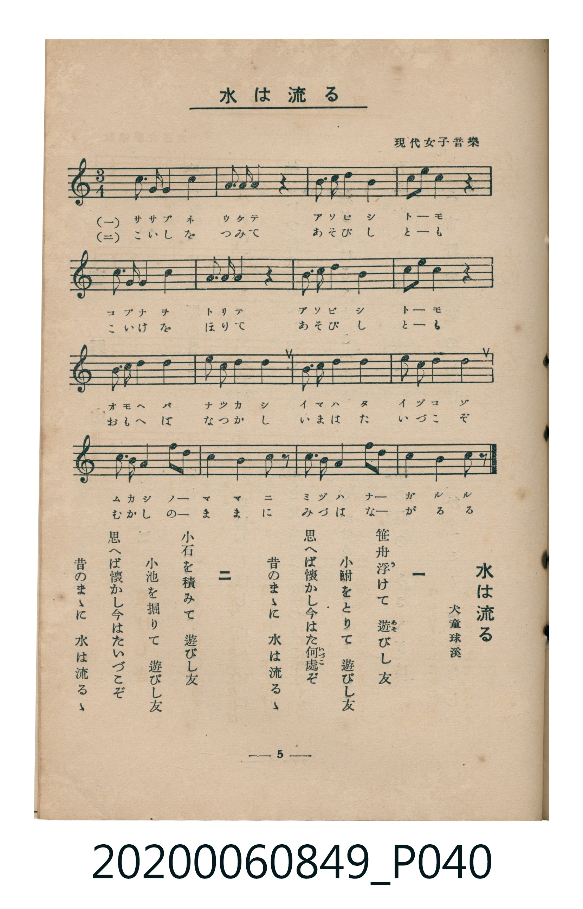

# 水は流るゝ

<audio controls src="mizu_wa_nagaruru.mp3"></audio>

- 詞：犬童球溪（現代女子音樂）
- 臺灣教育會公認《新定兒童唱歌》高等科女子用（2020.006.0849）

- note

原書資訊與歌詞全文（對應 P040.jpg，書頁 p. 5，高一第一學期第 4 首）：
調性與拍號：ハ長調（無升降記號）、3/4 拍

## 歌詞

```text
一
笹舟（ささぶね）浮（う）けて　遊（あそ）びし友（とも）
小鮒（こぶな）をとりて　遊びし友
思（おも）へば懷（なつ）かし　今（いま）はた何處（いづこ）ぞ
昔（むかし）のまゝに　水（みづ）は流（なが）るゝ

二
小石（こいし）を積（つ）みて　遊びし友
小池（こいけ）を掘（ほ）りて　遊びし友
思へば懷かし　今はたいづこぞ
昔のまゝに　水は流るゝ
```

## 原書掃描頁



## 調性分析

```text
================================================================================
📊 TMD Song Profile: [ 水は流るゝ ]
================================================================================
⏱  Duration:       1:00 (60.0s), 32 measures total
🎼 Key & Tempo:    首調基準 C, != 96.0 BPM, <3/4>
   - 分析範圍：      由實際發聲的音符與和弦推測調性；播放脈絡另行呈現
🎤 人聲音域:    G3 (MIDI 55) – A4 (MIDI 69) [跨度: 14 個半音 / 1.2 個八度, 難度: moderate]
   - 最低音:  G3 in [Main #1 @ m.2, 0:02]
   - 最高音: A4 in [Main #1 @ m.10, 0:16]
   - 適合: mezzo-soprano, contralto, tenor, baritone, bass
🏛  結構:      Main (30.0s) -> Main (30.0s)
⚡ 編曲密度:        Peak 1 軌道同時演奏
🗝  調性診斷：       G 調性不明確（純淨自然大調，未偵測到可信轉調）
   - 風格氣質:    純淨自然大調（陽光明朗、易唱易記，無明顯調外色彩）
   - 轉調歷程:    全曲維持單一推測調性（未偵測到可信轉調）
   - 核心骨幹音:  D, E, G, C, A
   - 調性數值:    G 調性不明確 [相關度: 0.76, 穩定度: Ambiguous, 自然音純度: 100.0%]
   - 候選調性 (K-S): G 大調 (0.76), C 大調 (0.73), E 小調 (0.63)
   - 五度圈歷程:   +1 -> +1
   - 各段落調性細節:
     • [Main #1]: G 調性不明確 (r: 0.76, 自然音純度: 100.0%)
     • [Main #2]: G 調性不明確 (r: 0.76, 自然音純度: 100.0%)

  [ 五度圈游移軌跡 ]
               C  
         F           [G ]*
      Bb               D  
      Eb               A  
         Ab           E  
            Db       B  
               F# 
     (* = active key center)

  [ 十二半音累積音高分佈 ]
     C  : ███████████████████       18.4%
     C# :                            0.0%
     D  : ████████████████████████  23.0%
     D# :                            0.0%
     E  : ███████████████████████   22.4%
     F  :                            0.0%
     F# :                            0.0%
     G  : ██████████████████████    21.3%
     G# :                            0.0%
     A  : ████████████████          14.9%
     A# :                            0.0%
     B  :                            0.0%
--------------------------------------------------------------------------------
Assignment 軌道音域：
  - Piano         : G3 – A4 (14 個半音 / 1.2 個八度, 128 個音符)
================================================================================
```

## ABC

```abc
X:1
T:水は流るゝ
C:TMD (Chen, Chih-Han / aguai)
M:3/4
L:1/16
Q:1/4=96
K:C

V:V1 name="Piano" snm="Pia"

[V:V1]
!mf! e3 e d3 d c4 | A3 A G4 z4 | c3 d e4 e4 | d2 g2 d4 z4 |
e3 e d3 d c4 | A3 A G4 z4 | c3 d e4 d4 | c2 A2 c4 z4 |
d3 d e3 e g4 | a3 a g4 e4 | d3 d e3 g g4 | a3 a g4 g4 |
a3 a g4 a2 g2 | e4 d4 c3 z | d3 d c4 A2 c2 | d4 e4 c3 z |
!mf! e3 e d3 d c4 | A3 A G4 z4 | c3 d e4 e4 | d2 g2 d4 z4 |
e3 e d3 d c4 | A3 A G4 z4 | c3 d e4 d4 | c2 A2 c4 z4 |
d3 d e3 e g4 | a3 a g4 e4 | d3 d e3 g g4 | a3 a g4 g4 |
a3 a g4 a2 g2 | e4 d4 c3 z | d3 d c4 A2 c2 | d4 e4 c3 z |
```

- [主旋律 TMD 檔案](mizu_wa_nagaruru.tmd)
- [鋼琴伴奏 TMD 檔案](mizu_wa_nagaruru_piano.tmd)
