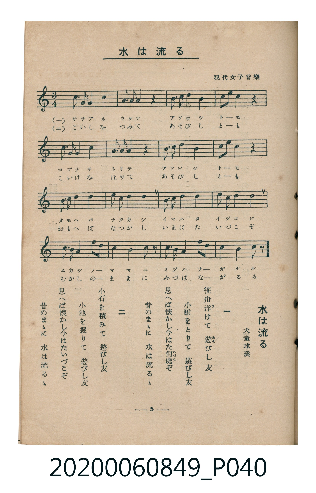

# 水は流るゝ

> Re:Shōka 使用 AI 協助辨識與重建樂譜，可能會有錯誤。歡迎回報。

- **鋼琴伴奏版**：<br><audio controls src="mizu_wa_nagaruru.mp3"></audio>

- 詞：犬童球溪（現代女子音樂）
- 臺灣教育會公認《新定兒童唱歌》高等科女子用（2020.006.0849）

## 說明

原書資訊與歌詞全文（對應 P040.jpg，書頁 p. 5，高一第一學期第 4 首）：
調性與拍號：ハ長調（無升降記號）、3/4 拍


## 歌詞

```text
一
笹舟（ささぶね）浮（う）けて　遊（あそ）びし友（とも）
小鮒（こぶな）をとりて　遊びし友
思（おも）へば懷（なつ）かし　今（いま）はた何處（いづこ）ぞ
昔（むかし）のまゝに　水（みづ）は流（なが）るゝ

二
小石（こいし）を積（つ）みて　遊びし友
小池（こいけ）を掘（ほ）りて　遊びし友
思へば懷かし　今はたいづこぞ
昔のまゝに　水は流るゝ
```

## ABC

<div class="abc-score" data-abc-src="mizu_wa_nagaruru.abc" aria-label="五線譜載入中"></div>

[下載 ABC 原始檔](mizu_wa_nagaruru.abc)

## TMD 檔案連結

- [主旋律 TMD 檔案](mizu_wa_nagaruru.tmd) [[在 TMD Studio 編輯](https://tmdlang.github.io/Tmd-TS/#tmd=s7IKdvYPcrWy4qpTUCpJTLdSSM7PyUlNLsnMz7MqzsjMK0nNjM_KTMmPL87Iz05Ugisry88pzU21ys4vyY9PzyzKKY43MjAyiDcwMIs3sDCxRCgszi8tSk61Kk7OyM_PiS9JrShJys_PRsgXFOWXpeYl5gHVFBSB7EsBK0IoSC3LTEkFSaemZJbkF2Um5iC5IrWoGOxSsCXxJUWJecXJRZkFIOcjVJVkpAKdWp5YklqEEASalJ6ZZ5WbmpmVicVZUOmSxEygx0GeL0-Mz03MzMtJzEtR4tLSUni2YcvjxvXPtjY-bup-3DRXQUuLS9FWwdKMy95WwZnLxljfxA5k2IuV897vmfW8a83z1UufT2h-tmvV-z0dz_v3Pdm9-OnSzU_XTng5f_OzFU3v93SC7X7Rvut54-JnU2e-aNr0bE7z09Y1L1b1Pm7oejZtw9N1s562TgIa83TKxmdrex43dL9cPeP52s7nyydCTHo-ZQXQbFA06AGjQQ8UDWBjufS1FGypBbgUFBSe9s1_NnvHi83tL1Z0vehoBzoG6MunrSueTWsHOuDpht5n7Z0KAQYmBnpZBenv9_QAFb9c0KhQoKdgCuQBXf1kR8PzNWuA5NO1O57NmQ9kK5govFw2DehcYGCBrHixav-zhuUgw7t7X8ycDxR93Nz_cup2oDgo_FoWPu1tfzmz98WKGWDZzscNjcAQVwCq5gJpBxoNop6v2fmiAyjd8bhxKhhte9y4Fqj62dZ1YME2kM7GiY8blz1uaHjZ2AUWbHrcOBcsvvlx4_Sn_d1gwRWPm0BxBPb9hv6X6yaBRSeDTQTGaOfjpklgRV1ws-D6QXqeNQCNBGroghjzuHHH48YNz9q3gwVXPW5cAhbsBmoAan6yG-KQlseN-8Di6x83zn-yd-qLmVNh4kuBdoOl5oFNnzEFJNHUADECLLEOqBmYLB83rgaaCEyrYJ37gTohJgLTLczuHrDzQWkYEnS7eqC-fD5_M8yXQCvBxjZNer6yFywIcTHQQGzeBWp-tnEBkuaJEM3P-maABXeDubjDCh4-yGECCQe49xF-x_QscsYEKaI82UOBgpY-F5cvsBiwCshMzMt3qDGoUagG2aBgY2imZQdmAXMbJHG_WNgDUg8SA6rKTatVMFbQBUJjBSMwbaRgCKZ1gdJm8WAGkDKFsHQVDOCSEGVGUO0gA2AyIINMwXJoesBRCXPKrh4Up1DJFTA7ITJgrTCTsDtjRyeKM2DWw5wD8gfUGRBXwEVQ_YvQY4pHD1wG2QlPZ89GcQK6JhAfxIaFEcKTEJ8ZIDkB5le4x2FSCPfCNXHVcnHp2imAEo4CkFbmAgA)]
- [鋼琴伴奏 TMD 檔案](mizu_wa_nagaruru_piano.tmd) [[在 TMD Studio 編輯](https://tmdlang.github.io/Tmd-TS/#tmd=s7IKdvYPcrWy4tLSUni2YcvjxvXPtjY-bup-3DT3_Z6Ol917nk_Y8mTPlqdL-593drzf06mgpcWlaKtgacZlb6vgzGVjrG9ix1WnoPRi5bz3e2Y971rzfPXS5xOan-1aBdT-vH_fk92Lny7d_HTthJfzNz9b0QQ0QQmsvH3X88bFz6bOfNG06dmc5qeta16s6n3c0PVs2oan62Y9bZ0ENObplI3P1vY8buh-uXrG87Wdz5dPhJj0fMoKoNlGBkYGegYGZnoGFiaWYGO5fBMz86wCMhPz8oM8HGoMahSquRSAwMbQTMsOzNLXUni-Zs2THQ0vFvYoaOmDxYCqctNqFYwVdIHQWMEITBspGIJpXaC0WTyYAaRMISxdBQO4JESZEVQ7yACYDMggU7Acmh4uZKfs6kFxCpVcAbMTIgPWCjMJuzN2dKI4A2Y9zDkgf0CdAXEFXATVvwg9pnj0wGWQnfB09mwUJ6BrAvFBbFgYITwJ8ZkBkhNgfoV7HCaFcC9cE1ctcrrxQUk3JniTjWG8QrRhLBjXKJhAOCBXoIibxgN5pvFgGXwRT8gwkBFwHrpZaLEHtxPFNDT3oMqBjccXHTCFJnB3IAwxAvLM4nPhsqh2gAJY104BFMYKSLQyFwA)]

## 分析

```text
================================================================================
📊 TMD Song Profile: [ 水は流るゝ ]
================================================================================
⏱  Duration:       0:30 (30.0s), 16 measures total
🎼 Key & Tempo:    首調基準 C, != 96.0 BPM, <3/4>
   - 分析範圍：      由實際發聲的音符與和弦推測調性；播放脈絡另行呈現
🎤 人聲音域:    G3 (MIDI 55) – A4 (MIDI 69) [跨度: 14 個半音 / 1.2 個八度, 難度: moderate]
   - 最低音:  G3 in [Main #1 @ m.2, 0:02]
   - 最高音: A4 in [Main #1 @ m.10, 0:16]
   - 適合: mezzo-soprano, contralto, tenor, baritone, bass
🏛  結構:      Main (30.0s)
⚡ 編曲密度:        Peak 1 軌道同時演奏
🗝  調性診斷：       G 調性不明確（純淨自然大調，未偵測到可信轉調）
   - 風格氣質:    純淨自然大調（陽光明朗、易唱易記，無明顯調外色彩）
   - 轉調歷程:    全曲維持單一推測調性（未偵測到可信轉調）
   - 核心骨幹音:  D, E, G, C, A
   - 調性數值:    G 調性不明確 [相關度: 0.76, 穩定度: Ambiguous, 自然音純度: 100.0%]
   - 候選調性 (K-S): G 大調 (0.76), C 大調 (0.73), E 小調 (0.63)
   - 五度圈歷程:   +1
   - 各段落調性細節:
     • [Main #1]: G 調性不明確 (r: 0.76, 自然音純度: 100.0%)

  [ 五度圈游移軌跡 ]
               C  
         F           [G ]*
      Bb               D  
      Eb               A  
         Ab           E  
            Db       B  
               F# 
     (* = active key center)

  [ 十二半音累積音高分佈 ]
     C  : ███████████████████       18.4%
     C# :                            0.0%
     D  : ████████████████████████  23.0%
     D# :                            0.0%
     E  : ███████████████████████   22.4%
     F  :                            0.0%
     F# :                            0.0%
     G  : ██████████████████████    21.3%
     G# :                            0.0%
     A  : ████████████████          14.9%
     A# :                            0.0%
     B  :                            0.0%
--------------------------------------------------------------------------------
Assignment 軌道音域：
  - Piano         : G3 – A4 (14 個半音 / 1.2 個八度, 64 個音符)
================================================================================
```


## 原書掃描頁




