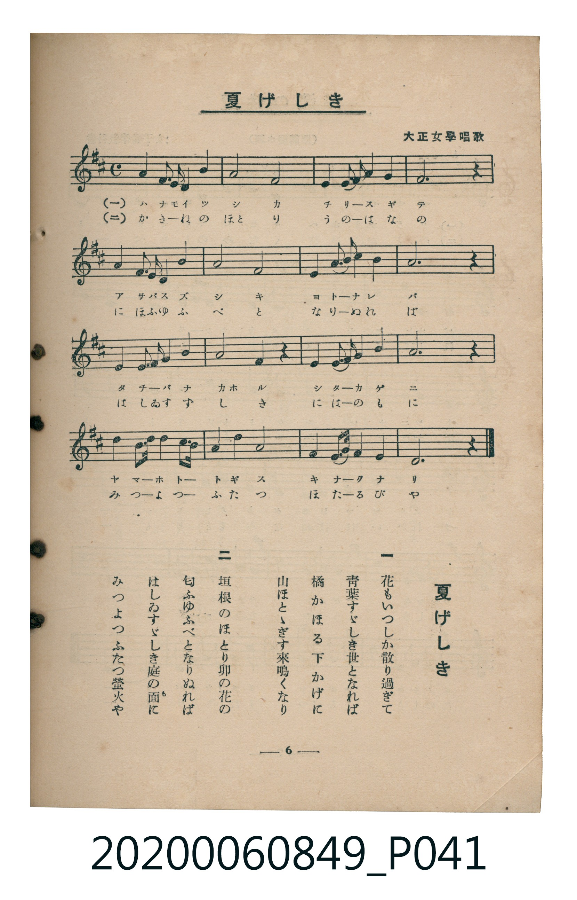

# 夏げしき

<audio controls src="natsugeshiki.mp3"></audio>

- （大正女學唱歌）
- 臺灣教育會公認《新定兒童唱歌》高等科女子用（2020.006.0849）

## 說明

原書資訊與歌詞全文（對應 P041.jpg，書頁 p. 6，高一第一學期第 5 首）：
調性與拍號：ニ長調（2 升記號）、4/4 拍

## 歌詞

```text
一
花（はな）もいつしか散（ち）り過（す）ぎて
青葉（あをば）すゞしき世（よ）となれば
橘（たちばな）かほる下（した）かげに
山（やま）ほとゝぎす來鳴（きな）くなり

二
垣根（かきね）のほとり卯（う）の花の
匂（にほ）ふゆふべとなりぬれば
はしゐすゞしき庭（には）の面（も）に
みつよつふたつ螢火（ほたるび）や
```

## ABC

```abc
X:1
T:夏げしき
M:4/4
L:1/16
Q:1/4=96
K:D
V:V1 name="Piano" snm="Pia"
[V:V1]
!mf! A,4 A,4 B,2 A,2 B,4 | D8 B,8 | A,4 B,4 D2 E2 D4 | B,12 z4 |
A,4 A,4 B,2 A,2 B,4 | D8 B,8 | E4 E4 F2 A2 F4 | E12 z4 |
F4 F4 A2 B2 A4 | F4 E4 D4 z4 | E4 E4 D2 E2 F4 | B,12 z4 |
D4 D4 E2 D2 B,2 A,2 | D4 E4 F8 | E4 E4 F2 E2 D2 B,2 | A,12 z4 |
!mf! A,4 A,4 B,2 A,2 B,4 | D8 B,8 | A,4 B,4 D2 E2 D4 | B,12 z4 |
A,4 A,4 B,2 A,2 B,4 | D8 B,8 | E4 E4 F2 A2 F4 | E12 z4 |
F4 F4 A2 B2 A4 | F4 E4 D4 z4 | E4 E4 D2 E2 F4 | B,12 z4 |
D4 D4 E2 D2 B,2 A,2 | D4 E4 F8 | E4 E4 F2 E2 D2 B,2 | A,12 z4 |
```

## TMD 檔案連結

- [主旋律 TMD 檔案](natsugeshiki.tmd) [[在 TMD Studio 編輯](https://tmdlang.github.io/Tmd-TS/#tmd=s7IKdvYPcrWy4tLSUni6pP9x46THjdMfN_YqaGlxKdoqWJpx2dsquHDZmOib2HHVKSi939PxdMnyZ2sXP126-enaHU-nbHy2tuf9nk4lkOSL9l3PGxc_mzrzRdOmZ3Oan7auebGq93FD17NpG56um_W0ddLz1UshOh43dL9cPeP52s7nyyeCTZrwfMoKoNlGBkYGegYGZnoGFiaWYGO59LUUbKkFuBQUFJ72zX82e8eLze0vVnS96GgHOubFynlPW1c8m9YO8tyG3mftnQoBBiaGelkF6e_39AAVv1zQqFCgp2AG5AFd_WRHw_M1a4Ak0P_P5swHshVMFV4umwZ07vs9s0BWvFi1_1nDcpDh3b0vZs4Hij5u7n45dTtQHORHhae9QMtngGU6Hzc0AsNWAaiSC6QVaCzYhK6NQJWPG9c_blwFUtTU9Lix5XHjEnDkdD-buhgsuxAs1fWysQ_MnQniNvY9blwGMuLl3EkvJgJdBJRoetwEjNYNYOmZj5vmQaL4yQ6gkzseN3WAxVcAbXrc1ANUBtL8bOUMsM75QEuAQlBXNHY_btz9uKn7yY5usCzQFLAXQOJAC1aDg3cj2OVNQNfuA8vtBpndNBfssJlP9rW93LwFrLkXZigw0QFt7oJ4f1cP2JB5i58t2AlWBjQaqHItWOU6mGldT3vXg2XbIOLA4AKSYJ09TWCJ1UClYLmtj5vaQGTjTpgfux43rkH4FBzG0x83TUAOmqe7gBZCTAHaA7Lh5dxFYG8BTQdywT593LgfFCNNQHXAeAHaAAysJS_mLXreuBqsGejU-cDAety4GRxNLSA9lCdhKFDQ0ufi8k3MzLMKyEzMy3eoMahRqAbZoGBjoWUHZgAzDiSdvljYA1IOEgMqyk2rVTCNV9CFEGbxIBpI6gLlDIEkCIK5IFgDV6QLlDQCK6hBSIOgAUgIHHcwC3f1oFhIvF1GQBKEjYH5yRgugtuiHZ0oFoG0gLCpghkQg7SDeCAjQHaBtcOtAHkGYgV-zzydPRvFDpBJIAwKCoh3IGIQZ2N6BKoOGgqo1tRycenaKYDiUAGJVuYCAA)]
- [鋼琴伴奏 TMD 檔案](natsugeshiki_piano.tmd) [[在 TMD Studio 編輯](https://tmdlang.github.io/Tmd-TS/#tmd=s7IKdvYPcrWy4tLSUni6pP9x46THjdMfN_a-39PxsnvP8wlbnuzZ8nRp__POjvd7OhW0tLgUbRUszbjsbRVcuGxM9E3suOoUlICKny5Z_mzt4qdLNz9du-PplI3P1vYA1SuBJF-073reuPjZ1JkvmjY9m9P8tHXNi1W9jxu6nk3b8HTdrKetk56vXgrR8bih--XqGc_Xdj5fPhFs0oTnU1YAzTYyMDLQMzAw0zOwMLEEG8vlm5iZZxWQmZiXH-ThUGNQo1DNpQAENhZadmCGvpbC8zVrnuxoeLGwR0FLHywGVJSbVqtgGq-gCyHM4kE0kNQFyhkCSRAEc0GwBq5IFyhpBFZQg5AGQQOQEBeyhbt6UCwk3i4jIAnCxgqmQAwTwW3Rjk4Ui0BaQNhUwQyIQdpBPJARILvA2uFWgDwDsQK_Z57Ono1iB8gkEAYFBcQ7EDGIszE9AlUHDQVUa2qRo9AHJQpN8EahIcisaMNYsF0mYI5JPISHImUWD-aZxefGAq3EG0l4jDQC80yhPFOImSAuupFo0YFiJJwD1AQzg7ArMUIft1-R3IVuHyigde0UQGGtgEQrcwEA)]

## 分析

```text
================================================================================
📊 TMD Song Profile: [ 夏げしき ]
================================================================================
⏱  Duration:       1:20 (80.0s), 32 measures total
🎼 Key & Tempo:    首調基準 D, != 96.0 BPM, <4/4>
   - 分析範圍：      由實際發聲的音符與和弦推測調性；播放脈絡另行呈現
🎤 人聲音域:    A3 (MIDI 57) – B4 (MIDI 71) [跨度: 14 個半音 / 1.2 個八度, 難度: moderate]
   - 最低音:  A3 in [Main #1 @ m.1, 0:00]
   - 最高音: B4 in [Main #1 @ m.9, 0:21]
   - 適合: soprano, mezzo-soprano, contralto, tenor, baritone, bass
🏛  結構:      Main (40.0s) -> Main (40.0s)
⚡ 編曲密度:        Peak 1 軌道同時演奏
🗝  調性診斷：       B 小調（純淨自然小調，未偵測到可信轉調）
   - 風格氣質:    純淨自然小調（陰鬱抒情、旋律集中，無明顯調外色彩）
   - 轉調歷程:    全曲維持單一推測調性（未偵測到可信轉調）
   - 核心骨幹音:  B, E, A, D, F#
   - 調性數值:    B 小調 [相關度: 0.73, 穩定度: Moderate, 自然音純度: 100.0%]
   - 候選調性 (K-S): B 小調 (0.73), A 大調 (0.69), D 大調 (0.67)
   - 五度圈歷程:   +5 -> +5
   - 各段落調性細節:
     • [Main #1]: B 小調 (r: 0.73, 自然音純度: 100.0%)
     • [Main #2]: B 小調 (r: 0.73, 自然音純度: 100.0%)

  [ 五度圈游移軌跡 ]
               C  
         F            G  
      Bb               D  
      Eb               A  
         Ab           E  
            Db      [B ]*
               F# 
     (* = active key center)

  [ 十二半音累積音高分佈 ]
     C  :                            0.0%
     C# :                            0.0%
     D  : █████████████████         18.6%
     D# :                            0.0%
     E  : ████████████████████      22.0%
     F  :                            0.0%
     F# : ████████████              13.6%
     G  :                            0.0%
     G# :                            0.0%
     A  : ██████████████████        19.5%
     A# :                            0.0%
     B  : ████████████████████████  26.3%
--------------------------------------------------------------------------------
Assignment 軌道音域：
  - Piano         : A3 – B4 (14 個半音 / 1.2 個八度, 112 個音符)
================================================================================
```


## 原書掃描頁




