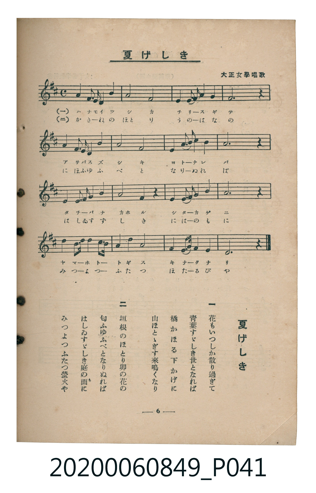

# 夏げしき

> Re:Shōka 使用 AI 協助辨識與重建樂譜，可能會有錯誤。歡迎回報。

- **鋼琴伴奏版**：<br><audio controls src="natsugeshiki.mp3"></audio>

- （大正女學唱歌）
- 臺灣教育會公認《新定兒童唱歌》高等科女子用（2020.006.0849）

## 說明

原書資訊與歌詞全文（對應 P041.jpg，書頁 p. 6，高一第一學期第 5 首）：
調性與拍號：ニ長調（2 升記號）、4/4 拍


## 歌詞

```text
一
花（はな）もいつしか散（ち）り過（す）ぎて
青葉（あをば）すゞしき世（よ）となれば
橘（たちばな）かほる下（した）かげに
山（やま）ほとゝぎす來鳴（きな）くなり

二
垣根（かきね）のほとり卯（う）の花の
匂（にほ）ふゆふべとなりぬれば
はしゐすゞしき庭（には）の面（も）に
みつよつふたつ螢火（ほたるび）や
```

## ABC

<div class="abc-score" data-abc-src="natsugeshiki.abc" aria-label="五線譜載入中"></div>

[下載 ABC 原始檔](natsugeshiki.abc)

## TMD 檔案連結

- [主旋律 TMD 檔案](natsugeshiki.tmd) [[在 TMD Studio 編輯](https://tmdlang.github.io/Tmd-TS/#tmd=s7IKdvYPcrWy4qpTUCpJTLdSSM7PyUlNLsnMz7MqzsjMK0nNjM_KTMmPL87Iz05Ugisry88pzU21ys4vyY9PzyzKKY43MjAyiDcwMIs3sDCxRCgszi8tSk61Kk7OyM_PiS9JrShJys_PRpePL0hMT7UKMDAxRMgUFOWXpeYl5gF1FxSBXJIC1o5QkFqWmZIKki5OTsyLL0stykzLTE1BcmNqUTHYHxArSooS84qTizILQJ5DqMovKsnITy9KLMiotMrILC7JL8pMTsyJz07MQ_JuSUYq0LfFqYnF-XnFyHoz0zPzrEoSM4HBAwqi8sT43MTMvJzEPKA7tLQUni7pf9w46XHj9MeNvQpaWlyKtgqWRlz2tgouXDYm-iZ2IJPe7-l4umT5s7WLny7d_HTtjqdTNj5b2_N-TyfYmhftu543Ln42deaLpk3P5jQ_bV3zYlXv44auZ9M2PF0362nrpOerl0J0PG7ofrl6xvO1nc-XTwSbNOH5lBVAs0HxogeMFz1QvICN5dLXUrClFuBSUFB42jf_2ewdLza3v1jR9aKjHeiYFyvnPW1d8WxaO8hzG3qftXcqgCJXL6sg_f2eHqDilwsaFQr0FMyAPKCrn-xoeL5mDZAE-v_ZnPlAtoKpwstl04DOfb9nFsiKF6v2P2tYDjK8u_fFzPlA0cfN3S-nbgeKg_yo8LQXaPkMsEzn44ZGYNgqAFVygbQCjQWb0LURqPJx4_rHjatAipqaHje2PG5cAo6c7mdTF4NlF4Klul429oG5M0Hcxr7HjctARrycO-nFRKCLgBJNj5uA0boBLD3zcdM8SBQ_2QF0csfjpg6w-AqgTY-beoDKQJqfrZwB1jkfaAlQCOqKxu7HjbsfN3U_2dENlgWaAvYCSBxowWpw8G4Eu7wJ6Np9YLndILOb5oIdNvPJvraXm7eANffCDAUmOqDNXRDv7-oBGzJv8bMFO8HKgEYDVa4Fq1wHM63rae96sGwbRBwYXEASrLOnCSyxGqgULLf1cVMbiGzcCfNj1-PGNQifgsN4-uOmCchB83QX0EKIKUB7QDa8nLsI7C2g6UAu2KePG_eDYqQJqA4YL0AbgIG15MW8Rc8bV4M1A506HxhYjxs3g6OpBaSH8iQMBQpa-lxcvsDcaxWQmZiX71BjUFMNskDBxtBMyw7MAmYcSDp9sRCYQzucEouKFQwfNUw2ASZjRPruBJkEUl4DTMW6YGgMJo0UDKF8MyiNUAGDEJUIWAPUBWFBaGO4DhO4CnQ9MGgAUwF2jY9hjcLj5n6o2OPmLii9SOFx0xK4aAvc1MdN29HMe9y0GsN1j5sb4XpXQek9QJU74XrWIaltw-HSeFSXGgHVNnbDTAAWnXBzG9fCRZHMBadhDMdCPIji2EaYA2DaIYauh4tCvABRC7MAt2ORE8WuHqREYQpMFBb0SBQQlWYK5gTNgEEsiaJpEVTscfMmKD0BJQp3wU3FlijWYrjucTMsNh43d0BpYDhDkxyItwZJ7QQcLsWWKGAJEBjlUHor0AWIWN2KMLcR5n64SzHSCEgVLMZh6QWSImDuA5ZqSGo3EHQpSjHRiZQiLIEpwtAIV5JAz-OwvE04ScCjkwwzYBBbktgPFYPlb0gEwqIKEZUgtasfN89GM_JxMyym4GGDlHZgxkOKCnicNkFSHyRVwLI_OsSWKhD5dzrUJGD6bZwJF52FMBeqAsml0OIFxaVI6QxiNiRVwEoEYKWFRS1ulyKliqezZyNXHsagZAFqBWFNFoZxUCMgcQjkwkUgGd4MKVbhUujRjKggIEnDBI0PUgErg9AhtioEUVnMg9KgpAFLAcg5HqQawkOuCBAlC8KFiFIEUTGB0gY8ZpETHLSiwYTY0gY8ITdC3A0xF-4qJFGQalj5AWxooKlAcS209EGog5iKqLI2I_kMVqXidm0tF5eunQKo7aEApJW5AA)]
- [鋼琴伴奏 TMD 檔案](natsugeshiki_piano.tmd) [[在 TMD Studio 編輯](https://tmdlang.github.io/Tmd-TS/#tmd=s7IKdvYPcrWy4qpTUCpJTLdSSM7PyUlNLsnMz7MqzsjMK0nNjM_KTMmPL87Iz05Ugisry88pzU21ys4vyY9PzyzKKY43MjAyiDcwMIs3sDCxRCgszi8tSk61Kk7OyM_PiS9JrShJys_PRpePL0hMT7UKMDAxRMgUFOWXpeYl5gF1FxSBXJIC1o5QkFqWmZIKki5OTsyLL0stykzLTE1BcmNqUTHYHxArSooS84qTizILQJ5DqMovKsnITy9KLMiotMrILC7JL8pMTsyJz07MQ_JuYhFQc3pqbmpeiVVBZmJefnxicnJ-bkFiXiZIDKGwJAOoyKo4NbE4P68Y2ZLM9Mw8q5LETGA4gsKyPDE-NzEzLycxD-hgLS2Fp0v6HzdOetw4_XFj7_s9HS-79zyfsOXJni1Pl_Y_7-x4v6dTQUuLS9FWwdKIy95WwYXLxkTfxA5kPFDx0yXLn61d_HTp5qdrdzydsvHZ2h6gerDdL9p3PW9c_GzqzBdNm57NaX7auubFqt7HDV3Ppm14um7W09ZJz1cvheh43ND9cvWM52s7ny-fCDZpwvMpK4Bmg2JVDxireqBYBRvL5Qt0t1UAKBCCPBxqDGqquRSAwMbQTMsOzNLXUni-Zs2THQ0vFvYoaOmDxWoUTBV0wdAYTBopGEL5ZlAaoQIGISoRsAaoC8KC0MZwHSZwFeh6YNAApgLsGh_DGoXHzf1QscfNXVB6kcLjpiVw0Ra4qY-btqOZ97hpNYbrHjc3wvWugtJ7gCp3wvWsQ1LbhsOl8aguNQKqbeyGmdDYizC3cS1cFMncxt2PG1dgOBbiQRTHNsIcANMOMXQ9XBTiBYhamAW4HYsc87t6aBbzEJVmCuYEzYBBLDHftAgq9rh5E5SegBJPu-CmYov5tRiue9wMC_LHzR1QGhiY0HQF4q1BUjsBh0uxxTwslQHjFUpvBboAEXVbEeY2wtwPdylGQgCpgkUrLFFAoh3mvsdNPUhqNxB0KUqG70SJdvTMCsukhKMdHmVkmAGD2KJ9P1QMllEhkQSLDkR0gdSuftw8G83Ix82w2ID7Hyl9wIyH5Hl4vDVBUhgk5mH5GB1ii3lERpwONQmYRhtnwkVnIcyFqkByKbScQHEpUlqCmA2JeVjWftzUhEUtbpcixfzT2bNRYt4wDqoKEk1ALlwEkm_NkCIOLoUek4jCHBL7Jmh8kApYUYIOsRX3iIJ9HpQGxT4skpEzLkg1hIdcaCMKCIQLEYUBohIBRT888pDTFLRSwITYoh-eVhsh7oaYC3cVkihINawYeNw4H00FimuhhQhCHcRURPWyGclnsOoPt2trkdsCPshtARO8TQHDeIVow1gFk3ggbRIfixCBUsDEAZIyBUrBGchqDPDXN4SNNwIyjOJzY6EMDBvRLUAr2Qi6Dp8KLOaj5x8TqMNhNI7wgRqGNXiAUaNrpwCKHQUgrcwFAA)]

## 分析

```text
================================================================================
📊 TMD Song Profile: [ 夏げしき ]
================================================================================
⏱  Duration:       0:41 (41.7s), 16 measures total
🎼 Key & Tempo:    首調基準 D, != 92.0 BPM, <4/4>
   - 分析範圍：      由實際發聲的音符與和弦推測調性；播放脈絡另行呈現
🎤 人聲音域:    D4 (MIDI 62) – D5 (MIDI 74) [跨度: 12 個半音 / 1.0 個八度, 難度: easy]
   - 最低音:  D4 in [Main #1 @ m.1, 0:01]
   - 最高音: D5 in [Main #1 @ m.13, 0:31]
   - 適合: soprano, mezzo-soprano, contralto, tenor, baritone, bass
🏛  結構:      Main (41.7s)
⚡ 編曲密度:        Peak 1 軌道同時演奏
🗝  調性診斷：       A 大調（流行色彩大調，未偵測到可信轉調）
   - 風格氣質:    流行大調（略帶和弦色彩音與裝飾副屬和弦）
   - 轉調歷程:    全曲維持單一推測調性（未偵測到可信轉調）
   - 核心骨幹音:  A, F#, E, D, B
   - 調性數值:    A 大調 [相關度: 0.83, 穩定度: Moderate, 自然音純度: 94.5%]
   - 候選調性 (K-S): A 大調 (0.83), D 大調 (0.78), F# 小調 (0.74)
   - 五度圈歷程:   +3
   - 各段落調性細節:
     • [Main #1]: A 大調 (r: 0.83, 自然音純度: 94.5%, 調外音: G)

  [ 五度圈游移軌跡 ]
               C  
         F            G  
      Bb               D  
      Eb              [A ]*
         Ab           E  
            Db       B  
               F# 
     (* = active key center)

  [ 十二半音累積音高分佈 ]
     C  :                            0.0%
     C# : ██                         3.0%
     D  : ███████████               14.0%
     D# :                            0.0%
     E  : ███████████               14.4%
     F  :                            0.0%
     F# : ████████████████          20.8%
     G  : ████                       5.5%
     G# :                            0.0%
     A  : ████████████████████████  31.8%
     A# :                            0.0%
     B  : ████████                  10.6%
--------------------------------------------------------------------------------
Assignment 軌道音域：
  - Piano         : D4 – D5 (12 個半音 / 1.0 個八度, 54 個音符)
================================================================================
```


## 原書掃描頁




