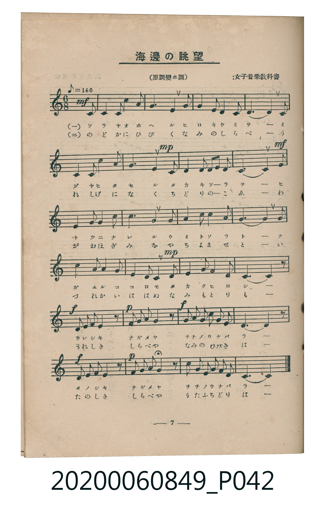
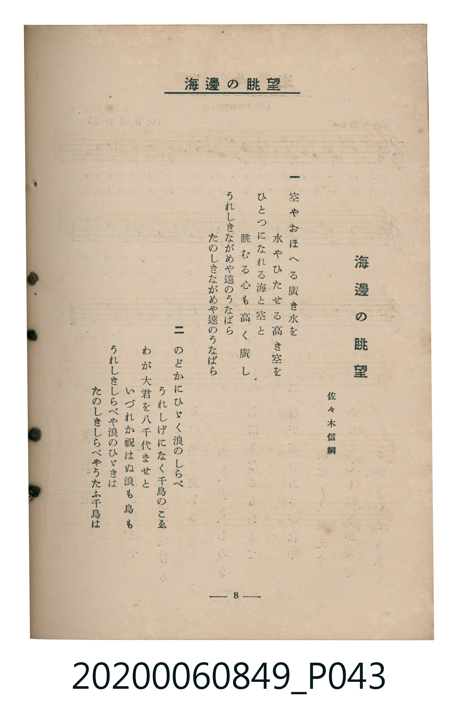

# 海邊眺望

> Re:Shoka 使用 AI 辨識樂譜，可能會有錯誤。歡迎回報。

<audio controls src="kaihen_chobo.mp3"></audio>

- 詞：佐々木信綱（女子音樂教科書）
- 臺灣教育會公認《新定兒童唱歌》高等科女子用（2020.006.0849）

## 說明

原書資訊與歌詞全文（對應 P042.jpg – P043.jpg，書頁 pp. 7–8，高一第一學期第 6 首）：
目次名「海邊眺望」，內頁題名「海邊の眺望（原調變ホ調）」
調性與拍號：ヘ長調（1 降記號）、6/8 拍（♪=160，折合附點四分音符 ♩.=80，弱起第 6 拍進入）

## 歌詞

```text
一
空（そら）やおほへる廣（ひろ）き水（みづ）を
水やひたせる高（たか）き空を
ひとつになれる海（うみ）と空と
眺（なが）むる心（こころ）も高く廣し
うれしきながめや遠（をち）のうなばら
たのしきながめや遠のうなばら

二
のどかにひゞく浪（なみ）のしらべ
うれしげになく千鳥（ちどり）のこゑ
わが大君（おほぎみ）を八千代（やちよ）ませと
いづれか祝（いは）はぬ浪も鳥も
うれしきしらべや浪のひゞきは
たのしきしらべやうたふ千鳥は
```

## ABC

```abc
X:1
T:海邊眺望
M:6/8
L:1/16
Q:3/8=53
K:F
V:V1 name="Piano" snm="Pia"
[V:V1]
!mf! z4 z2 z4 C2 | F4 F2 F4 G2 | A6 F4 F2 | G4 G2 C4 C2 |
F10 F2 | D4 D2 E4 E2 | !mp! F6 C4 C2 | D4 G2 E2 D2 E2 |
!mf! C10 C2 | C4 F2 F4 G2 | A6 F4 A2 | G4 B2 A4 G2 |
F10 F2 | B4 B2 A4 A2 | !mp! G4 G2 F4 F2 | E4 G2 C4 E2 |
F10 z2 | !f! C2 F2 G2 A4 z2 | !p! C2 F2 G2 A4 z2 | !f! B2 A2 B2 G2 F2 E2 |
F10 z2 | !f! C2 F2 G2 A4 z2 | !p! F2 G2 A2 B4 z2 | A2 G2 F2 G2 A2 G2 |
F10 z2 | !mf! z4 z2 z4 C2 | F4 F2 F4 G2 | A6 F4 F2 |
G4 G2 C4 C2 | F10 F2 | D4 D2 E4 E2 | !mp! F6 C4 C2 |
D4 G2 E2 D2 E2 | !mf! C10 C2 | C4 F2 F4 G2 | A6 F4 A2 |
G4 B2 A4 G2 | F10 F2 | B4 B2 A4 A2 | !mp! G4 G2 F4 F2 |
E4 G2 C4 E2 | F10 z2 | !f! C2 F2 G2 A4 z2 | !p! C2 F2 G2 A4 z2 |
!f! B2 A2 B2 G2 F2 E2 | F10 z2 | !f! C2 F2 G2 A4 z2 | !p! F2 G2 A2 B4 z2 |
A2 G2 F2 G2 A2 G2 | F10 z2 |
```

## TMD 檔案連結

- [主旋律 TMD 檔案](kaihen_chobo.tmd) [[在 TMD Studio 編輯](https://tmdlang.github.io/Tmd-TS/#tmd=s7IKdvYPcrWy4qpTUCpJTLdSSM7PyUlNLsnMz7MqzsjMK0nNjM_KTMmPL87Iz05Ugisry88pzU21ys4vyY9PzyzKKY43MjAyiDcwMIs3sDCxRCgszi8tSk61Kk7OyM_PiS9JrShJys_PRsgXFOWXpeYl5gHVFBSB7EsBK0IoSC3LTEkFSaemZJbkF2Um5iC5IrWoGOxSsCXxJUWJecXJRZkFIOcjVJVkpAKdWp5YklqkxKWlpfBs6_aXTV3P5-x6Nme2gpYWl6KtgoUBl72tghuXjZm-hR1I44uV897vmfVk74THDa3P5qx4sn_h820b3-_peLp089O1E17O3_xsRdOzqTOfL5_4bPaO93s6wba9aN_1vHExUPhF06Znc5qftq55sar3cUPXs2kbnq6b9bR10vPVS59O2fhsbc_jhu6Xq2c8X9sJNABi5PMpK4DGgwJRDxiIeqBABBvLpa-lYEstwKWgoPC0bz7QyS82t79Y0fWiox3oGKBfn7aueDatHeS_Db3P2jsVAgxMjPSyCtIVHjVMBnGMQZz3e3qAOl8uaFQoKNBTMAdKWQCFgP54sqPh-Zo1QPLp2h3P5swHshXMFF4umwb0ADAQQZY-n73u2ZqFTycAQ6MHOfgfN_QCjXjauhxo6suFPcgKHjeug6gBuapv_otV-1-s63rcPBvIAJoL1AgyF8h51rAc5I3u3hcz5wNte9w84-XU7WBFHYYKL2f2vlgxAywD1NIIjF0FoEqg1KOZq2wNzQxAXuqa8XRCx8uZLS93z3s6e_bTjjZg7D5fs0zh0cyVerYWICVP92x8sXU7xFtA7S8bNj1tXQo0kQvkBKC3wT5cuQto7OPGuY-bgJ7ufNzU8rgR6Ifdjxt3PG7qfrp7MVh20-MmoO2djxt7n23YAhbZ_7gRZNTjpkkgU4CiYJ2bHjfOf9w4G6gTGLxgdUBuN0Qn0CaoarC6FY8blzxuXP24cdXjph6gBmDogTW0Ac0Ga1gB0tC4AuzIORBHrnrc2AO2tAHktv3NYMHJIARxXlMT0NrHjf1AZz9unA6xqg1kfON0oAMg-h83NQKd-rJxAUhz06THjQvBtq0D2wxUsAEYEBCdQKcDRbHoRFcNDs5dPRBdQKmVQD-DvQYMtnlA5zzbugrmfIjXwMY2ARk70dwIdA44RIBe6G1-uRkYwkBtC0EmNnXBdAI9OxGsrakf6KinS5Y_nQBKa7Bo64Na0jTpaetqoClPIFEIip2Fj5s6wKbsA8URJGgfNwIlloLt736-dC7YIKDIerC69Y8b1wAdDwrXzUA1TZghCvUG0HiQOpDzIH4GSq3HDEWEanD4AaW2QvwJVU15SQEFClr6XFy-iZl5VgGZiXn5DjUGNQrVIBsUbCy07MAMYPkEyR9PN_Q_X98A0gESrlEwUNAFYhBZnZtWq2Aar1ADjmGQDkhx8WJhD0K5IVChIZg0AvKMgTSID8I1QBGQKNAEXbAxYHEIBMqiGLqrB8VQM5AWIGEOooEETCvYqOrcAoizIMqMQAogamsgCiAQh-s7USwCq8fmfGOo803AYiA5nI4Hlj4oZprAtcEMMQJrBrsbFCxgX0HDBclzIGiAHi5TUIyuhnjJEKgbZD5QtUI1JDBQhICqQA4wAVuM34anrWuJsQHCB_kMJGIMNhgkghowILNrubh07RRAaU8BiVbmAgA)]
- [鋼琴伴奏 TMD 檔案](kaihen_chobo_piano.tmd) [[在 TMD Studio 編輯](https://tmdlang.github.io/Tmd-TS/#tmd=s7IKdvYPcrWy4tLSUni2dfvLpq7nc3Y9mzP7_Z6Ol917nk_Y8mTPlqdL-593drzf06mgpcWlaKtgYcBlb6vgxmVjpm9hx1WnoPRi5bz3e2Y92TvhcUPrszkrnuxf-HzbRqAJT5dufrp2wsv5m5-taHo2debz5ROfzd4BNEcJrKl91_PGxUDhF02bns1pftq65sWq3scNXc-mbXi6btbT1knPVy99OmXjs7U9jxu6X66e8XxtJ9AAiJHPp6wAGm9kYGSgZ2BgpmdgYWIJNpbLNzEzzyogMzEvP8jDocagRqGaSwEIbCy07MAMfS2Fp3s2vti6_emG_ufrGxS09MHCNQoGCrpADCKrc9NqFUzjFWq4YDqer1nzZEfDi4U9COWGQIWGYNIIyDMG0iA-CNcARUCiQBN0wcaAxSEQKIti6K4eFEPNQFqAhDmIBhIwrWCjqnMLIM6CKDMCKYCorYEogEAcru9EsQisHpvzjaHONwGLgeRwOv7p7NkoZprAtcEMMQJrBrsbFCxgX0HDBclzIGiAHi5TUIyuhnjJEKgbZD5QtUI1JDBQhICqQA4wAVuM34anrWuJsQHCB_kMJGIMNhgkghowILNrkZOeD7lJDz0c0BMdJJqjDWPBNBYB03ioiGk8VjUYAY2aAE3w6wYJGEEFjOJzcViK4QnUtEd1T2AkRJzmkR9MqOkRXS2mANQNMHsIeAAtMeIyLdoEFr5EeQCYJHXtFECpUgGJVuYCAA)]

## 分析

```text
================================================================================
📊 TMD Song Profile: [ 海邊眺望 ]
================================================================================
⏱  Duration:       1:52 (112.5s), 50 measures total
🎼 Key & Tempo:    首調基準 F, != 80.0 BPM, <6/8>
   - 分析範圍：      由實際發聲的音符與和弦推測調性；播放脈絡另行呈現
🎤 人聲音域:    C4 (MIDI 60) – A#4 (MIDI 70) [跨度: 10 個半音 / 0.8 個八度, 難度: easy]
   - 最低音:  C4 in [Main #1 @ m.1, 0:01]
   - 最高音: A#4 in [Main #1 @ m.12, 0:25]
   - 適合: soprano, mezzo-soprano, contralto, tenor, baritone, bass
🏛  結構:      Main (56.2s) -> Main (56.2s)
⚡ 編曲密度:        Peak 1 軌道同時演奏
🗝  調性診斷：       F 大調（純淨自然大調，未偵測到可信轉調）
   - 風格氣質:    純淨自然大調（陽光明朗、易唱易記，無明顯調外色彩）
   - 轉調歷程:    全曲維持單一推測調性（未偵測到可信轉調）
   - 核心骨幹音:  F, A, G, C, E
   - 調性數值:    F 大調 [相關度: 0.91, 穩定度: High, 自然音純度: 100.0%]
   - 候選調性 (K-S): F 大調 (0.91), C 大調 (0.57), F 小調 (0.57)
   - 五度圈歷程:   -1 -> -1
   - 各段落調性細節:
     • [Main #1]: F 大調 (r: 0.91, 自然音純度: 100.0%)
     • [Main #2]: F 大調 (r: 0.91, 自然音純度: 100.0%)

  [ 五度圈游移軌跡 ]
               C  
        [F ]*          G  
      Bb               D  
      Eb               A  
         Ab           E  
            Db       B  
               F# 
     (* = active key center)

  [ 十二半音累積音高分佈 ]
     C  : █████████                 14.5%
     C# :                            0.0%
     D  : ███                        4.3%
     D# :                            0.0%
     E  : ████                       6.5%
     F  : ████████████████████████  37.7%
     F# :                            0.0%
     G  : ██████████                15.2%
     G# :                            0.0%
     A  : ██████████                15.9%
     A# : ████                       5.8%
     B  :                            0.0%
--------------------------------------------------------------------------------
Assignment 軌道音域：
  - Piano         : C4 – A#4 (10 個半音 / 0.8 個八度, 168 個音符)
================================================================================
```


## 原書掃描頁






