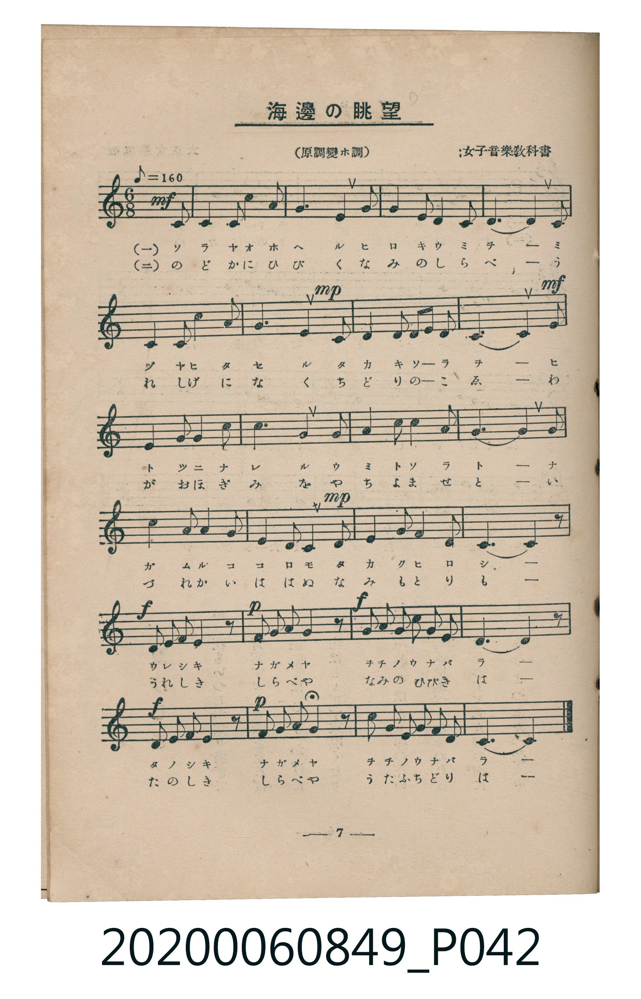
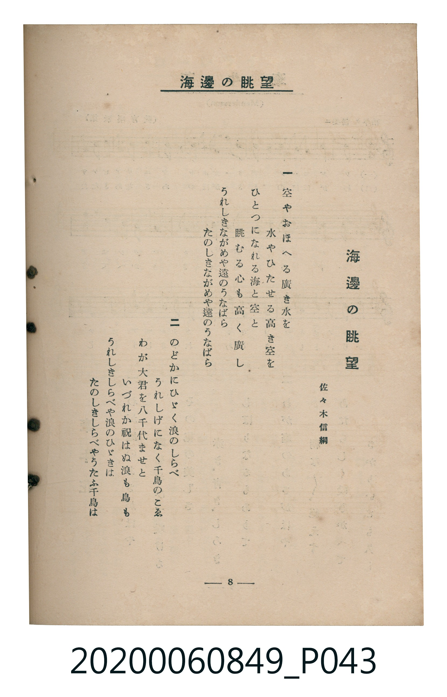

# 海邊眺望

> Re:Shōka 使用 AI 協助辨識與重建樂譜，可能會有錯誤。歡迎回報。

- **鋼琴伴奏版**：<br><audio controls src="kaihen_chobo.mp3"></audio>

- 詞：佐々木信綱
- 出處：女子音樂教科書
- 臺灣教育會公認《新定兒童唱歌》高等科女子用（2020.006.0849）

## 說明

原書資訊與歌詞全文（對應 P042.jpg – P043.jpg，書頁 pp. 7–8，高一第一學期第 6 首）：
目次名「海邊眺望」，內頁題名「海邊の眺望（原調變ホ調）」
調性與拍號：ハ長調（無升降記號）、6/8 拍（♪=160，折合附點四分音符 ♩.=80，弱起第 6 拍進入）
出處註記：女子音樂教科書
註：第一段第一句譜面作「ヒロキウミヲ」，底欄歌詞作「廣き水を」。


## 歌詞

```text
一
空やおほへる廣き水を
水やひたせる高き空を
ひとつになれる海と空と
眺むる心も高く廣し
うれしきながめや遠のうなばら
たのしきながめや遠のうなばら

二
のどかにひゞく浪のしらべ
うれしげになく千鳥のこゑ
わが　大君を八千代ませと
いづれか祝はぬ浪も鳥も
うれしきしらべや浪のひゞきは
たのしきしらべやうたふ千鳥は
```

## ABC

<div class="abc-score" data-abc-src="kaihen_chobo.abc" aria-label="五線譜載入中"></div>

[下載 ABC 原始檔](kaihen_chobo.abc)

## TMD 檔案連結

- [主旋律 TMD 檔案](kaihen_chobo.tmd) [[在 TMD Studio 編輯](https://tmdlang.github.io/Tmd-TS/#tmd=s7IKdvYPcrWy4qpTUCpJTLdSSM7PyUlNLsnMz7MqzsjMK0nNjM_KTMmPL87Iz05Ugisry88pzU21ys4vyY9PzyzKKY43MjAyiDcwMIs3sDCxRCgszi8tSk61Kk7OyM_PiS9JrShJys_PRpePL0hMT7UKMDAxwiljjJApKMovS81LzAOaW1AEcmMK2GCEgtSyzJRUkHRxcmJefFlqUWZaZmoKkutTi4rBPoRYUVKUmFecXJRZAPI2QlV-UUlGfnpRYkFGpVVGZnFJflFmcmJOfHZiHlJAlGSkAsOhPLEktQhZZ2Z6Zp5VbmpmViYWP0OlSxIzgaEKCtnyxPjcxMy8nMQ8oCO1tBSebd3-sqnr-Zxdz-bMVtDS4lK0VbAw4LK3VXDmsjHTt7ADmfRi5bz3e2Y92TvhcUPrszkrnuxf-HzbRrAdT9t3vZg5FSj5dOnmp2snvJy_-dmKpmdTZz5fPvHZ7B1gJS_adz1vXAwUe9G06dmc5qeta16s6n3c0PVs2oan62Y9bZ30fPXSp1M2Plvb87ih--XqGc_XdgJ1Q8x7PmXF-z0doOjWA0a3Hii63-_pVOLi0tdSsKUW4FJQUHjaNx_o3heb21-s6HrR0Q50DNDPT1tXPJvWDnTA0w29z9o7FUBpRi-rIF3hUcNkEMcYxHm_pweo8-WCRoWCAj0Fc6CUBVAI6I8nOxqer1kDJJ-u3fFsznwgW8FM4eWyaUAPAMMLZOnz2euerVn4dAIwNHqQo-FxQy_QiKety4GmvlzYg6zgceM6iBqQq_rmv1i1_8W6rsfNs4EMoLlAjSBzgZxnDctB3ujufTFzPtC2x839L6duByvqeN6y8Glv-8uZvS9WzADLArU1AmNaAagaKP1o5ipbQzMDkLe6Zjyd0PFyZsvL3fOezp79tKMNGL3P1yxTeDRzpZ6tBUjJ0z0bX2zdDvEaUPvLhk1PW5cCTQQHKThpvFixG2gPrgQCdu2K3UBpSFA9W7cVGmb9S1-snfNy7qIne-cAPf-4edLj5rWPm4Bo2ePm-Y-bN0HDaNfUZ2taILEFUfl09-LHjb3PNmx53DQJqOZxQxMXyBKgkeAQX7nrcVPL40ZgOO5-3LjjcVM3snqQCjALqGLT48b5jxtnA1UAoxKoAqwTrAIst-Jx45LHjasfN6563NQDVASMHaAgSFHjCrBFc4DKG0Dm729-3NQENqMfbNd0iBltIH2N04Emg8xoBJrRCLT3ZeMCYAyDZEGCGx43gUMS7BSgKBGqwX7d1QPRBZRa-bixG-zOTY-b5gGd8GwrUCXYqKbOx4070dwyCeoloFN7m19uXgpWOvlx00SwuqZ-kM0NDU-XLH86ARgyk562rgaqewLy1T5QWEG8_rgRGHxLwUZ2P18693Hj-seNa0D2AoMBaGRTE2YAQF0D9BLMfRDnAqXWYwYAQjXY60CprTDnglVTXiJAgYKWPheXd2JmRmqec0Z-Ur5VQGZiXr5Dja5hTTXIIgUbCy07MANbcaQASckvFvYoaEDyiYK2gonC0w39z9c36MALE00sOoH2gkytUTBQ0AViEFmdm1arYAgUMgRyDBUM44CUGZBrCqR1FYyB2BTKM1YwAiupAdMQCOSBTfQxrFGIB_LjweTjpr1AVY-bV4LYzUuA_FVg1myw6AywzsfNq8HkJLDYWrCutUC8DCw6Hyy6CW4PWARikxGKTY3rQCobwTY1dgMx2NTGTWDRzRC9jf1gchVYbD9UFzC6wXZ2gkV3ImxqbAPahD_wd_WAA5_EMMcZwNW5BZAoAIWrERCCQhqiHgLBcWSMFNSPm1thQQsMQJA39oO80bQbOWihYhA2KGj3AmX2gKMFPXCBkQAPXGD2AQfDdCAGmw0MUlAQgaIQEZgLEcHe1AUJUJDZjZPBdk5EmN3UTzA4d3SSE5yQpAkKRWCQAkMLFK4gEUiCNYOIo4U2RAVyOHaA_d8CxN1gVhc4bNaghOMysNh8sEgHOBxBLEgogvTDQhGoFxGKjZBQBIUNKFYeN_bBkx_ITEistYDFFoLZQJMb94FVgrNJ4wqkJAlUhz8MgdUoWUkSEjygwAIFGihIjcDpDpwkQYkQEcqoSdIAORSbQOH1uHkBPMQ2g1MBKPuBsvbj5kUY6XE9LOUC5UGi2-Emx6OE4lKw6h5w5oaGBJBcD2YDzWgE24yctZuaoGEHSpcgk5tQTCaQsaeQE4rVwNwJyrQm4NAChoxCNTD0TIChZgYOObAIUA2EDwxzU1BmRipFUQNzGTgBgoIElG3BzgYnLlAwP25eCM72MNFNQNwIxH1QfUBVzRPgZS-2AG2DBicoe_fCzAHxgCUhqBwEJUqY6CpwoEJKS6BNwPIUpAcWAUQG6tPWtbQKVGhQmgKF8aVOoBfAAUSbAJ0Pr04IBygw8MHqt4JzPaj8hKZStACt5eLStVNAaiEoALnKXAA)]
- [鋼琴伴奏 TMD 檔案](kaihen_chobo_piano.tmd) [[在 TMD Studio 編輯](https://tmdlang.github.io/Tmd-TS/#tmd=s7IKdvYPcrWy4qpTUCpJTLdSSM7PyUlNLsnMz7MqzsjMK0nNjM_KTMmPL87Iz05Ugisry88pzU21ys4vyY9PzyzKKY43MjAyiDcwMIs3sDCxRCgszi8tSk61Kk7OyM_PiS9JrShJys_PRpePL0hMT7UKMDAxwiljjJApKMovS81LzAOaW1AEcmMK2GCEgtSyzJRUkHRxcmJefFlqUWZaZmoKkutTi4rBPoRYUVKUmFecXJRZAPI2QlV-UUlGfnpRYkFGpVVGZnFJflFmcmJOfHZiHlJAJBYBNaen5qbmlVgVZCbm5ccnJifn5xYk5mWCxBAKSzKAiqzKE0tSi5CtyEzPzLPKTc3MysQSOFDpksRMYPCDoqA8MT43MTMvJzEP6BstLYVnW7e_bOp6PmfXszmz3-_peNm95_mELU_2bHm6tP95Z8f7PZ0KWlpcirYKFgZc9rYKzlw2ZvoWdiDjX6yc937PrCd7JzxuaH02Z8WT_Qufb9sItvhp-64XM6cCJZ8u3fx07YSX8zc_W9H0bOrM58snPpu9A6zkRfuu542LgWIvmjY9m9P8tHXNi1W9jxu6nk3b8HTdrKetk56vXvp0ysZna3seN3S_XD3j-dpOoG6Iec-nrAA6FJRY9ICJRQ-UWIDOVOLi8k7MzEjNc87IT8q3CgAFZJCHQ42uYU01lwIQ2Fho2YEZ-loKtuhA4fmaNU92NLxY2KOg8XTPxhdbtytoK5goPN3Q_3x9g44CKFnpZRWka2LRqaUPNrVGwUBBF4hBZHVuWq2CIVDIEMgxVDCMA1JmQK4pkNZVMAZiUyjPWMEIrKQGTEMgkAc20cewRiEeyI8Hk4-b9gJVPW5eCWI3LwHyV4FZs8GiM8A6HzevBpOTwGJrwbrWAvEysOh8sOgmuD1gEYhNRig2Na4DqWwE29TYDcRgUxs3gUU3Q_Q29oPJVWCx_VBdjxung-3sBIvuRNjU2Aa0CX_g7-oBBz6JYY4zgKtzCyBRAApXIyAEhTREPQSC48gYKagfN7fCghYYgCBv7Ad5o2k3ctBCxSBsUNDuBcrsAUcLeuACIwEeuI-besDBMB2IwWYDgxQURKAoRATmQkSwN3VBAhRkduNksJ0TEWY39RMMzh2d5AQnJGmCQhEYpMDQAoUrSASSYM0g4mihDVGBHI4dYP-3AHE3mNUFDps1KOG4DCw2HyzSAQ5HEAsSiiD9sFAE6kWEYiMkFEFhA4qVx4198OQHMhMSay1gsYVgNtDkxn1gleBs0rgCKUkC1eEPw6ezZ5OVJCHBAwosUKCBgtQInO7ASRKUCBGhjJokDZBDsQkUXo-bF8BDbDM4FYCyHyhrP25ehJEe18NSLlAeJLodbnI8SiguBavuAWduaEgAyfVgNtCMRrDNyFm7qQkadqB0CTK5CcVkAhl7CjmhWA3MnaBMawIOLWDIKFQDQ88EGGpm4JADiwDVQPjAMDcFZWakUhQ1MJeBEyAoSEDZFuxscOICBfPj5oXgbA8T3QTEjUDcB9UHVNU8AV72YgvQNmhwgrJ3L8wcEA9YEoLKQVCihImuAgcqpLQE2gQsT0F6YBFAZKA-bV1Lq0CFBqUpUBhf6gR6ARxAtAnQ-fDqhHCAAgMfrH4rONeDyk9oKkUL0FosDQQfXA0ERHMAS_UODiZQTamrYBIPoeECUArON4UrgLEgNCg0kS2DVH-IQoSQ8aimoatANx1SG6Cbju5WOB9mLXbr0QyHFpNww_Frxho0-JwOKT7gpsM0wdTCrYEL4A8pdMdDMhLpxuN2PDCd6dopICW1aB_DWAV0ISOwkDIXAA)]

## 分析

```text
================================================================================
📊 TMD Song Profile: [ 海邊眺望 ]
================================================================================
⏱  Duration:       0:54 (54.0s), 24 measures total
🎼 Key & Tempo:    首調基準 C, != 80.0 BPM, <6/8>
   - 分析範圍：      由實際發聲的音符與和弦推測調性；播放脈絡另行呈現
🎤 人聲音域:    C4 (MIDI 60) – C5 (MIDI 72) [跨度: 12 個半音 / 1.0 個八度, 難度: easy]
   - 最低音:  C4 in [KaihenChobo #1 @ m.1, 0:01]
   - 最高音: C5 in [KaihenChobo #1 @ m.2, 0:03]
   - 適合: soprano, mezzo-soprano, contralto, tenor, baritone, bass
🏛  結構:      KaihenChobo (54.0s)
⚡ 編曲密度:        Peak 1 軌道同時演奏
🗝  調性診斷：       C 大調（純淨自然大調，未偵測到可信轉調）
   - 風格氣質:    純淨自然大調（陽光明朗、易唱易記，無明顯調外色彩）
   - 轉調歷程:    全曲維持單一推測調性（未偵測到可信轉調）
   - 核心骨幹音:  C, G, D, E, A
   - 調性數值:    C 大調 [相關度: 0.92, 穩定度: High, 自然音純度: 100.0%]
   - 候選調性 (K-S): C 大調 (0.92), G 大調 (0.74), E 小調 (0.55)
   - 五度圈歷程:   +0
   - 各段落調性細節:
     • [KaihenChobo #1]: C 大調 (r: 0.91, 自然音純度: 100.0%)

  [ 五度圈游移軌跡 ]
              [C ]*
         F            G  
      Bb               D  
      Eb               A  
         Ab           E  
            Db       B  
               F# 
     (* = active key center)

  [ 十二半音累積音高分佈 ]
     C  : ████████████████████████  30.4%
     C# :                            0.0%
     D  : █████████████             16.7%
     D# :                            0.0%
     E  : ████████████              15.2%
     F  : ███                        3.6%
     F# :                            0.0%
     G  : █████████████████████     26.1%
     G# :                            0.0%
     A  : ██████                     8.0%
     A# :                            0.0%
     B  :                            0.0%
--------------------------------------------------------------------------------
Assignment 軌道音域：
  - Piano         : C4 – C5 (12 個半音 / 1.0 個八度, 84 個音符)
================================================================================
```


## 原書掃描頁






