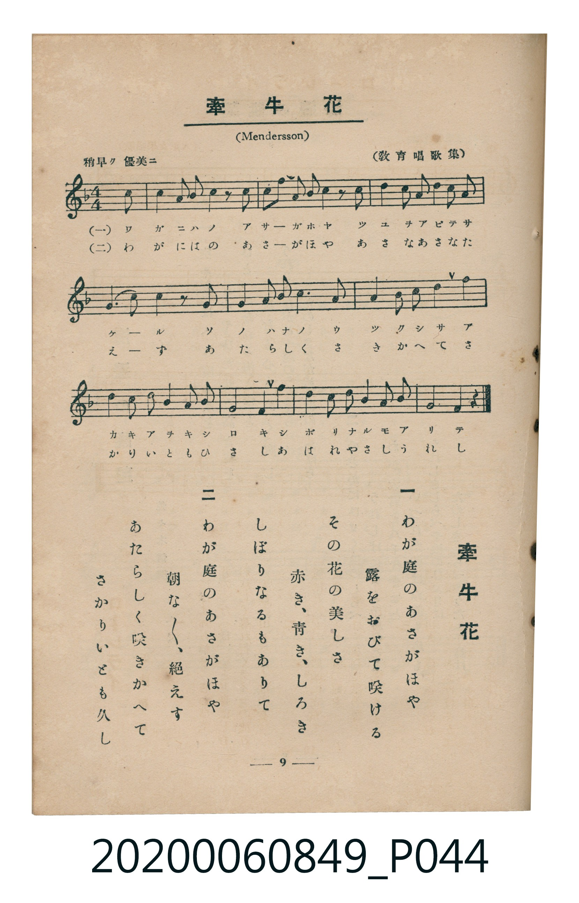

# 牽牛花

<audio controls src="kengyuka.mp3"></audio>

- 曲：Mendelssohn（教育唱歌集）
- 臺灣教育會公認《新定兒童唱歌》高等科女子用（2020.006.0849）

## 說明

原書資訊與歌詞全文（對應 P044.jpg，書頁 p. 9，高一第一學期第 7 首）：
調性與拍號：ヘ長調（1 降記號）、4/4 拍（稍早ク 優美ニ，弱起第 4 拍後半進入）

## 歌詞

```text
一
わが庭（には）のあさがほや
露（つゆ）をおびて咲（さ）ける
その花（はな）の美（うつく）しさ
赤（あか）き、青（あを）き、しろき
しぼりなるもありて　やさしうれし

二
わが庭のあさがほや
朝（あさ）な／＼、絶（た）えず
あたらしく咲きかへて
さかりいとも久（ひさ）し
あはれやさしうれし
```

## ABC

```abc
X:1
T:牽牛花
C:曲：Mendelssohn（教育唱歌集）
M:4/4
L:1/16
Q:1/4=108
K:F
V:V1 name="Piano" snm="Pia"
[V:V1]
!mf! z4 z4 z4 z2 C2 | A4 G2 F2 F4 z2 F2 | G2 d2 c2 B2 A4 z2 F2 | d4 c2 B2 A2 G2 A2 B2 |
A6 G2 G4 z2 C2 | A4 G2 F2 F6 A2 | c4 B2 G2 F4 E2 F2 | G2 F2 E2 F2 B4 A2 G2 |
F4 E4 D4 D2 D2 | D2 B2 G2 D2 C4 F2 A2 | G8 F4 z4 | !mf! z4 z4 z4 z2 C2 |
A4 G2 F2 F4 z2 F2 | G2 d2 c2 B2 A4 z2 F2 | d4 c2 B2 A2 G2 A2 B2 | A6 G2 G4 z2 C2 |
A4 G2 F2 F6 A2 | c4 B2 G2 F4 E2 F2 | G2 F2 E2 F2 B4 A2 G2 | F4 E4 D4 D2 D2 |
D2 B2 G2 D2 C4 F2 A2 | G8 F4 z4 |
```

## TMD 檔案連結

- [主旋律 TMD 檔案](kengyuka.tmd)
- [鋼琴伴奏 TMD 檔案](kengyuka_piano.tmd)

## 分析

```text
================================================================================
📊 TMD Song Profile: [ 牽牛花 ]
================================================================================
⏱  Duration:       0:48 (48.9s), 22 measures total
🎼 Key & Tempo:    首調基準 F, != 108.0 BPM, <4/4>
   - 分析範圍：      由實際發聲的音符與和弦推測調性；播放脈絡另行呈現
🎤 人聲音域:    C4 (MIDI 60) – D5 (MIDI 74) [跨度: 14 個半音 / 1.2 個八度, 難度: moderate]
   - 最低音:  C4 in [Main #1 @ m.1, 0:01]
   - 最高音: D5 in [Main #1 @ m.3, 0:04]
   - 適合: soprano, mezzo-soprano, contralto, tenor, baritone, bass
🏛  結構:      Main (24.4s) -> Main (24.4s)
⚡ 編曲密度:        Peak 1 軌道同時演奏
🗝  調性診斷：       F 大調（純淨自然大調，未偵測到可信轉調）
   - 風格氣質:    純淨自然大調（陽光明朗、易唱易記，無明顯調外色彩）
   - 轉調歷程:    全曲維持單一推測調性（未偵測到可信轉調）
   - 核心骨幹音:  F, G, A, D, C
   - 調性數值:    F 大調 [相關度: 0.85, 穩定度: High, 自然音純度: 100.0%]
   - 候選調性 (K-S): F 大調 (0.85), D 小調 (0.72), C 大調 (0.58)
   - 五度圈歷程:   -1 -> -1
   - 各段落調性細節:
     • [Main #1]: F 大調 (r: 0.85, 自然音純度: 100.0%)
     • [Main #2]: F 大調 (r: 0.85, 自然音純度: 100.0%)

  [ 五度圈游移軌跡 ]
               C  
        [F ]*          G  
      Bb               D  
      Eb               A  
         Ab           E  
            Db       B  
               F# 
     (* = active key center)

  [ 十二半音累積音高分佈 ]
     C  : ██████████                10.5%
     C# :                            0.0%
     D  : ███████████               11.8%
     D# :                            0.0%
     E  : █████                      5.3%
     F  : ████████████████████████  25.0%
     F# :                            0.0%
     G  : ███████████████████       19.7%
     G# :                            0.0%
     A  : ██████████████████        18.4%
     A# : █████████                  9.2%
     B  :                            0.0%
--------------------------------------------------------------------------------
Assignment 軌道音域：
  - Piano         : C4 – D5 (14 個半音 / 1.2 個八度, 110 個音符)
================================================================================
```


## 原書掃描頁




