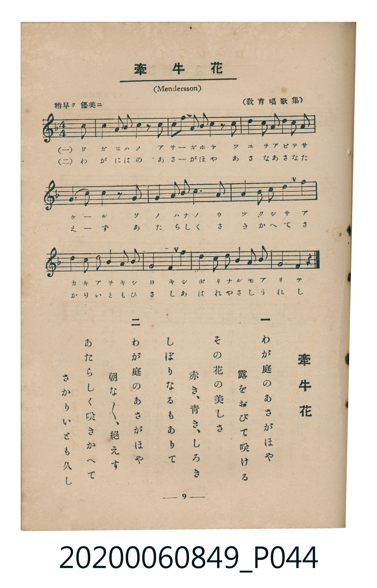

# 牽牛花

> Re:Shōka 使用 AI 協助辨識與重建樂譜，可能會有錯誤。歡迎回報。

- **鋼琴伴奏版**：<br><audio controls src="kengyuka.mp3"></audio>

- 曲：Mendelssohn（教育唱歌集）
- 臺灣教育會公認《新定兒童唱歌》高等科女子用（2020.006.0849）

## 說明

原書資訊與歌詞全文（對應 P044.jpg，書頁 p. 9，高一第一學期第 7 首）：
調性與拍號：ヘ長調（1 降記號）、4/4 拍（稍早ク 優美ニ，弱起第 4 拍後半進入）


## 歌詞

```text
一
わが庭（には）のあさがほや
露（つゆ）をおびて咲（さ）ける
その花（はな）の美（うつく）しさ
赤（あか）き、青（あを）き、しろき
しぼりなるもありて　やさしうれし

二
わが庭のあさがほや
朝（あさ）な／＼、絶（た）えず
あたらしく咲きかへて
さかりいとも久（ひさ）し
あはれやさしうれし
```

## ABC

<div class="abc-score" data-abc-src="kengyuka.abc" aria-label="五線譜載入中"></div>

[下載 ABC 原始檔](kengyuka.abc)

## TMD 檔案連結

- [主旋律 TMD 檔案](kengyuka.tmd) [[在 TMD Studio 編輯](https://tmdlang.github.io/Tmd-TS/#tmd=s7IKdvYPcrWy4qpTUCpJTLdSSM7PyUlNLsnMz7MqzsjMK0nNjM_KTMmPL87Iz05Ugisry88pzU21ys4vyY9PzyzKKY43MjAyiDcwMIs3sDCxRCgszi8tSk61Kk7OyM_PiS9JrShJys_PRsgXFOWXpeYl5gHVFBSB7EsBK0IoSC3LTEkFSaemZJbkF2Um5iC5IrWoGOxSsCXxJUWJecXJRZkFIOcjVJVkpAKdWpCTmIdkLNCk9Mw8q9zUzKxMLM6CSpenFpekFuXF56bm5KdUKnFpaSk879z7vHP2i66NClpaXIq2CoYGFlz2tgpuXDYm-iZ2IAOezd70fs8s39S8lNSc4uL8jLz3ezqeTZ35omnT0ykbn63teTm77f2eTrBdL9p3PW9cDJF8Nqf5aeuaF6t6Hzd0PZu24em6WU9bJz1fvRSi6XFD98vVM56v7Xy-fOLTpZufrp3wfMoKoMGgYNcDBrseKNjBxnLpaynYUgtwKSgoPO2b_2z2jheb21-s6HrR0Q50zIuV8562rng2rR3ogKcbep-1dyoEGJiY6GUVpL_f0wNU_HJBo0KBngLQQT1AVz_Z0fB8zRog-XTtjmdz5gPZCuYKL5dNAzoXGFAgK16s2v-sYTnI8O7eFzPnA0UfN894OXU7UBxohaHCy5m9L1bMAMt0Pm5oBIa0AlAlUOr5it5n01c-blqv8LRl1fN9fY-bu4F2Pt2z8cXW7SB7wOqe7ut52tv1smHT09alQAO4QDYCXQOiHjf1P27sebprLdCsx42rHzeuB9nQuO5xY9PjxqlAqceNux83tYCUvpwDjFagoiWPm0Dx97hp0uPGrseNmx83Lns6CSI1Fax54uOmbrDZjXOBJgFTClhu_ePGVRCzgc4Ei7SBzGrsBwtOB2oGB8TWJWA5oO1AjwAlgKmh8eXcSVDBJiADKgjS09QLZEOsAhqw53ET0D2rgLY_bgLqB6oGcpc9bmgAegDsGaCatsdNQC9NhwTBrh6UIMDu7Wdz5sJcBPEe0BdAN-8BOuH51m1gKXCsNAIZ4LgEK53_uAniq35g2IAc3Nj9uHEH0DkQFUArgI4EOg_osBVA1z7Z2Qo2CagUYsl0uEnrQS7G9ABQmvLUDQUKWvpcXL6JwPwekJmYl-9QY1BTDbJAwcZCyw7MAGYpSJp6uqH_-foGkAaQcI2CgYIuEq7OTatVMI1XqAGHL0gXJN2_WNiD0GIMVGqkYAiEIC2GQBEjBTMFU2BSBclARMyALIiIERCboBm4qwfDQJCRRmDtIOtR7NAF8mqApukCzQGJ6SqYx4MsQXVjJ4qRIHVgVSZg7UZAIahGXQUzKAFEQIfGg00FUkB7dYGKQHaBHAKCEB_qAq2q5eLStVMABbECkFbmAgA)]
- [鋼琴伴奏 TMD 檔案](kengyuka_piano.tmd) [[在 TMD Studio 編輯](https://tmdlang.github.io/Tmd-TS/#tmd=s7IKdvYPcrWy4tLSUnjeufd55-wXXRvf7-l42b3n-YQtT_Zsebq0_3lnx_s9nQpaWlyKtgqGBhZc9rYKblw2Jvomdlx1CkrPZm96v2eWb2peSmpOcXF-Rh5Q-7OpM180bXo6ZeOztT0vZ7cBtSuBlL5o3_W8cTFE8tmc5qeta16s6n3c0PVs2oan62Y9bZ30fPVSiKbHDd0vV894vrbz-fKJT5dufrp2wvMpK4AGGxkYGegZGJjpGViYWIKN5fJNzMyzCshMzMsP8nCoMaip5lIAAhsLLTswQ19L4emejS-2bn-6of_5-gYFLX2wcI2CgYIuEq7OTatVMI1XqOGC6Xq-Zs2THQ0vFvYgtBgDlRopGAIhSIshUMRIwUzBVMEELAMRMQOyICJGQGyCZuCuHgwDQUYagbWDrEexQxfIqwGapgs0BySmq2AeD7IE1Y2dKEaC1IFVmYC1GwGFoBp1FcygBBABHRoPNhVIAe3VBSoC2QVyCAhCfKgLtKoWOYR9kEPYhHAIQyDeMDUEWR5tGAuyTMEEFwdfIJrGgxWaxseC7EI1ECqHxRC0YEMyBKQPaAhIxAwsCgwWEAVRgmwmyGvA8NG1UwAFkQISrcwFAA)]

## 分析

```text
================================================================================
📊 TMD Song Profile: [ 牽牛花 ]
================================================================================
⏱  Duration:       0:24 (24.4s), 11 measures total
🎼 Key & Tempo:    首調基準 F, != 108.0 BPM, <4/4>
   - 分析範圍：      由實際發聲的音符與和弦推測調性；播放脈絡另行呈現
🎤 人聲音域:    C4 (MIDI 60) – D5 (MIDI 74) [跨度: 14 個半音 / 1.2 個八度, 難度: moderate]
   - 最低音:  C4 in [Main #1 @ m.1, 0:01]
   - 最高音: D5 in [Main #1 @ m.3, 0:04]
   - 適合: soprano, mezzo-soprano, contralto, tenor, baritone, bass
🏛  結構:      Main (24.4s)
⚡ 編曲密度:        Peak 1 軌道同時演奏
🗝  調性診斷：       F 大調（純淨自然大調，未偵測到可信轉調）
   - 風格氣質:    純淨自然大調（陽光明朗、易唱易記，無明顯調外色彩）
   - 轉調歷程:    全曲維持單一推測調性（未偵測到可信轉調）
   - 核心骨幹音:  F, G, A, D, C
   - 調性數值:    F 大調 [相關度: 0.85, 穩定度: High, 自然音純度: 100.0%]
   - 候選調性 (K-S): F 大調 (0.85), D 小調 (0.72), C 大調 (0.58)
   - 五度圈歷程:   -1
   - 各段落調性細節:
     • [Main #1]: F 大調 (r: 0.85, 自然音純度: 100.0%)

  [ 五度圈游移軌跡 ]
               C  
        [F ]*          G  
      Bb               D  
      Eb               A  
         Ab           E  
            Db       B  
               F# 
     (* = active key center)

  [ 十二半音累積音高分佈 ]
     C  : ██████████                10.5%
     C# :                            0.0%
     D  : ███████████               11.8%
     D# :                            0.0%
     E  : █████                      5.3%
     F  : ████████████████████████  25.0%
     F# :                            0.0%
     G  : ███████████████████       19.7%
     G# :                            0.0%
     A  : ██████████████████        18.4%
     A# : █████████                  9.2%
     B  :                            0.0%
--------------------------------------------------------------------------------
Assignment 軌道音域：
  - Piano         : C4 – D5 (14 個半音 / 1.2 個八度, 55 個音符)
================================================================================
```


## 原書掃描頁




