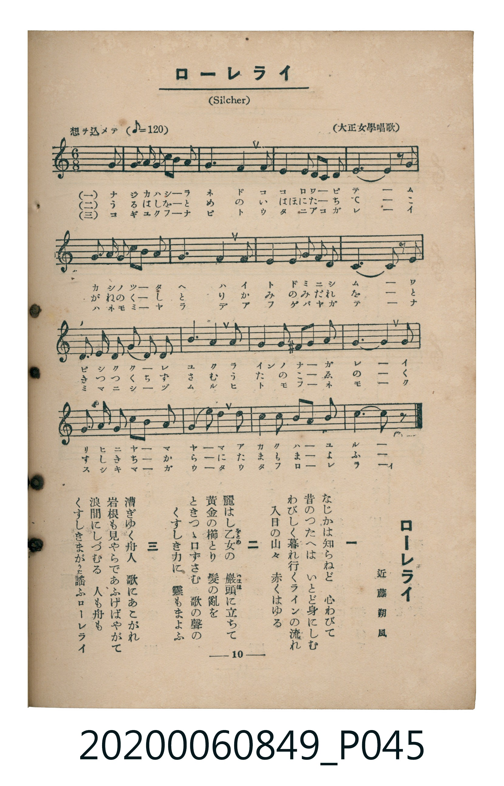

# ローレライ

> Re:Shoka 使用 AI 協助辨識與重建樂譜，可能會有錯誤。歡迎回報。

<audio controls src="rorerai.mp3"></audio>

- 詞：近藤朔風
- 曲：Friedrich Silcher（大正女學唱歌）
- 臺灣教育會公認《新定兒童唱歌》高等科女子用（2020.006.0849）

## 說明

原書資訊與歌詞全文（對應 P045.jpg，書頁 p. 10，高一第一學期第 8 首）：
調性與拍號：ハ長調（無升降記號）、6/8 拍（想ヲ込メテ ♪=120，折合附點四分音符 ♩.=60，弱起第 6 拍進入）

## 歌詞

```text
一
なじかは知（し）らねど　心（こころ）わびて
昔（むかし）のつたへは　いとど身（み）にしむ
わびしく暮（く）れ行（ゆ）くラインの流（なが）れ
入日（いりひ）の山々（やまやま）　赤（あか）くはゆる

二
麗（うる）はし乙女（をとめ）の　巖頭（いはほ）に立（た）ちて
黃金（こがね）の櫛（くし）とり　髪（かみ）の亂（みだ）れを
ときつゝ口（くち）ずさむ　歌（うた）の聲（こゑ）の
くすしき力（ちから）に　靈（たま）もまよふ

三
漕（こ）ぎゆく舟人（ふなびと）　歌にあこがれ
岩根（いはね）も見（み）やらであふげばやがて
浪間（なみま）にしづむる　人（ひと）も舟も
くすしきまがうた謠（うた）ふローレライ
```

## ABC

```abc
X:1
T:ローレライ
C:曲：Friedrich Silcher（大正女學唱歌）
M:6/8
L:1/16
Q:3/8=40
K:C
V:V1 name="Piano" snm="Pia"
[V:V1]
!mf! z2 z2 z2 z2 z2 G,2 | E3 F E2 G3 F E2 | D4 C2 A,4 A,2 | G,4 G,2 A,2 G,2 A,2 |
D10 G,2 | E3 F E2 G3 F E2 | D4 C2 A,4 A,2 | G,4 C2 D3 E D2 |
C10 C2 | D4 D2 B,3 B, D2 | G4 F2 E4 E2 | B,4 B,2 D3 C A,2 |
G,10 G,2 | E3 F E2 G3 F E2 | A4 A2 G4 E2 | G4 F2 D3 E D2 |
C10 z2 |
```

## TMD 檔案連結

- [主旋律 TMD 檔案](rorerai.tmd) [[在 TMD Studio 編輯](https://tmdlang.github.io/Tmd-TS/#tmd=s7IKdvYPcrWy4qpTUCpJTLdSSM7PyUlNLsnMz7MqzsjMK0nNjM_KTMmPL87Iz05Ugisry88pzU21ys4vyY9PzyzKKY43MjAyiDcwMIs3sDCxRCgszi8tSk61Kk7OyM_PiS9JrShJys_PRsgXFOWXpeYl5gHVFBSB7EsBK0IoSC3LTEkFSaemZJbkF2Um5iC5IrWoGOxSsCXxJUWJecXJRZkFIOcjVJVkpAKdmpafk52TX5SKLl6eWJJapMSlpaXwuHnt4-Y9j5vXPG5e-bhpiYKWFpeirYKZAZe9rYIzl42ZvoUdSO-LlfPe75n1Yv_EF9OXPJsz5eWiFWAjn83eBBR2K8pMTSnKTM5QCM7MSc5ILXq_p-PpkuXP1i5-unTz07U7nk7Z-Gxtz_s9nWA9L9p3PW9c_GzqzBdNm57NaX7auubFqt7HDV3Ppm14um7W09ZJz1cvheh43ND9cvWM52s7ny-fCDZpwvMpK4Bmg0JdDxjqeqBQBxvLpa-lYEstwKWgoPC0b_6z2TtebG5_saLrRUc70DHAEHjauuLZtHaQ5zb0PmvvVAgwMDHVyypIf7-nB6j45YJGhQI9BUMDIBfo7Cc7Gp6vWQMkgQHwbM58IFvBQuHlsmlA9wKDDGTHi1X7nzUsB5ne3fti5nyg6OPm_pdTtwPFgXY8b1n4tLf95czeFytmgGU7Hzc0AqNDAagaKP2sefPj5k0v9gGjbuHj5jaFRzNX2Roagex-1jXj6YSOlzNbXu6e93T27KcdbS_nb36-ZhlQyUo9WzOQkqd7Nr7Yuh3kJDOQcS8bNj1tXQq0gQvkLKCTQdTjxlWPG2c8bux-3Lj--XygbMfjxukgVzR1Pm5c-7hx5eOGhqf7m8Hik0GoCegsoGz_48bNjxuXgYx4NmMKSLqpAWwKWHPjuseNSx43zn_cuANoLtCIx40tjxtXAI17sWs12Cyg34HKVgPVAzWCHQI1cvrjxv5ns9aBFfWDrep5sRCYqoAWtIH19EOS8GNgyDSue7a1EawS6AlQygMqBkdr69Jn0yF-aXnc1PW4EZh8QY56unHj44ZWsFlA5-yDkOAgb3ixdQlYfRPQE1BrgA5vanvc1A0Jrl1gk1_uAvoPqAwkDla2HujiJztnAtMt2NhJIF82Ad0EDgNg0G2f9nLBWqhLQIp3Q_z9fDVQO1AQHOGNC6Eh-XJ388v2ibCw7gFGAMSgZ6tnQ8IDFrxAO7qApr9cvQosDgx2SHiue7KrCRK8jxsXQMID6CZIPANDvxcUK01zn_Yvhhm3EKxt1uPGqaD4a2gAZ2Cw_6BOW_cCFHhgBzUBXQYSgRgH1DwTHFu9T7sgrgP6ohuYbKARC3Td3A6IH6GB3AQMW2CYA0W2QlNgJzj57JkKsQCssQ8U5o39LzrmP9m1Cyy-FRy7wMgGlgmgmAKVGKCEAzQNHEjQKN-08tmCnUgBDQ66pqYXyyABDQ4fYHyDkvVysGagucDY2gBOBEATIUl566qX04AOgaQoYCCCHQ5Jpo1LQUHU1A10Asxpm6COAlrTMR9IoocMyL8gs0Gh-WINMEKQQ3YrWpkM0kx5qQYFClr6XFy-iZl5VgGZiXn5DjUGNQrVIBsUbAzNtOzALGBhCikhnm7of76-AaQFJFyjYKCgi4Grc9NqFUzjgawacOSBdEMKPmDuRGg1BirQVTAB06ZI7BoFIzBPV8EQiM1A5oAgmFEDMRcEwQywIIKF0IoMsThlF6igoJpTQJIQhcZgugYsgg5BYmgB0oniCphdINocYjaQghgIcRXIXSBLIGyIC6EqoVogZhhiOBF_eAArBSLDwwwWBHAZmDuQXUg4MEDppIarlotL104BlPYUgLQyFwA)]
- [鋼琴伴奏 TMD 檔案](rorerai_piano.tmd) [[在 TMD Studio 編輯](https://tmdlang.github.io/Tmd-TS/#tmd=s7IKdvYPcrWy4tLSUnjcvPZx857HzWseN6983LTk_Z6Ol917nk_Y8mTPlqdL-593drzf06mgpcWlaKtgZsBlb6vgzGVjpm9hx1WnoPRi5bz3e2a92D_xxfQlz-ZMeblohRJI-NnsTUBht6LM1JSizOQMheDMnOSM1CKg0U-XLH-2dvHTpZufrt3xdMrGZ2t7gKaD9bxo3_W8cfGzqTNfNG16Nqf5aeuaF6t6Hzd0PZu24em6WU9bJz1fvRSi43FD98vVM56v7Xy-fCLYpAnPp6wAmm1kYGSgZ2BgpmdgYWIJNpbLNzEzzyogMzEvP8jDocagRqGaSwEIbAzNtOzALH0thad7Nr7Yuv3phv7n6xsUtPTBwjUKBgq6GLg6N61WwTQeyKrhgul-vmbNkx0NLxb2ILQaAxXoKpiAaVMkdo2CEZinq2AIxGYgc0AQzKiBmAuCYAZYEMFCaEWGWJyyq4eaTgFJQhQag-kasAg6BImhBUgniitgdoFoc4jZQApiIMRVIHeBLIGwIS6EqoRqgZhhiOFE_OHxdPZsIsPDDBYEcBmYO5BdSDgwQOmkhqsWOen5oCQ9C-JSHoTEm84M40E-No5HMGoUTOLBXBMQgrGwqzQFyhuBuSAWpmVoKYl4y0DGwdTBrEDVj8VnqAkG1W3YjIA5ASgHTBEm6mBVUBZBv6GnCvx-wxlmuL0GjH5dOwVQClDAQitzAQA)]

## 分析

```text
================================================================================
📊 TMD Song Profile: [ ローレライ ]
================================================================================
⏱  Duration:       0:51 (51.0s), 17 measures total
🎼 Key & Tempo:    首調基準 C, != 60.0 BPM, <6/8>
   - 分析範圍：      由實際發聲的音符與和弦推測調性；播放脈絡另行呈現
🎤 人聲音域:    G3 (MIDI 55) – A4 (MIDI 69) [跨度: 14 個半音 / 1.2 個八度, 難度: moderate]
   - 最低音:  G3 in [Main #1 @ m.1, 0:02]
   - 最高音: A4 in [Main #1 @ m.15, 0:42]
   - 適合: mezzo-soprano, contralto, tenor, baritone, bass
🏛  結構:      Main (51.0s)
⚡ 編曲密度:        Peak 1 軌道同時演奏
🗝  調性診斷：       G 大調（流行色彩大調，未偵測到可信轉調）
   - 風格氣質:    流行大調（略帶和弦色彩音與裝飾副屬和弦）
   - 轉調歷程:    全曲維持單一推測調性（未偵測到可信轉調）
   - 核心骨幹音:  G, D, E, C, A
   - 調性數值:    G 大調 [相關度: 0.89, 穩定度: Moderate, 自然音純度: 94.8%]
   - 候選調性 (K-S): G 大調 (0.89), C 大調 (0.78), E 小調 (0.65)
   - 五度圈歷程:   +1
   - 各段落調性細節:
     • [Main #1]: G 大調 (r: 0.89, 自然音純度: 94.8%, 調外音: F)

  [ 五度圈游移軌跡 ]
               C  
         F           [G ]*
      Bb               D  
      Eb               A  
         Ab           E  
            Db       B  
               F# 
     (* = active key center)

  [ 十二半音累積音高分佈 ]
     C  : ██████████████            15.1%
     C# :                            0.0%
     D  : ███████████████████       20.3%
     D# :                            0.0%
     E  : ███████████████           16.1%
     F  : █████                      5.2%
     F# :                            0.0%
     G  : ████████████████████████  25.5%
     G# :                            0.0%
     A  : ████████████              12.5%
     A# :                            0.0%
     B  : █████                      5.2%
--------------------------------------------------------------------------------
Assignment 軌道音域：
  - Piano         : G3 – A4 (14 個半音 / 1.2 個八度, 67 個音符)
================================================================================
```


## 原書掃描頁




