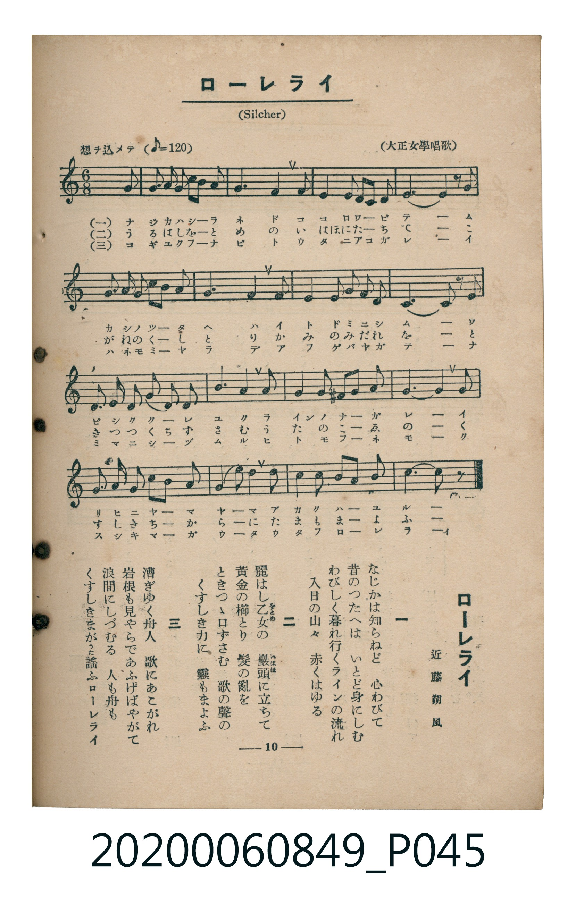

# ローレライ

> Re:Shōka 使用 AI 協助辨識與重建樂譜，可能會有錯誤。歡迎回報。

- **鋼琴伴奏版**：<br><audio controls src="rorerai.mp3"></audio>

- 詞：近藤朔風
- 曲：Friedrich Silcher
- 出處：（大正女學唱歌）
- 臺灣教育會公認《新定兒童唱歌》高等科女子用（2020.006.0849）

## 說明

原書資訊與歌詞全文（對應 P045.jpg，書頁 p. 10，高一第一學期第 8 首）：
調性與拍號：ハ長調（無升降記號）、6/8 拍（想ヲ込メテ ♪=120，折合附點四分音符 ♩.=60，弱起第 6 拍進入）
出處註記：（大正女學唱歌）
註：第一段末句譜面作「イリヒニヤマヤマ」，底欄歌詞作「入日の山々」。


## 歌詞

```text
一
なじかは知らねど　心わびて
昔のつたへは　いとど身にしむ
わびしく暮れ行くラインの流れ
入日の山々　赤くはゆる

二
麗はし乙女（をとめ）の　巖頭（いはほ）に立ちて
黃金（こがね）の櫛とり　髪の亂を
ときつゝ口ずさむ　歌の聲の
くすしき力に　靈もまよふ

三
漕ぎゆく舟人　歌にあこがれ
岩根も見やらであふげばやがて
浪間にしづむる　人も舟も
くすしきまがうた（うた）謠ふローレライ
```

## ABC

<div class="abc-score" data-abc-src="rorerai.abc" aria-label="五線譜載入中"></div>

[下載 ABC 原始檔](rorerai.abc)

## TMD 檔案連結

- [主旋律 TMD 檔案](rorerai.tmd) [[在 TMD Studio 編輯](https://tmdlang.github.io/Tmd-TS/#tmd=s7IKdvYPcrWy4qpTUCpJTLdSSM7PyUlNLsnMz7MqzsjMK0nNjM_KTMmPL87Iz05Ugisry88pzU21ys4vyY9PzyzKKY43MjAyiDcwMIs3sDCxRCgszi8tSk61Kk7OyM_PiS9JrShJys_PRpePL0hMT7UKMDAxRcgUFOWXpeYl5gF1FxSBXJIC1o5QkFqWmZIKki5OTsyLL0stykzLTE1BcmNqUTHYHxArSooS84qTizILQJ5DqMovKsnITy9KLMiotMrILC7JL8pMTsyJz07MQ_JuSUYq0Ldp-TnZOflFqeji5YklqUXIJmamZ-ZZlacWA4Xz4nNTc_JTKjGkSxIzgWEKCtfyxPjcxMy8nMQ8oOO1tBQeN6993LzncfOax80rHzctUdDS4lK0VTAz4LK3VXDmsjHTt7ADGfZi5bz3e2a92D_xxfQlz-ZMebloBdiOZ7M3AYXdioBBAfRJhkJwZk5yBtR5T9t3vZg5FSj9fk_H0yXLn61d_HTp5qdrdzydsvHZ2p73ezrBql6073reuPjZ1JkvmjY9m9P8tHXNi1W9jxu6nk3b8HTdrKetk56vXgrR8bih--XqGc_Xdj5fPhFs0oTnU1YAzQalBT1gWtADpQWwsVz6Wgq21AJcCgoKT_vmP5u948Xm9hcrul50tAMdAwyPp60rnk1rB3luQ--z9k4FUILSyypIf7-nB6j45YJGhQI9BUMDIBfo7Cc7Gp6vWQMkgQHwbM58IFvBQuHlsmlA9wJDCGTHi1X7nzUsB5ne3fti5nyg6OPm_pdTtwPFgXY8b1n4tLf95czeFytmgGU7Hzc0AiNHAagaKP2sefPj5k0v9gEjcuHj5jaFRzNX2Roagex-1jXj6YSOlzNbXu6e93T27KcdbS_nb36-ZhlQyUo9WzOQkqd7Nr7Yuh3kJDOQcS8bNj1tXQq0AexzcCS-WLEbaC-eqAR7YMVuoAqIL5-t2_pszuqn_UtfrJ3zcu6iJ3vnPG7oASavx82rHjdPetzc_bgZyJ4HJRuAXuh5umvqszUtkKCFqAe64tn0pY8b1z3duPFxQytQ2eOGJi6QVUAbQNTjxlWPG2c8bux-3Lj--fylj5s6Hzeufdy48nFDw9P9zY-b-h83bn7cuAyk9NmMKUCDHjcuedw4_3HjDqAGoKLHjS2PG1cANbzYtfpxIxBNf9wEMRiqdfrjxv5ns9Y9bup5sbAHyIbkkcfAwG5c92xrI1AcHEbo7mx4sRVoD9CI9Y-b2h43dUPcvAus-OUuoKHrgUY_2TkTGIjAAH3cNAnkiqZGUKQC3Qh0_PZpLxesBUmBHAhUDAxYoNTq56uBPl0I9dHL3c0v2yeCFU1-3Ah0HVADSP-z1bPBxnUBDXq5GhhA657sagLaAQkwoG97QaHQNPdp_-LHjbMeN04F-hmoFJTBGte9aNwEJCFKge6fCQ6C3qddQCNXg8ybC3Rt0-PGfY-bgNZuhcYFOPaf7Zn6uLEP5N_G_hcd85_s2gUzFBiuQC1gN0LDa9PKZwt2Ag16saz7cVMLONqWgxVtfdwIDIsNIEGQjyAxt3XVy2lA3eDoaQRGcgMwRIFmg2wAGtExH0iiOxjkQpABQMcAswrQqRBG54s1C0CWoBZ5IM2UFxNQoKClz8UVBCy2ixIzrQIyE_PyHWp0DWuqQZYo2BiaadmBWdgKKAVI1gGmNAUNSJZU0FYwUXi6of_5-gYdePGiiUUn0FKQqTUKBgq6GNgUiGvApC4wg4NowzggYQ7mIqQg0ASJrlEwhvJAtBFII5RGyMAg3CKwQ3wMaxTigTx0_Li5C6z7cdMOsK7HTauBYv1g1naw_B4wuRKiqrkXyYbHzZ0wVtNmqCkgGiK3FkyuRzJjMtSMNjSXQtyxAOFWIxxubQTpBNnSDbGjcT0QTwfbPwlhT-MKqKpGZLc2roOzWiDyQN0wkd3AxAxmzEcyZiFU2TJszm0EewbiXGMczoUHCsTqx83LgGxIgExFChZoBICDBxG0HTBWE8h-kCn74XIg7z9uWgS343HTGqgZIBrDrcA2BMit-JP5LlCBqqBBYuqmOA2DVIFEIWkYlJrR0zBIFSINg9InJFi2A73bBw4OUHxCAxMcSKCAmIESmKD0DNEFDgrk4AWn4cfNkIiHBCwo3YPUgFIkZjoFRSAinQILNYg5jWuhaQxY6iHcA06dIFWgNAl3TxMoyiG6QDaC5OGRCzUDxH_cCHIBsIiGqAGnccyECE7t8IQI8ysopz5uBicRqN8giQ3mf1B-RoRPO9xlIB0geVAChYhsAquYANeNSGzY8zE4ORNIbDs6yUlsoDQCSg8gGpRuQDQk3YBSHQyCUh-MRqRCcDpThzIwEygMohaYsDwJTmyQnAvNv5DAhAUEcgkBUQEJVmihCW6fwAUhaRYUSrA0iyvzQoyDZF5EeuuFiDcuAWN4egMXV8DmA8SsRlj8QcxogLFgJSi4oIOIQNIbyKMw90yEqoGVmCjuAduGnN4gJgEbjSj5BxZErVC_Ieelx82QPAxigdI0an6EpFnkAhLkY5AakAxm-EDyI970Bmxl06hwAwuDCRAEyQMLMRgXzDCCaQQzkGSRIaicQ052q-ChAw1TSM6Dhsc8aHiAxCDqEOKQMIHmYmhZiUi2SCUTONGCTIGpQYagnIyc5mZCTAGWZpD0B01t0DIOWoY1wVsDUHG47eDUBjJnH9w9TWBxEB-W6kApAKRmK373gNJc006oKaBsuRbud7T8BK44kdyDqECxVKmQ9AYxCzVzg_vguJxUy8Wla6cAbV0qAJnKXAA)]
- [鋼琴伴奏 TMD 檔案](rorerai_piano.tmd) [[在 TMD Studio 編輯](https://tmdlang.github.io/Tmd-TS/#tmd=s7IKdvYPcrWy4qpTUCpJTLdSSM7PyUlNLsnMz7MqzsjMK0nNjM_KTMmPL87Iz05Ugisry88pzU21ys4vyY9PzyzKKY43MjAyiDcwMIs3sDCxRCgszi8tSk61Kk7OyM_PiS9JrShJys_PRpePL0hMT7UKMDAxRcgUFOWXpeYl5gF1FxSBXJIC1o5QkFqWmZIKki5OTsyLL0stykzLTE1BcmNqUTHYHxArSooS84qTizILQJ5DqMovKsnITy9KLMiotMrILC7JL8pMTsyJz07MQ_JuYhFQc3pqbmpeiVVBZmJefnxicnJ-bkFiXiZIDKGwJAOoyCotPyc7J78oFV28PLEktQjZ6sz0zDyr8tRioHBefG5qTn5KJYZ0SWImMPBBEVCeGJ-bmJmXk5gH9KWWlsLj5rWPm_c8bl7zuHnl46Yl7_d0vOze83zClid7tjxd2v-8s-P9nk4FLS0uRVsFMwMue1sFZy4bM30LO5ANL1bOe79n1ov9E19MX_JszpSXi1aALX42exNQ2K0IGJDAcMhQCM7MSc6Auvlp-64XM6cCpYEWPV2y_NnaxU-Xbn66dsfTKRufre0B2gVW9aJ91_PGxc-mznzRtOnZnOanrWterOp93ND1bNqGp-tmPW2d9Hz1UoiOxw3dL1fPeL628_nyiWCTJjyfsgJoNigl6QFTkh4oJYGN5QoCBmZRYqZVACjsgzwcanQNa6q5FIDAxtBMyw7M0tdSsEUHCs_XrHmyo-HFwh4Fjad7Nr7Yul1BW8FE4emG_ufrG3QUQAlOL6sgXROLTi19sKk1CgYKuhjYFIhrwKSughmYNowDEuZgLkIKAk2Q6BoFYygPRBuBNEJphAwMwi0CO8THsEYhHshDx4-bu8C6HzftAOt63LQaKNYPZm0Hy-8Bkyshqpp7kWx43NwJYzVthpoCoiFya8HkeiQzJkPNaENzKcQdCxBuNcLh1kaQTpAt3RA7GtcD8XSw_ZMQ9jSugKpqRHZr4zo4qwUiD9QNE9n9uHE1mDEfyZiFUGXLsDm3EewZiHONcTgXHigQqx83LwOyIQEyFSlYoBEADh5E0HbAWE0g-0Gm7IfLgbz_uGkR3I7HTWugZoBoDLc2LQG7FX8y39UDTuYkpm6K0zBIFUgUkoZBqRk9DYNUIdIwKH1CgmU70Lt94OAAxSc0MMGBBAqIGSiBCUrPEF3goEAOXnAaftwMiXhIwILSPUgNKEViplNQBCLS6ePGHog5jWuhaexxIzj3QBMRKHWCVIHSJNw9TaAoh-gC2QiSh0cu1AwQ_3EjyAWPm0A2gHwOSuOYCRGc2uEJEeZXUE593AxOIlC_QRIbzP-g_IwIn3a4y0A6QPKgBAoR2QRWMQGuG5HYsOdjcHImkNh2dJKT2EBpBJQeQDQo3YBoSLoBpToYBKU-GI1IheB0pg5lYCZQGEQtMGF5EpzYIDkXmn8hgQkLCOQSAqICEqzQQrNpyeNmRLkISbOgUIKlWVyZF2IcJPMi0lsvRLxxCRjD0xu4uHrcOAtiViMs_iBmNMBYsBIUXNBBRCDpDeRRmHsmQtXASkwU94BtQ05vEJMeN89DyT-wIGqF-g05Lz1uhuRhEAuUplHzIyTNIheQIB-D1IBkMMMHkh_xprens2fTqHADC4MJEATJAwsxGBfMMIJpBDOQZJEhqJxDTnar4KEDDVNIzoOGxzxoeIDEIOoQ4pAwgeZiaFmJSLZIJRM40YJMgalBhqCcjJzmZkJMAZZmkPQHTW3QMg5ahjXBWwNQcbjt4NQGMmcf3D1NYHEQH5bqQCkApGYrfveA0lzTTqgpoGy5Fu53tPwErjiR3IOoQLFUqZD0BjELNXOD2sY4nVSL1rj0QWlcWiDaloiWJFrLEEIC0wXIQGABFA-h4QIm6AIYKsAU0Ah4HkBU53C7qGw6pPxGZBSoJoRmGMuICBEIjWYFNMtS0wPAuNK1U4BGV7SPYawCMtcIlWsM5ipzAQA)]

## 分析

```text
================================================================================
📊 TMD Song Profile: [ ローレライ ]
================================================================================
⏱  Duration:       0:48 (48.0s), 16 measures total
🎼 Key & Tempo:    首調基準 C, != 60.0 BPM, <6/8>
   - 分析範圍：      由實際發聲的音符與和弦推測調性；播放脈絡另行呈現
🎤 人聲音域:    C4 (MIDI 60) – D5 (MIDI 74) [跨度: 14 個半音 / 1.2 個八度, 難度: moderate]
   - 最低音:  C4 in [Rorerai #1 @ m.4, 0:11]
   - 最高音: D5 in [Rorerai #1 @ m.16, 0:46]
   - 適合: soprano, mezzo-soprano, contralto, tenor, baritone, bass
🏛  結構:      Rorerai (48.0s)
⚡ 編曲密度:        Peak 1 軌道同時演奏
🗝  調性診斷：       C 調性不明確（純淨自然大調，未偵測到可信轉調）
   - 風格氣質:    純淨自然大調（陽光明朗、易唱易記，無明顯調外色彩）
   - 轉調歷程:    全曲維持單一推測調性（未偵測到可信轉調）
   - 核心骨幹音:  G, C, E, D, A
   - 調性數值:    C 調性不明確 [相關度: 0.88, 穩定度: Ambiguous, 自然音純度: 98.9%]
   - 候選調性 (K-S): C 大調 (0.88), G 大調 (0.86), E 小調 (0.67)
   - 五度圈歷程:   +1
   - 各段落調性細節:
     • [Rorerai #1]: G 大調 (r: 0.88, 自然音純度: 92.1%, 調外音: F)

  [ 五度圈游移軌跡 ]
               C  
         F           [G ]*
      Bb               D  
      Eb               A  
         Ab           E  
            Db       B  
               F# 
     (* = active key center)

  [ 十二半音累積音高分佈 ]
     C  : ███████████████           20.2%
     C# :                            0.0%
     D  : ████████                  10.1%
     D# :                            0.0%
     E  : █████████                 12.2%
     F  : ██████                     7.4%
     F# : █                          1.1%
     G  : ████████████████████████  31.4%
     G# :                            0.0%
     A  : ███████                    9.0%
     A# :                            0.0%
     B  : ███████                    8.5%
--------------------------------------------------------------------------------
Assignment 軌道音域：
  - Piano         : C4 – D5 (14 個半音 / 1.2 個八度, 65 個音符)
================================================================================
```


## 原書掃描頁




