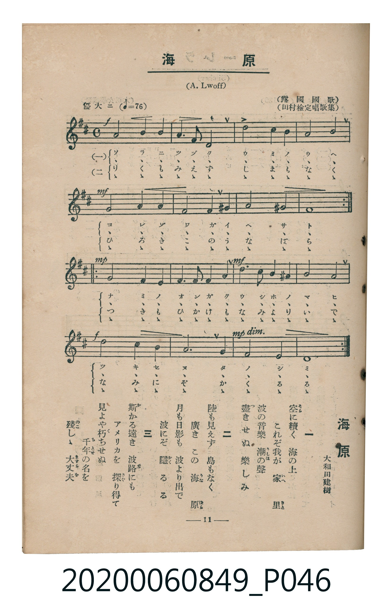

# 海原

> Re:Shōka 使用 AI 協助辨識與重建樂譜，可能會有錯誤。歡迎回報。

- **鋼琴伴奏版**：<br><audio controls src="unabara.mp3"></audio>

- 詞：大和田建樹（田村檢定唱歌集）
- 曲：A. Lwoff（露國國歌）
- 臺灣教育會公認《新定兒童唱歌》高等科女子用（2020.006.0849）

## 說明

原書資訊與歌詞全文（對應 P046.jpg，書頁 p. 11，高一第二學期第 1 首）：
調性與拍號：ニ長調（2 升記號）、4/4 拍（優大ニ ♩=76）


## 歌詞

```text
一
空（そら）に續（つづ）く　海（うみ）の上（うへ）
これぞ我（わ）が　家（いへ）里（さと）
波（なみ）の音樂（おんがく）　潮（うしほ）の聲（こゑ）
盡（つ）きせぬ　樂（たの）しみ

二
陸（りく）も見（み）えず　島（しま）もなく
廣（ひろ）きこの　海原（うなばら）
月（つき）も日影（ひかげ）も　波より出（い）で
波にぞ　隱（かく）るる

三
斯（か）かる遠（とほ）き　波路（なみぢ）にも
アメリカを　探（さぐ）り得（え）て
見（み）よや朽（く）ちせぬ　千年（ちとせ）の名（な）を
殘（のこ）しゝ　大丈夫（ますらを）
```

## ABC

<div class="abc-score" data-abc-src="unabara.abc" aria-label="五線譜載入中"></div>

[下載 ABC 原始檔](unabara.abc)

## TMD 檔案連結

- [主旋律 TMD 檔案](unabara.tmd) [[在 TMD Studio 編輯](https://tmdlang.github.io/Tmd-TS/#tmd=s7IKdvYPcrWy4qpTUCpJTLdSSM7PyUlNLsnMz7MqzsjMK0nNjM_KTMmPL87Iz05Ugisry88pzU21ys4vyY9PzyzKKY43MjAyiDcwMIs3sDCxRCgszi8tSk61Kk7OyM_PiS9JrShJys_PRpePL0hMT7UKMDAxQ8gUFOWXpeYl5gF1FxSBXJIC1o5QkFqWmZIKki5OTsyLL0stykzLTE1BcmNqUTHYHxArSooS84qTizILQJ5DqMovKsnITy9KLMiotMrILC7JL8pMTsyJz07MQ_JuSUYq0Ld5iSWlRanoouWJJalFyOZlpmfmWeWmZmZlYvEvVLo8tRioKy8-NzUnP6VSiUtLS-HZ1u1P--YraGlxKdoqmJtx2dsquHDZmOib2IE0v1g57_2eWU-XLH86qef5lA1Pd-96tmLn-z0dQPazuROfrVr0dN2sp1M2Plvb83J22_s9nWAbn83eBNTkqKfgU56flgZU_XLOpqdzuoEIqA6m6EX7rueNi59NnfmiadOzOc1PW9e8WNX7uKHr2bQNIDNbJz1fvRRi8uOG7perZzxf2_l8-cSnSzc_XTvh-ZQVQFNBUa8HjHo9UNSDjeXS11KwpRbgUlBQAIbMs9k7Xmxuf7Gi60VHO9AxwAB52rri2bR2oAOebuh91t6pAEo_elkF6e_39AAVv1zQqFCgp2BoCOQCnf1kR8PzNWue7Op5unbHsznzgWwFQ4WXy6YB3QsMI5AdL1btf9awHGR6d--LmfOBoo-bu19O3Q4UB3lS4Wkv0PYZYJnOxw2NwJhRAKoEWd-yChgxQMUKj2autDU3A8pzgQwEWgminq_cBVT0uHHu4yagVZ2PG1c_3wUMfaDIkseNS8Ei_Y8bGoDxDxZse9wItA8ouO7Jji6YyA6QmUCzHjdOftzU87hx3rOOiSC5pn6wUmDUNDxdtw2sugWi-mU7xI6pjxuBcQTW_GzzIrDQKrgNL-dvfraiCSzY9bhpMsigRrCJQOfsXQezfPrjxt0Q9S8agQkKKAh0BNB6sKHPZy-E-AWsovdx4-zHjWtA-qHmzgdqA0sBTdkPCZZdPSDq5UygM4E-6IJa2dT0Ylk3WAvEcUDGLJC3NkO8BdS-D6IM7IF-cKrYvRgst-lxEzAeINYDPbEOEprANAPzAVDDBkjog8NhTgcs-MHampqeTV_6dO9GqFmN3Y8bJ0GtAhq0edHjJpAzn7ZDorEFbNNyaIACYxMYG0B1L2dB9AM1Q7zTDUTQZACxddp6iAKwfpDsy8YFYJEVsPAFZjuQfS-2Q1SC4ulxIzDOQGkG6BpwAmha9Lh54ePmVY-bgEKTQBr6ILEKjOgJYIu7nu6bDhYB-hKocxk4bSMHLcg7Lc_m7AWLQBLQQni8Pe1tfrpzC1gKKAh02mxI1D-dAErqQEeBTZgE9tG6GWChdcBQh0Zx01yQEUuWP9nR8XTJarDsvseNM4FhD9QDDX7KSwQoUNDS5-LyTQQWpwGZiXn5DjUGNdUgCxRsLLTswAxgMQTK9DsaXizsUdAwUXi6of_5-gYdeEmhCTICpLBGoTqtVsFUQRcMzaC4RsEEzDcGFhUQmRoFwzgo0xyuCFkbWBHYSB_DGmBs7YWKPW5eCSa7wToeN7dARVuBatbDDX_ctAyufj6Y7MMQn4FqixFItgsm29gPIpuaILoa90NFO4B4FsKWxulw9ftQ1K9CMQfJFmOQLMjtEFkQC5iAobpWQEV3A3Evki0I00DuAKZkqPhqmDjYXogtyNG1q4eI6MoFxhckdnTBEQDCNcCYgoiAaBN1sBAsdsBciNNgqmAQOcI2wxzXvAbsRFAAgSIMFkmPmyDiS6DisOh43LQV4fXmDuw2gCKrcRNcByiwIEEGEp8MD651YLINKo4Ixg0IG5o6sdsAiqgmUEBD_LAQTIJMAIkjAn4S2LypUBsmwMVhCQkkCsy7sFSHsAQlW3USE08FiHgChbsR2HRIDBiDaUjMgSMUmrnMwVnJFBJ_sFwFi0ekyGqGp3u03AIJssfNm-HRBYo-RD563LQdKDsbRQ8i4jei2gSONFB0QyIBHGnwHAOJTFCOAFYaKDJQNwDTPrDAhQcuSAaS90Fyy1FtAucySJ4FqYfoAqkGiUNyJLBUBmKwyxtBPgPJgCIZxF8BlwElIJSkA45wjBh8Ons2cQUjchyAIhM1C0GiFBzTMGGQECQdwUpOtHQKjj54QDStBZO7Ic5u7kFS_7gJFCAgUVBEwSIPZjok4rGYD4409AIIlP5B4vOQzQcXZogAhhVsUPPhbDTzwVEFCmaIGaC8CylWkYtXiBy0BAHXgnAr4PEB9MIeDCtqubh07RRAVZsCkFbmAgA)]
- [鋼琴伴奏 TMD 檔案](unabara_piano.tmd) [[在 TMD Studio 編輯](https://tmdlang.github.io/Tmd-TS/#tmd=s7IKdvYPcrWy4qpTUCpJTLdSSM7PyUlNLsnMz7MqzsjMK0nNjM_KTMmPL87Iz05Ugisry88pzU21ys4vyY9PzyzKKY43MjAyiDcwMIs3sDCxRCgszi8tSk61Kk7OyM_PiS9JrShJys_PRpePL0hMT7UKMDAxQ8gUFOWXpeYl5gF1FxSBXJIC1o5QkFqWmZIKki5OTsyLL0stykzLTE1BcmNqUTHYHxArSooS84qTizILQJ5DqMovKsnITy9KLMiotMrILC7JL8pMTsyJz07MQ_JuYhFQc3pqbmpeiVVBZmJefnxicnJ-bkFiXiZIDKGwJAOoyCovsaS0KBVdtDyxJLUI2eLM9Mw8q9zUzKxMLAEDlS5PLQbqyovPTc3JT6lU4tLSUni2dfvTvvnv93S87N7zfMKWJ3u2PF3a_7yz4_2eTgUtLS5FWwVzMy57WwUXLhsTfRM7kIkvVs57v2fW0yXLn07qeT5lw9Pdu56t2Ak0Ach-Nnfis1WLnq6b9XTKxmdre17ObgOaA3bGs9mbgJoc9RR8yvPT0kD2zdn0dE43EAHVwRS9aN_1vHHxs6kzXzRtejan-Wnrmhereh83dD2btgFkZuuk56uXQkx-3ND9cvWM52s7ny-f-HTp5qdrJzyfsgJoKijh6AETjh4o4YCN5fJNBPo8ABTOQR4ONQY11VwKQGBjoWUHZuhrKTxfs-bJjoYXC3sUtPTBYjUK1Wm1CqYKumBoBsU1CiZgvrGCIVSmRsEwDso0hytC1gZWBDbSx7BG4XHTXqjY4-aVYLIbrONxcwtUtBWoZj3c8MdNy-Dq54PJPgzxGai2GIFku2Cyjf0gsqkJoqtxP1S0A4hnIWxpnA5Xvw9F_SoUc5BsMQbJgtwOkQWxHjdB_dK4Aiq6G4h7kWxBmAZyx-PGRVDx1TBxsL0QW5BjZlcPaszkAqMGEhG64LAG4RpgpEBEQLSJOlgIFhFgLsQVMFUwiBw3m2HuaF4Ddg0oLEBxA4uPx00Q8SVQcVjIP27aivBlcwd2G0Dx0rgJrgMULpDQAYlPhofMOjDZBhVHhNgGhA1NndhtAMVJEyhMIX5YCCZBJoDEEWE8CWzeVKgNE-DisDQDEu143AhLYAhLUDJLJ1qUFCCiBBTERmCDIIFtDKYhkQSOO2iWMQdnEFNIVMHyCizKkOKlGZ6a0fIAJHQeN2-GxwwophC543HTdqDsbBQ9iDjeiGoTOH5AMQsJb3D8wPMBJN5A6fxxIzj80HIIKEU_bgLFPCQcQTKQHA2SW45qEzjvQHIiSD1EF0g1SBySzx43LgRisMsbQT4DyYDiE8RfAZcBpRWUVAKOW4zIejp7NkbJhhzcoHhDzRiQ2ANHKkwYJARJHbCiDy31gWMK7uemtWByN8SFzT1I6h83gfwOEgXFCSyeYKZD4hiL-eD4QS9BQKkaJD4P2XxwaYQIS1jJBDUfzkYzHxwroBCFmAHKkZByEbl8hMhBy4XGmYisiBT0QC_swbCiFrkW8kGuhUzw1kKG8UDt0WbxubFgo03AXEMIxwjMMY2H8FBV4is_TeMxTTGC2WAM5hpDDTWDKMVqKloRADUV1TkodpigGgqRw5dQUXwLMRDVeGyWgYJa104BFNoKQFqZCwA)]

## 分析

```text
================================================================================
📊 TMD Song Profile: [ 海原 ]
================================================================================
⏱  Duration:       0:50 (50.5s), 16 measures total
🎼 Key & Tempo:    首調基準 D, != 76.0 BPM, <4/4>
   - 分析範圍：      由實際發聲的音符與和弦推測調性；播放脈絡另行呈現
🎤 人聲音域:    D4 (MIDI 62) – D5 (MIDI 74) [跨度: 12 個半音 / 1.0 個八度, 難度: easy]
   - 最低音:  D4 in [Main #1 @ m.2, 0:04]
   - 最高音: D5 in [Main #1 @ m.3, 0:06]
   - 適合: soprano, mezzo-soprano, contralto, tenor, baritone, bass
🏛  結構:      Main (50.5s)
⚡ 編曲密度:        Peak 1 軌道同時演奏
🗝  調性診斷：       D 調性不明確（流行色彩大調，未偵測到可信轉調）
   - 風格氣質:    流行大調（略帶和弦色彩音與裝飾副屬和弦）
   - 轉調歷程:    全曲維持單一推測調性（未偵測到可信轉調）
   - 核心骨幹音:  F#, A, B, D, G
   - 調性數值:    D 調性不明確 [相關度: 0.79, 穩定度: Ambiguous, 自然音純度: 93.8%]
   - 候選調性 (K-S): D 大調 (0.79), F# 小調 (0.76), B 小調 (0.71)
   - 五度圈歷程:   +2
   - 各段落調性細節:
     • [Main #1]: D 調性不明確 (r: 0.79, 自然音純度: 93.8%, 調外音: G#, A#)

  [ 五度圈游移軌跡 ]
               C  
         F            G  
      Bb              [D ]*
      Eb               A  
         Ab           E  
            Db       B  
               F# 
     (* = active key center)

  [ 十二半音累積音高分佈 ]
     C  :                            0.0%
     C# : ██                         2.3%
     D  : ██████████████            14.8%
     D# :                            0.0%
     E  : ██████                     6.2%
     F  :                            0.0%
     F# : ████████████████████████  25.8%
     G  : █████████                 10.2%
     G# : ████                       4.7%
     A  : █████████████████         18.7%
     A# : █                          1.6%
     B  : ███████████████           15.6%
--------------------------------------------------------------------------------
Assignment 軌道音域：
  - Piano         : D4 – D5 (12 個半音 / 1.0 個八度, 41 個音符)
================================================================================
```


## 原書掃描頁




