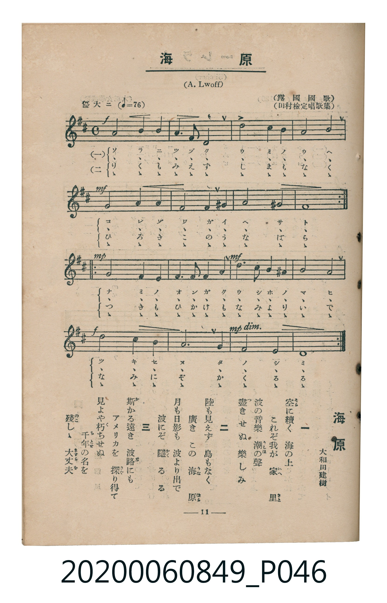

# 海原

<audio controls src="unabara.mp3"></audio>

- 詞：大和田建樹（田村檢定唱歌集）
- 曲：A. Lwoff（露國國歌）
- 臺灣教育會公認《新定兒童唱歌》高等科女子用（2020.006.0849）

## 說明

原書資訊與歌詞全文（對應 P046.jpg，書頁 p. 11，高一第二學期第 1 首）：
調性與拍號：ニ長調（2 升記號）、4/4 拍（優大ニ ♩=76）

## 歌詞

```text
一
空（そら）に續（つづ）く　海（うみ）の上（うへ）
これぞ我（わ）が　家（いへ）里（さと）
波（なみ）の音樂（おんがく）　潮（うしほ）の聲（こゑ）
盡（つ）きせぬ　樂（たの）しみ

二
陸（りく）も見（み）えず　島（しま）もなく
廣（ひろ）きこの　海原（うなばら）
月（つき）も日影（ひかげ）も　波より出（い）で
波にぞ　隱（かく）るる

三
斯（か）かる遠（とほ）き　波路（なみぢ）にも
アメリカを　探（さぐ）り得（え）て
見（み）よや朽（く）ちせぬ　千年（ちとせ）の名（な）を
殘（のこ）しゝ　大丈夫（ますらを）
```

## 原書掃描頁



## 分析

```text
================================================================================
📊 TMD Song Profile: [ 海原 ]
================================================================================
⏱  Duration:       2:31 (151.6s), 48 measures total
🎼 Key & Tempo:    首調基準 D, != 76.0 BPM, <4/4>
   - 分析範圍：      由實際發聲的音符與和弦推測調性；播放脈絡另行呈現
🎤 人聲音域:    D4 (MIDI 62) – D5 (MIDI 74) [跨度: 12 個半音 / 1.0 個八度, 難度: easy]
   - 最低音:  D4 in [Main #1 @ m.2, 0:04]
   - 最高音: D5 in [Main #1 @ m.12, 0:34]
   - 適合: soprano, mezzo-soprano, contralto, tenor, baritone, bass
🏛  結構:      Main (50.5s) -> Main (50.5s) -> Main (50.5s)
⚡ 編曲密度:        Peak 1 軌道同時演奏
🗝  調性診斷：       D 大調（流行色彩大調，未偵測到可信轉調）
   - 風格氣質:    流行大調（略帶和弦色彩音與裝飾副屬和弦）
   - 轉調歷程:    全曲維持單一推測調性（未偵測到可信轉調）
   - 核心骨幹音:  A, F#, D, G, E
   - 調性數值:    D 大調 [相關度: 0.83, 穩定度: High, 自然音純度: 93.8%]
   - 候選調性 (K-S): D 大調 (0.83), A 大調 (0.66), F# 小調 (0.60)
   - 五度圈歷程:   +2 -> +2 -> +2
   - 各段落調性細節:
     • [Main #1]: D 大調 (r: 0.83, 自然音純度: 93.8%, 調外音: G#)
     • [Main #2]: D 大調 (r: 0.83, 自然音純度: 93.8%, 調外音: G#)
     • [Main #3]: D 大調 (r: 0.83, 自然音純度: 93.8%, 調外音: G#)

  [ 五度圈游移軌跡 ]
               C  
         F            G  
      Bb              [D ]*
      Eb               A  
         Ab           E  
            Db       B  
               F# 
     (* = active key center)

  [ 十二半音累積音高分佈 ]
     C  :                            0.0%
     C# :                            0.0%
     D  : ████████████              15.6%
     D# :                            0.0%
     E  : ███████                    8.6%
     F  :                            0.0%
     F# : █████████████             16.4%
     G  : ████████████              15.6%
     G# : █████                      6.2%
     A  : ████████████████████████  31.2%
     A# :                            0.0%
     B  : █████                      6.2%
--------------------------------------------------------------------------------
Assignment 軌道音域：
  - Piano         : D4 – D5 (12 個半音 / 1.0 個八度, 132 個音符)
================================================================================
```

## ABC

```abc
X:1
T:海原
C:曲：A. Lwoff（露國國歌）
M:4/4
L:1/16
Q:1/4=76
K:D
V:V1 name="Piano" snm="Pia"
[V:V1]
!f! a8 b4 a4 | f6 d2 a8 | g8 f4 e4 | d8 a8 |
!mf! f8 g4 a4 | g6 e2 a4 ^g4 | a8 ^g8 | a16 |
!mp! f8 e4 f4 | g4 f4 e4 d4 | !mf! b4 a4 ^g4 a4 | d8 g8 |
!f! b8 a4 g4 | f6 d2 a8 | !mp! g6 f2 e8 | d16 |
!f! a8 b4 a4 | f6 d2 a8 | g8 f4 e4 | d8 a8 |
!mf! f8 g4 a4 | g6 e2 a4 ^g4 | a8 ^g8 | a16 |
!mp! f8 e4 f4 | g4 f4 e4 d4 | !mf! b4 a4 ^g4 a4 | d8 g8 |
!f! b8 a4 g4 | f6 d2 a8 | !mp! g6 f2 e8 | d16 |
!f! a8 b4 a4 | f6 d2 a8 | g8 f4 e4 | d8 a8 |
!mf! f8 g4 a4 | g6 e2 a4 ^g4 | a8 ^g8 | a16 |
!mp! f8 e4 f4 | g4 f4 e4 d4 | !mf! b4 a4 ^g4 a4 | d8 g8 |
!f! b8 a4 g4 | f6 d2 a8 | !mp! g6 f2 e8 | d16 |
```

- [主旋律 TMD 檔案](unabara.tmd)
- [鋼琴伴奏 TMD 檔案](unabara_piano.tmd)
