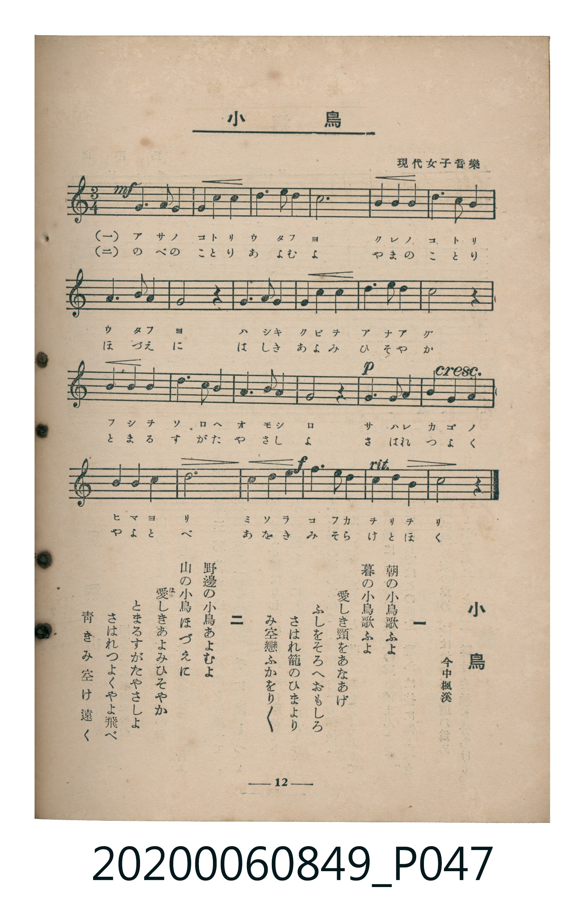

# 小鳥

> Re:Shoka 使用 AI 協助辨識與重建樂譜，可能會有錯誤。歡迎回報。

<audio controls src="kotori.mp3"></audio>

- 詞：今中楓溪（現代女子音樂）
- 臺灣教育會公認《新定兒童唱歌》高等科女子用（2020.006.0849）

## 說明

原書資訊與歌詞全文（對應 P047.jpg，書頁 p. 12，高一第二學期第 2 首）：
調性與拍號：ト長調（1 升記號）、3/4 拍

## 歌詞

```text
一
朝（あさ）の小鳥（ことり）歌（うた）ふよ
暮（くれ）の小鳥歌ふよ
愛（は）しき頸（くび）をあなあげ
ふしをそろへおもしろ
さはれ籠（かご）のひまより
み空戀（そらこ）ふかをり／＼

二
野邊（のべ）の小鳥あよむよ
山（やま）の小鳥ほづえに
愛しきあよみひそやか
とまるすがたやさしよ
さはれつよくやよ飛（と）べ
青（あを）きみ空け遠（とほ）く
```

## ABC

```abc
X:1
T:小鳥
M:3/4
L:1/16
Q:1/4=96
K:G
V:V1 name="Piano" snm="Pia"
[V:V1]
!mf! D3 D D4 D4 | G3 A B4 A4 | G3 E D4 G4 | D3 D D3 D G2 A2 |
B3 A G4 A4 | B3 B A4 d4 | B3 A G4 E4 | D3 G A4 z4 |
B3 B A4 d4 | B3 A G4 E4 | D3 G F3 E D3 z | !p! D3 D E3 E F2 F2 |
G3 G A4 B4 | A3 B c4 A4 | !f! d3 B G4 E2 A2 | G3 F A3 G G3 z |
```

## TMD 檔案連結

- [主旋律 TMD 檔案](kotori.tmd) [[在 TMD Studio 編輯](https://tmdlang.github.io/Tmd-TS/#tmd=s7IKdvYPcrWy4qpTUCpJTLdSSM7PyUlNLsnMz7MqzsjMK0nNjM_KTMmPL87Iz05Ugisry88pzU21ys4vyY9PzyzKKY43MjAyiDcwMIs3sDCxRCgszi8tSk61Kk7OyM_PiS9JrShJys_PRsgXFOWXpeYl5gHVFBSB7EsBK0IoSC3LTEkFSaemZJbkF2Um5iC5IrWoGOxSsCXxJUWJecXJRZkFIOcjVJVkpAKdmpiXmQvSq6Wl8HRD_8vNSxW0tLgUbRUszbjsbRXcuWyM9U3sQHperJz3fs-sJ7u7nuxY-2zp5Ge7Vr3f0_G8f9-T3YufLt38dO2El_M3P1vR9H5PJ9iKF-27njcufjZ15oumTc_mND9tXfNiVe_jhq5n0zY8XTfraeuk56uXPp2y8dnanscN3S9Xz3i-tvP58okQk55PWQE0GxRyesCQ0wOFHNhYLn0tBVtqAS4FBYWnffOfzd7xYnP7ixVdLzragY4B-vJp64pn09qBDni6ofdZe6dCgIGJuV5WQfr7PT1AxS8XNCoU6CkYGgG5QGc_2dHwfM2aJ7t6nq7d8WzOfCBbwUjh5bJpQPcCQwtkx4tV-581LAeZ3t37YuZ8oOjj5o6XU7cDxYF2GCo87QXaPgMs0_m4oREY3ApAlVwgrUDDQdSzOXOBKh83Nj1unApS1LgOElNgwcmPG1c8buoCigNdDxZpe9wINqtx6-OmDrD-WevAEv2Pm4AqEPpBYY9Q1DIbrGg9WMX0x429LxfsgGpr3AwSbJoEdsIqMDkJpAekG6gUJDH3cVPv48Ydjxu7HjcBpYGCvRAVU4FGAu19vnEB2LDux41TIG543LjpceM-oO1A10OU7n--ctezjgawOqB5QEWTof4AagNaAvJl__s9eyBhs6sHRL1s73sJEgdqAZq4E9l7IHeCTG-A-vDpxo0gdU0tQGtR1e1-3AgkgUashoYEJACgBjTuBzsV6CKgzm6IU1eAnQ70zMzHjcBAnA-WA3oV6G-wXXB_P25cAjYDGPYtQMbLxZBQBqZvoAN2gn0wdxI0dpuADKAo0F5QSDxunPiyERJoQNt2g6X6QRooT_pQoKClz8Xlm5iZZxWQmZiX71BjUKNQDbJBwcbQTMsOzALmOFD63tHwYmEPSD1IDKgqN61WwTReQRcIgRSUBWZDGDUKhmDaSMEYKmKEJmOGpA0iApLDMBNIgWRBumvA8Q5z0a4eFBdBrDGCG4WwDiJjDBcxRZNB6AE6Cc0dhnBdBjApFEfs6MTiCHKtMocwEAFjAArpAuSAhmoDUmDFYALFRU9nz0ZxEcQ-hDdgsVEDFTFWMIGKIAKsGhS3UFkU94IjASoEtBqiwxAqAHQsVy0Xl66dAihFKQBpZS4A)]
- [鋼琴伴奏 TMD 檔案](kotori_piano.tmd) [[在 TMD Studio 編輯](https://tmdlang.github.io/Tmd-TS/#tmd=s7IKdvYPcrWy4tLSUni6of_l5qXv93S87N7zfMKWJ3u2PF3a_7yz4_2eTgUtLS5FWwVLMy57WwV3LhtjfRM7rjoFpRcr573fM-vJ7q4nO9Y-Wzr52a5VQO3P-_c92b346dLNT9dOeDl_87MVTUATlMDK23c9b1z8bOrMF02bns1pftq65sWq3scNXc-mbXi6btbT1knPVy99OmXjs7U9jxu6X66e8Xxt5_PlEyEmPZ-yAmi2kYGRgZ6BgZmegYWJJdhYLt_EzDyrgMzEvPwgD4cagxqFai4FILAxNNOyA7P0tRSer1nzZEfDi4U9Clr6YDGgqty0WgXTeAVdIARSUBaYDWHUKBiCaSMFY6iIEZqMGZI2iAhIDsNMIAWSBemu4UJ20a4eFBdBrDGCG4WwDiJjDBcxRZNB6AE6Cc0dhnBdBjApFEfs6MTiCHKtMocwEAFjAArpAuSAhmoDUmDFYALFRU9nz0ZxEcQ-hDdgsVEDFTFWMIGKIAKsGhS3UFkU94IjASoEtBqiwxAqAHQsVy1ygvJBSVAmeNOTYbxCtGEsGCM4pvHIPLCUaTyQBxKHSOJLEJimIPTBJU3APLipID_giV7iDEFyKUgG06UYcYSpkUhbQAGua6cACnMFJFqZCwA)]

## 分析

```text
================================================================================
📊 TMD Song Profile: [ 小鳥 ]
================================================================================
⏱  Duration:       0:30 (30.0s), 16 measures total
🎼 Key & Tempo:    首調基準 G, != 96.0 BPM, <3/4>
   - 分析範圍：      由實際發聲的音符與和弦推測調性；播放脈絡另行呈現
🎤 人聲音域:    D4 (MIDI 62) – D5 (MIDI 74) [跨度: 12 個半音 / 1.0 個八度, 難度: easy]
   - 最低音:  D4 in [Main #1 @ m.1, 0:00]
   - 最高音: D5 in [Main #1 @ m.6, 0:10]
   - 適合: soprano, mezzo-soprano, contralto, tenor, baritone, bass
🏛  結構:      Main (30.0s)
⚡ 編曲密度:        Peak 1 軌道同時演奏
🗝  調性診斷：       D 大調（純淨自然大調，未偵測到可信轉調）
   - 風格氣質:    純淨自然大調（陽光明朗、易唱易記，無明顯調外色彩）
   - 轉調歷程:    全曲維持單一推測調性（未偵測到可信轉調）
   - 核心骨幹音:  D, A, G, B, E
   - 調性數值:    D 大調 [相關度: 0.88, 穩定度: Moderate, 自然音純度: 97.8%]
   - 候選調性 (K-S): D 大調 (0.88), G 大調 (0.82), B 小調 (0.59)
   - 五度圈歷程:   +2
   - 各段落調性細節:
     • [Main #1]: D 大調 (r: 0.88, 自然音純度: 97.8%, 調外音: C)

  [ 五度圈游移軌跡 ]
               C  
         F            G  
      Bb              [D ]*
      Eb               A  
         Ab           E  
            Db       B  
               F# 
     (* = active key center)

  [ 十二半音累積音高分佈 ]
     C  : ██                         2.2%
     C# :                            0.0%
     D  : ████████████████████████  25.8%
     D# :                            0.0%
     E  : ████████                   8.6%
     F  :                            0.0%
     F# : ████                       4.3%
     G  : █████████████████████     22.0%
     G# :                            0.0%
     A  : █████████████████████     22.6%
     A# :                            0.0%
     B  : ██████████████            14.5%
--------------------------------------------------------------------------------
Assignment 軌道音域：
  - Piano         : D4 – D5 (12 個半音 / 1.0 個八度, 70 個音符)
================================================================================
```


## 原書掃描頁




