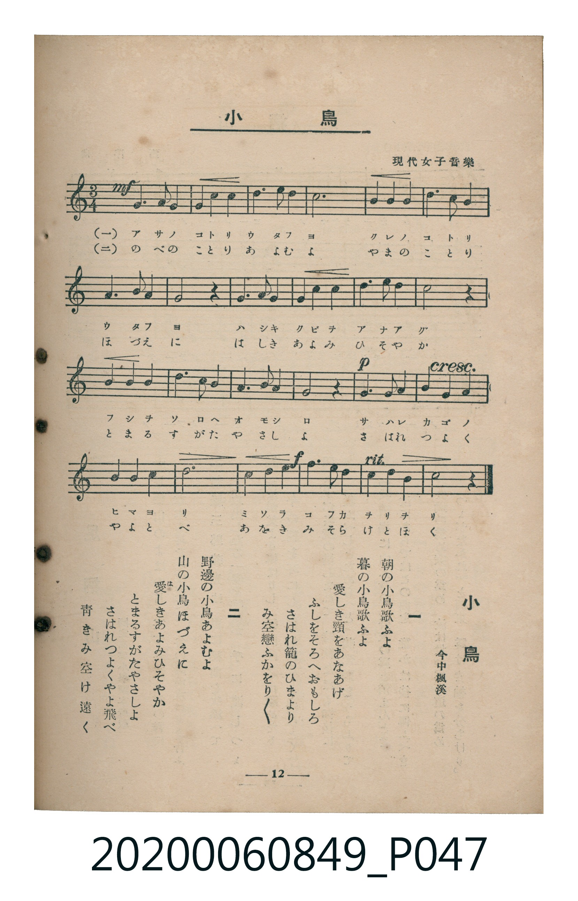

# 小鳥

> Re:Shōka 使用 AI 協助辨識與重建樂譜，可能會有錯誤。歡迎回報。

- **鋼琴伴奏版**：<br><audio controls src="kotori.mp3"></audio>
- **NEUTRINO 歌聲合成版**：<br><audio controls src="kotori_neutrino.mp3"></audio>

- 詞：今中楓溪
- 出處：現代女子音樂
- 臺灣教育會公認《新定兒童唱歌》高等科女子用（2020.006.0849）

## 說明

原書資訊與歌詞全文（對應 P047.jpg，書頁 p. 12，高一第二學期第 2 首）：
調性與拍號：ハ長調（無升降記號）、3/4 拍
出處註記：現代女子音樂


## 歌詞

```text
一
朝の小鳥歌ふよ
暮の小鳥歌ふよ
愛（は）しき頸をあなあげ
ふしをそろへおもしろ
さはれ籠のひまより
み空戀ふかをり／＼

二
野邊の小鳥あよむよ
山の小鳥ほづえに
愛（は）しきあよみひそやか
とまるすがたやさしよ
さはれつよくやよ飛べ
青きみ空け遠く
```

## ABC

<div class="abc-score" data-abc-src="kotori.abc" aria-label="五線譜載入中"></div>

[下載 ABC 原始檔](kotori.abc)

## TMD 檔案連結

- [主旋律 TMD 檔案](kotori.tmd) [[在 TMD Studio 編輯](https://tmdlang.github.io/Tmd-TS/#tmd=s7IKdvYPcrWy4qpTUCpJTLdSSM7PyUlNLsnMz7MqzsjMK0nNjM_KTMmPL87Iz05Ugisry88pzU21ys4vyY9PzyzKKY43MjAyiDcwMIs3sDCxRCgszi8tSk61Kk7OyM_PiS9JrShJys_PRpePL0hMT7UKMDAxR8gUFOWXpeYl5gF1FxSBXJIC1o5QkFqWmZIKki5OTsyLL0stykzLTE1BcmNqUTHYHxArSooS84qTizILQJ5DqMovKsnITy9KLMiotMrILC7JL8pMTsyJz07MQ_JuSUYq0LeJeZm5iTnIWjPTM_OsShIzgaEDCqHyxPjcxMy8nMQ8oDO0tBSebuh_uXmpgpYWl6KtgqUZl72tgjOXjbG-iR3IjBcr573fM-vJ7q4nO9Y-Wzr52a5VYKOftu96MXMqUOZ5_74nuxc_Xbr56doJL-dvfraiCSz_on3X88bFz6bOfNG06dmc5qeta16s6n3c0PVs2oan62Y9bZ30fPXSp1M2Plvb87ih--XqGc_Xdj5fPhFizPMpK97v6QBFlR4wqvRAUfV-T6cSF5e-loIttQCXgoLC0775z2bveLG5_cWKrhcd7UDHAH37tHXFs2ntQAc83dD7rL1TARTfelkF6e_39AAVv1zQqFCgp2BoBOQCnf1kR8PzNWue7Op5unbHsznzgWwFI4WXy6YB3QsMG5AdL1btf9awHGR6d--LmfOBoo-b-19O3Q4UB9rxvGXh0972lzN7X6yYAZbtfNzQCAx6BaBqsAvBwfxixW6gPNbA5gKpAroCRD2bM_dx4zpIdIICtnHr46YOsMSsdTgkWmYDHfG4cT3I4sbpjxt7Xy7Y8bhp0uPGpseNq8DkJJA6kA6gNEhi7uOm3seNOx43dj1uAkoDBcEOfdw4FWjM46ae5xsXAO163LjpceM-oC2Pm7og0vufr9z1rKMBbFI3yKSmrvd7-t_v2QPxwa4eEPWyve9lUxfcrSAHgIxogDr36caNSHK7HzcCSaDrV2P3ClR3436wY4DubgHaDHHMCrDjuh83znzcCAyO-WA5oAeAvgFbBPfN48YlYDP6QSqaOl4unv24cSfYpXOBYQG0AuStx40TXzYCfd0PkqA8ZUKBgpY-F5c3sOgqyrQKyEzMy3eoMaipBlmhYGOhZQdmYMsQCqAEuaPhxcIeBQ0zUOZ-vr5BB56KNbFoAFoEMqxGoTo3rVbBVEEXCM3AdA2YNIyDETUKRiBKV8E4DsKqgYjDYI2COZCEYbhqoBowH2yNj2GNwuOmRWCJx01bFR4394HVPm7aDBJp7gCTq6Biy6Dq9gPFpkLEmleg2Pi4aT1YxxowiWwWxDSoWRC7jYByjesgco07oWyQ2GSwCMhkYMKEijVB7Qaa0dQANRfkOmS7W8D69oFJZLMgpkHNAidx3JG1q4ecyDID22IOpiHxBIIGSDzS4xCsGymW8IV-PJTfD1WzHYjXosQIOEybN0HFoDHe3AVlg8RAcnCzkGJoNzQElwIxKMRBYqtR7W0E2QFSMx2Ie5FiDBJHwJwJFYPYASwAoLEFEutGsZdAVuokJ3bw5gO8cVddAMuDplB5kB6QCJiHiB1wjIDCHTmU90JDeS0Qz4CKgdI_SGwRVDVILyimkEITmA8havqhOQkkBgrxx01bwOLgfIUUQ-CcAkn3TaDQBInNhIZ0DxDPh5oBCnGQ2FRwTKHmIVhMgvwBUrMeKNcDFVuCFJOgFEYglp7Onk1JLKFmDFjuBouCxYBZBRw1wOLRBGvmAbMhcYsrMzVPAgfkPDAJCj6QGCRq4MVJMyjYIJH4uHklNLhgRRkwCMFRAlIHim6IbnjUw81Cy0yQIgoalFB7gUUfir3QjAN2ITwzgTIQLON0QsUmwk2BZFKQGKQAgNlby8Wla6cAqbcUgCxlLgA)]
- [鋼琴伴奏 TMD 檔案](kotori_piano.tmd) [[在 TMD Studio 編輯](https://tmdlang.github.io/Tmd-TS/#tmd=s7IKdvYPcrWy4qpTUCpJTLdSSM7PyUlNLsnMz7MqzsjMK0nNjM_KTMmPL87Iz05Ugisry88pzU21ys4vyY9PzyzKKY43MjAyiDcwMIs3sDCxRCgszi8tSk61Kk7OyM_PiS9JrShJys_PRpePL0hMT7UKMDAxR8gUFOWXpeYl5gF1FxSBXJIC1o5QkFqWmZIKki5OTsyLL0stykzLTE1BcmNqUTHYHxArSooS84qTizILQJ5DqMovKsnITy9KLMiotMrILC7JL8pMTsyJz07MQ_JuYhFQc3pqbmpeiVVBZmJefnxicnJ-bkFiXiZIDKGwJAOoyAoknJiDbEdmemaeVUliJjAYQUFZnhifm5iZl5OYB3SvlpbC0w39Lzcvfb-n42X3nucTtjzZs-Xp0v7nnR3v93QqaGlxKdoqWJpx2dsqOHPZGOub2IEMfrFy3vs9s57s7nqyY-2zpZOf7VoFtu9p-64XM6cCZZ7373uye_HTpZufrp3wcv7mZyuawPIv2nc9b1z8bOrMF02bns1pftq65sWq3scNXc-mbXi6btbT1knPVy99OmXjs7U9jxu6X66e8Xxt5_PlEyHGPJ-yAuhEUETrASNaDxTRQAcqcXF5A5NBUaZVAChkgjwcagxqqrkUgMDGQssOzNDXUrBFBwrP16x5sqPhxcIeBQ0zUAg8X9-gowBKA3pZBemaWDRo6YMNq1Gozk2rVTBV0AVCMzBdAyYN42BEjYIRiNJVMI6DsGog4jBYo2AOJGEYrhqoBswHW-NjWKPwuGkRWOJx01aFx819YLWPmzaDRJo7wOQqqNgyqLr9QLGpELHmFSg2Pm5aD9axBkwimwUxDWoWxG4joFzjOohc404oGyQ2GSwCMvlxUxdUrAlqN9CMpgaouSDXIdvdAta3D0wimwUxDWoWF_7I2tVDTmSZgW0xB9OQeAJBAyQe6XEI1o0US_hCPx7K74eq2Q7Ea1FiBBymzZugYtAYb-6CskFiIDm4WUgxtBsagkuBGBTiILHVqPY2guwAqZkOxL1IMQaJo8eN-6FiEDseN86FxhZIrBvFXgJZqZOc2MGbD_DGXXUBLA-aQuVBekAiYB4idsAxAgp35FDeCw3ltUA8AyoGSv8gsUVQ1SC9oJhCCk1gPoSo6YfmJJAYKMQfN20Bi4PzFVIMgXMKJN03gUITJDYTGtI9QDwfagYoxEFiU8ExhZqHYDEJ8gdIzXqgXA9UbAlSTIJSGIFYejp7NiWxhJoxYLkbLAoWA2YVcNQAi0cTrJkHzIbELa7M1DwJHJDzwCQo-EBikKiBFyfNoGCDROLj5pXQ4IIVZcAgBEcJSB0ouiG64VEPNwstM0GKKGhQQu0FFn0o9kIzDtiF8MwEykCwjNMJFZsINwWSSUFikAIAZm8tarXlg1xtmSCqLUQlBY8Mw3gF0_h4EIXKBjGMIHw8EsgceFpBlK5wW4yACszAapF0GZBoPVA9ih2QMgJuB06HEbTdBFkczEG2B5rK0e3BH0ogU6B8sASIj-EZYKzp2ilAIi7axzBWAYlnBOYpcwEA)]

## 分析

```text
================================================================================
📊 TMD Song Profile: [ 小鳥 ]
================================================================================
⏱  Duration:       0:45 (45.0s), 24 measures total
🎼 Key & Tempo:    首調基準 C, != 96.0 BPM, <3/4>
   - 分析範圍：      由實際發聲的音符與和弦推測調性；播放脈絡另行呈現
🎤 人聲音域:    G4 (MIDI 67) – F5 (MIDI 77) [跨度: 10 個半音 / 0.8 個八度, 難度: easy]
   - 最低音:  G4 in [Kotori #1 @ m.1, 0:00]
   - 最高音: F5 in [Kotori #1 @ m.22, 0:39]
   - 適合: soprano, mezzo-soprano, contralto, tenor, baritone, bass
🏛  結構:      Kotori (45.0s)
⚡ 編曲密度:        Peak 1 軌道同時演奏
🗝  調性診斷：       G 大調（純淨自然大調，未偵測到可信轉調）
   - 風格氣質:    純淨自然大調（陽光明朗、易唱易記，無明顯調外色彩）
   - 轉調歷程:    全曲維持單一推測調性（未偵測到可信轉調）
   - 核心骨幹音:  C, D, G, B, A
   - 調性數值:    G 大調 [相關度: 0.88, 穩定度: High, 自然音純度: 97.8%]
   - 候選調性 (K-S): G 大調 (0.88), C 大調 (0.67), D 大調 (0.47)
   - 五度圈歷程:   +1
   - 各段落調性細節:
     • [Kotori #1]: G 大調 (r: 0.88, 自然音純度: 97.8%, 調外音: F)

  [ 五度圈游移軌跡 ]
               C  
         F           [G ]*
      Bb               D  
      Eb               A  
         Ab           E  
            Db       B  
               F# 
     (* = active key center)

  [ 十二半音累積音高分佈 ]
     C  : ████████████████████████  22.1%
     C# :                            0.0%
     D  : ██████████████████████    20.6%
     D# :                            0.0%
     E  : ████                       3.7%
     F  : ██                         2.2%
     F# :                            0.0%
     G  : ██████████████████████    20.6%
     G# :                            0.0%
     A  : █████████████             11.8%
     A# :                            0.0%
     B  : █████████████████████     19.1%
--------------------------------------------------------------------------------
Assignment 軌道音域：
  - Piano         : G4 – F5 (10 個半音 / 0.8 個八度, 60 個音符)
================================================================================
```


## 原書掃描頁




