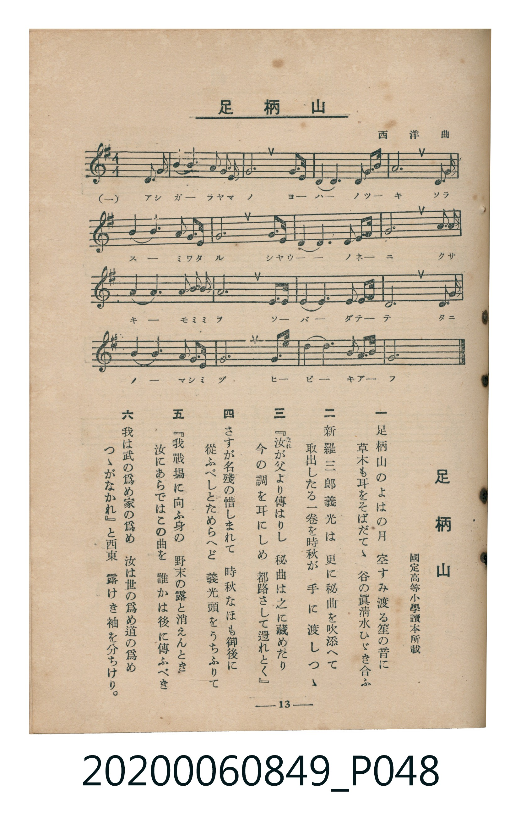

# 足柄山

> Re:Shōka 使用 AI 協助辨識與重建樂譜，可能會有錯誤。歡迎回報。

- **鋼琴伴奏版**：<br><audio controls src="ashigarayama.mp3"></audio>

- 詞：國定高等小學讀本所載
- 曲：西洋曲
- 臺灣教育會公認《新定兒童唱歌》高等科女子用（2020.006.0849）

## 說明

原書資訊與歌詞全文（對應 P048.jpg，書頁 p. 13，高一第二學期第 3 首）：
調性與拍號：ト長調（1 升記號）、4/4 拍（弱起第 4 拍進入）


## 歌詞

```text
一
足柄山（あしがらやま）のよはの月（つき）　空（そら）すみ渡（わた）る笙（しやう）の音（ね）に
草木（くさき）も耳（みみ）をそばだてゝ　谷（たに）の眞清水（ましみづ）ひゞき合（あ）ふ

二
新羅三郎義光（しんらさぶらうよしみつ）は　更（さら）に祕曲（ひきよく）を吹添（ふきそ）へて
取出（とりいだ）したる一卷（ひとまき）を　時秋（ときあき）が手（て）に渡（わた）しつゝ

三
『汝（なれ）が父（ちち）より傳（つた）はりし　祕曲は之（これ）に藏（をさ）めたり
今（いま）の調（しらべ）を耳にしめ　都路（みやこぢ）さして還（かへ）れとく』

四
さすが名殘（なごり）の惜（お）しまれて　時秋なほも御後（みあと）に
從（したが）ふべしとためらへど　義光頭（かうべ）をうちふりて

五
『我（われ）戰場（いくさば）に向（むか）ふ身（み）の　野末（のずゑ）の露（つゆ）と消（き）えんとき
汝にあらではこの曲を　誰（たれ）かは後（のち）に傳ふべき

六
我は武（ぶ）の爲（た）め家（いへ）の爲め　汝は世（よ）の爲め道（みち）の爲め
つゝがなかれ』と西東（にしひがし）　露けき袖（そで）を分（わか）ちけり。
```

## ABC

```abc
X:1
T:足柄山
C:曲：西洋曲
M:4/4
L:1/16
Q:1/4=104
K:G
V:V1 name="Piano" snm="Pia"
[V:V1]
!mf! z4 z4 z4 D3 G | B4 B8 G3 A | B4 G8 B3 G | E6 D2 E4 A3 d |
A12 A3 B | d4 d6 B2 A3 G | A12 B3 G | E6 D2 E4 G3 B |
G12 D3 G | B4 B6 G2 B3 G | A12 F3 G | A6 F2 D4 E3 F |
G12 A3 B | d4 d6 B2 G3 E | G12 B3 d | e6 d2 B4 E3 F |
G12 z4 |
```

## TMD 檔案連結

- [主旋律 TMD 檔案](ashigarayama.tmd) [[在 TMD Studio 編輯](https://tmdlang.github.io/Tmd-TS/#tmd=s7IKdvYPcrWy4qpTUCpJTLdSSM7PyUlNLsnMz7MqzsjMK0nNjM_KTMmPL87Iz05Ugisry88pzU21ys4vyY9PzyzKKY43MjAyiDcwMIs3sDCxRCgszi8tSk61Kk7OyM_PiS9JrShJys_PRsgXFOWXpeYl5gHVFBSB7EsBK0IoSC3LTEkFSaemZJbkF2Um5iC5IrWoGOxSsCXxJUWJecXJRZkFIOcjVJVkpAKdmpdYUlqUii4K1FKWimQiRLQgJzEZSSnQ1vTMPKvc_LykUmA4YEiUpxaXpBblxeem5uSnVCpxaWkpvNi2-dn8lqcbNypoaXEp2ioYGphw2dsquHPZmOib2IEMeLFy3vs9s57O6X66btbL1TOer-18uqH_6dodL9Y1PJuz5llnw4s9nWCbns3eBFT4Yun-Z1u6gWyw2Iv2Xc8bFz-bOvNF06Znc5qftq55sar3cUPXs2kbgMY9bZ30fPXSp1M2Plvb87ihG2L68-UTny7d_HTthOdTVrzf0wGKLj1gdOmBous9yCoufS0FW2oBLgUFhad985_N3vFic_uLFV0vOtqBjgH6-WnrimfT2oEOeLqh91l7p0KAgYmFXlZB-vs9PUDFLxc0KhToKRgaA7lAZz_Z0fB8zZonu3qA4fJsznwgW8FY4eWyaUD3AoMEZMeLVfufNSwHmd7d-2LmfKDo4-aOl1O3A8WBdhgqPO0F2j4DLNP5uKERGPgKQJUg6_dsfLF1O8hEsMjLhk1PW5cCFXGBTAXaCzYcFolA9Y8bmx43Tn_c2PO4qfNxU8vjxn0gExvXPW4CSq0HMp7N6QArW_K4EWg-0LKG5yt3gUXmArWAFc983Lj_2Y6FIMGm_seNYDc1dT9fMxOsbDrY2DaIsS_nbwYLrgVzV4Nd09v5bA4o6h43AjVPhVrT1PSiAaJ0PxCBRSaBrGzc8LhxwePGZY-b5gKd8mLDdrCa-UCzIBY8nzPv2Y7WZxu2gMX3gf0GNAEUBI8bNz1umgc0_-kEiJeawIJbIUGzqwdEARPa832tT3Z0vmzue75v5dNWoA8hfpgMCiCQ87aBGW3gAIIYvgRsznqge57Nhtg7FRY0q58vnQpO6EDBTUCrwbr6Id55OmHns-27wVJbQVKNc8FadgB9B05m_dOetkNCesXjpq7HjcBQXABWAbR1PjCAgbH5tBfif6DRK8C-hYTdJJBTZjY9X94N1Q4yHRjPYNnGnmedEPFlECeiRx3I_CXA8IUmmU4Q9bih79lGoPuAulY9buqBmPO8YxtYZCEQge0FGtL1tAkSbcD0AjFtPdjx00EJBxwWQJEnOyEOAIYpxKjVL6YDAwWoHRjHU8FGNYL92AV2wu4usGpE4oTkAnC0ALk7IX4GphegQWDBRqBlL5v3vti-HpqCQClw8uPGRWDtwDgE-nDZy6YWsGw3MMjBJvSAQ6r_cUM_2OdPZ88G-xykHpjCe55O6H22bgY0CBqnAB0Hccyz5jlgQQgXaPI-sFHL4HEAVr8bmKKf7lv4dB_Qw5BEDYwPYKqH5YKn-4DFJiRFARMzJFSAqWInWAToLGBgNIJ9C0weK0FhCU6cLxcAMxLED23wgACzgXGyFRzwy6DJewosGjsmQmMbHPbPOjY8XQBJtMAwgmTADRBnPZ0AUdkANB_inhe7gLkM5HpoGQEM5fa-Z3MgguseN8563ATUAs7ncyBpHpiOIDl_xbNtkEwHSYNAY4HxAUqY4Fy3EZixgVHXBPbhcnDBA5ReB0ot4MT8YhXQTeB8Dk0wQA-vh4Ul0GJw8gO6uAmYBCCh1guJw9a1YPM7JgLVP1sLTPBA9cBECy4pOiBOhBRXjU_XQRIzMBTAyQGsAJKUwM5b_2QHsHwGuhvoDYTsy8bJsPiEuAEqDkk5oFwEKlpBCaAblCoagAG8AlTlzYWUveDkCsq9QDXTIaUrMOQeNwKd2_tiEdg-UJm3HFpgdADDEpJRIRECjOSJoEhuaALZR3ntBgUKWvpcXL6JwBZAQGZiXr5DjUGNQjXIBgUbQzMtOzALWKlCqhpg7f58fQNIC0i4RsFAQRcM0enq3LRaBdN4MNtQoQYcPSBTQBXhjoYXC3sQRhhDtcBoGDQEk0ZIKiAiCAgRBxkPMckMYh8Egi2HixhBxICKICxMCBE3RnPrrh4Ut5rCDEdzBUQz0CU4jSfBrRBvAl2C4WEU9VgCtpNgwIJMhDsFp2PNEeZDjEJWCJaEugDuaqAgbudiDVpggUtU0EIMBVqD23yIh4CRCwtbJDmQcbAAIMatsARcw1XLxaVrpwDKGApAWpkLAA)]
- [鋼琴伴奏 TMD 檔案](ashigarayama_piano.tmd) [[在 TMD Studio 編輯](https://tmdlang.github.io/Tmd-TS/#tmd=s7IKdvYPcrWy4tLSUnixbfOz-S1PN258v6fjZfee5xO2PNmz5enS_uedHe_3dCpoaXEp2ioYGphw2dsquHPZmOib2HHVKSi9WDnv_Z5ZT-d0P1036-XqGc_Xdj7d0P907Y4X6xqezVnzrLPhxZ5OJZDCZ7M3ARW-WLr_2ZZuIBss9qJ91_PGxc-mznzRtOnZnOanrWterOp93ND1bNoGoHFPWyc9X7306ZSNz9b2PG7ohpj-fPnEp0s3P1074fmUFUCXGhkYGegZGJjpGViYWALdqcTF5ZuYmWcVkJmYlx_k4VBjUKNQzaUABDaGZlp2YJa-lsLTPRtfbN0OdOnz9Q0KWvpg4RoFAwVdMESnq3PTahVM48FsQ4UaLpgpz9esebKj4cXCHoQRxlAtMBoGDcGkEZIKiAgCQsRBxkNMMoPYB4Fgy-EiRhAxoCIICxNCxI3R3LqrB8WtpjDD0VwB0Qx0CU7jSXArxJtAl2B4GEU9loDtJBiwIBPhTsHpWHOE-RCjkBWCJaEugLsaKIjbuViD9uns2UQFLcRQoDW4zYd4CBi5sLBFkgMZBwsAYtwKS8A1XLXI-cIHJV-YEM4WEIg34RvGK0QbxsIoDD5UlQmQaxIfC6aN4nNBCk3jgWxToBiIgW4JWopFtwSuF4c1cHlkrRgeQU1oOO1AGAaLZEwZ3NagpxDSwgunDcB41bVTAEWtAhKtzAUA)]

## 分析

```text
================================================================================
📊 TMD Song Profile: [ 足柄山 ]
================================================================================
⏱  Duration:       0:39 (39.2s), 17 measures total
🎼 Key & Tempo:    首調基準 G, != 104.0 BPM, <4/4>
   - 分析範圍：      由實際發聲的音符與和弦推測調性；播放脈絡另行呈現
🎤 人聲音域:    D4 (MIDI 62) – E5 (MIDI 76) [跨度: 14 個半音 / 1.2 個八度, 難度: moderate]
   - 最低音:  D4 in [Main #1 @ m.1, 0:01]
   - 最高音: E5 in [Main #1 @ m.16, 0:34]
   - 適合: soprano, mezzo-soprano, contralto, tenor, baritone, bass
🏛  結構:      Main (39.2s)
⚡ 編曲密度:        Peak 1 軌道同時演奏
🗝  調性診斷：       G 大調（純淨自然大調，未偵測到可信轉調）
   - 風格氣質:    純淨自然大調（陽光明朗、易唱易記，無明顯調外色彩）
   - 轉調歷程:    全曲維持單一推測調性（未偵測到可信轉調）
   - 核心骨幹音:  G, A, B, D, E
   - 調性數值:    G 大調 [相關度: 0.82, 穩定度: High, 自然音純度: 100.0%]
   - 候選調性 (K-S): G 大調 (0.82), D 大調 (0.67), E 小調 (0.66)
   - 五度圈歷程:   +1
   - 各段落調性細節:
     • [Main #1]: G 大調 (r: 0.82, 自然音純度: 100.0%)

  [ 五度圈游移軌跡 ]
               C  
         F           [G ]*
      Bb               D  
      Eb               A  
         Ab           E  
            Db       B  
               F# 
     (* = active key center)

  [ 十二半音累積音高分佈 ]
     C  :                            0.0%
     C# :                            0.0%
     D  : ████████████              14.8%
     D# :                            0.0%
     E  : ███████████               12.9%
     F  :                            0.0%
     F# : ██                         2.7%
     G  : ████████████████████████  28.9%
     G# :                            0.0%
     A  : ██████████████████        21.5%
     A# :                            0.0%
     B  : ████████████████          19.1%
--------------------------------------------------------------------------------
Assignment 軌道音域：
  - Piano         : D4 – E5 (14 個半音 / 1.2 個八度, 64 個音符)
================================================================================
```


## 原書掃描頁




