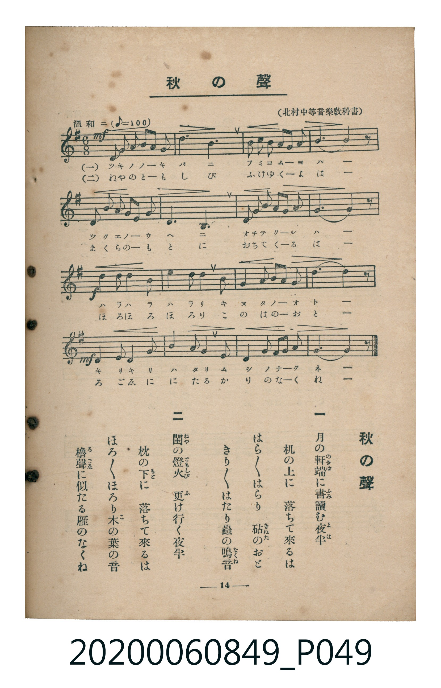

# 秋の聲

> Re:Shoka 使用 AI 辨識樂譜，可能會有錯誤。歡迎回報。

<audio controls src="aki_no_koe.mp3"></audio>

- 編：北村季晴（北村中等音樂教科書）
- 臺灣教育會公認《新定兒童唱歌》高等科女子用（2020.006.0849）

## 說明

原書資訊與歌詞全文（對應 P049.jpg，書頁 p. 14，高一第二學期第 4 首）：
調性與拍號：ホ短調（1 升記號）、6/8 拍（溫和ニ ♪=100）

## 跨冊／重複收錄參照

> 同曲（《新定兒童唱歌》高等科男、女共用教材）

- **[同曲]** 《新定兒童唱歌》高等科男子用（2020.006.0848）：[**〈秋の聲〉**](../../koto_boys_2020.006.0848/1_2_05_aki_no_koe/index.md)（`G` / `6/8` — [原始 TMD](../../koto_boys_2020.006.0848/1_2_05_aki_no_koe/aki_no_koe.tmd)）
- 總表：[跨冊重複與同名歌曲總索引](../../../duplicate_songs.md)

## 歌詞

```text
一
月（つき）の軒端（のきば）に　書（ふみ）讀（よ）む夜半（よは）
机（つくゑ）の上（うへ）に　落（お）ちて來（く）るは
はら／＼はらり　砧（きぬた）のおと
きり／＼はたり　蟲（むし）の鳴音（なくね）

二
閨（ねや）の燈火（ともしび）　更（ふ）け行（ゆ）く夜半
枕（まくら）の下（もと）に　落ちて來るは
ほろ／＼ほろり　木（こ）の葉（は）の音（おと）
櫓聲（ろごゑ）に似（に）たる　雁（かり）のなくね
```

## ABC

```abc
X:1
T:秋の聲
M:6/8
L:1/16
Q:3/8=67
K:Em
V:V1 name="Piano" snm="Pia"
[V:V1]
!mf! E2 G2 B2 B4 B2 | c6 B6 | A2 G2 A2 B4 c2 | B10 z2 |
E2 G2 B2 B4 E2 | F6 B,6 | E2 F2 G2 A4 G2 | F10 z2 |
!f! B2 A2 B2 c4 B2 | e6 d4 B2 | A2 G2 A2 B4 e2 | B10 z2 |
!mf! E2 F2 G2 A4 B2 | c6 B4 E2 | B2 A2 G2 F4 G2 | E10 z2 |
!mf! E2 G2 B2 B4 B2 | c6 B6 | A2 G2 A2 B4 c2 | B10 z2 |
E2 G2 B2 B4 E2 | F6 B,6 | E2 F2 G2 A4 G2 | F10 z2 |
!f! B2 A2 B2 c4 B2 | e6 d4 B2 | A2 G2 A2 B4 e2 | B10 z2 |
!mf! E2 F2 G2 A4 B2 | c6 B4 E2 | B2 A2 G2 F4 G2 | E10 z2 |
```

## TMD 檔案連結

- [主旋律 TMD 檔案](aki_no_koe.tmd) [[在 TMD Studio 編輯](https://tmdlang.github.io/Tmd-TS/#tmd=s7IKdvYPcrWy4qpTUCpJTLdSSM7PyUlNLsnMz7MqzsjMK0nNjM_KTMmPL87Iz05Ugisry88pzU21ys4vyY9PzyzKKY43MjAyiDcwMIs3sDCxRCgszi8tSk61Kk7OyM_PiS9JrShJys_PRsgXFOWXpeYl5gHVFBSB7EsBK0IoSC3LTEkFSaemZJbkF2Um5iC5IrWoGOxSsCXxJUWJecXJRZkFIOcjVJVkpAKdWpyaWJyfV4xTWEtL4fny7seN6140blLQ0uJStFUwNDDgsrdVcOfKTq20VXDN5bIx07ewAxnwfPuK93tmPe2Z_mzuxKdrFz-bueX9ng4I98mOtc_Xdr6cv_nZiqZnU2c-Xz7x2ewd7_d0gi1-0b7reeNioPCLpk3P5jQ_bV3zYlXv44auZ9M2PF0362nrpOerlz6dsvHZ2p7HDd0vV88AmgQ04OnSzU_XTng-BWhnByiY9YDBrAcKZrCxXPpaCrbUAlwKCgpP--YDnfxic_uLFV0vOtqBjnmxct7T1hXPprWDfLmh91l7p0KAgYmlXlZB-vs9PUDFLxc0KhToKRiaALlAZz_Z0fB8zZonu3qert3xbM58IFvBROHlsmlA9wKDDWTHi1X7nzUsB5ne3fti5nyg6OPm2c_nrwWKA-0wVHjaC7R9Blim83FDIzDcFYAqgVLPdq1-OqnncXO3wqOZq2yBMQRUwAUyEWgniHo2pwOo6nHjkseNQOWdoPjcDQzV9WDBdUDBx40bwOKrHzc0gGMGKL71cSPQ2s4X6xpA3CagCZ2PmxqeLpnztLcLIvK4EWhCJ8SCXTAL-h83TYTY8WQHWF1j2-NGUFxDTH8xYS9YECgFFFn4uHHZk31tYJF-sAXAxLYeZCKQetwEDBig6B4I-3FTF1D_8wXLwaqBTl7zuBEcEiAfdD1uXAHR1gtUh9DWOB-i7cX8TWA3NzxunA7R83LzFmB6BJu1CuTqxrXwQNvVA6JeTgMlLaD446YWiJbn7R3PG1eDBVc8bmoCGvW4EWgCMC6AgQZK7MBAA6uc-GJhD9g6oM-A3H5IoIEDat5UsLp94IAC-g8SUN1g1UATgVYiAgoePsjBsvtxEzAOIf4DsSH-ezYH4tjJ0OidCDQaGj8gv0I9CgolWIytngzM02BrgUE5BRZpq5_s2QNWCvQmkAsMvW6g6S9nN4IFu8FhCwlxaKCBzKI8h0GBgpY-F5dvYmaeVUBmYl6-Q41BjUI1yAYFGwstOzADmK9BuWhHAzCIQcpBYkBFuWm1CmbxCoYKxkCoC8Q1wMylC2aByBoFI6CcEZhnAuRBREHQQKEGHOkwg3f1oBiMZCaQWaNgHg8xFUKB5YFCIKN1gSRcHpvJOzpRnQx0sTHYSSCHghxsBtZmCuUhHGyGz8FPZ8_GGhJwV6EGBdgTIGsNIU4FuRkohmx4LReXrp0CKBYUkGhlLgA)]
- [鋼琴伴奏 TMD 檔案](aki_no_koe_piano.tmd) [[在 TMD Studio 編輯](https://tmdlang.github.io/Tmd-TS/#tmd=s7IKdvYPcrWy4tLSUni-vPtx47oXjZve7-l42b3n-YQtT_Zsebq0_3lnx_s9nQpaWlyKtgqGBgZc9rYK7lzZqZW2Cq65XDZm-hZ2XHUKSs-3r3i_Z9bTnunP5k58unbxs5lbgOZAuE92rH2-tvPl_M3PVjQ9mzrz-fKJz2bvAJqpBNL3on3X88bFQOEXTZuezWl-2rrmxarexw1dz6ZteLpu1tPWSc9XL306ZeOztT2PG7pfrp4BNAlowNOlm5-unfB8CtDODiMDIwM9AwMzPQMLE0uwsVy-iZl5VgGZiXn5QR4ONQY1CtVcCkBgY6FlB2boA727Zs2THQ0vFvYoaOmDxYCKctNqFcziFQwVjIFQF4hrFEyANIgFImsUjIByRmCeCZAHEQVBA4UaLmSDd_WgGIxkJpBZo2AeDzEVQoHlgUIgo3WBJFwem8k7OlGdDHSxMdhJIIeCHGwG1mYK5SEcbIbPwU9nz8YaEnBXoQYF2BMgaw0hTgW5GSiGbHgtciT4kBAJZvEQg6LN4nNjoeFjgilkhCkEDc5o43iQCMEoIWQAJGKgQkbEWoMWP_h8YwgTMCXoFgLRhc2ZWMIMj_-gqqAxp2unAIo8BSRamQsA)]

## 分析

```text
================================================================================
📊 TMD Song Profile: [ 秋の聲 ]
================================================================================
⏱  Duration:       0:57 (57.6s), 32 measures total
🎼 Key & Tempo:    首調基準 G, != 100.0 BPM, <6/8>
   - 分析範圍：      由實際發聲的音符與和弦推測調性；播放脈絡另行呈現
🎤 人聲音域:    B3 (MIDI 59) – E5 (MIDI 76) [跨度: 17 個半音 / 1.4 個八度, 難度: challenging]
   - 最低音:  B3 in [Main #1 @ m.6, 0:09]
   - 最高音: E5 in [Main #1 @ m.10, 0:16]
   - 適合: soprano, mezzo-soprano, contralto, tenor, baritone, bass
🏛  結構:      Main (28.8s) -> Main (28.8s)
⚡ 編曲密度:        Peak 1 軌道同時演奏
🗝  調性診斷：       B 小調（流行色彩小調，未偵測到可信轉調）
   - 風格氣質:    流行小調（略帶和弦色彩音與裝飾副屬和弦）
   - 轉調歷程:    全曲維持單一推測調性（未偵測到可信轉調）
   - 核心骨幹音:  B, E, F#, A, C
   - 調性數值:    B 小調 [相關度: 0.69, 穩定度: Moderate, 自然音純度: 90.2%]
   - 候選調性 (K-S): B 小調 (0.69), E 小調 (0.65), B 大調 (0.64)
   - 五度圈歷程:   +5 -> +5
   - 各段落調性細節:
     • [Main #1]: B 小調 (r: 0.69, 自然音純度: 90.2%, 調外音: C)
     • [Main #2]: B 小調 (r: 0.69, 自然音純度: 90.2%, 調外音: C)

  [ 五度圈游移軌跡 ]
               C  
         F            G  
      Bb               D  
      Eb               A  
         Ab           E  
            Db      [B ]*
               F# 
     (* = active key center)

  [ 十二半音累積音高分佈 ]
     C  : ██████                     9.8%
     C# :                            0.0%
     D  : █                          2.2%
     D# :                            0.0%
     E  : ██████████                16.3%
     F  :                            0.0%
     F# : ████████                  13.0%
     G  : ██████                     9.8%
     G# :                            0.0%
     A  : ███████                   10.9%
     A# :                            0.0%
     B  : ████████████████████████  38.0%
--------------------------------------------------------------------------------
Assignment 軌道音域：
  - Piano         : B3 – E5 (17 個半音 / 1.4 個八度, 108 個音符)
================================================================================
```


## 原書掃描頁




