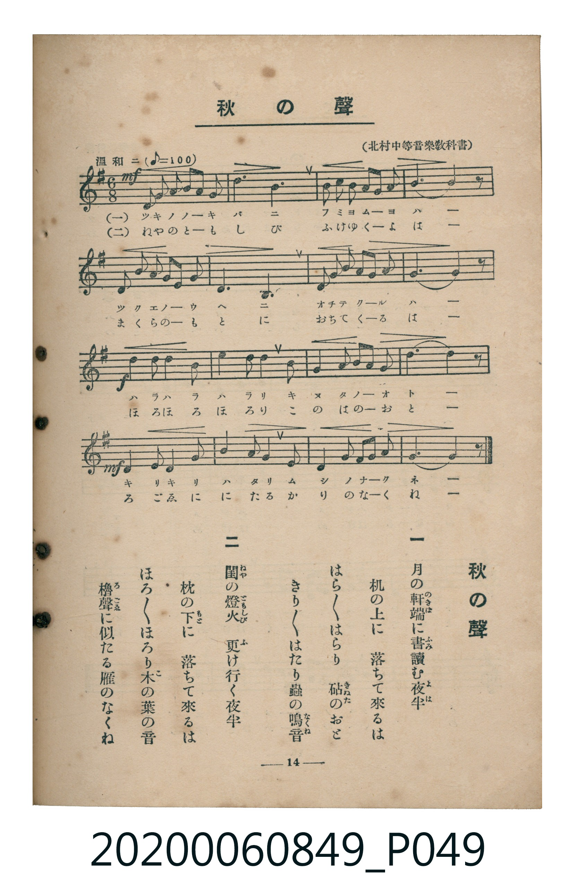

# 秋の聲

> Re:Shōka 使用 AI 協助辨識與重建樂譜，可能會有錯誤。歡迎回報。

- **鋼琴伴奏版**：<br><audio controls src="aki_no_koe.mp3"></audio>

- 編：北村季晴（北村中等音樂教科書）
- 臺灣教育會公認《新定兒童唱歌》高等科女子用（2020.006.0849）

## 說明

原書資訊與歌詞全文（對應 P049.jpg，書頁 p. 14，高一第二學期第 4 首）：
調性與拍號：ト長調（1 升記號）、6/8 拍（溫和ニ ♪=100）
出處註記：（北村中等音樂教科書）


## 歌詞

```text
一
月（つき）の軒端（のきば）に　書（ふみ）讀（よ）む夜半（よは）
机（つくゑ）の上（うへ）に　落（お）ちて來（く）るは
はら／＼はらり　砧（きぬた）のおと
きり／＼はたり　蟲（むし）の鳴音（なくね）

二
閨（ねや）の燈火（ともしび）　更（ふ）け行（ゆ）く夜半
枕（まくら）の下（もと）に　落ちて來るは
ほろ／＼ほろり　木（こ）の葉（は）の音（おと）
櫓聲（ろごゑ）に似（に）たる　雁（かり）のなくね
```

## ABC

<div class="abc-score" data-abc-src="aki_no_koe.abc" aria-label="五線譜載入中"></div>

[下載 ABC 原始檔](aki_no_koe.abc)

## TMD 檔案連結

- [主旋律 TMD 檔案](aki_no_koe.tmd) [[在 TMD Studio 編輯](https://tmdlang.github.io/Tmd-TS/#tmd=s7IKdvYPcrWy4qpTUCpJTLdSSM7PyUlNLsnMz7MqzsjMK0nNjM_KTMmPL87Iz05Ugisry88pzU21ys4vyY9PzyzKKY43MjAyiDcwMIs3sDCxRCgszi8tSk61Kk7OyM_PiS9JrShJys_PRpePL0hMT7UKMEDWWVCUX5aal5gH1F1QBHJJClg7QkFqWWZKKki6ODkxL74stSgzLTM1BcmNqUXFYH9ArCgpSswrTi7KLAB5DqEqv6gkIz-9KLEgo9IqI7O4JL8oMzkxJz47MQ_JuyUZqUDfFqcmFufnFSPrzUzPzLMqScwEBg8oiMoT43MTM_NyEvOA7tDSUni-vPtx47oXjZsUtLS4FG0VDA0MuOxtFdy5bMz0LexA5jzfvuL9nllPe6Y_mzvx6drFz2Zueb-nA8J9smPt87WdL-dvfrai6dnUmc-XT3w2e8f7PZ1g-1-073reuBgo_KJp07M5zU9b17xY1fu4oevZtA1P18162jrp-eqlT6dsfLa253FD98vVM4AmAQ14unTz07UTnk8B2tkBijA9YITpgSIMbCyXvpaCLbUAl4KCwtO--UAnv9jc_mJF14uOdqBjXqyc97R1xbNp7SBfbuh91t6pAIp1vayC9Pd7eoCKXy5oVCjQUzA0AXKBzn6yo-H5mjVPdvU8Xbvj2Zz5QLaCicLLZdOA7gUGG8iOF6v2P2tYDjK9u_fFzPlA0cfNHS-nbgeKA-0wVHjaC7R9Blim83FDIzDcFYAqgVLPdq1-OqnncXO3wqOZq2yBMQNUAHZ0-64XM6e-WLEbqA1oGsHo4AJpAroTRD2b0wFU_7hxyeNGoBWdoLjfDYyJ9WDBdUDBx40bwOKrHzc0gLUDxbc-bgQ6tfPFugYQtwloQufjpoanS-Y87e2CiDxuBJoAdtyzObtgFvQ_bpoIsePJDrC6xrbHjSAHQUx_MWEvWBAoBRRZ-Lhx2ZN9bWCRfrAFwIS5HmQikHrcBAxMoOgeCPtxUxdQ__MFy8GqgU5e87gRHHogH3Q9blwB0dYLVIfQ1jgfou3F_E1gNzc8bpwO0fNy8xZgoIHNWgVydeNaeKDt6gFRL6eBkiNQ_HFTC0TL8_aO542rwYIrHjc1AY163Ag0ARh_wEADZRBgoIFVTnyxsAdsHdBnQG4_JNDAATVvKljdPnBAAf0HCahusGqgiUArEQEFDx_kYNn9uAkYhxD_gdgQ_z2bA3HsZGj0TgQaDY0fkF-hHgWFEizGVk8G5n-wtcCgnAKLtNVP9uwBKwV6E8gFhl430PSXsxvBgt3gsIWEODTQQGZRniuhQEFLn4vLMTvTL987H1juZibm5TvUGNRUgyxRsLHQsgMzsBUHCqDsuKMBGO4KGiYKTzf0P1_foAPPw5pYNACtAhlWo1Cdm1arYBqvYBavYKhgBMRARo2CqYIuEBqDyRogbQrEIEkjMA8kCoIGCjVgU3wMaxQeN7coPG5aC6T7wFgXzAOJTwCrBWVpiGmPm6cC8XwgXgHEC8ByK8Di_XCTgW6AmGwEFG8EmtoENL1xHRCvAJvcBFLfOB1icuNmmMmNW4F4IlC-DUiDTANmU7D4ehST8Yfjrh5ywhEYhJAgAgckmA8OQggF5hsiBaIhnkBcD8SgoIEE4jJw0MxAD8SmVUBeIxADvQrUAZJbjTcQ94GDBJjrwAGJCERQgIICcTU8ELuAeCEQL4MHYjfJgbijk6zECEqLQPNNwaQxUMQMhQcKNSNoKMISKWYYgt3cvBKJhSq6Cilx9oDZ--GhvQos2oEjDHeD1fQisVBEm7rAITkZLAoOY2CYwVhdSKFNVBg-nT2bkgytC0qJYBoUVqBMCwo1sCg0dRoqmEMyPc7kCAwkUKABkxqcBQ9KcKCBgxKYh0Fqt4PZoNwPDgZgogSp7cUelMDgAgXKFCBrIjT5gYIHlAiB5S44yYFY4IQHCVaQyY1g-4CJElIqIJtcy8Wla6cAKz0VgGxlLgA)]
- [鋼琴伴奏 TMD 檔案](aki_no_koe_piano.tmd) [[在 TMD Studio 編輯](https://tmdlang.github.io/Tmd-TS/#tmd=s7IKdvYPcrWy4qpTUCpJTLdSSM7PyUlNLsnMz7MqzsjMK0nNjM_KTMmPL87Iz05Ugisry88pzU21ys4vyY9PzyzKKY43MjAyiDcwMIs3sDCxRCgszi8tSk61Kk7OyM_PiS9JrShJys_PRpePL0hMT7UKMEDWWVCUX5aal5gH1F1QBHJJClg7QkFqWWZKKki6ODkxL74stSgzLTM1BcmNqUXFYH9ArCgpSswrTi7KLAB5DqEqv6gkIz-9KLEgo9IqI7O4JL8oMzkxJz47MQ_Ju4lFQM3pqbmpeSVWBZmJefnxicnJ-bkFiXmZIDGEwpIMoCKr4tTE4vy8YmRLMtMz86xKEjOB4QgKy_LE-NzEzLycxDygg7W0FJ4v737cuO5F46b3ezpedu95PmHLkz1bni7tf97Z8X5Pp4KWFpeirYKhgQGXva2CO5eNmb6FHcjw59tXvN8z62nP9GdzJz5du_jZzC1A_RDukx1rn6_tfDl_87MVTc-mzny-fOKz2TuAZoEd9aJ91_PGxUDhF02bns1pftq65sWq3scNXc-mbXi6btbT1knPVy99OmXjs7U9jxu6X66eATQJaMDTpZufrp3wfArQzg5QdOsBo1sPFN1gY7kcszP98r3zgfEICqEgD4cag5pqLgUgsLHQsgMz9LUUbNGBwvM1a57saHixsEdBw0Th6Yb-5-sbdBRAaUEvqyBdE4sGLX2wYTUK1blptQqm8Qpm8QqGCkZADGTUKJgq6AKhMZisAdKmQAySNALzQKIgaKBQAzbFx7BG4XFzi8LjprVAug-MdcE8kPgEsNrHzd1Q0x43TwXi-UC8AogXgOVWgMX74SYD3QAx2Qgo3gg0tQloeuM6IF4BNrkJpL5xOsTkxs0wkxu3AvFEoHwbkAaZ9ripAyy-HsVk_OG4q4eccAQGISSIwAEJ5oODEEKB-YZIgWiIJxDXAzEoaCCBuAwcNDPQA7FpFZDXCMRArwJ1gORW4w3EfeAgedzUCQ5IRCCCAhQUiKvhgdgFxAuBeBk8ELtJDsQdnWQlRlBaBJpvCiaNgSJmKDxQqBlBQxGWSDHDEOzm5pVILFTRVUiJswfM3g8P7VVg0Q4cYbgbrKYXiYUi2tQFDsnJYFFwGAPDDMbqQgptosLw6ezZlGRoXVBKBNOgsAJlWlCogUWhqdNQwRyS6XEmR2AggQINmNTgLHhQggMNHJTAPAxSux3MBuV-cDAAEyVIbS_2oAQGFyhQpgBZE6HJDxQ8oET4uBFYNgCTHIgFTniQYAWZ3Ai2D5goIaUCssm16IWnD47CE1FUwoPMEJJJow3jY8EMfCKm8fG5MDHjeKggkAEWBAUesj2QogTDHjMkM4DmoZqBIghkYHcSuk2Q_IbHRyYwI_F5Et1eNFugKZKIcMPqQ7yeAcafrp0CLAqjfQyBEsh8IzBfmQsA)]

## 分析

```text
================================================================================
📊 TMD Song Profile: [ 秋の聲 ]
================================================================================
⏱  Duration:       0:28 (28.8s), 16 measures total
🎼 Key & Tempo:    首調基準 G, != 100.0 BPM, <6/8>
   - 分析範圍：      由實際發聲的音符與和弦推測調性；播放脈絡另行呈現
🎤 人聲音域:    B3 (MIDI 59) – E5 (MIDI 76) [跨度: 17 個半音 / 1.4 個八度, 難度: challenging]
   - 最低音:  B3 in [AkiNoKoe #1 @ m.6, 0:09]
   - 最高音: E5 in [AkiNoKoe #1 @ m.10, 0:16]
   - 適合: soprano, mezzo-soprano, contralto, tenor, baritone, bass
🏛  結構:      AkiNoKoe (28.8s)
⚡ 編曲密度:        Peak 1 軌道同時演奏
🗝  調性診斷：       G 大調（純淨自然大調，未偵測到可信轉調）
   - 風格氣質:    純淨自然大調（陽光明朗、易唱易記，無明顯調外色彩）
   - 轉調歷程:    全曲維持單一推測調性（未偵測到可信轉調）
   - 核心骨幹音:  D, G, B, A, E
   - 調性數值:    G 大調 [相關度: 0.88, 穩定度: High, 自然音純度: 100.0%]
   - 候選調性 (K-S): G 大調 (0.88), D 大調 (0.76), B 小調 (0.72)
   - 五度圈歷程:   +1
   - 各段落調性細節:
     • [AkiNoKoe #1]: G 大調 (r: 0.88, 自然音純度: 100.0%)

  [ 五度圈游移軌跡 ]
               C  
         F           [G ]*
      Bb               D  
      Eb               A  
         Ab           E  
            Db       B  
               F# 
     (* = active key center)

  [ 十二半音累積音高分佈 ]
     C  :                            0.0%
     C# :                            0.0%
     D  : ████████████████████████  31.5%
     D# :                            0.0%
     E  : ██████                     7.6%
     F  :                            0.0%
     F# : █                          1.1%
     G  : █████████████████████     27.2%
     G# :                            0.0%
     A  : ████████                  10.9%
     A# :                            0.0%
     B  : █████████████████         21.7%
--------------------------------------------------------------------------------
Assignment 軌道音域：
  - Piano         : B3 – E5 (17 個半音 / 1.4 個八度, 58 個音符)
================================================================================
```


## 原書掃描頁




