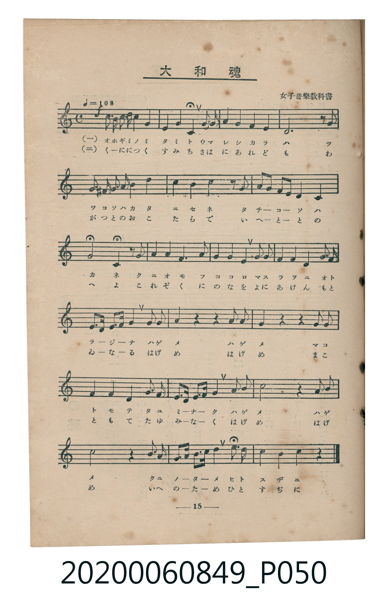
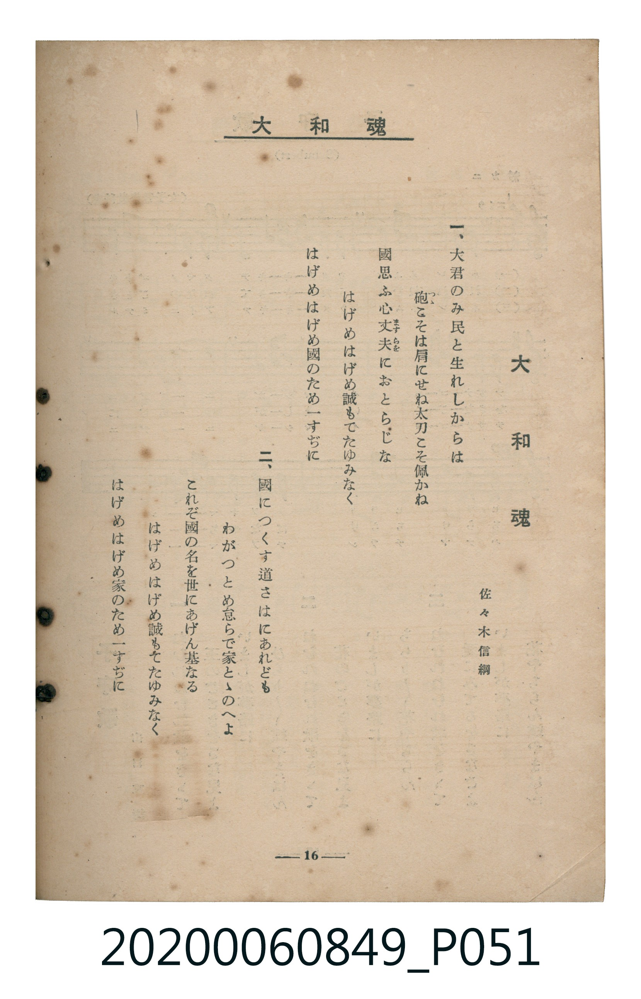

# 大和魂

> Re:Shoka 使用 AI 協助辨識與重建樂譜，可能會有錯誤。歡迎回報。

<audio controls src="yamato_damashii.mp3"></audio>

- 詞：佐々木信綱（女子音樂教科書）
- 臺灣教育會公認《新定兒童唱歌》高等科女子用（2020.006.0849）

## 說明

原書資訊與歌詞全文（對應 P050.jpg – P051.jpg，書頁 pp. 15–16，高一第二學期第 5 首）：
調性與拍號：ハ長調（無升降記號）、4/4 拍（♩=108，弱起後半小節進入）

## 歌詞

```text
一、
大君（おほぎみ）のみ民（たみ）と生（うま）れしからは
砲（つつ）こそは肩（かた）にせね太刀（たち）こそ佩（は）かね
國思（くにおも）ふ心丈夫（こころますらを）におとらじな
はげめはげめ誠（まこと）もてたゆみなく
はげめはげめ國のため一（ひと）すぢに

二、
國につくす道（みち）さはにあれども
わがつとめ怠（おこた）らで家（いへ）とゝのへよ
これぞ國の名（な）を世（よ）にあげん基（もとゐ）なる
はげめはげめ誠もてたゆみなく
はげめはげめ家のため一すぢに
```

## ABC

```abc
X:1
T:大和魂
M:4/4
L:1/16
Q:1/4=108
K:C
V:V1 name="Piano" snm="Pia"
[V:V1]
!f! z4 z4 G,2 G, G, C2 C2 | D4 D4 E4 G2 E2 | D4 C4 A,4 C4 | G,8 z4 z2 G,2 |
G,2 ^F,2 G,2 A,2 C4 D4 | E4 D4 C4 z2 G2 | G2 E D C2 D2 E2 C2 A,4 | A,4 G,4 z2 G,2 C2 C2 |
C4 B,2 C2 D2 D2 G,2 C D | E2 E2 D2 D2 C2 E2 D2 C B, | A,3 B, C2 A,2 G,4 C3 D | E4 z4 z4 D3 C |
A,4 z4 z4 C3 C | G,4 C4 D4 E2 D2 | C3 D E2 F2 G4 A3 A | G8 z4 E3 D |
C8 z4 D3 C | B,3 C D2 E2 F4 A2 F2 | E4 D4 C4 z4 |
```

## TMD 檔案連結

- [主旋律 TMD 檔案](yamato_damashii.tmd) [[在 TMD Studio 編輯](https://tmdlang.github.io/Tmd-TS/#tmd=s7IKdvYPcrWy4qpTUCpJTLdSSM7PyUlNLsnMz7MqzsjMK0nNjM_KTMmPL87Iz05Ugisry88pzU21ys4vyY9PzyzKKY43MjAyiDcwMIs3sDCxRCgszi8tSk61Kk7OyM_PiS9JrShJys_PRsgXFOWXpeYl5gHVFBSB7EsBK0IoSC3LTEkFSaemZJbkF2Um5iC5IrWoGOxSsCXxJUWJecXJRZkFIOcjVJVkpAKdmpuZk1mSWFSpxKWlpfB0yfKnk3perm1S0NLiUrRVMDSw4LK3VXDmsjHRN7ED6Xyxct77PbOe7J3wuKH12ZwVT_YvfL5t4_s9HU-Xbn66dsLL-ZufrWh6NnXm8-UTn83e8X5PJ9i6F-27njcuBgq_aNr0bE7z09Y1L1b1Pm7oejZtw9N1s562Tnq-eunTKRufre153ND9cvWM52s7gQZAjHw-ZQXQeFAo6gFDUQ8UimBjufS1FGypBbgUFBSe9s0HOvnF5vYXK7pedLQDHQP069PWFc-mtYP8t6H3WXunQoCBqYFeVkG6wqOGySCOIYjzfk8PUOfLBY0KBQV6CoamQDlDM6Ag0CdPdjQ8X7Pmya6ep2t3PJszH8hWMFV4uWwa0AvAYARZ-2LV_mcNy0EWdve-mDkfKPq4uf_l1O1AcaC1z1sWPu1tfzmz98WKGWDZzscNjcC4UACqBko_mrnSFhhHQLue7tn4Yuv2p_t6nvZ2Pd3Q_3x9w8uGTU9blwJ1cIGsAToEqBPsT2AcT5gN1Py4setx4-7HjX2PG4FWdT5uXAdkPNswESw1Hya44vkUoLVAkbbHjftAIk09jxunP27sftwElF0PMvH5gk1gFUuACKxn8uPGuUC5F00rweLdQOPA4qsfN85-3Lj26ZJVTzsaYNYshGt5sheifj1YBKhrLdi9c7qfNcwFS_SDjeh63NQEVrH16f7mJzs6ni5ZDZYFGjH5cVMv0JmPG2eCXNc0CWYr0KMrwO6d8bhxFchQoCWPGyc9bmqEM16sWgA2BagZaBAwzQH1Nz1uXAZyYxPQ7_uBOoEuwK4Z6EZw8AGVNgJDGmzQJqgpQLc0LgK6AhINu4BJHBINIC1ApwEDDeitmS8bJ4N1Aa2BBMhUsOFABU3gEF8JdA3Y7iagaiAfqA3oo8ZnDRBXAz0IdDU4lEHeXP503TaweMvjRlAuBCsGRgnQiTseN3VAPAEMLKBB8yBufzoBlJ6AfgQbMenJDmAS7QAqhYUgMCiAHp38dP4usDiQCzRxAlh21eOmbpxhSkogrtuGHIiIgAOqpjyLQ4GClj4Xl29iZp5VQGZiXr5DjUGNQjXIBgUbQzMtOzALWLJAsxM4I4G0gIRrFAwUdMEQRlen1SqYxgMZQAKIDIEsEK4BRzXIGFDe39HwYmEPwgwjqF4YbQylTaFshAqQUSBoBrIBWaAGYikyRHYZWBLVDbt6UNwAVmGiDnU51AaY6TDra-BOQ3cQ2BKIO8CONgLLgFSBdIDYcCejBUUnijPgquDegTsfHpRwS81hwiB7QBiqzgjqUBCGSYGUwfiGIJ0ozng6ezY2ZwCVwZ0OdxDEdpgd6CGNCBxDZO-gK4EYAlSCGidTMOMEOZSREwiIDQsKI7CICciVUBVmUBISH9iSBcTxQG-ghEPrWhQXwCxG14zwITgOIIEOMRPkCpgLQGz8aQaSIGq5uHTtFEBZUAFIK3MBAA)]
- [鋼琴伴奏 TMD 檔案](yamato_damashii_piano.tmd) [[在 TMD Studio 編輯](https://tmdlang.github.io/Tmd-TS/#tmd=s7IKdvYPcrWy4tLSUni6ZPnTST0v1za939PxsnvP8wlbnuzZ8nRp__POjvd7OhW0tLgUbRUMDSy47G0VnLlsTPRN7LjqFJRerJz3fs-sJ3snPG5ofTZnxZP9C59v2wg04unSzU_XTng5f_OzFU3Pps58vnzis9k7gAYpgTW173reuBgo_KJp07M5zU9b17xY1fu4oevZtA1P18162jrp-eqlT6dsfLa253FD98vVM56v7QQaADHy-ZQVQOONDIwM9AwMzPQMLEwswcZy-SZm5lkFZCbm5Qd5ONQY1ChUcykAgY2hmZYdmKUP9OSejS-2bn-6of_5-gYFLX2wcI2CgYIuGMLo6rRaBdN4IANIAJEhkAXCNVwwY56vWfNkR8OLhT0IM4ygemG0MZQ2hbIRKkBGgaAZyAZkgRqIpcgQ2WVgSVQ37OpBcQNYhYk61OVQG2Cmw6yvgTsN3UFgSyDuADvaCCwDUgXSAWLDnYwWFJ0ozoCrgnsH7nx4UMItNYcJg-wBYag6I6hDQRgmBVIG4xuCdKI44-ns2dicAVQGdzrcQRDbYXaghzQicAyRvYOuBGIIUAlqnEzBjBPkUEZOICA2LCiMwCImIFdCVZhBSUh8YEsWEMcDvYESDq1rUVwAsxhdM8KH4DiABDrETJArYC4AsfGnGUiCqEXOgT4oOdCEcAY0UDCMV4g2jMWfyUzjgYpM42PhiiEiQJYJkDIBSiCpATEMCGUYJPNANDC0ECJAzTCLzEAKzeJzMdyHmvJBrgBpBvsGwgU5Cm4NwniwgWAhfEkYZgDcu1CGAdhIUNKEOcsApBZvQoRqRXMLUAREEQ46jFQF1wwKJrhOLPEAUQJKH7p2CqAkooBEK3MBAA)]

## 分析

```text
================================================================================
📊 TMD Song Profile: [ 大和魂 ]
================================================================================
⏱  Duration:       0:42 (42.2s), 19 measures total
🎼 Key & Tempo:    首調基準 C, != 108.0 BPM, <4/4>
   - 分析範圍：      由實際發聲的音符與和弦推測調性；播放脈絡另行呈現
🎤 人聲音域:    F#3 (MIDI 54) – A4 (MIDI 69) [跨度: 15 個半音 / 1.2 個八度, 難度: moderate]
   - 最低音:  F#3 in [Main #1 @ m.5, 0:09]
   - 最高音: A4 in [Main #1 @ m.15, 0:32]
   - 適合: mezzo-soprano, contralto, tenor, baritone, bass
🏛  結構:      Main (42.2s)
⚡ 編曲密度:        Peak 1 軌道同時演奏
🗝  調性診斷：       C 大調（純淨自然大調，未偵測到可信轉調）
   - 風格氣質:    純淨自然大調（陽光明朗、易唱易記，無明顯調外色彩）
   - 轉調歷程:    全曲維持單一推測調性（未偵測到可信轉調）
   - 核心骨幹音:  C, D, G, E, A
   - 調性數值:    C 大調 [相關度: 0.87, 穩定度: Moderate, 自然音純度: 99.2%]
   - 候選調性 (K-S): C 大調 (0.87), G 大調 (0.77), A 小調 (0.58)
   - 五度圈歷程:   +0
   - 各段落調性細節:
     • [Main #1]: C 大調 (r: 0.87, 自然音純度: 99.2%, 調外音: F#)

  [ 五度圈游移軌跡 ]
              [C ]*
         F            G  
      Bb               D  
      Eb               A  
         Ab           E  
            Db       B  
               F# 
     (* = active key center)

  [ 十二半音累積音高分佈 ]
     C  : ████████████████████████  26.7%
     C# :                            0.0%
     D  : ███████████████████       21.3%
     D# :                            0.0%
     E  : █████████████             14.0%
     F  : ███                        3.1%
     F# : █                          0.8%
     G  : ██████████████████        20.2%
     G# :                            0.0%
     A  : ██████████                11.2%
     A# :                            0.0%
     B  : ██                         2.7%
--------------------------------------------------------------------------------
Assignment 軌道音域：
  - Piano         : F#3 – A4 (15 個半音 / 1.2 個八度, 97 個音符)
================================================================================
```


## 原書掃描頁






