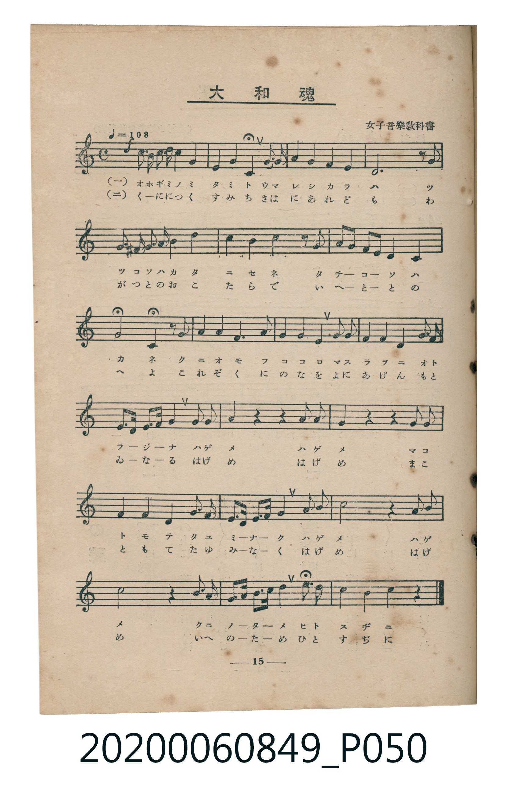
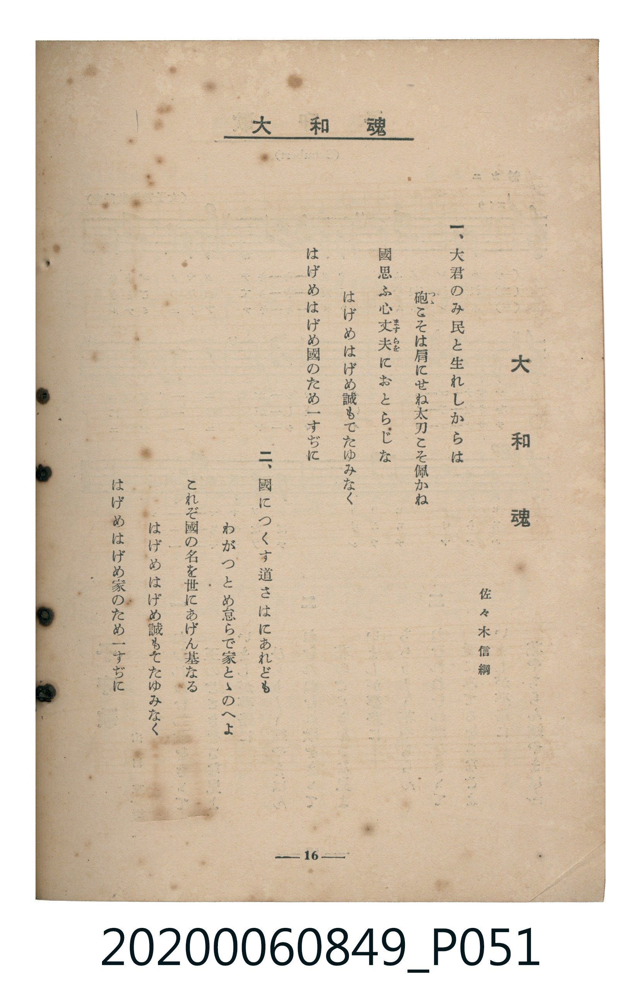

# 大和魂

> Re:Shōka 使用 AI 協助辨識與重建樂譜，可能會有錯誤。歡迎回報。

- **鋼琴伴奏版**：<br><audio controls src="yamato_damashii.mp3"></audio>

- 詞：佐々木信綱
- 出處：女子音樂教科書
- 臺灣教育會公認《新定兒童唱歌》高等科女子用（2020.006.0849）

## 說明

原書資訊與歌詞全文（對應 P050.jpg – P051.jpg，書頁 pp. 15–16，高一第二學期第 5 首）：
調性與拍號：ハ長調（無升降記號）、4/4 拍（♩=108）
出處註記：女子音樂教科書
註：第二段第二句譜面作「わがつとのおこたらで」，底欄歌詞作「わがつとめ怠らで」。


## 歌詞

```text
一、
大君のみ民と生れしからは
砲（つつ）こそは肩にせね太刀こそ佩かね
國思ふ心丈夫（ますらを）におとらじな
はげめはげめ誠もてたゆみなく
はげめはげめ國のため一すぢに

二、
國につくす道さはにあれども
わがつとめ怠らで家とゝのへよ
これぞ國の名を世にあげん基なる
はげめはげめ誠もてたゆみなく
はげめはげめ家のため一すぢに
```

## ABC

<div class="abc-score" data-abc-src="yamato_damashii.abc" aria-label="五線譜載入中"></div>

[下載 ABC 原始檔](yamato_damashii.abc)

## TMD 檔案連結

- [主旋律 TMD 檔案](yamato_damashii.tmd) [[在 TMD Studio 編輯](https://tmdlang.github.io/Tmd-TS/#tmd=s7IKdvYPcrWy4qpTUCpJTLdSSM7PyUlNLsnMz7MqzsjMK0nNjM_KTMmPL87Iz05Ugisry88pzU21ys4vyY9PzyzKKY43MjAyiDcwMIs3sDCxRCgszi8tSk61Kk7OyM_PiS9JrShJys_PRpePL0hMT7UKMDA1wCljiJApKMovS81LzAOaW1AEcmMK2GCEgtSyzJRUkHRxcmJefFlqUWZaZmoKkutTi4rBPoRYUVKUmFecXJRZAPI2QlV-UUlGfnpRYkFGpVVGZnFJflFmcmJOfHZiHlJAlGSkAsMhNzMnsySxqBJZc2Z6Zp5VbmpmViYWb0OlSxIzgQELCtzyxPjcxMy8nMQ8oDu1tBSeLln-dFLPy7VNClpaXIq2CoYGFlz2tgrOXDYm-iZ2IHNerJz3fs-sJ3snPG5ofTZnxZP9C59v2wi24Wn7rhczpwIlny7d_HTthJfzNz9b0fRs6sznyyc-m70DrORF-67njYuBYi-aNj2b0_y0dc2LVb2PG7qeTdvwdN2sp62Tnq9e-nTKxmdrex43dL9cPeP52k6gboh5z6eseL-nAxTfesD41gPF9_s9nUpcXPpaCrbUAlwKCgpP--YD3ftic_uLFV0vOtqBjgH6-WnrimfT2oEOeLqh91l7pwIo0ehlFaQrPGqYDOIYgjjv9_QAdb5c0KhQUKCnYGgKlDM0AwoCffJkR8PzNWue7Op5unbHsznzgWwFU4WXy6YBvQAMMZC1L1btf9awHGRhd--LmfOBoo-b-19O3Q4UB1r7vGXh0972lzN7X6yYAZbtfNzQCIwTBaBqoPSjmSttgXEFFAb7ABwTL1bsBirGFR9gK1fsBkpD3PVs3VaoA_uXvlg75-XcRU_2znnc0PO4qf9xY8_jxiWPG1c8blz3uLHrcePkx43zHzd1Pm5c_rgBaHvP011Tn61pgQQUFl1Njc8aFsDVP25o4gJZDgwRoBfAzgUmugmzwYbvf7ZhIlDL8ylA84Hapz9u7AZrXA9S93zBJqBXwYYuAQUAyB1zgXIvmlY-blz9uBFoxNqnS1Y97WiASD3ZCxTvBgqCLZnT_awBqHrr0_3NT3Z0PF2yGmzWvseNM0E2NE0Cmwg0Beg_oJOB7BmPG1eBdAJteNw4CegLOOPFKqB3mh43LgOHQxvQ2UCljxv7sasG2gz2G1BpI8jTQAsbFwGtgoTCLmBSh4QCSBnQfqDvgGE38yXIC1PBhgAFm8DBsRJoK9gOHKH7dN02sAjQm0D7djxu6oC4aDJY9zyIQ55O6AX69smOaVCDQW6c_HT-LpAXmrqp4mGQM7B5GKia8iwKBQpa-lxckYm5iSX5LkASWGtkWgVkJublO9QY1FSDrFKwMTTTsgOzsBURCqDkvqPhxcIeBQ0Thacb-p-vb9CB52tNLBqANoIMq1GoTqtVMIxT0AVCcwjDCERAhXSBORtC1ygYo4kYovBNgSrM0FSYQGmYzhoFIygLHRpAddWAXeVjWANMF6vAMo-bZwPZ68Cs-WCyD6oHwoeY-7hpP4bo4-YOGKtpGVRkHkht8xq4-HY4azVc10qEqc39ONwbD1bZgnCxEVB1I0T14-Y9QDbIPBi5BGY2VAXY7MaZcFG42xsXwllTofR6sFq46xqb4C7ugYshubgJJo_VxU0g-2vAmRV3OtrVA05HxqSlI1DsmagDCRADlBDMoRaDkxPEdfBEBZODC8DjH6wVbBYQg9INLMXAUhtSCgGH_-OmzWByL4gExxdSXMJTBUh1N1x0N4zV3IsSOiDVIJWNYLk9CNOhbJAdEH3weESKfVB8QOIaWHCBSXCqbeyC6WqcjHBNIzyVNnXC5Zcju6YRnLqA9A6ECyDmIrEh-kD2QFxDoIToJKeEgOVmGITFBGqcgSCMhuV7mBjCDBiNXJZAzIDpgdGweIfoMEEpGWDxC4Po8bgebCJyjEPKEpDKRSj6QLkMZCIoliEq4azmtXDWPLDMTqipsNz2uHkTnIVuE6jsQU4boDhEcXETrGyCxDUoZYDcgcjTIDshLOQyCFISgEyExTmw8oKbOQnFdIRaeJnRiFABS4uwEgOUngikn6ezZ5NTMkDi2ghKm6CkBdT0A0pRyDRIHDX9oKuAm4FUKkDiB1wKN0HCHcxuhudDaCkBij2QeliZC4oJZJp4dZD0AUo5SHHeNAFhNzSOIG6CpxVg2Q6LE5B6UKmD1Xyi1e0Dk-C0RKiMn0JOTOLLoyAx3HENqxCQ6gAYRI5ssBKkqIRX4PBs-7i5DcYCF9ePm0FVO0gtpEBFjmpIcIMCD190wiDWaEfKwvDiFl7FAtuQcBa4adIEchtILaTawYh6eFbGFaUYbkFWRyBztq4lJ0pxRgcoKpDznhm00gZqgNfoxhAGkE-obgdB5IjFGfjg6IKUpyB1kLYeJCKRAhWu_3EzpEQDl7fQMhrCh0cSvGyG2YGcR3EHPLhtAS63EaUtJBKREhpc_-NGSF0ALkVR2nbwhAtvwyHcUcvFpWungNrwVwCKKHMBAA)]
- [鋼琴伴奏 TMD 檔案](yamato_damashii_piano.tmd) [[在 TMD Studio 編輯](https://tmdlang.github.io/Tmd-TS/#tmd=s7IKdvYPcrWy4qpTUCpJTLdSSM7PyUlNLsnMz7MqzsjMK0nNjM_KTMmPL87Iz05Ugisry88pzU21ys4vyY9PzyzKKY43MjAyiDcwMIs3sDCxRCgszi8tSk61Kk7OyM_PiS9JrShJys_PRpePL0hMT7UKMDA1wCljiJApKMovS81LzAOaW1AEcmMK2GCEgtSyzJRUkHRxcmJefFlqUWZaZmoKkutTi4rBPoRYUVKUmFecXJRZAPI2QlV-UUlGfnpRYkFGpVVGZnFJflFmcmJOfHZiHlJAJBYBNaen5qbmlVgVZCbm5ccnJifn5xYk5mWCxBAKSzKAiqxyM3MySxKLKpFtyUzPzLPKTc3MysQSPlDpksRMYAyAYqE8MT43MTMvJzEP6CEtLYWnS5Y_ndTzcm3T-z0dL7v3PJ-w5cmeLU-X9j_v7Hi_p1NBS4tL0VbB0MCCy95WwZnLxkTfxA5k-IuV897vmfVk74THDa3P5qx4sn_h820bwdY-bd_1YuZUoOTTpZufrp3wcv7mZyuank2d-Xz5xGezd4CVvGjf9bxxMVDsRdOmZ3Oan7auebGq93FD17NpG56um_W0ddLz1UufTtn4bG3P44bul6tnPF_bCdQNMe_5lBVAl4JSix4wteiBUgvQnUpcXJGJuYkl-S5AEpjwMq0CQIEZ5OFQY1BTzaUABDaGZlp2YJa-loItOlB4vmbNkx0NLxb2KGiYKDzd0P98fYOOAihF6WUVpGti0aClDzasRqE6rVbBME5BFwjNIQwjEAEV0lUwhdI1CsZoIoYofFOgCjM0FSZQGqazRsEIykKHBlBdNWBX-RjWKDxuWgWWedw8G8heB2bNB5N9UD0QPsTcx037MUQfN3fAWE3LoCLzQGqb18DFt8NZq-G6ViJMbe7H4d54sMoWhIuNgKobIaofN-8BskHmwcglMLOhKsBmN86Ei8Ld3rgQzpoKpdeD1cJd19gEd3EPXAzJxU0weawubgLZX8OFPx3t6gGnI2PS0hEo9kzUgQSIAUoI5lCLwckJ4jp4ooLJwQXg8Q_WCjYLiEHpBpZiYKkNKYWAw_9x02YwuRdEguMLKS7hqQKkuhsuuhvGau5FCR2QapDKRrDcHoTpUDbIDog-eDwixT4oPiBx_bhxBZgEp9rGLpiuxskI1zTCU2lTJ1x-ObJrGsGpC0jvQLgAYi4SG6IPZA_ENQRKiE5ySghYboZBWEygxhkIwmhYvoeJIcyA0chlCcQMmB4YDYt3iA4TlJIBFr8wiB6P68EmIsc4pCwBqVyEog-Uy0AmgmIZohLOal4LZ80Dy-yEmgrLbY-bN8FZ6DaByh7ktAGKQxQXN8HKJkhcg1IGyB2IPA2yE8JCLoMgJQHIRFicP26E-61pEorpCLXwMqMRoQKWFmElBig9EUg_T2fPJqdkgMS1EZQ2QUkLqOkHlKKQaZA4avpBVwE3A6lUgMQPuBRugoQ7mN0Mz4fQUgIUeyD1sDIXFBPINPHqIOkDlHKQ4rxpAsJuaBxB3ARPK8CyHRYnIPWgUger-USr2wcmwWmJUBk_hZyYxJdHQWK44xpWISDVATCIHNlgJUhRCa_A4dn2cXMbjAUurh83g6p2kFpIgYoc1ZDgBgUevuiEQazRjpSF4cUtvIp93AhpVoBY4KZJE8htILWQagcj6uFZGVeUYrgFWR2BzNm6lpwoxRkdoKhAzntm0EobqAFeoxtDGEA-obodBJEjFmfgg6MLUp6C1EHaepCIRApUuP7HzZASDVzeQstoCB8eSfCyGWYHch7FHfDgtgW43EaUtpBIREpocP2PGyF1AbgURWnbwRMuvA2HcEct9na_D3K73wTR7Ec08hFla3y8gikQG0IoYDSg8U0QHCAFjEwgwwjCN0BKUoh2H9xoI6ASM6jxQB3IRgN1ohuMYhKknYFoQEBMQNUIpfC6GGQtssHQCgiReLFoNQBCEA2WBXEwXAcp-xCFGqp9GIaieBvFNZAch8U1IG8iBTSaN0HGAGNe104BNfKjfQxjFbCIGoFFlbkA)]

## 分析

```text
================================================================================
📊 TMD Song Profile: [ 大和魂 ]
================================================================================
⏱  Duration:       0:44 (44.4s), 20 measures total
🎼 Key & Tempo:    首調基準 C, != 108.0 BPM, <4/4>
   - 分析範圍：      由實際發聲的音符與和弦推測調性；播放脈絡另行呈現
🎤 人聲音域:    C4 (MIDI 60) – E5 (MIDI 76) [跨度: 16 個半音 / 1.3 個八度, 難度: moderate]
   - 最低音:  C4 in [YamatoDamashii #1 @ m.2, 0:03]
   - 最高音: E5 in [YamatoDamashii #1 @ m.19, 0:41]
   - 適合: soprano, mezzo-soprano, contralto, tenor, baritone, bass
🏛  結構:      YamatoDamashii (44.4s)
⚡ 編曲密度:        Peak 1 軌道同時演奏
🗝  調性診斷：       C 大調（純淨自然大調，未偵測到可信轉調）
   - 風格氣質:    純淨自然大調（陽光明朗、易唱易記，無明顯調外色彩）
   - 轉調歷程:    全曲維持單一推測調性（未偵測到可信轉調）
   - 核心骨幹音:  G, C, D, F, A
   - 調性數值:    C 大調 [相關度: 0.89, 穩定度: Moderate, 自然音純度: 99.3%]
   - 候選調性 (K-S): C 大調 (0.89), G 大調 (0.83), E 小調 (0.57)
   - 五度圈歷程:   +0
   - 各段落調性細節:
     • [YamatoDamashii #1]: C 大調 (r: 0.89, 自然音純度: 99.3%, 調外音: F#)

  [ 五度圈游移軌跡 ]
              [C ]*
         F            G  
      Bb               D  
      Eb               A  
         Ab           E  
            Db       B  
               F# 
     (* = active key center)

  [ 十二半音累積音高分佈 ]
     C  : █████████████████         18.9%
     C# :                            0.0%
     D  : ████████████              12.9%
     D# :                            0.0%
     E  : █████████                 10.1%
     F  : ██████████                11.5%
     F# : █                          0.7%
     G  : ████████████████████████  26.6%
     G# :                            0.0%
     A  : ██████████                11.5%
     A# :                            0.0%
     B  : ███████                    7.7%
--------------------------------------------------------------------------------
Assignment 軌道音域：
  - Piano         : C4 – E5 (16 個半音 / 1.3 個八度, 91 個音符)
================================================================================
```


## 原書掃描頁






