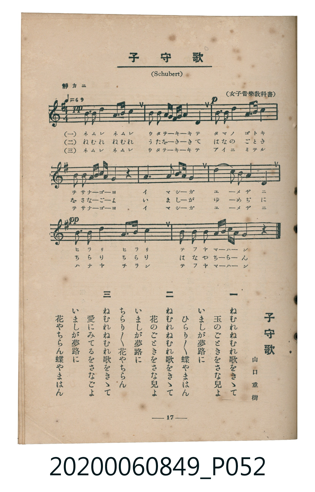

# 子守歌

> Re:Shoka 使用 AI 協助辨識與重建樂譜，可能會有錯誤。歡迎回報。

<audio controls src="komoriuta.mp3"></audio>

- 詞：山口重樹
- 曲：Franz Schubert（女子音樂教科書）
- 臺灣教育會公認《新定兒童唱歌》高等科女子用（2020.006.0849）

## 說明

原書資訊與歌詞全文（對應 P052.jpg，書頁 p. 17，高一第二學期第 6 首）：
調性與拍號：ト長調（1 升記號）、4/4 拍（靜カニ ♩=69）

## 跨冊／重複收錄參照

> 同名異曲（各冊收錄之不同詞曲版本）

- **[同名異曲]** 《新定兒童唱歌》尋常科第六學年用（2020.006.0847.0006）：[**〈子守唄〉**](../../grade_6_2020.006.0847.0006/4_14_komoriuta/index.md)（`E,` / `4/4` — [原始 TMD](../../grade_6_2020.006.0847.0006/4_14_komoriuta/komoriuta.tmd)）
- **[同名異曲]** 楊金土手抄《唱歌帖》第 7 冊・VII（2020.006.0843）：[**〈子守唄（搖籃曲）〉**](../../../shokacho/vol_07/p229b_komoriuta/index.md)（`B,` / `4/4` — [原始 TMD](../../../shokacho/vol_07/p229b_komoriuta/komoriuta.tmd)）
- 總表：[跨冊重複與同名歌曲總索引](../../../duplicate_songs.md)

## 歌詞

```text
一
ねむれねむれ歌（うた）をきゝて
玉（たま）のごときをさな兒（ご）よ
いましが夢路（ゆめぢ）に
ひらり／＼蝶（てふ）やまはん

二
ねむれねむれ歌をきゝて
花（はな）のごときをさな兒よ
いましが夢路に
ちらり／＼花やちらん

三
ねむれねむれ歌をきゝて
愛（あい）にみてるをさなごよ
いましが夢路に
花やちらん蝶やまはん
```

## ABC

```abc
X:1
T:子守歌
C:曲：Franz Schubert（女子音樂教科書）
M:4/4
L:1/16
Q:1/4=69
K:G
V:V1 name="Piano" snm="Pia"
[V:V1]
!pp! B3 c B2 A2 B3 B A4 | G A B c d2 c B B2 A4 z2 | !p! B3 c B2 A2 B3 B A4 | G2 B d g2 e c B2 A2 G2 z2 |
A4 A2 B c d2 B2 G4 | c2 A2 F2 D2 A2 B c B4 | !pp! B3 c B2 A2 B3 B A4 | G2 B d g2 e c B2 A2 G2 z2 |
```

## TMD 檔案連結

- [主旋律 TMD 檔案](komoriuta.tmd) [[在 TMD Studio 編輯](https://tmdlang.github.io/Tmd-TS/#tmd=s7IKdvYPcrWy4qpTUCpJTLdSSM7PyUlNLsnMz7MqzsjMK0nNjM_KTMmPL87Iz05Ugisry88pzU21ys4vyY9PzyzKKY43MjAyiDcwMIs3sDCxRCgszi8tSk61Kk7OyM_PiS9JrShJys_PRsgXFOWXpeYl5gHVFBSB7EsBK0IoSC3LTEkFSaemZJbkF2Um5iC5IrWoGOxSsCXxJUWJecXJRZkFIOcjVJVkpAKdmpaYm5lTqcSlpaXwdO2Ep-s6nq3tUdDS4lK0VTCz5LK3VXDnsjHRN7EDaXuxct77PbOebtz4tH_xy_beZyt2gk17NnsTUNgNaEuVQnByRmlSalHJ-z0dT5duBpr4cv7mZyuank2d-Xz5xGezd7zf0wnW86J91_PGxUDhF02bns1pftq65sWq3scNXc-mbXi6btbT1knPVy99OmUj0DGPG7pfrp7xfG0n0ACIkc-nrAAaDwpYPWDA6oECFmwsl76Wgi21AJeCgsLTvvlAJ7_Y3P5iRdeLjnagY4Ah8LR1xbNp7SD_beh91t6pEGBgaqSXVZD-fk8PUPHLBY0KBXoKhuZALtDZT3Y0PF-z5smunqdrdzybMx_IVjBTeLlsGtC9wCAD2fFi1f5nDctBpnf3vpg5Hyj6uLnj5dTtQHGgHYYKT3uBts8Ay3Q-bmgERoUCUCVQ6uXcOY-bVj9u7lZ4NHOlrRkoCLhABgKtBFGPG9c-bmp43NQDZwCdD9T2uLHtcSPYsKZJjxt7HzfNfdy4DKTheR_QSUDp-Y8b94GkG9c9bpzyuHEFWBFQ6dTHjauA8QJWMwWsvwNiTwtQw-PG6Y8be54uWfRi-3qQiqa2x02NjxsXgQ1aDVG36XETUFPX-z397_fseTF3G9ikZY8bt4INg5iy_nHTZIgvdvXg9AW6y190bQSbtR7oQjwux-lguAsXoriwayPYVRBBqKt2dBLtqmcts8GuagJaCAmGx437QR5u6oa7CuROAq5CcwYw3FDCCqiC8rQOBQpa-lxcvomZeVYBmYl5-Q41BjUK1SAbFGwMzbTswCxgFgMl6B0NLxYCiwl9sBhQVUFBrYKxgi4QmoBpIyCG8I3BbBCsUTAEso2BKkyh6mAqQdAArKKaGHPAUQFzya4eFJcYgpWaKhjGARlmSKaAJCB2wMyBmA1xDUgVSAXEnSZQWfN4IGEKImBqIW5Bd8OOTvJCg5BTuWq5uHTtFEBRogCklbkA)]
- [鋼琴伴奏 TMD 檔案](komoriuta_piano.tmd) [[在 TMD Studio 編輯](https://tmdlang.github.io/Tmd-TS/#tmd=s7IKdvYPcrWy4tLSUni6dsLTdR3P1va839PxsnvP8wlbnuzZ8nRp__POjvd7OhW0tLgUbRXMLLnsbRXcuWxM9E3suOoUlF6snPd-z6ynGzc-7V_8sr332YqdSiDhZ7M3AYXdihLzqhSCkzNKk1KLSoDmPl26GWjNy_mbn61oejZ15vPlE5_N3gE0HaznRfuu542LgcIvmjY9m9P8tHXNi1W9jxu6nk3b8HTdrKetk56vXvp0ykagCx83dL9cPeP52k6gARAjn09ZATTeyMDIQM_AwEzPwMLEEmwsl29iZp5VQGZiXn6Qh0ONQY1CNZcCENgYmmnZgVn6WgrP16x5sqPhxcIeBS19sBhQVUFBrYKxgi4QmoBpIyCG8I3BbBCsUTAEso2BKkyh6mAqQdAArKKaGHO4kF2yqwfFJYZgpaYKhnFAhhmSKSAJiB0wcyBmQ1wDUgVSAXGnCVTWPB5ImIIImFqIW9DdsKOTvNAg5FSuWuQY8UGJEQu8EWIYD3K3MZiEsE3jwRSqFFTQCIsUqi68QQ5WYhKvYAZXDxQyAMqgGI9sOJoUQheGXWhBS9BfWJwBCkVdOwVQQCpgoZW5AA)]

## 分析

```text
================================================================================
📊 TMD Song Profile: [ 子守歌 ]
================================================================================
⏱  Duration:       0:27 (27.8s), 8 measures total
🎼 Key & Tempo:    首調基準 G, != 69.0 BPM, <4/4>
   - 分析範圍：      由實際發聲的音符與和弦推測調性；播放脈絡另行呈現
🎤 人聲音域:    D4 (MIDI 62) – G5 (MIDI 79) [跨度: 17 個半音 / 1.4 個八度, 難度: challenging]
   - 最低音:  D4 in [Main #1 @ m.6, 0:18]
   - 最高音: G5 in [Main #1 @ m.4, 0:11]
   - 適合: soprano, mezzo-soprano, tenor, baritone
🏛  結構:      Main (27.8s)
⚡ 編曲密度:        Peak 1 軌道同時演奏
🗝  調性診斷：       B 小調（流行色彩小調，未偵測到可信轉調）
   - 風格氣質:    流行小調（略帶和弦色彩音與裝飾副屬和弦）
   - 轉調歷程:    全曲維持單一推測調性（未偵測到可信轉調）
   - 核心骨幹音:  B, A, G, C, D
   - 調性數值:    B 小調 [相關度: 0.55, 穩定度: Moderate, 自然音純度: 91.0%]
   - 候選調性 (K-S): B 小調 (0.55), G 大調 (0.48), A 小調 (0.48)
   - 五度圈歷程:   +5
   - 各段落調性細節:
     • [Main #1]: B 小調 (r: 0.55, 自然音純度: 91.0%, 調外音: C)

  [ 五度圈游移軌跡 ]
               C  
         F            G  
      Bb               D  
      Eb               A  
         Ab           E  
            Db      [B ]*
               F# 
     (* = active key center)

  [ 十二半音累積音高分佈 ]
     C  : ██████                     9.0%
     C# :                            0.0%
     D  : ████                       6.6%
     D# :                            0.0%
     E  : █                          1.6%
     F  :                            0.0%
     F# : █                          1.6%
     G  : █████████                 13.9%
     G# :                            0.0%
     A  : ████████████████████      30.3%
     A# :                            0.0%
     B  : ████████████████████████  36.9%
--------------------------------------------------------------------------------
Assignment 軌道音域：
  - Piano         : D4 – G5 (17 個半音 / 1.4 個八度, 63 個音符)
================================================================================
```


## 原書掃描頁




