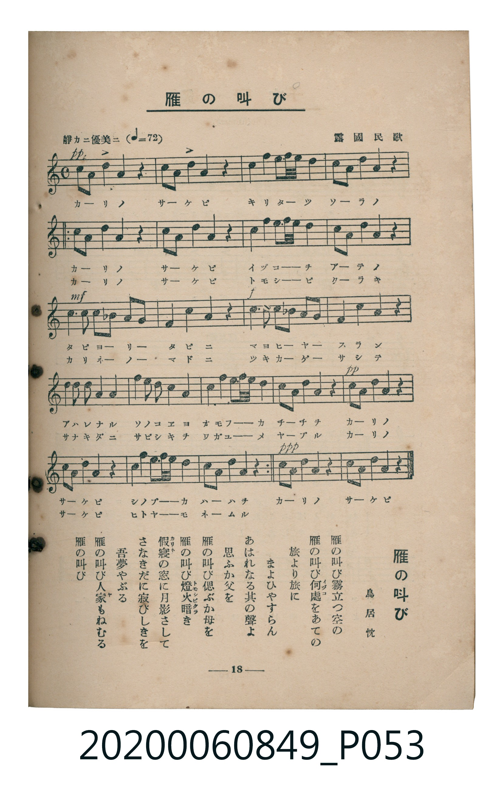

# 雁の叫び

> Re:Shōka 使用 AI 協助辨識與重建樂譜，可能會有錯誤。歡迎回報。

- **鋼琴伴奏版**：<br><audio controls src="kari_no_sakebi.mp3"></audio>

- 詞：鳥居忱
- 曲：露國民歌
- 臺灣教育會公認《新定兒童唱歌》高等科女子用（2020.006.0849）

## 說明

原書資訊與歌詞全文（對應 P053.jpg，書頁 p. 18，高一第二學期第 7 首）：
調性與拍號：ニ短調（無調號，曲中臨時降ロ音）、4/4 拍（靜カニ優美ニ ♩=72）
出處註記：露國民歌


## 歌詞

```text
雁の叫び霧立つ空の
雁の叫び何處（イヅコ）をあての
旅より旅に　まよひやすらん
あはれなる其の聲よ　思ふか父を
雁の叫び偲ぶか母を
雁の叫び燈火暗（トモシビクラ）き
假寢（カリネ）の窓に月影さして
さなきだに寂びしきを　吾夢やぶる
雁の叫び人家（ヤ）もねむる
雁の叫び
```

## ABC

<div class="abc-score" data-abc-src="kari_no_sakebi.abc" aria-label="五線譜載入中"></div>

[下載 ABC 原始檔](kari_no_sakebi.abc)

## TMD 檔案連結

- [主旋律 TMD 檔案](kari_no_sakebi.tmd) [[在 TMD Studio 編輯](https://tmdlang.github.io/Tmd-TS/#tmd=s7IKdvYPcrWy4qpTUCpJTLdSSM7PyUlNLsnMz7MqzsjMK0nNjM_KTMmPL87Iz05Ugisry88pzU21ys4vyY9PzyzKKY43MjAyiDcwMIs3sDCxRCgszi8tSk61Kk7OyM_PiS9JrShJys_PRpePL0hMT7UKMDA1RsgUFOWXpeYl5gF1FxSBXJIC1o5QkFqWmZIKki5OTsyLL0stykzLTE1BcmNqUTHYHxArSooS84qTizILQJ5DqMovKsnITy9KLMiotMrILC7JL8pMTsyJz07MQ_JuSUYq0LeJeZm5iTnIWjPTM_OsclMzszKxeA0qXZ5aXJJalBefm5qTn1KpxKWlpfByduPjxnVP-1c_btysoKXFpWirYG7EZW-r4MyVnVppq-CSy2Vjom9iBzLqxcp57_fMerl56dONrU_3bwQb_2z2JpDYnE1P53Q_2zDx2doesPCL9l3PGxc_mzrzRdOmZ3Oan7auebGq93FD17NpG56um_W0ddLz1UufTtkIVP64ofvl6hnP13Y-Xz7x6dLNT9dOeD5lxfs9HaBI1ANGoh4oEt_v6VTi4tLXUrClFuBSUFB42jf_2ewdLza3v1jR9aKjHegYoA-ftq54Nq0d6ICnG3qftXcqgFKCXlZB-vs9PUDFLxc0KhToKRhaALlAZz_Z0fB8zZonu3qert3xbM58IFvBXOHlsmlA9wJDBWTHi1X7nzUsB5ne3fti5nyg6OPm7ufz1wLFgXY8b1kIZIDFgaZverJj7Yv2Fc9mNr2c2fu4ee3L-ZuBBj1uaARGgAJQP1DDy7lzHjetBhrxtGXV8319QIbCo5krbc2NgArBXmrf9WLm1Bcrdr9YMQMtXrhA8sjR_XLO8uerux83Lnm-chdQEF36yd6pQKOAdj5uWvK4ufVxE9gxTZMeNzY9blwG1fBsOlACqKILxGhc_bih4XHjPpBI46bHTS2PG2c-bgLqmQxSCta3_nFTz-PGVY-bup-2bgOa8QKkrgOo7VnD3MeNWx83dj_v2Aa0BN0xT4HqGoEaup-t78Ui_by943nj6mezpoOc2wxEix43bX_cPPlx0_rHzStB7m7sBQdPY_vT9YvAfgIG4qrHzcAwBcqte75qMtD1z-Z0PN278XHj1MeN04FehDgayFkF1P24cQFQxdP1QD9sBkuDnAF099MJ-54uAdoG9CvQ3d0Ygbhr19N128CuWgIOPqD-tY-bGrAoBfEpT9dQoKClz8XlmVdSlG8VkJmYl-9QY1BTDbJBwcbQTMsOzMKWnRRAyXlHw4uFPQoaTzt7n63bqmCi8HRD__P1DTrwrKCJRR_QPpCZNQrVBQW1CoZxCroKZkBsBGKAIIgDggZQuoZ4NSBoAmMYgxhAHpCG6yPKLLDzfAxrFIBRD-Q_bt4DJldB5R8390FZ8XBTHzdtRahs2ghXORmLyrVwWbiJTfuhuiG4BUn1XiQXrMTtAq5aLi4nYElNRhzu6oHEYX_vi2VtwGh8sXU7qTE58iJxCVy2FcZq2gzVDcGbkFQvQnJBG24XQNxsRCM3N3fAZUHugbh5O4qbYbpA5q5HcgE84cETL8LNBAqITnDiIrVkyE2DlgwwCOaACXMdIAGKblOwQ02QFWBNCQrVVDQMKVmB8iwMQoLucfMKpEADRRuEjawaEcigGhkzkuahmAoxbxKSqaCEhzB1J1wlomwAJUPUKEJNVgjTIS7sRTIdlMDgpsPd8ri5E6-bYeUVWAU4iaAk4CZQVkC4GZRgISpBiQ9iKixTEJmsns6eDU5WpqQlK3hpAWaACVgEw2hgGkApesCKMJIDVUsqoutBpLQHz8DN_WByDZjsgovC4hlWg0BEwbELKaaaQCkLIgpjgdQiihqEDVPBJLSIgKcgULw3QmVAJIgNUQ8r-JALKSKLM6SUCk8lYF9BU1VzA1wUlg5R1YJzIaRQQ6pnkYriZlCxBhZtAoUZRH4Zsg-bFyKpRuS2x83T4OphYUCODwnUxVOA6RrYmnra24VUIz9bu0jBmEY1MghStbYlvg5FZH9YMEECGXtigyR0SACD2KhRiysJEVczggpYiCyijoRFPQTDsgNIdS-SSxbA1WMkClCTzDk_JZGcJhk4GezrASeD51ubnm-d8HTDPgWjgWtf07I5BQooXTsFcB8k2scwVgHIAbVlUdlGYDYoQGHiylwA)]
- [鋼琴伴奏 TMD 檔案](kari_no_sakebi_piano.tmd) [[在 TMD Studio 編輯](https://tmdlang.github.io/Tmd-TS/#tmd=s7IKdvYPcrWy4qpTUCpJTLdSSM7PyUlNLsnMz7MqzsjMK0nNjM_KTMmPL87Iz05Ugisry88pzU21ys4vyY9PzyzKKY43MjAyiDcwMIs3sDCxRCgszi8tSk61Kk7OyM_PiS9JrShJys_PRpePL0hMT7UKMDA1RsgUFOWXpeYl5gF1FxSBXJIC1o5QkFqWmZIKki5OTsyLL0stykzLTE1BcmNqUTHYHxArSooS84qTizILQJ5DqMovKsnITy9KLMiotMrILC7JL8pMTsyJz07MQ_JuYhFQc3pqbmpeiVVBZmJefnxicnJ-bkFiXiZIDKGwJAOoyAoknJiDbEdmemaeVW5qZlYmljCASpenFpekFuXF56bm5KdUKnFpaSm8nN34uHHd0_7Vjxs3v9_T8bJ7z_MJW57s2fJ0af_zzo73ezoVtLS4FG0VzI247G0VnLmyUyttFVxyuWxM9E3sQOa_WDnv_Z5ZLzcvfbqx9en-jWA7n83eBBKbs-npnO5nGyY-W9sDFn7Rvut54-JnU2e-aNr0bE7z09Y1L1b1Pm7oejZtw9N1s562Tnq-eunTKRuByh83dL9cPeP52s7nyyc-Xbr56doJz6esADoPlAT0gElAD5QEgI5T4uLyzCspyrcKAAVZkIdDjUFNNZcCENgYmmnZgVn6Wgq26EDh-Zo1T3Y0vFjYo6DxtLP32bqtCiYKTzf0P1_foKMASiR6WQXpmlj0aemDzaxRqC4oqFUwjFPQVTADYiMQAwRBHBA0gNI1xKsBQRMYwxjEAPKANFwfUWaBnedjWKPwuGk1kP-4eQ-YXAWVf9zcB2XFw0193LQVobJpI1zlZCwq18Jl4SY27YfqhuAWJNV7kVywErcLuGpRotEHORpNoLFYo2ASH69gBMRmQGyAgw_ChhBhDAUgW5yAyZ6stLKrB5JW-ntfLGsDJpcXW7eTmmJGXmJZApdthbGaNkN1Q_AmJNWLkFzQhtsFEDcb0cjNzR1wWZB7IG7ejuJmmC6QueuRXABP4PBMgnAzgYKoE5y4SC2BctOgJRAMgjlgwlwHSICi2xTsUBNkBVhTgkI1FQ1DSlagsgEGIUH3uHkFUqCBog3CRlaNCOTHzd1QFnIkzUMxFWLeJCRTQQkPYepOuEpEGQRKhqhRhJqsEKZDXNiLZDoogcFNh7vlcXMnXjfDykWwCnASQUnATaCsgHAzKMFCVIISH8RUWKYgMlk9nT0bnKxMSUtW8NICzAATsAiG0cA0gFL0gBVhJAeqllRE17dIaQ-egZv7weQaMNkFF4XFM6ymgoiCYxdSTDWBUhZEFMYCqUUUNQgbpoJJaBEBT0GgeG-EyoBIEBuiHlbwIRdSRBZnSCkVnkrAvoKmquYGuCgsHaKqBedCSKGGVJ8jFcXNoGINLNoECjOI_DJkHzYvRFKNyG2Pm6fB1cPCgBwfEqiLpwDTNbDV9rS3C6lGfrZ2kYIxjWpkEKRqbUt8HYrI_rBgggQy9sQGSeiQAAaxUaMWVxIirmYEFbAQWUQdCYt6CIZlB5DqXiSXLICrx0gUqI0yrC0_YDpAtMDgcUdxaxDZbEgFjGI2UB-UQuHDjMYtjWwwtAhGlK1Q-2E0wlUwmrDD8XoEOWvgDSpCDWXn_JRE8hrKYBfs6wFnzudbm55vnfB0wz4Fo4HrXdGykYsaVOR1XEBm6NopgDtA0T6GsQpADihLoLKNwGyQXTBxZS4A)]

## 分析

```text
================================================================================
📊 TMD Song Profile: [ 雁の叫び ]
================================================================================
⏱  Duration:       2:06 (126.7s), 38 measures total
🎼 Key & Tempo:    首調基準 C, != 72.0 BPM, <4/4>
   - 分析範圍：      由實際發聲的音符與和弦推測調性；播放脈絡另行呈現
🎤 人聲音域:    F4 (MIDI 65) – F5 (MIDI 77) [跨度: 12 個半音 / 1.0 個八度, 難度: easy]
   - 最低音:  F4 in [Body[L1] #1 @ m.10, 0:30]
   - 最高音: F5 in [Intro[L1] #1 @ m.3, 0:07]
   - 適合: soprano, mezzo-soprano, contralto, tenor, baritone, bass
🏛  結構:      Intro[L1] (13.3s) -> Body[L1] (53.3s) -> Body[L2] (53.3s) -> Coda[L1] (6.7s)
⚡ 編曲密度:        Peak 1 軌道同時演奏
🗝  調性診斷：       A 小調（純淨自然小調，未偵測到可信轉調）
   - 風格氣質:    純淨自然小調（陰鬱抒情、旋律集中，無明顯調外色彩）
   - 轉調歷程:    全曲維持單一推測調性（未偵測到可信轉調）
   - 核心骨幹音:  A, C, D, F, E
   - 調性數值:    A 小調 [相關度: 0.81, 穩定度: High, 自然音純度: 98.4%]
   - 候選調性 (K-S): A 小調 (0.81), D 小調 (0.67), F 大調 (0.62)
   - 五度圈歷程:   +3 -> +3 -> +3 -> +3
   - 各段落調性細節:
     • [Intro[L1] #1]: A 調性不明確 (r: 0.74, 自然音純度: 100.0%)
     • [Body[L1] #1]: A 小調 (r: 0.81, 自然音純度: 98.2%, 調外音: A#)
     • [Body[L2] #1]: A 小調 (r: 0.81, 自然音純度: 98.2%, 調外音: A#)
     • [Coda[L1] #1]: A 調性不明確 (r: 0.69, 自然音純度: 100.0%)

  [ 五度圈游移軌跡 ]
               C  
         F            G  
      Bb               D  
      Eb              [A ]*
         Ab           E  
            Db       B  
               F# 
     (* = active key center)

  [ 十二半音累積音高分佈 ]
     C  : ███████████████████       25.2%
     C# :                            0.0%
     D  : ██████████████████        24.0%
     D# :                            0.0%
     E  : ████                       4.8%
     F  : █████████                 11.4%
     F# :                            0.0%
     G  : █                          1.6%
     G# :                            0.0%
     A  : ████████████████████████  31.4%
     A# : █                          1.6%
     B  :                            0.0%
--------------------------------------------------------------------------------
Assignment 軌道音域：
  - Piano         : F4 – F5 (12 個半音 / 1.0 個八度, 174 個音符)
================================================================================
```


## 原書掃描頁




