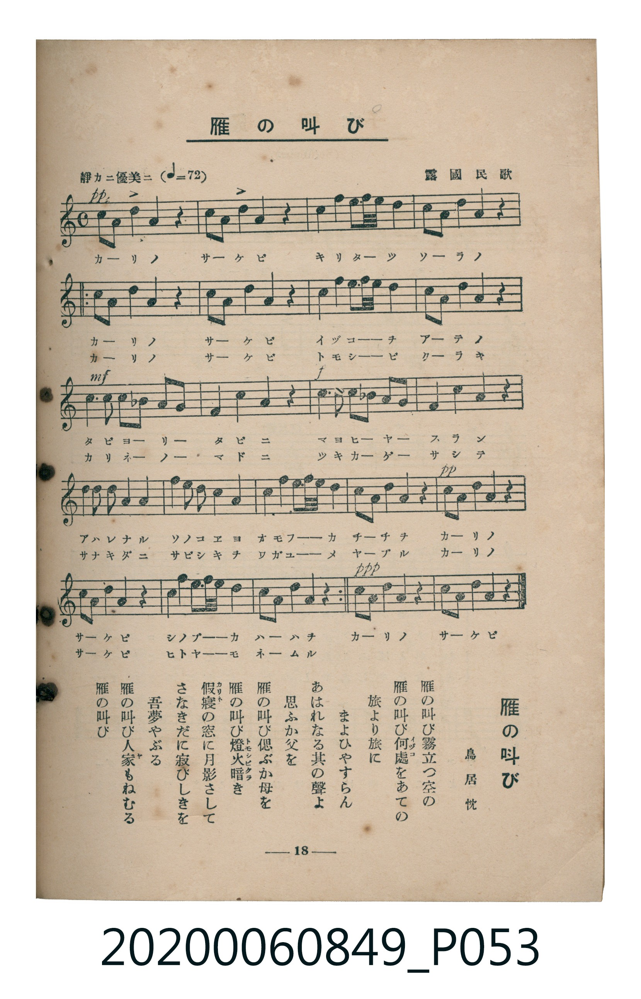

# 雁の叫び

<audio controls src="kari_no_sakebi.mp3"></audio>

- 詞：鳥居忱
- 曲：露國民歌
- 臺灣教育會公認《新定兒童唱歌》高等科女子用（2020.006.0849）

## 說明

原書資訊與歌詞全文（對應 P053.jpg，書頁 p. 18，高一第二學期第 7 首）：
調性與拍號：イ短調（無升降記號）、4/4 拍（靜カニ優美ニ ♩=72）

## 歌詞

```text
雁（かり）の叫（さけ）び霧立（きりた）つ空（そら）の
雁の叫び何處（いづこ）をあての
旅（たび）より旅に　まよひやすらん
あはれなる其（そ）の聲（こゑ）よ　思（おも）ふか父（ちち）を
雁の叫び偲（しの）ぶか母（はは）を
雁の叫び燈火暗（ともしびくら）き
假寢（かりね）の窓（まど）に月影（つきかげ）さして
さなきだに寂（さ）びしきを　吾夢（わがゆめ）やぶる
雁の叫び人家（ひとや）もねむる
雁の叫び
```

## ABC

```abc
X:1
T:雁の叫び
C:曲：露國民歌
M:4/4
L:1/16
Q:1/4=72
K:Am
V:V1 name="Piano" snm="Pia"
[V:V1]
!pp! A,4 E4 E4 z4 | A,4 D4 D4 z4 | E4 F2 E2 D4 C4 | B,4 A,4 B,4 z4 |
!pp! A,4 E4 E4 z4 | A,4 D4 D4 z4 | E4 F2 E2 D4 C4 | B,4 A,4 B,4 z4 |
!mf! C6 C2 B,4 G,4 | A,4 B,4 C4 z4 | !f! E6 E2 D4 B,4 | C4 D4 E4 z4 |
F4 E4 D4 C4 | B,4 A,4 B,4 E4 | F4 E2 D2 C4 B,4 | A,4 A,4 A,4 z4 |
!pp! A,4 E4 E4 z4 | A,4 D4 D4 z4 | E4 F2 E2 D4 B,4 | A,4 A,4 A,4 z4 |
!pp! A,4 E4 E4 z4 | A,4 D4 D4 z4 | E4 F2 E2 D4 C4 | B,4 A,4 B,4 z4 |
!mf! C6 C2 B,4 G,4 | A,4 B,4 C4 z4 | !f! E6 E2 D4 B,4 | C4 D4 E4 z4 |
F4 E4 D4 C4 | B,4 A,4 B,4 E4 | F4 E2 D2 C4 B,4 | A,4 A,4 A,4 z4 |
!pp! A,4 E4 E4 z4 | A,4 D4 D4 z4 | E4 F2 E2 D4 B,4 | A,4 A,4 A,4 z4 |
!pp! A,4 A,4 A,4 z4 | A,4 A,4 A,4 z4 |
```

## TMD 檔案連結

- [主旋律 TMD 檔案](kari_no_sakebi.tmd)
- [鋼琴伴奏 TMD 檔案](kari_no_sakebi_piano.tmd)

## 分析

```text
================================================================================
📊 TMD Song Profile: [ 雁の叫び ]
================================================================================
⏱  Duration:       2:06 (126.7s), 38 measures total
🎼 Key & Tempo:    首調基準 C, != 72.0 BPM, <4/4>
   - 分析範圍：      由實際發聲的音符與和弦推測調性；播放脈絡另行呈現
🎤 人聲音域:    G3 (MIDI 55) – F4 (MIDI 65) [跨度: 10 個半音 / 0.8 個八度, 難度: easy]
   - 最低音:  G3 in [Body #1 @ m.9, 0:29]
   - 最高音: F4 in [Intro #1 @ m.3, 0:07]
   - 適合: mezzo-soprano, contralto, tenor, baritone, bass
🏛  結構:      Intro (13.3s) -> Body (53.3s) -> Body (53.3s) -> Coda (6.7s)
⚡ 編曲密度:        Peak 1 軌道同時演奏
🗝  調性診斷：       A 小調（推測轉調經歷 1 次）
   - 風格氣質:    純淨自然小調（陰鬱抒情、旋律集中，無明顯調外色彩）
   - 轉調歷程:    A 小調起奏 ➔ [Body] 轉至 A 小調 (+0 半音 / 五度圈 +0 步)
   - 核心骨幹音:  A, E, D, B, C
   - 調性數值:    A 小調 [相關度: 0.82, 穩定度: Moderate, 自然音純度: 100.0%]
   - 候選調性 (K-S): A 小調 (0.82), A 大調 (0.73), D 大調 (0.55)
   - 五度圈歷程:   +3 -> +3 -> +3 -> +3
   - 各段落調性細節:
     • [Intro #1]: A 大調 (r: 0.73, 自然音純度: 88.5%, 調外音: C, F)
     • [Body #1]: A 小調 (r: 0.80, 自然音純度: 100.0%)
     • [Body #2]: A 小調 (r: 0.80, 自然音純度: 100.0%)
     • [Coda #1]: A 調性不明確 (r: 0.68, 自然音純度: 100.0%)

  [ 五度圈游移軌跡 ]
               C  
         F            G  
      Bb               D  
      Eb              [A ]*
         Ab           E  
            Db       B  
               F# 
     (* = active key center)

  [ 十二半音累積音高分佈 ]
     C  : ██████████                11.6%
     C# :                            0.0%
     D  : ███████████████           17.1%
     D# :                            0.0%
     E  : ████████████████████      22.1%
     F  : ████                       5.0%
     F# :                            0.0%
     G  : █                          1.6%
     G# :                            0.0%
     A  : ████████████████████████  27.1%
     A# :                            0.0%
     B  : ██████████████            15.5%
--------------------------------------------------------------------------------
Assignment 軌道音域：
  - Piano         : G3 – F4 (10 個半音 / 0.8 個八度, 136 個音符)
================================================================================
```


## 原書掃描頁




