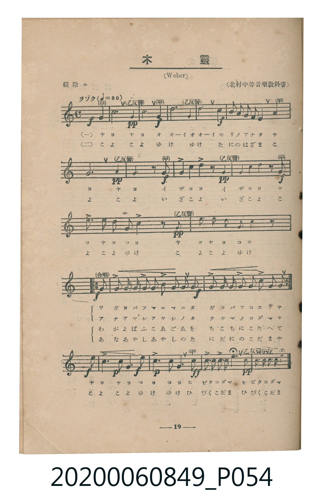
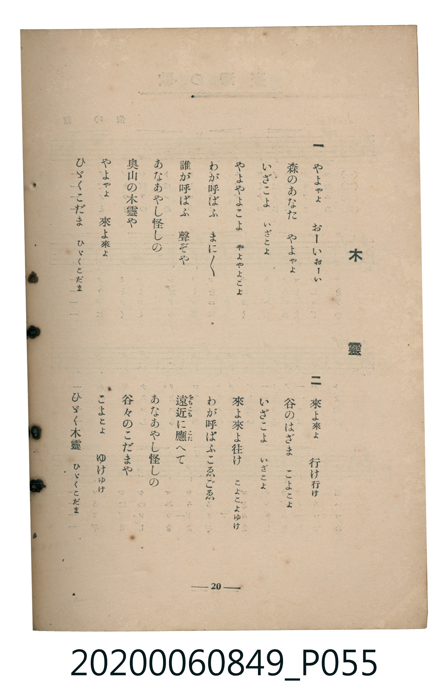

# 木靈

<audio controls src="kodama.mp3"></audio>

- 曲：Carl Maria von Weber（北村中等音樂教科書）
- 臺灣教育會公認《新定兒童唱歌》高等科女子用（2020.006.0849）

## 說明

原書資訊與歌詞全文（對應 P054.jpg – P055.jpg，書頁 pp. 19–20，高一第二學期第 8 首）：
調性與拍號：ヘ長調（1 降記號）、4/4 拍（緩除ニ ♩=80，弱起第 4 拍進入，甲乙反響應答）

## 歌詞

```text
一
やよやよ　おーいおーい
森（もり）のあなた　やよやよ
いざこよ　いざこよ
やよやよこよ　やよやよこよ
わが呼（よ）ばふ　まに／＼
誰（たれ）が呼ばふ　聲（こゑ）ぞや
あなあやし怪（あや）しの
奥山（おくやま）の木靈（こだま）や
やよやよ　來（こ）よ來よ
ひゞくこだま　ひゞくこだま

二
來よ來よ　行（ゆ）け行け
谷（たに）のはざま　こよこよ
いざこよ　いざこよ
來よ來よ往（ゆ）け　こよこよゆけ
わが呼ばふこゑごゑ
遠近（をちこち）に應（こた）へて
あなあやし怪しの
谷々のこだまや
こよこよ　ゆけゆけ
ひゞく木靈　ひゞくこだま
```

## ABC

```abc
X:1
T:木靈
C:曲：Carl Maria von Weber（北村中等音樂教科書）
M:4/4
L:1/16
Q:1/4=80
K:F
V:V1 name="Piano" snm="Pia"
[V:V1]
!f! z4 z4 z4 F4 | !pp! !f! F4 F4 F4 A4 | !pp! c4 A4 c4 A4 | !f! F2 F2 G2 G2 A2 F2 G2 E2 |
F8 z4 A4 | !pp! !f! G6 A2 G4 z2 F2 | !pp! B4 B2 B2 A4 z2 F2 | !f! B4 B2 B2 A4 z2 c2 |
B3 B A2 A2 G2 G2 C4 | !pp! z4 c4 B3 B A2 A2 | G2 G2 C4 z4 z4 | !f! F2 E2 F2 G2 A2 G2 A2 B2 |
!f! c4 C4 F2 E2 F2 G2 | A2 G2 A2 B2 c4 C4 | !f! !p! d4 B4 d4 B4 | !f! !p! c4 A4 c4 A4 |
!ff! G4 c4 c2 c2 c2 c2 | !pp! c4 C2 C2 C2 C2 C4 | !f! z4 z4 z4 F4 | !pp! !f! F4 F4 F4 A4 |
!pp! c4 A4 c4 A4 | !f! F2 F2 G2 G2 A2 F2 G2 E2 | F8 z4 A4 | !pp! !f! G6 A2 G4 z2 F2 |
!pp! B4 B2 B2 A4 z2 F2 | !f! B4 B2 B2 A4 z2 c2 | B3 B A2 A2 G2 G2 C4 | !pp! z4 c4 B3 B A2 A2 |
G2 G2 C4 z4 z4 | !f! F2 E2 F2 G2 A2 G2 A2 B2 | !f! c4 C4 F2 E2 F2 G2 | A2 G2 A2 B2 c4 C4 |
!f! !p! d4 B4 d4 B4 | !f! !p! c4 A4 c4 A4 | !ff! G4 c4 c2 c2 c2 c2 | !pp! c4 C2 C2 C2 C2 C4 |
```

## TMD 檔案連結

- [主旋律 TMD 檔案](kodama.tmd) [[在 TMD Studio 編輯](https://tmdlang.github.io/Tmd-TS/#tmd=s7IKdvYPcrWy4qpTUCpJTLdSSM7PyUlNLsnMz7MqzsjMK0nNjM_KTMmPL87Iz05Ugisry88pzU21ys4vyY9PzyzKKY43MjAyiDcwMIs3sDCxRCgszi8tSk61Kk7OyM_PiS9JrShJys_PRsgXFOWXpeYl5gHVFBSB7EsBK0IoSC3LTEkFSaemZJbkF2Um5iC5IrWoGOxSsCXxJUWJecXJRZkFIOcjVJVkpAKdmpdYUlqUqsSlpaXwbM6Kl3M7FLS0uBRtFSwMuOxtFdy4bEz0TexAep7N3vR-zyznxKIcBd9EoH1Av-YphKcmpRa939PxtGf6s7kTn-xY-3xt58v5m5-taHo2debz5ROfzd7xfk8n2M4X7bueNy4GCr9o2vRsTvPT1jUvVvU-buh6Nm3D03WznrZOer566dMpG5-t7Xnc0P1y9QygSUADni7d_HTthOdTVgAtAQWlHjAo9UBBCTaWS19LwZZagEtBQeFp33ygk19sbn-xoutFRzvQMS9WznvauuLZtHaQLzf0PmvvVAgwMDXRyypIV3jUMBnEMQVx3u_pAep8uaBRoaBAT8HQEihnZAAUBPrkyY6G52vWPNnV83Ttjmdz5gPZChYKL5dNA3oBGKIga1-s2v-sYTnIwu7eFzPnA0UfN894OXU7UBxoraHCy5m9L1bMAMt0Pm5oBEaJAlAlUOr59pUvZy553Nyt8GjmSlsLkIVP92x8sXU7yBKwopcNm562LgWKP5-y6cnOmU_7e1_O3w_0xfO1U4CGcYFsB7oPRD1uannc1AElGxoeN3Y9bt7zuLEFzgAperZ4HdDax01Nj5u6QI5pXPe4selx46rHjfNBepCMABsJ0j3tceNkmJEILoaNcEUYghCl_Y8be55O3AO2vQNs9YbHjVvBpu573Lj6_Z7-93v2QAJzA0gR0EFNPWB1IG1w1S8agckYYvBEsOw8oFUQt0L8AfQZ0JXTnzWsAqsDccHqpgP9Ck4iS5c-3bgRLNf1uLEfrHofJCggGQhqfOMCqDjUeNTQfbKvDaIOrKIDyIUH2abHTfNABsPMAHsRXRAScbt6wBRYM4QE-XAh0NtAm4AWAB01EcgFkuCA2bAdGjCg4ILE3XpwhEDsAEcAIsTxxx2ypU_3NSDbiGYYUBzqAHgkQmMDHAmPG6cASZD0y8YFL_YDIwWoY9LjxoVgvy4EG7kamGBhwQrOA407Hjcuwx5riJgC-vdxQyvYm7CghEU1kutAKQ7kQCRnwkIbEp_Ywx-ojvIiBwoUtPS5uHwTM_OsAjIT8_IdagxqFKpBNijYGJpp2YFZwJIOkrOfbuh_vr4BpAUkXKNgoKALhuh0dVqtgiGUXQNOLiAzQAXRDlASQRgAU1RdUIDQARcEmmIMM0XBFMqCiYC1oAvWQM2FOQCEjaAYpAbGN48HmwmzCQZh7kcYh-z2XT0obgeZA4Ngx4B0wQRBJsEcUQMsDSGiIBqEYeaDVcG8DnM7XsVAI0F-RgvUThSHQQwwAWuEuQmETUGehgQmPKKQAxFdH8xBGPrRoxvFNU9nz4aUAk8ndADrVGCOQbgMFiLg4IfFBcyJIBrkBERUwy3Eqg_mPHT9GLrRYnEKSmCBjDZDCQBQqGCKQVRiJkJ8aRCoAZYe4I5CwwjPQqIC5GZsBMTgWi4uXTtgEygzTwGJVuYCAA)]
- [鋼琴伴奏 TMD 檔案](kodama_piano.tmd) [[在 TMD Studio 編輯](https://tmdlang.github.io/Tmd-TS/#tmd=s7IKdvYPcrWy4tLSUng2Z8XLuR3v93S87N7zfMKWJ3u2PF3a_7wTKNKpoKXFpWirYGHAZW-r4MZlY6JvYsdVp6D0bPam93tmOScW5Sj4JhZlJiqU5ecphKcmpRYBjXnaM_3Z3IlPdqx9vrbz5fzNz1Y0PZs68_nyic9m7wAaqQTS_6J91_PGxUDhF02bns1pftq65sWq3scNXc-mbXi6btbT1knPVy99OmXjs7U9jxu6X66eATQJaMDTpZufrp3wfMoKoCVGBkYGegYGZnoGFiaWYGO5fBMz86wCMhPz8oM8HGoMahSquRSAwMbQTMsOzNLXUni6Z-OLrdufbuh_vr5BQUsfLFyjYKCgC4bodHVarYIhlF3DBTPj-Zo1T3Y0vFjYgzAApqi6oAChAy4INMUYZoqCKZQFEwFrQResgZoLcwAIG0ExSA2Mbx4PNhNmEwzC3I8wDtntu3pQ3A4yBwbBjgHpggmCTII5okbBBCoKokEYZj5YFczrMLfjVQw0EuRntEDtRHEYxAATsEaYm0DYFORpSGDCIwo5ENH1wRyEoR89ulFc83T2bBTXwEIBHOSw8Ic5C0SDrEVEL9wSrPpgTkLXj6EbLeamYDjJDMXToJDAFIOoxEx4-NIdUAMsDcAdhYYRnoUEP8jN2AiIwbXIGdQHJYOaEM6fEIg_D8YrRBvGgjGQCedDKZjPQFzTeIgwiEZWh24BWkYxjYfqATGAahVMgHwTiFkgrdBUiyqIJ32DzQPaDDcX5FGgNhAf5AMc1uJLpGh-RujFEgooNuNLZjAfwWhcQYthGSQMQExoAtC1A1YXmXkKSLQyFwA)]

## 分析

```text
================================================================================
📊 TMD Song Profile: [ 木靈 ]
================================================================================
⏱  Duration:       1:48 (108.0s), 36 measures total
🎼 Key & Tempo:    首調基準 F, != 80.0 BPM, <4/4>
   - 分析範圍：      由實際發聲的音符與和弦推測調性；播放脈絡另行呈現
🎤 人聲音域:    C4 (MIDI 60) – D5 (MIDI 74) [跨度: 14 個半音 / 1.2 個八度, 難度: moderate]
   - 最低音:  C4 in [Main #1 @ m.9, 0:26]
   - 最高音: D5 in [Main #1 @ m.15, 0:42]
   - 適合: soprano, mezzo-soprano, contralto, tenor, baritone, bass
🏛  結構:      Main (54.0s) -> Main (54.0s)
⚡ 編曲密度:        Peak 1 軌道同時演奏
🗝  調性診斷：       F 大調（純淨自然大調，未偵測到可信轉調）
   - 風格氣質:    純淨自然大調（陽光明朗、易唱易記，無明顯調外色彩）
   - 轉調歷程:    全曲維持單一推測調性（未偵測到可信轉調）
   - 核心骨幹音:  C, A, F, G, A#
   - 調性數值:    F 大調 [相關度: 0.84, 穩定度: Moderate, 自然音純度: 100.0%]
   - 候選調性 (K-S): F 大調 (0.84), C 大調 (0.73), A 小調 (0.66)
   - 五度圈歷程:   -1 -> -1
   - 各段落調性細節:
     • [Main #1]: F 大調 (r: 0.84, 自然音純度: 100.0%)
     • [Main #2]: F 大調 (r: 0.84, 自然音純度: 100.0%)

  [ 五度圈游移軌跡 ]
               C  
        [F ]*          G  
      Bb               D  
      Eb               A  
         Ab           E  
            Db       B  
               F# 
     (* = active key center)

  [ 十二半音累積音高分佈 ]
     C  : ████████████████████████  29.1%
     C# :                            0.0%
     D  : ███                        3.1%
     D# :                            0.0%
     E  : ██                         2.4%
     F  : ██████████████            16.5%
     F# :                            0.0%
     G  : ████████████              14.2%
     G# :                            0.0%
     A  : █████████████████         20.5%
     A# : ████████████              14.2%
     B  :                            0.0%
--------------------------------------------------------------------------------
Assignment 軌道音域：
  - Piano         : C4 – D5 (14 個半音 / 1.2 個八度, 176 個音符)
================================================================================
```


## 原書掃描頁






