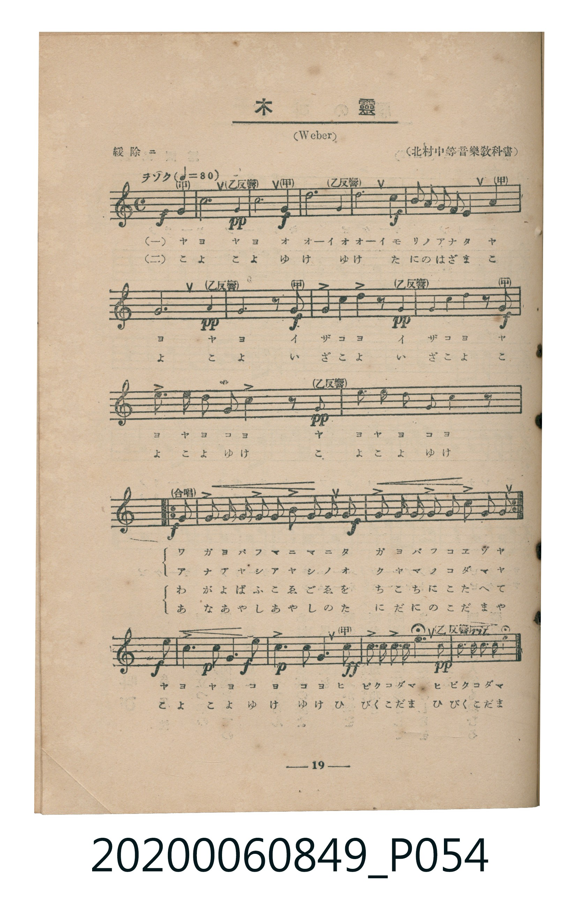
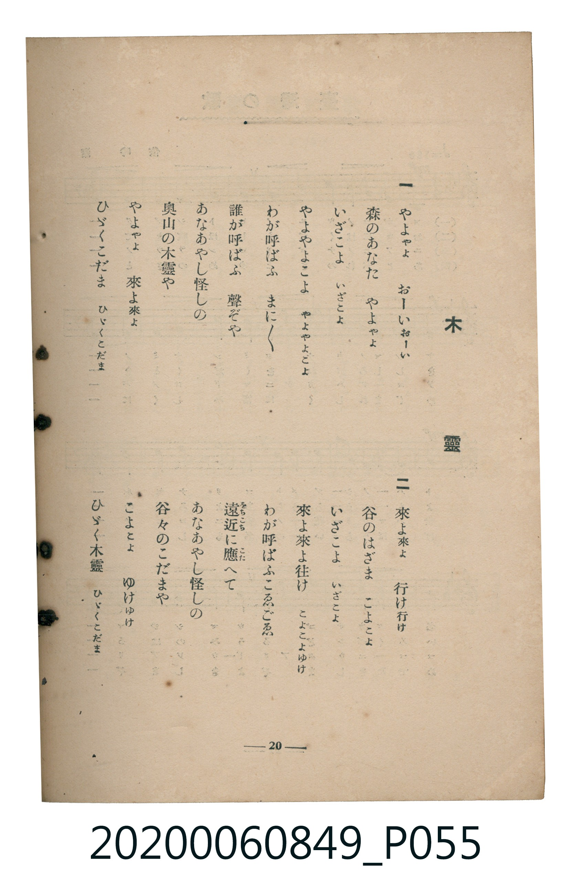

# 木靈

> Re:Shōka 使用 AI 協助辨識與重建樂譜，可能會有錯誤。歡迎回報。

- **鋼琴伴奏版**：<br><audio controls src="kodama.mp3"></audio>

- 曲：Carl Maria von Weber（北村中等音樂教科書）
- 臺灣教育會公認《新定兒童唱歌》高等科女子用（2020.006.0849）

## 說明

原書資訊與歌詞全文（對應 P054.jpg – P055.jpg，書頁 pp. 19–20，高一第二學期第 8 首）：
調性與拍號：ハ長調（無升降記號）、4/4 拍（緩除ニ ♩=80，弱起第 4 拍進入，甲乙反響應答）


## 歌詞

```text
一
やよやよ　おーいおーい
森（もり）のあなた　やよやよ
いざこよ　いざこよ
やよやよこよ　やよやよこよ
わが呼（よ）ばふ　まに／＼
誰（たれ）が呼ばふ　聲（こゑ）ぞや
あなあやし怪（あや）しの
奥山（おくやま）の木靈（こだま）や
やよやよ　來（こ）よ來よ
ひゞくこだま　ひゞくこだま

二
來よ來よ　行（ゆ）け行け
谷（たに）のはざま　こよこよ
いざこよ　いざこよ
來よ來よ往（ゆ）け　こよこよゆけ
わが呼ばふこゑごゑ
遠近（をちこち）に應（こた）へて
あなあやし怪しの
谷々のこだまや
こよこよ　ゆけゆけ
ひゞく木靈　ひゞくこだま
```

## ABC

<div class="abc-score" data-abc-src="kodama.abc" aria-label="五線譜載入中"></div>

[下載 ABC 原始檔](kodama.abc)

## TMD 檔案連結

- [主旋律 TMD 檔案](kodama.tmd) [[在 TMD Studio 編輯](https://tmdlang.github.io/Tmd-TS/#tmd=s7IKdvYPcrWy4qpTUCpJTLdSSM7PyUlNLsnMz7MqzsjMK0nNjM_KTMmPL87Iz05Ugisry88pzU21ys4vyY9PzyzKKY43MjAyiDcwMIs3sDCxRCgszi8tSk61Kk7OyM_PiS9JrShJys_PRpePL0hMT7UKMDA1wSljipApKMovS81LzAOaW1AEcmMK2GCEgtSyzJRUkHRxcmJefFlqUWZaZmoKkutTi4rBPoRYUVKUmFecXJRZAPI2QlV-UUlGfnpRYkFGpVVGZnFJflFmcmJOfHZiHlJAlGSkAsMhL7GktCgVWWtmemaeVXlqcUlqUV58bmpOfkolhnRJYiYwWEFBW54Yn5uYmZeTmAd0pZaWwrM5K17O7VDQ0uJStFWwMOCyt1Vw5rIx0TexA5nxbPam93tmOScW5Sj4JhZlJgJjI08hPDUptej9no6nPdOfzZ34ZMfa52s7X87f_GxF07OpM58vn_hs9o73ezrBbnjRvut542Kg8IumTc_mND9tXfNiVe_jhq5n0zY8XTfraeuk56uXPp2y8dnanscN3S9XzwCaBDTg6dLNT9dOeD5lBdASUGTrASNbDxTZYGO59LUUbKkFuBQUFJ72zQc6-cXm9hcrul50tAMd82LlvKetK55Nawf5ckPvs_ZOBVCK0csqSFd41DAZxDEFcd7v6QHqfLmgUaGgQE_B0BIoZ2QAFAT65MmOhudr1jzZ1fN07Y5nc-YD2QoWCi-XTQN6ARiiIGtfrNr_rGE5yMLu3hcz5wNFHzf3v5y6HSgOtPZ5y8Knve0vZ_a-WDEDLNv5uKERGC0KQNUg6e0rX85c8ri5W-HRzJW2FiBLn-7Z-GLrdpBFYEUvGzY9bV0KFH8-ZdOTnTOf9ve-nL8f6JPna6cADeMCuQDoRhD1uKnlcVMHlGxoeNzY9bh5z-PGFjgDpOjZ4nVAax83NT1u6gI5pnHd48amx42rHjfOB-lBMgJsJEj3tMeNk2FGIrgYNsIVYQhClPY_bux5OnEP2PYOsNUbHjduBZu673Hj6vd7-t_v2QMJ0A0gRUAHNfWA1YG0wVW_aAQmZYjBE8Gy84BWQdwK8QfQZ0BXTn_WsAqsDsQFq5sO9Cs4mSxd-nTjRrBc1-PGfrDqfZCggGQiqPGNC6DiUONRQ_fJvjaIOrCKDiAXHmSbHjfNAxkMMwPsRXRBSMTt6gFTYM0QEuTDhUBvA20CWgB01EQgF0iCA2bDdmjAgIILEnfrwRECsQMcAYgQxx93yJY-3deAbCOaYUBxqAPgkQiNDXAkPG6cAiRB0i8bF7zYD4wUoI5JjxsXgv26EGzkamCChQUrOA807njcuAx7rCFiCujfxw2tYG_CghIW1UiuA6U4kAORnAkLbUh8Yg9_oDrKix0oUNDS5-LyBRbHVgGZiXn5DjW6hjXVIBsUbAzNtOzALGBpB8nZTzf0P1_fANICEq5RMFDQBUN0ujqtVsEUyq4Bq_UxrFGIh4qg04-bl6CqNcKjtnEyXC3MbaBCbgco6SEcZhgHVYUOqwsKkJyGRx2yDxSMcCkjQgnIJLg1NQrmQNIMqtMEiI2hMiAxpCAABtfj5hU4jEQKMHyqmlYhVDWtetQw9XETTB9FapsXIdkO0ve4uQ9sBkj8cXMXmL0f063wyAUmfVxmI6IXn6qmNoSqxomUqWqcj6RqNVhkHZhcDyangcl9mO5DSX67elCSHyxZoENw6oPHNE5loGwES4AIVfBEBE9qYHWwBE1QIcxAqiUwUJ6EJBNQZG2D6W3aDDcFppNElWDbqZdcwGY2tkBUgSMUVS9CJ6kqQeJo5VAnMCE87ex92tuFURoBKVDuB0UCPIrQopCQSpxxCAozCBsSqlhDlGjVoKSPGf4g_0LYkKyFyFRIoUGs6qZ-HGG3rwcYdu_3zgOKPJ09Gx6aoGbwhA5gQx3YinyxrO3pxqkvp3UDq2PUTAfBIAhhw0IRNTchqwCHL4yDJXyb1sDD53HzBCCeCsTzwLxuMInEBhd6yHpgOhDhvBHMBhUnkDiBFJpIYd3YAxYFh1vjBiDeCg1ZYEMFLDYFwW6aBLGvcSEsvIEsWCEG1gMu3IAtFjC5DEw2IcKdamFmDBJATpSQOgBSHwCTWtN2JB5IZjuYDak1QDUIKNDA5S04Yc6Dy0ECrQEpoMH60QuIRnAtBPYasJkFZE1H4oFkpoNJSLkOChJEWb8AzILJQQJtAZgERxJUP0ZGhyZNcGLF0eyoBuZqeEjBBeGhRZRiWNsBuWRAsExQTYAZgV0xSkECgrgqAlgYo4iBYwJDJVrhAdENTZTNkEITFK-wgh4Uk5B4JF01rAGIq1qAZRIUMXDBg177oxdHEN2boCqhdjf2w4t9SBqBtQBIU41wdS0Xl64dcAQjM08BSCtzAQA)]
- [鋼琴伴奏 TMD 檔案](kodama_piano.tmd) [[在 TMD Studio 編輯](https://tmdlang.github.io/Tmd-TS/#tmd=s7IKdvYPcrWy4qpTUCpJTLdSSM7PyUlNLsnMz7MqzsjMK0nNjM_KTMmPL87Iz05Ugisry88pzU21ys4vyY9PzyzKKY43MjAyiDcwMIs3sDCxRCgszi8tSk61Kk7OyM_PiS9JrShJys_PRpePL0hMT7UKMDA1wSljipApKMovS81LzAOaW1AEcmMK2GCEgtSyzJRUkHRxcmJefFlqUWZaZmoKkutTi4rBPoRYUVKUmFecXJRZAPI2QlV-UUlGfnpRYkFGpVVGZnFJflFmcmJOfHZiHlJAJBYBNaen5qbmlVgVZCbm5ccnJifn5xYk5mWCxBAKSzKAiqzyEktKi1KR7chMz8yzKk8tLkktyovPTc3JT6nEkC5JzASGPygOyhPjcxMz83IS84De0dJSeDZnxcu5He_3dLzs3vN8wpYne7Y8Xdr_vBMo0qmgpcWlaKtgYcBlb6vgzGVjom9iBzL42exN7_fMck4sylHwTSzKTATGZZ5CeGpSahHQmKc905_Nnfhkx9rnaztfzt_8bEXTs6kzny-f-Gz2DqCRYIe9aN_1vHExUPhF06Znc5qftq55sar3cUPXs2kbnq6b9bR10vPVS59O2fhsbc_jhu6Xq2cATQIa8HTp5qdrJzyfsgJoCSip6AGTih4oqYCN5fIFesoqABR-QR4ONbqGNdVcCkBgY2imZQdm6WspPN2z8cXW7U839D9f36CgpQ8WrlEwUNAFQ3S6Oq1WwRTKrgGr9TGsUYiHiqDTj5uXoKo1wqO2cTJcLcxtz9esebKj4cXCHoTDDOOgqtBhdUEBktPwqEP2gYIRLmVEKAGZBLemRsEcSJpBdZoAsTFUBiSGFATA4HrcvAKHkUgBhk9V0yqEqqZVjxqmPm6C6aNIbfMiJNtB-h4394HNAIk_bu4Cs_djuhUeuY-bOnCZjYhefKqa2hCqGidSpqpxPpKq1WCRdWByPZicBib3YboPJfnt6kFJfrBkgQ7BqQ8e0ziVgbIRLAEiVMETETypgdXBEjRBhTADqZbAQHkSkkxAkbUNprdpM9wUmE4SVYJtp15yAZvZ2AJRBY5QVL0InaSqBImjlUOdwITwtLP3aW8XRmkEpEC5HxQJ8ChCi0JCKnHGISjMIGxIqGINUaJVg5I-ZviD_AthQ7IWIlMhhQaxqpv6cYTdvh5g2L3fOw8o8nT2bHhogurHCR3Auu1pf--LZW1PN059Oa0bXNMiZzoIBkEIGxaKqLkJWQU4fGEcLOHbtAYePo-bJwDxVCCeB-Z1g0kkNrjQQ9YD04EI541gNqg4gcQJpNBECuvGHrAoONwaNwDxVmjIPm4Chd_jxikIdtMkiH2NC2HhDWTBCjGwHnDh9rhxB5hcBiabEOFOtTAzBgkgJ0pIHQCpD4BJrWk7Eg8ksx3MhtQaoBoEFGjg8hacMOfB5SCB1oAU0GD96AVEI7gWAnvtcVMLkDUdiQeSmQ4mIeU6KEgQZf0CMAsmBwm0BWASHElQ_RgZHZo0wYkVR7OjGpir4SEFF4SHFlGKYW0H5JIBwTJBNQFmBHbFKAUJCOKqCGBhjCIGjgkMlWiFB0Q3NFE2QwpNULzCCnpQTELikXTVsAYgrmoBlklQxMAFD3rtj14cQXRvgqqE2t3YDy_2IWkE1gIgTTXC1bXI7WwflHa2CeFmNgTibfKCU1B8vIIxEJsCMVA5NE1gCALzNZBthBDCzgVpNAFivE0dZNPBijHsI8ZRhOtQmPdAGgzRDEKIEV-foJqMFABACikEwCyUAEKTR7MUR7kA9S2MRhUB-wWU06FioGA0A6tC8yHENmBK0rUDdh8z8xSAtDIXAA)]

## 分析

```text
================================================================================
📊 TMD Song Profile: [ 木靈 ]
================================================================================
⏱  Duration:       0:57 (57.0s), 19 measures total
🎼 Key & Tempo:    首調基準 C, != 80.0 BPM, <4/4>
   - 分析範圍：      由實際發聲的音符與和弦推測調性；播放脈絡另行呈現
🎤 人聲音域:    E4 (MIDI 64) – F5 (MIDI 77) [跨度: 13 個半音 / 1.1 個八度, 難度: moderate]
   - 最低音:  E4 in [Main #1 @ m.6, 0:16]
   - 最高音: F5 in [Main #1 @ m.19, 0:55]
   - 適合: soprano, mezzo-soprano, contralto, tenor, baritone, bass
🏛  結構:      Main (57.0s)
⚡ 編曲密度:        Peak 1 軌道同時演奏
🗝  調性診斷：       C 調性不明確（純淨自然大調，未偵測到可信轉調）
   - 風格氣質:    純淨自然大調（陽光明朗、易唱易記，無明顯調外色彩）
   - 轉調歷程:    全曲維持單一推測調性（未偵測到可信轉調）
   - 核心骨幹音:  G, C, D, A, B
   - 調性數值:    C 調性不明確 [相關度: 0.81, 穩定度: Ambiguous, 自然音純度: 100.0%]
   - 候選調性 (K-S): C 大調 (0.81), G 大調 (0.78), C 小調 (0.62)
   - 五度圈歷程:   +1
   - 各段落調性細節:
     • [Main #1]: G 調性不明確 (r: 0.80, 自然音純度: 97.2%, 調外音: F)

  [ 五度圈游移軌跡 ]
               C  
         F           [G ]*
      Bb               D  
      Eb               A  
         Ab           E  
            Db       B  
               F# 
     (* = active key center)

  [ 十二半音累積音高分佈 ]
     C  : ██████████████████        32.7%
     C# :                            0.0%
     D  : ██████                    10.9%
     D# :                            0.0%
     E  : █                          2.7%
     F  : █                          2.7%
     F# :                            0.0%
     G  : ████████████████████████  44.2%
     G# :                            0.0%
     A  : ██                         3.4%
     A# :                            0.0%
     B  : ██                         3.4%
--------------------------------------------------------------------------------
Assignment 軌道音域：
  - Piano         : E4 – F5 (13 個半音 / 1.1 個八度, 94 個音符)
================================================================================
```


## 原書掃描頁






