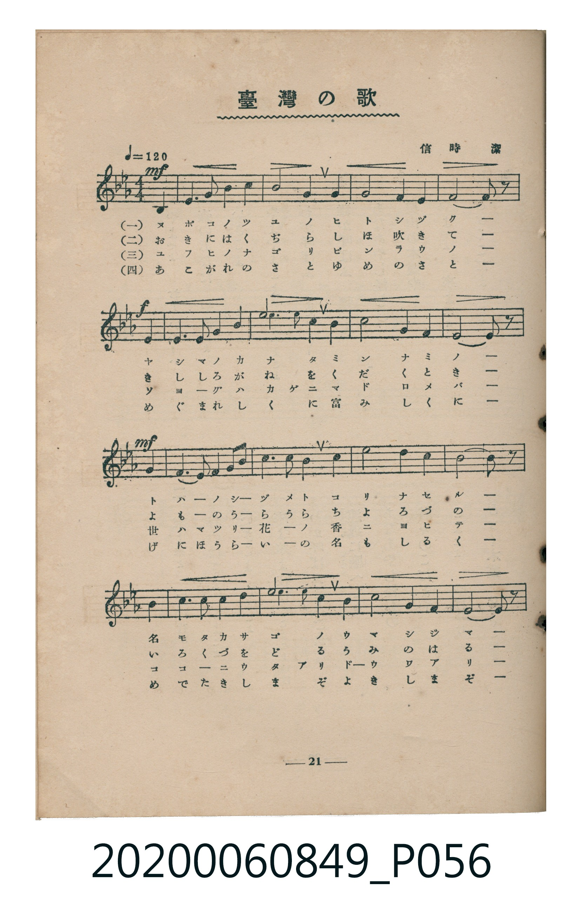
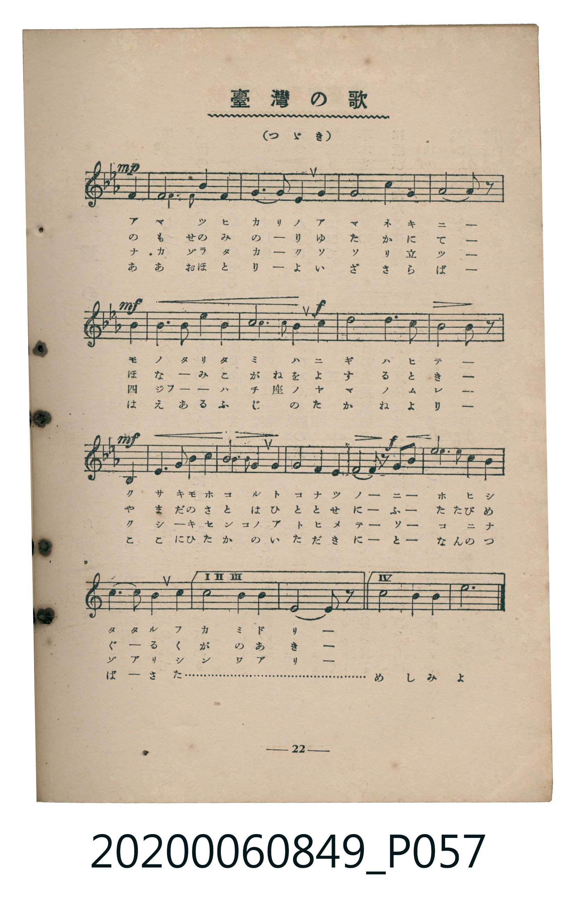
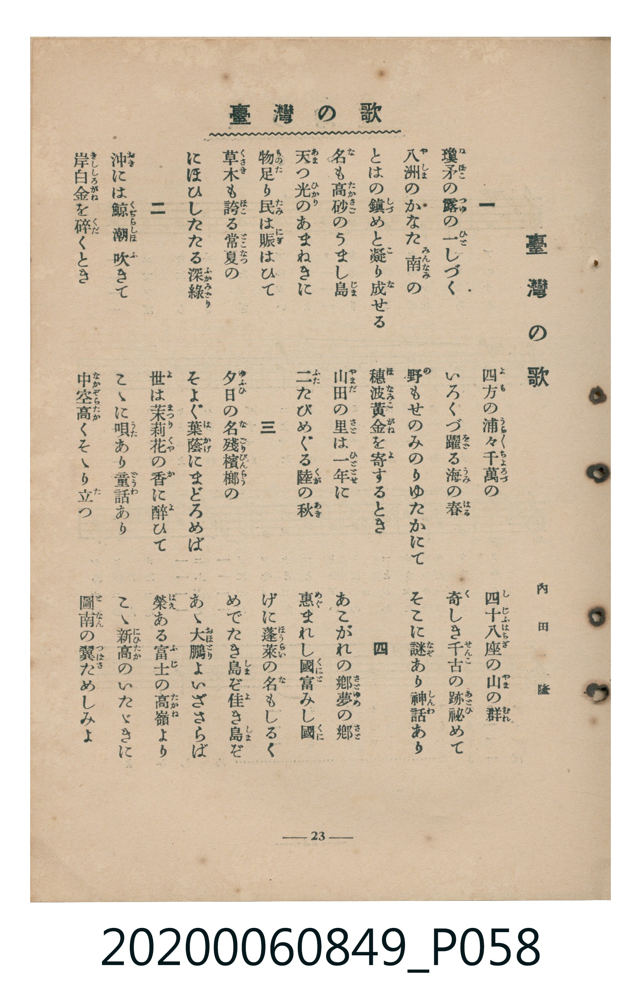

# 臺灣の歌

> Re:Shoka 使用 AI 辨識樂譜，可能會有錯誤。歡迎回報。

<audio controls src="taiwan_no_uta.mp3"></audio>

- 詞：內田隆（昭和6年臺灣教育會選歌）
- 曲：信時潔
- 臺灣教育會公認《新定兒童唱歌》高等科女子用（2020.006.0849）

## 說明

原書資訊與歌詞全文（對應 P056.jpg – P058.jpg，書頁 pp. 21–23，高一第二學期第 9 首）：
調性與拍號：變ロ長調／ト律音階（2 降記號）、4/4 拍（♩=120，弱起第 4 拍進入）

## 跨冊／重複收錄參照

> 同曲（《新定兒童唱歌》高等科男、女共用教材）

- **[同曲]** 《新定兒童唱歌》高等科男子用（2020.006.0848）：[**〈臺灣の歌〉**](../../koto_boys_2020.006.0848/1_2_09_taiwan_no_uta/index.md)（`B,` / `4/4` — [原始 TMD](../../koto_boys_2020.006.0848/1_2_09_taiwan_no_uta/taiwan_no_uta.tmd)）
- 總表：[跨冊重複與同名歌曲總索引](../../../duplicate_songs.md)

## 歌詞

```text
一　瓊矛（ぬぼこ）の露（つゆ）の一（ひと）しづく
八洲（やしま）のかなた南（みんなみ）の
とはの鎭（しづ）めと凝（こ）り成（な）せる
名（な）も高砂（たかさご）のうまし島（じま）
天（あま）つ光（ひかり）のあまねきに
物足（ものた）り民（たみ）は賑（にぎ）はひて
草木（くさき）も誇（ほこ）る常夏（とこなつ）の
にほひしたたる深綠（ふかみどり）

二　沖（おき）には鯨（くぢら）潮（しほ）吹（ふ）きて
岸白金（きししろがね）を碎（くだ）くとき
四方（よも）の浦々（うらうら）千萬（ちよろづ）の
いろくづ躍（をど）る海（うみ）の春（はる）
野（の）もせのみのりゆたかにて
穗波黃金（ほなみこがね）を寄（よ）するとき
山田（やまだ）の里（さと）は一年（ひととせ）に
二（ふ）たびめぐる陸（くが）の秋（あき）

三　夕日（ゆふひ）の名殘（なごり）檳榔（びんらう）の
そよぐ葉蔭（はかげ）にまどろめば
世（よ）は茉莉花（まつりくゎ）の香（か）に醉（ゑ）ひて
こゝに唄（うた）あり童話（どうわ）あり
中空高（なかぞらたか）くそゝり立（た）つ
四十八座（しじふはちざ）の山（やま）の群（むれ）
奇（く）しき千古（せんこ）の跡（あと）祕（ひ）めて
そこに謎（なぞ）あり神話（しんわ）あり

四　あこがれの鄕（さと）夢（ゆめ）の鄕（さと）
惠（めぐ）まれし國（くに）富（と）みし國（くに）
げに蓬萊（ほうらい）の名（な）もしるく
めでたき島（しま）ぞ佳（よ）き島（しま）ぞ
あゝ大鵬（おほとり）よいざさらば
榮（はえ）ある富士（ふじ）の高嶺（たかね）より
こゝ新高（にひたか）のいたゞきに
圖南（となん）の翼（つばさ）ためしみよ
```

## ABC

```abc
X:1
T:臺灣の歌
C:曲：信時潔
M:4/4
L:1/16
Q:1/4=120
K:Bb
V:V1 name="Piano" snm="Pia"
[V:V1]
!mf! z4 z4 z4 F4 | D6 F2 B4 c4 | d8 c4 B4 | G8 F4 G4 |
!f! F10 z2 F4 | D6 F2 B4 d4 | f8 d4 B4 | c8 d4 B4 |
!mf! G10 z2 D4 | E6 F2 G4 A2 B2 | G6 G2 F4 G4 | e8 d4 G4 |
c10 z2 F4 | D6 F2 B4 d4 | f8 d4 B4 | c8 G4 E4 |
!mp! F10 z2 D4 | D8 G4 F4 | G6 A2 B4 G4 | F8 c4 B4 |
!mf! G10 z2 E4 | E6 E2 B4 G4 | !f! d8 c4 d4 | e8 d4 B4 |
!mf! c10 z2 D4 | D6 F2 G4 F2 E2 | D6 F2 G4 A2 B2 | !f! c4 B4 c4 d4 |
f8 d4 B4 | c6 d2 c4 B4 | c8 d4 B4 | G10 z2 z4 |
!mf! z4 z4 z4 F4 | D6 F2 B4 c4 | d8 c4 B4 | G8 F4 G4 |
!f! F10 z2 F4 | D6 F2 B4 d4 | f8 d4 B4 | c8 d4 B4 |
!mf! G10 z2 D4 | E6 F2 G4 A2 B2 | G6 G2 F4 G4 | e8 d4 G4 |
c10 z2 F4 | D6 F2 B4 d4 | f8 d4 B4 | c8 G4 E4 |
!mp! F10 z2 D4 | D8 G4 F4 | G6 A2 B4 G4 | F8 c4 B4 |
!mf! G10 z2 E4 | E6 E2 B4 G4 | !f! d8 c4 d4 | e8 d4 B4 |
!mf! c10 z2 D4 | D6 F2 G4 F2 E2 | D6 F2 G4 A2 B2 | !f! c4 B4 c4 d4 |
f8 d4 B4 | c6 d2 c4 B4 | c8 B4 c4 | d12 z4 |
```

## TMD 檔案連結

- [主旋律 TMD 檔案](taiwan_no_uta.tmd) [[在 TMD Studio 編輯](https://tmdlang.github.io/Tmd-TS/#tmd=s7IKdvYPcrWy4qpTUCpJTLdSSM7PyUlNLsnMz7MqzsjMK0nNjM_KTMmPL87Iz05Ugisry88pzU21ys4vyY9PzyzKKY43MjAyiDcwMIs3sDCxRCgszi8tSk61Kk7OyM_PiS9JrShJys_PRsgXFOWXpeYl5gHVFBSB7EsBK0IoSC3LTEkFSaemZJbkF2Um5iC5IrWoGOxSsCXxJUWJecXJRZkFIOcjVJVkpAKdWpCTmJyqxKWlpfCifdfzxsWPG9c9W9ujoKXFpWirYGhkwGVvq-Ckw2Vjom9iB9L6YuW893tmPW1d_nzKhpez2t7v6Xg2Y-3TST1mT3dugZjwbOrMF02bns1pftm4A2jU-z2dYDufzd4E1Phk_8JnM5ue7Z0CFkPT8LR1zYtVvY8bup5N2_B0HdCSSc9XL306ZSPQlMcN3S9Xz3i-tvP58olPl25-unbC8ykrgJaDglcPGLx6oOAFW8Wlr6VgSy3ApaCg8LRv_rPZO15sbn-xoutFRzvQMcAweNq64tm0dqADnm7ofdbeqRBgYGqml1WQrvCoYTKIYwHivN_TA9T5ckGjQkGBnoKRIVDOyBgoCPTJkx0Nz9esebKr5-naHc_mzAeyFSwVXi6bBvQCMJRA1r5Ytf9Zw3KQhd29L2bOB4q-WNf1uHnty6nbgVLv9_Q_bu54uq_75fzNL2f1gUJC4eXM3hcrZoDVdj5uaATGmAJQL1Dq0cyVtsCoBNr8dM_GF1u3g2wDy71s2PS0dSlQORfIRqCbHjc0PJ_c9Xz-bKCux41rHjfuedw4GWRc47qXc4DxBxRc8rgJGOsgEaB6sMimx43AqACKTH_cuPRxYz840FpXP9sC1tDUApbYB9HzuLH7ceOqx43zn_ZOB2ve_7hpMlgE6CWQApBmoHmPG9eD7OxbC1YEMhgk3dQIlHraPhcsCHZXU9ezjglg7iqw_tmPm7rB9k8AeRwq2tQESjsLmsAi88FOmPq4cQrMRW1A1wHteLp5G1jBDIhjwaYsWQkWaoK5f8nTVmD8QPzcDbQcZgRIwePGtY8bex83rgbpfN658sW2zWD_A-WAKsCRAnTthokwV0A8vP7FZojI6seNwGgEiYBNXwZOA72dz-aAkjkwVMFuBnoK5J0Xq0BJ73HjblgodD_dsePpkn6wIDDsICG6BDlEgcYDVQMNBoYl0PL5QD3Ptm98vm0BWM9WcKDsf9y4EuIpSHrYBcx2Dc82ARMlUEkX1HaQSetfroe7atHjJmCQdD7buw4WVbuB3KcTdkIMBmsBhgrYP0837Xg-c-_LdoiPgaJA1dMfNwEZPcDQA_tk0vNFoNQMNhroNqBmIAPopV6w_tmzn00DG9wECliI_55tXfa4oRWspw3oFggJckJv84sJa8DiC8HqgdaAUxEsSFrAQkDjl77YBU4tTZOAAQAJz2dbt0NNhCXMZzOAmoEi64Gy0OTxsh3iVKDPQbECSn2gqAYG4zpgMALzCSy1AYMM7P_nK6c_27zo5e5mWBAAowSU9MExhgiCp-tbIH4E2zwTaCFSEGzcCCx5YRkLmOgggbTuZTuwpAWaCEwkkMy4Hpg9gWUyPIeCETBfg2IQGrtIMQR052Zw9poAtO3lzB2wKAAV30DTny8H-hmSEUCJAFpcAEuZhqdLpj6bDg4ZkHeB6QiY6UE6gBnw2boZkDwIzGuQZPVs1eZny4D5DigItG0yJLaQo2QuKKIaJ7yY2PliCiTrA3MD0PeTYCkP6GFgEu0FO3UDxBXg5AkNq_Uvejpf9HW-6NoI1gxUDSyugCm3_3ETJHOte7lsJlgKFIdAE1-2gfNzEzA6gFxYvgPFR9NcoPTTKeCYACUDcAYGBkBTF7BSerESYsFKcGoD5juoFMRFa5-v3AUscWCeB7p_HtiroMQAS9JAnwIR0CxIwEJMXwJN5E97G4EF6NNdy2FZClgmAYMWGBYLHzeC6ghQAG8EOwGcCqCRtA-Y44EiDY-bQNEGNmsppKCAuBBoUC8wVzztB6sDlZXAZAct3l9sXwiLYVD6eb50KiTlwIpdaLgAAwWoZ_WLNZCUD_QdsDkAC5el82DhAszUwBBECheox4AJBmwFOLk3AVP8upctEIug6fbpkkXQtNTUCI0wVAUgg541g0stcHIFK9oHNmv60zmQwAQG72qQWeshKRySH4CZDF0BxEvATL_6xeQ1LyYAUygkS0KKEWDMQxMyck0C9hswRsG1HNgJy8ER2wurPuB13bwneyEVACRpYlEAsR8YPnOfLln-ciukrAKmVqATVkArF1B2AMbwNJD_QY4Cp_lnyyBlLTA9QMwGGtEN9O3TxUBfQUpzYOIDB97qGU-37YLVOEBnQ0oYoKPASRWSzoGtLVhqBeYwYB6Ap1NgYQa0HFhXzEPUbE_nTIPV3cACZRUwoqGpb_8esOASoCOBroWWKqAAAnoYWMt3gDRT3iKDAgUtfS6uMGA7N9UpP6XSKiAzMS_focagRqEaZI2CjYWWHZgBbAxC2jxPN_Q_X98A0gYSrlEwUNCF4-rctFoF03ggqwacUEG6QK2zHQ0vFgKbwjAtxiAVuiCFhkDKCKRcwRgsBOGBRGsUzCCqwOp0IbwaCBsCDRSqsdu2qwePbSB7gMZAzQDxILaB7EUVgdsPtgrkM7BJaD7rRLHLBG4XWLc5yE64SUAK2SsmSDZChWCOANmI6TFgtqfAY2ArwO5DD8XcAqxe2zUFm21QgyCug_kM7E_MOMISl_CwhLgExXuta7GFJZBCMhs5mYCiH-Jr5KBE9TXeuGvGEZwwHwKtxhCGRinMayA3gNg4Qh_Vf6uB9j3tBNYcXQhbIQ41RoQVVy0Xl2teSmZeuqGRMe78SDDFgvIjkmEmxBiFmR0hZkFN0rVTgJcUCkAO3JkgDhYZYLTYKShzAQA)]
- [鋼琴伴奏 TMD 檔案](taiwan_no_uta_piano.tmd) [[在 TMD Studio 編輯](https://tmdlang.github.io/Tmd-TS/#tmd=s7IKdvYPcrWy4tLSUnjRvut54-LHjeuere15v6fjZfee5xO2PNmz5enS_uedHe_3dCpoaXEp2ioYGhlw2dsqOOlw2Zjom9hx1SkovVg57_2eWU9blz-fsuHlrDag7mcz1j6d1GP2dOcWiLHPps580bTp2Zzml407wOZ3KoE0Ppu9Cajxyf6Fz2Y2Pds7BSyGpuFp65oXq3ofN3Q9m7bh6TqgJZOer176dMpGoCmPG7pfrp7xfG3n8-UTny7d_HTthOdTVgAtNzIwMtAzMDDTM7AwsQRbxRWWWlSc6pSfUmkVkJmYlx_k4VBjUKNQzaUABDYWWnZghr6WwtM9G19s3f50Q__z9Q0KWvpg4RoFAwVdOK7OTatVMI0Hsmq4YLqer1nzZEfDi4U9CC3GIBW6IIWGQMoIpFzBGCwE4YFEaxTMIKrA6nQhvBoIGwINFKqx27arB49tIHuAxkDNAPEgtoHsRRWB2w-2CuQzsEloPutEscsEbhdYtznITrhJQArZKyZINkKFYI4A2YjpsaezZ1PgMbAVYPehh2JuAVav7ZqCzTaoQRDXwXwG9idmHGGJS3hYQlyC4r3WtdjCEkghmY2cTEDRD_E1clCi-hpv3DXjCE6YD4FWYwhDoxTmNZAbQGwcoY_qv9VA-5529j7t7ULYCnGoMSKsuGoxcqQPSo40IZwjIbAGTxY0BPkl2jAW7GwIxzQewjOLB3PN4nMhfFMIHySNZiZaRkMxExx7MI4RTgvQXYklO0Wb4HAYxFQjgu5EzzeE3EnYRPS8ge4ysjyPNf3DPY9qCooFuJ2JlsLRnQlO2ujhCbMCOZQIp2JkraAU7JqXkpmXbmhkjK9OIVjqguoUbMZhzxCEghpujglxjsKsnCCuQnET1CziXAQPU6hzdO0U4FldAciBexPEwSIDLOfsFJS5AA)]

## 分析

```text
================================================================================
📊 TMD Song Profile: [ 臺灣の歌 ]
================================================================================
⏱  Duration:       2:08 (128.0s), 64 measures total
🎼 Key & Tempo:    首調基準 B,, != 120.0 BPM, <4/4>
   - 分析範圍：      由實際發聲的音符與和弦推測調性；播放脈絡另行呈現
🎤 人聲音域:    D4 (MIDI 62) – F5 (MIDI 77) [跨度: 15 個半音 / 1.2 個八度, 難度: moderate]
   - 最低音:  D4 in [VerseBody #1 @ m.2, 0:02]
   - 最高音: F5 in [VerseBody #1 @ m.7, 0:12]
   - 適合: soprano, mezzo-soprano, contralto, tenor, baritone, bass
🏛  結構:      VerseBody (60.0s) -> Ending123 (4.0s) -> VerseBody (60.0s) -> Ending4 (4.0s)
⚡ 編曲密度:        Peak 1 軌道同時演奏
🗝  調性診斷：       A# 大調（推測轉調經歷 2 次）
   - 風格氣質:    純淨自然大調（陽光明朗、易唱易記，無明顯調外色彩）
   - 轉調歷程:    A# 大調起奏 ➔ [Ending123] 轉至 G 小調 (-3 半音 / 五度圈 +3 步) ➔ [VerseBody] 轉至 A# 大調 (+3 半音 / 五度圈 -3 步)
   - 核心骨幹音:  D, F, G, C, A#
   - 調性數值:    A# 大調 [相關度: 0.74, 穩定度: Moderate, 自然音純度: 100.0%]
   - 候選調性 (K-S): A# 大調 (0.74), G 小調 (0.71), D 小調 (0.66)
   - 五度圈歷程:   -2 -> +1 -> -2 -> +2
   - 各段落調性細節:
     • [VerseBody #1]: A# 大調 (r: 0.75, 自然音純度: 100.0%)
     • [Ending123 #1]: G 小調 (r: 0.75, 自然音純度: 100.0%)
     • [VerseBody #2]: A# 大調 (r: 0.75, 自然音純度: 100.0%)
     • [Ending4 #1]: D 調性不明確 (r: 0.45, 自然音純度: 100.0%)

  [ 五度圈游移軌跡 ]
               C  
         F           [G ]*
     [Bb]*             [D ]*
      Eb               A  
         Ab           E  
            Db       B  
               F# 
     (* = active key center)

  [ 十二半音累積音高分佈 ]
     C  : █████████████████         16.6%
     C# :                            0.0%
     D  : ████████████████████████  24.0%
     D# : ████████                   8.3%
     E  :                            0.0%
     F  : ███████████████████       18.6%
     F# :                            0.0%
     G  : ██████████████████        18.0%
     G# :                            0.0%
     A  : █                          1.2%
     A# : █████████████             13.3%
     B  :                            0.0%
--------------------------------------------------------------------------------
Assignment 軌道音域：
  - Piano         : D4 – F5 (15 個半音 / 1.2 個八度, 200 個音符)
================================================================================
```


## 原書掃描頁








