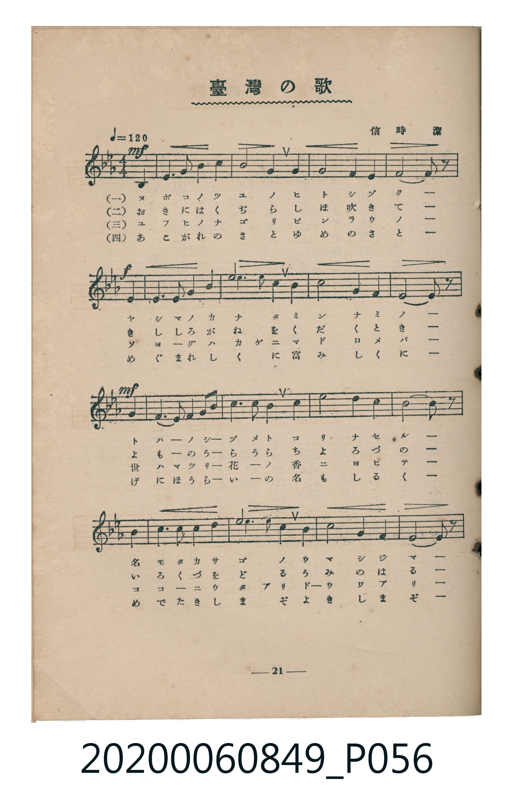
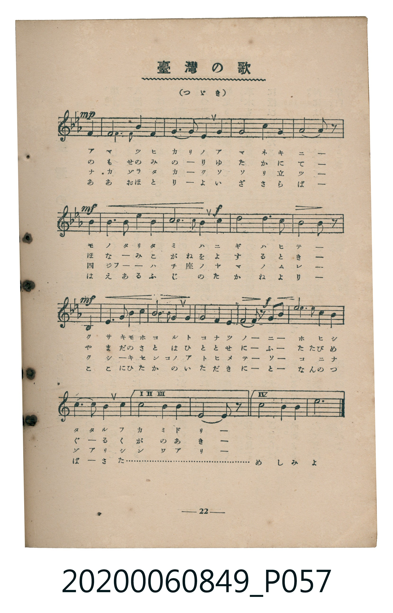
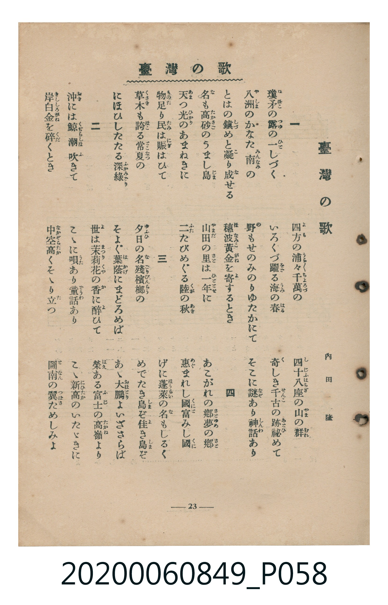

# 臺灣の歌

> Re:Shōka 使用 AI 協助辨識與重建樂譜，可能會有錯誤。歡迎[回報](https://github.com/TMDLang/reshoka/issues)。

- **鋼琴伴奏版**：<br><audio controls src="taiwan_no_uta.mp3"></audio>
- **NEUTRINO 歌聲合成版**：<br><audio controls src="taiwan_no_uta_neutrino.mp3"></audio>

- 詞：內田隆（昭和4年臺灣教育會選歌）
- 曲：信時潔
- 臺灣教育會公認《新定兒童唱歌》高等科女子用（2020.006.0849）

## 說明

原書資訊與歌詞全文（對應 P056.jpg – P058.jpg，書頁 pp. 21–23，高一第二學期第 9 首）：
調性與拍號：變ホ長調（降 E 大調，3 降記號）、4/4 拍（♩=120，弱起第 4 拍進入）


## 歌詞

```text
一　瓊矛（ぬぼこ）の露（つゆ）の一（ひと）しづく
八洲（やしま）のかなた南（みんなみ）の
とはの鎭（しづ）めと凝（こ）り成（な）せる
名（な）も高砂（たかさご）のうまし島（じま）
天（あま）つ光（ひかり）のあまねきに
物足（ものた）り民（たみ）は賑（にぎ）はひて
草木（くさき）も誇（ほこ）る常夏（とこなつ）の
にほひしたたる深綠（ふかみどり）

二　沖（おき）には鯨（くぢら）潮（しほ）吹（ふ）きて
岸白金（きししろがね）を碎（くだ）くとき
四方（よも）の浦々（うらうら）千萬（ちよろづ）の
いろくづ躍（をど）る海（うみ）の春（はる）
野（の）もせのみのりゆたかにて
穗波黃金（ほなみこがね）を寄（よ）するとき
山田（やまだ）の里（さと）は一年（ひととせ）に
二（ふ）たびめぐる陸（くが）の秋（あき）

三　夕日（ゆふひ）の名殘（なごり）檳榔（びんらう）の
そよぐ葉蔭（はかげ）にまどろめば
世（よ）は茉莉花（まつりくゎ）の香（か）に醉（ゑ）ひて
こゝに唄（うた）あり童話（どうわ）あり
中空高（なかぞらたか）くそゝり立（た）つ
四十八座（しじふはちざ）の山（やま）の群（むれ）
奇（く）しき千古（せんこ）の跡（あと）祕（ひ）めて
そこに謎（なぞ）あり神話（しんわ）あり

四　あこがれの鄕（さと）夢（ゆめ）の鄕（さと）
惠（めぐ）まれし國（くに）富（と）みし國（くに）
げに蓬萊（ほうらい）の名（な）もしるく
めでたき島（しま）ぞ佳（よ）き島（しま）ぞ
あゝ大鵬（おほとり）よいざさらば
榮（はえ）ある富士（ふじ）の高嶺（たかね）より
こゝ新高（にひたか）のいたゞきに
圖南（となん）の翼（つばさ）ためしみよ
```

## ABC

<div class="abc-score" data-abc-src="taiwan_no_uta.abc" aria-label="五線譜載入中"></div>

[下載 ABC 原始檔](taiwan_no_uta.abc)

## TMD 檔案連結

- [主旋律 TMD 檔案](taiwan_no_uta.tmd) [[在 TMD Studio 編輯](https://tmdlang.github.io/Tmd-TS/#tmd=s7IKdvYPcrWy4qpTUCpJTLdSSM7PyUlNLsnMz7MqzsjMK0nNjM_KTMmPL87Iz05Ugisry88pzU21ys4vyY9PzyzKKY43MjAyiDcwMIs3sDCxRCgszi8tSk61Kk7OyM_PiS9JrShJys_PRpePL0hMT7UKMDA1wyljjlPGAiFTUJRflpqXmAe0saAI5PoUsJUIBallmSmpIOni5MS8-LLUosy0zNQUJH-lFhWD_Q6xoqQoMa84uSizABQgCFX5RSUZ-elFiQUZlVYZmcUl-UWZyYk58dmJeUhBVJKRCgyhgpzE5FRknZnpmXlWJYmZwAAFBWp5YnxuYmZeTmIekisQqsqBrsxPS8tMzkzMUeLS0lJ40b7reePix43rnq3tUdDS4lK0VTA0MuCyt1Vw1eGyMdE3sQOZ8mLlvPd7Zj1tXf58yoaXs9re7-l4NmPt00k9Jk93boGY8GzqzBdNm57NaX7ZuANo1Ps9nWDrn83eBNT4ZP_CZzObnu2dAhZD0_C0dc2LVb2PG7qeTdvwdB3QkknPVy99OmUj0JTHDd0vV894vrbz-fKJT5dufrp2wvMpK4CWg9KGHjBt6IHSBtgqLn0tBVtqAS4FBYWnffOfzd7xYnP7ixVdLzragY4BhsHT1hXPprUDHfB0Q--z9k4FUALTyypIV3jUMBnEsQBx3u_pAep8uaBRoaBAT8HIEChnZAwUBPrkyY6G52vWPNnV83Ttjmdz5gPZCpYKL5dNA3oBGEoga1-s2v-sYTnIwu7eFzPnA0VfrOt63Dz75dTtQCmgzS9n9iq4KjxdshzM7TFWAAq8WDEDrLbzcUMjMMYUgHqBKh_NXGkLjEqgoqd7Nr7Yuh1kG1juZcOmp61Lgcq5QDYC3fS4oeH55K7n82cDdT1uXPO4cc_jxskg4xrXvZwDjD-g4JLHTcBYB4kA1YNFNj1uBEYFUGT648aljxv7wYHWuvrZFrCGphawxD6InseN3Y8bVz1unP-0dzpY8_7HTZPBIkA_gBSANAPNe9y4HmRn31qwIpDBIOmmRqDU0_a5YEGwu5q6nnVMAHNXgfXPftzUDbZ_AsjjUNGmJlDaWdAEFpkPdsLUx41TYC5qA7oOaMfTzdvACmZAHAs2ZclKsFATzP1LnrYC4wfi526g5TAjQAoeN6593Nj7uHE1SOfzzpUvtm0G-x8oB1QBjhSgazdMhLkC4uH1LzZDRFY_buyDiIBNXwZOA72dz-aAkjkwVMFuBnoK5J0Xq0BJ73HjblgodD_dsePpkn6wIDDsICG6BDlEgcYDVQMNBoYl0PL5QD3Ptm98vm0BWM9WcKDsf9y4EuIpSHrYBcx2Dc82ARMlUEkX1HaQSetfroe7atHjJmCQdD7buw4WVbuB3KcTdkIMBmsBhgrYP0837Xg-c-_LdoiPgaJA1dMfNwEZPcDQA_tk0vNFwGCAGA10G1AzkAH0Ui9Y_-zZz6aBDW4CBSzEf8-2Lnvc0ArW0wZ0C4QEOaG3-cWENWDxhWD1QGvAqQgWJC1gIaDxS1_sAqeWpknAAICE57Ot26EmwhLmsxlAzUCR9UBZaPJ42Q5xKtDnoFgBpT5QVAODcR0wGIH5BJbagEEG9v_zldOfbV70cnczLAiAUQJK-uAYQwTB0_UtED-CbZ4JtBApCDZuBJa8sIwFTHSQQFr3sh1Y0gJNBCYSSGZcD8yewDIZnkPBCJivQTEIjV2kGAK6czM4e00A2vZy5g5YFICKb6Dpz5cD_QzJCKBEAC0ugKVMw9MlU59NB4cMyLvAdATM9CAdwAz4bN0MSB4E5jVIsnq2avOzZcB8BxQE2jYZElvIUTIXFFGNE15M7HwxBZL1gbkB6PtJsJQH9DAwifaCnboB4gpw8oSG1foXPZ0v-jpfdG0EawaqBhZXwJTb_7gJkrnWvVw2EywFikOgiS_bwPm5CRgdQC4s34Hio2kuUPrpFHBMgJIBOAMDA6CpC1gpvVgJsWAlOLUB8x1UCuKitc9X7gKWODDPA90_D-xVUGKAJWmgT4EIaBYkYCGmL4Em8qe9jcAC9Omu5bAsBSyTgEELDIuFjxtBdQQogDeCnQBOBdBI2gfM8UCRhsdNoGgDm7UUUlBAXAg0qBeYK572g9WBykpgsoMW7y-2L4TFMCj9PF86FZJyYMUuNFyAgQLUs_rFGkjKB_oO2ByAhcvSebBwAWZqYAgihQvUY8AEA7YCnNybgCl-3csWiEXQdPt0ySJoWmpqhEYYqgKQQc-awaUWOLmCFe0DmzX96RxIYAKDdzXIrPWQFA7JD8BMhq4A4iVgpl_9YvKaFxOAKRSSJSHFCDDmoQkZuSYB-w0Yo-BaDuyE5eCI7YVVH_C6bt6TvZAKAJI0sSiA2A8Mn7nAWvzlVkhZBUytQCesgFYuoOwAjOFpIP-DHAVO88-WQcpaYHqAmA00ohvo26eLgb6ClObAxAcOvNUznm7bBatxgM6GlDBAR4GTKiSdA1tbsNQKzGHAPABPp8DCDGg5sK6Yh6jZns6ZBqu7gQXKKmBEQ1Pf_j1gwSVARwJdCy1VQAEE9DCwlu8Aaaa8RQYFClr6XFxhwCZ1qqGRsYlVWH5mcqpDja5hTTXIGgUbCy07MKNGwUBBFw6rc9NqFUzjgawaBUOwiLGCKZA0A4uAWBAxCK4BkyBoBMQg9TVgFgQaKFQDDQOLgm3yMaxRAJkMg8DmE1gHsA0F5U8G4nVg1hKITFMbXC1EfBNUxwq4-HQwuRQq3g83PR6ouwVhtxG63V1QHb1Q_mogXg9mgcwAySyCqW3qhNsEEt8NN2MrmASZABJfhmw3RBRitzGa3WBfgXSA9EN8BfPfKqjMFLhakDuBlQE0PCajuQlmEkg3wu65CLtN0P3dBNUBMQlYygDN6gGzQGaAZKbC1YJCGe7apka4OMStIHXIcQEJc5CqGnBpBk9ChuBkAko8QJE4qFpQioIIgViwVAVKPTBt0DQESpHgxAZPRJCoADlhH9wx3VDHgAIQIjcfTO5HDziwCrg4WsCBvIJIMAh7pgNNAEUoKLgg-tbCzGuaBBaHJZoFcHtAIlAT4ckMFkgdCHuAiQPCB6meAE-EMP-ATIclUIiPIeIr4faD3QUJdqD4Blz2ABMCyHx4uEEjHZaoYRkHZg_M3aBwgoUBsj9BqhDhBnIlPNIhJYAhmAaVHrAYNkMqSeDJwBwuBCtcQJEOThhI8Y3IcpDYhrkalO0hvocmVnCyBoUoKNsgx_dsqDgoXBHuBmc3RHw3gTIHsj2wpA_KbBA-LOMthMpAYg4eD_CCCDVdIRVEoPgGxzEs_YKKOoh7wfEAKbWQHQFLCrAgB7bFwOKwshC13AEHAFKUQ3SBghDiHYgHQDLo9kDLHqRAAEc5OMgwy1aUfA6LYBANilGy8nlBLUQYEe9Qp4DyMiQYEIUOvIBEjSlw_kBOrzPQxCGBBC4EkeIdFHeQ1A2JQUiuRs1nEPth9iDyBcR-UIxipi9wkYoU77BCF1TZgCMDXEqBZOCBDi3wQfaCxOEVYBOkPIEW3_D0jZGOwZG-HCncIOkSlmMQ4TMPbCq4hICqQg43WDkDUoUt3IBjSKagJgZyljcCRzQkaiENA2NwFKM2FUDJACJiAjcbWsyjZ3uEY8GZBJ7iIYEMCgRY8MNqNYSOtWAS5C2M4gqcrDCzPaiQgJmHXj1AowVec4OiDaIHkixA5mPmRVCxhRz9UHcDAxVWjMCiH5ZsYNUGuAaH0sjJAqYeFB4Ie8CRixT9MP-AwgfkBnhxjigWwREPLZiA9DS4_aAMhigjUKoTSCKH5XlIeW0KyenIORxSzoPafpCCHVQggCCENkMr6pFanEgxDwl3cAJG8zki40EqSljI96GIQ1ILZoyAqy-kCh7RXACZC68-wNU8JBVBK3h4RpkJD0FYbK7AUsGjF_igYgiiGtJmhBYX4GoExJ8GS3kQnSgpGRoWTQ3gGIS4DIt_wDEPa0g0wQsskH2oLoCkcMyUtxZqTweWAgZSq6C06ijtGICbBkhRDml2ggISkiGh2QdqOSLIEW0T9DYdtNOAVveCEwhSlEMCFtRSw9WQhSUtzM4GpI0BbUugtYHAAY0U5bC2I9A_YB2QNiiqu1ELL4Q9IJsRbTrUJIzauEetU8D6sEQtxB5Y0kIUXqDWKo5CEtoWhkU5pDoHUuj1OVKrDmuDDeIkWPUDsRqSr5HSJ1L0IKkA93oQwQBpvCKSAVLaR6pcYWUCoi8FqcIgeQJSlqCXl5BSABRBaP1PaPkHSiLQDgW03VOL6Fu75qXAetcGmJ1rWKMHFEjQHhA8lA3AXW_kYEPEGKQ4grYCUDIjUlEJDjBYgYCemkCxikUPuL-ByFG4WxUQPTCPmpDsTVgDEOJTFH8idSUhrQ1YLw3Wmoa4AGq_rp0CfBxDAYkDdBGcC3IekKPMBQA)]
- [鋼琴伴奏 TMD 檔案](taiwan_no_uta_piano.tmd) [[在 TMD Studio 編輯](https://tmdlang.github.io/Tmd-TS/#tmd=s7IKdvYPcrWy4qpTUCpJTLdSSM7PyUlNLsnMz7MqzsjMK0nNjM_KTMmPL87Iz05Ugisry88pzU21ys4vyY9PzyzKKY43MjAyiDcwMIs3sDCxRCgszi8tSk61Kk7OyM_PiS9JrShJys_PRpePL0hMT7UKMDA1wyljjlPGAiFTUJRflpqXmAe0saAI5PoUsJUIBallmSmpIOni5MS8-LLUosy0zNQUJH-lFhWD_Q6xoqQoMa84uSizABQgCFX5RSUZ-elFiQUZlVYZmcUl-UWZyYk58dmJeUhBlFgE1JyempuaV2JVkJmYlx-fmJycn1uQmJcJEkMoLMkAKrIqyElMTkW2IjM9M8-qJDETGPKg0C9PjM9NzMzLScxDci5CVTnQO_lpaZnJmYk5SlxaWgov2nc9b1z8uHHds7U97_d0vOze83zClid7tjxd2v-8s-P9nk4FLS0uRVsFQyMDLntbBVcdLhsTfRM7kNEvVs57v2fW09blz6dseDmrDaj72Yy1Tyf1mDzduQVi7LOpM180bXo2p_ll4w6w-Z1gNz2bvQmo8cn-hc9mNj3bOwUshqbhaeuaF6t6Hzd0PZu24ek6oCWTnq9e-nTKRqApjxu6X66e8Xxt5_PlE58u3fx07YTnU1YALQelLD1gytIDpSywVVxhwGhKNTQytgoABWyQh0ONrmFNNZcCENhYaNmBGTUKBgq6cFidm1arYBoPZNUoGIJFjBVMgaQZWATEgohBcA2YBEEjIAaprwGzINBAoRpoGFgUbJOPYY0CyGQYfNy4BqzjceMeKH8yEK8Ds5ZAZJra4Goh4pugOlbAxaeDyVlQ8X646fFA3S0Iu43Q7e6C6uiF8lcD8XowC2QGSGYGTG1TJ9wmkPhuuBlbwSTIBJD4MmS7IaIQu43R7Ab7CqQDpB_iK5j_VkFlpsDVgtz5uHEzNDwmo7kJZhJIN8LuuWC7odELiUZDcFSBIhAoEgdVC4pViBCIBYtZUAzCtEHjEZQqwBEOj0hIcICcsA_u-G6oY0CegMjNB5P70R0PVgEXR3M8KGoRkYawZzrQBFCgPm7sgepbCw-MSWBxWMQtgNsDEoGaCI9qWOLoQNgDjCAIH6R6AjwhwPwDMh2WSCA-hoivhNsPdldTI1R8AxZ7oJEByR2GYBqUs2Ahb4aUy-DRYw4XgmU8UGSAIwwpHhDJERILsGQKyhIQV0FCAJS9IPEASlLI8TAbKg7yLyIewEkREQ9NTWj2QJMeOCFC-LBEuRAqAwlRePjAMylqfCNlUlA8gMMelq5AxQDEveDMDcnRyI6ARREoYiDiIEsR5QRqngQHACwqYAEPokEhTVa-KKiFCCPiAxpOoLQPcd7jxqlQx8AzNWoIgtMTLI2DSFDBgywOcTzIXOT4gKRmUBqHhCwkF6CmS4j9MHtA-Q3ZflBIY8Y7SA45PiC5FlJAgkyC5GqQDDxFQAspkL0gcXih3QTJf2CXI6U75PSFki-MwKEOCWdIzWIMDm_kusYYHCcQERO4gdAyCj1vIEIWnJLgyQLiY5CLYGEBdSOSjrVgEhTKyAkMkqfR4wIW57Ph5qGXbdAwghf9oDCE6IHEEch8zAQLytvIcQF1d-M8eF6DxQUsDmFlHrgKgNLIcQRTDwoPhD3gMgMWF5DCxhSSHZCzAaSQAlXqkFIJlGtAEEKboZVTSE0JpBiBhAc4d6C5CJE6IaUvLET6UMQhsYgZUuCyH6nWQNRBIHPhZR-47oDELrTWgJTPQJGZ8JCChfIKLLUGemkFbyRAGwPQPAUuA0H8abAUAdGJksKgYdHUAM4dEJeh-gelCqe0JQaub5CiAlQsQZI4JAFDkxs0sBBBgahA0StwaCsNrUAHRxxSVEA8DKqWYZkDViAiWnGQKMds3UEqLmgFhZoJwQGOHBWwhgLQP2AdkAYHqrtRMzvCHpDNiAocNWmhtqYgdQSQQq8kkKpwrLUz2Ap47QzJ_5B8AAlkJO-Agw1JBbj5h3DeBJiZUJ1IaR-pxIblIUSjch5UtAme91DyPayuA3kD2lCEh4MBuJeA7DFEgQPJYNDCH6WQR8r8YC_Bkjh6PPRi1wNuliHSIu7KBKKnFr3DY0S4vwP2lYJxvDa4oAL6O17bUMFQG5SZDLVB1QswEMA8uCScQgSPOUgvxCQwEzPIkK2AsKCGQAwHWQKryyAsiAVmQEVwCagOk3htsCXIRkKsgxa4EMdBrYWphlkL48P9CXKythHUEigT3f-QwgZEG4HZQBl1qG-1kQsZKBdmN8zpIBrChtiDaiQl_gW2viByUBuhXgVSYBZUH6wDBNYMjzxTdXjQACmwzSBfgxgwt6AUoKDARbEMli5ANDTEoJ5D9jZIHNwNhkY0JARBEBgYoFCEBidGYGJPPFRNn5DuOTgVwP0EKQRANDRiEAkUybVAt6IEFiLW4KkJzsCMOIjXMLKrDxHjExBfGMaDTARaDjEViYsiYxIPith4sAtg9gP5ICZIGBLLSG4DcUxAHGOIJJgNCk9QdoWHISyo4HZDmOYIE6HGgawHmQUzDCJuBDcNQsJNgpiFaglQCUIlCge7HMQShH9BJoIsBFkL0wT1Eyw7INkG9S_IEFgwALXBHQgylDp-0jZCCnV0Pkgzggdkg2MDFDfQaAHaDmEC9apD2HBZJGVARwHNhRqDVD5CRdHiERR9kKhD9xxIFKwI3PCFSsINxhu6qOllYNIs1NXx2lDt8LgGa4SnVWBAAvlAEqIZ7CL0YDQChTaQQMQA0ACI7UjqoJJQKZDHoCkNyoAEBVIwQIMALIJaNJgM1oFLWMMF1jfugbbfob1neOMa3oSF9fvAbTiIOPamMKSXAW7p0XoAD9KMBA-0QB0Pa5zCRlFhDUhY-38_XBwyUAEbcENtl4OHIWg44AWxDdS0hg5IgLvCIBn00SFowxdp6ArsbnCzGdmfWAKdRqNDjcuhDgG16nvhTkLtF4La6Yh-KUgVcqDDRh8hrXlYoENGJGg7mgIb5QCNmoD6NfCEgRhRBLsaOqYHpKfB3Q5K54iIQhkhhfSZ6TL6ABvjBfWAkHpdQBrRj4cknflQcUQ3Zy3ch-jdD7SBRdr01pGH4SBdSUwnQpwOC3yQPEQcNCCOYygLOtxOSu8WW0cRljcg7kcNdMhQDKgnhza7A00GoMSBcC1qIQlJ8qByByQOG1CGuB1LTTHa4xvt8cGjabTHh5E-qdfjAwUWSqcPSiGcCPc2PNeh59bRDt9ohw-qebTDN0I6fGjFga6dAmwQKNrHMFYBhW-ExjdG8E2gqpW5AA)]

## 分析

```text
================================================================================
📊 TMD Song Profile: [ 臺灣の歌 ]
================================================================================
⏱  Duration:       1:08 (68.0s), 34 measures total
🎼 Key & Tempo:    首調基準 E,, != 120.0 BPM, <4/4>
   - 分析範圍：      由實際發聲的音符與和弦推測調性；播放脈絡另行呈現
🎤 人聲音域:    A#3 (MIDI 58) – D#5 (MIDI 75) [跨度: 17 個半音 / 1.4 個八度, 難度: challenging]
   - 最低音:  A#3 in [Verse1234 #1 @ m.1, 0:01]
   - 最高音: D#5 in [Verse1234 #1 @ m.7, 0:12]
   - 適合: soprano, mezzo-soprano, contralto, tenor, baritone, bass
🏛  結構:      Verse1234 (60.0s) -> Verse123End (4.0s) -> Verse4End (4.0s)
⚡ 編曲密度:        Peak 1 軌道同時演奏
🗝  調性診斷：       D# 大調（推測轉調經歷 2 次）
   - 風格氣質:    純淨自然大調（陽光明朗、易唱易記，無明顯調外色彩）
   - 轉調歷程:    D# 大調起奏 ➔ [Verse123End] 轉至 C 小調 (-3 半音 / 五度圈 +3 步) ➔ [Verse4End] 轉至 D# 大調 (+3 半音 / 五度圈 -3 步)
   - 核心骨幹音:  A#, D#, C, G, F
   - 調性數值:    D# 大調 [相關度: 0.85, 穩定度: Moderate, 自然音純度: 100.0%]
   - 候選調性 (K-S): D# 大調 (0.85), C 小調 (0.75), A# 大調 (0.74)
   - 五度圈歷程:   -3 -> +0 -> -3
   - 各段落調性細節:
     • [Verse1234 #1]: D# 大調 (r: 0.85, 自然音純度: 100.0%)
     • [Verse123End #1]: C 小調 (r: 0.56, 自然音純度: 100.0%)
     • [Verse4End #1]: D# 大調 (r: 0.76, 自然音純度: 100.0%)

  [ 五度圈游移軌跡 ]
              [C ]*
         F            G  
      Bb               D  
     [Eb]*              A  
         Ab           E  
            Db       B  
               F# 
     (* = active key center)

  [ 十二半音累積音高分佈 ]
     C  : █████████████████████     21.0%
     C# :                            0.0%
     D  : ████                       4.2%
     D# : ██████████████████████    22.1%
     E  :                            0.0%
     F  : ████████████              11.8%
     F# :                            0.0%
     G  : ███████████████           15.3%
     G# : ██                         1.9%
     A  :                            0.0%
     A# : ████████████████████████  23.7%
     B  :                            0.0%
--------------------------------------------------------------------------------
Assignment 軌道音域：
  - Voice         : A#3 – D#5 (17 個半音 / 1.4 個八度, 106 個音符)
================================================================================
```


## 原書掃描頁








