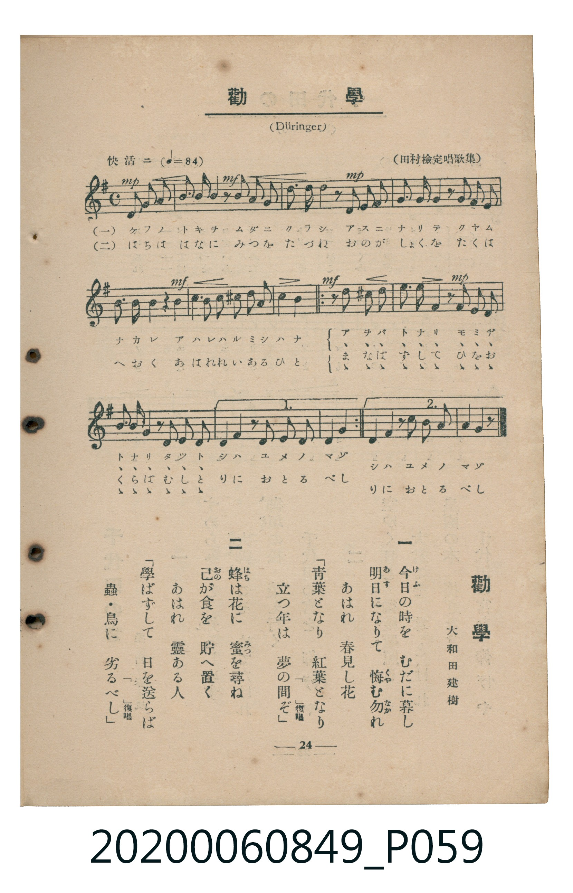

# 勸學

> Re:Shōka 使用 AI 協助辨識與重建樂譜，可能會有錯誤。歡迎回報。

- **鋼琴伴奏版**：<br><audio controls src="kangaku.mp3"></audio>
- **NEUTRINO 歌聲合成版**：<br><audio controls src="kangaku_neutrino.mp3"></audio>

- 詞：大和田建樹（田村檢定唱歌集）
- 曲：Düringer
- 臺灣教育會公認《新定兒童唱歌》高等科女子用（2020.006.0849）

## 說明

原書資訊與歌詞全文（對應 P059.jpg，書頁 p. 24，高一第二學期第 10 首）：
調性與拍號：ト長調（1 升記號）、4/4 拍（快活ニ ♩=84，弱起 3 個八分音符進入）


## 歌詞

```text
一
今日（けふ）の時（とき）を　むだに暮（くら）し
明日（あす）になりて　悔（くや）む勿（なか）れ
あはれ　春見（はるみ）し花（はな）
「青葉（あをば）となり　紅葉（もみぢ）となり
立（た）つ年（とし）は　夢（ゆめ）の間（ま）ぞ」復唱

二
蜂（はち）は花に　蜜（みつ）を尋（たづ）ね
己（おの）が食（しよく）を　貯（たくは）へ置（お）く
あはれ　靈（れい）ある人（ひと）
「學（まな）ばずして　日（ひ）を送（おく）らば
蟲（むし）・鳥（とり）に　劣（おと）るべし」復唱
```

## ABC

<div class="abc-score" data-abc-src="kangaku.abc" aria-label="五線譜載入中"></div>

[下載 ABC 原始檔](kangaku.abc)

## TMD 檔案連結

- [主旋律 TMD 檔案](kangaku.tmd) [[在 TMD Studio 編輯](https://tmdlang.github.io/Tmd-TS/#tmd=s7IKdvYPcrWy4qpTUCpJTLdSSM7PyUlNLsnMz7MqzsjMK0nNjM_KTMmPL87Iz05Ugisry88pzU21ys4vyY9PzyzKKY43MjAyiDcwMIs3sDCxRCgszi8tSk61Kk7OyM_PiS9JrShJys_PRpePL0hMT7UKMDBF0llQlF-WmpeYB9RdUARySQpYO0JBallmSipIujg5MS--LLUoMy0zNQXJjalFxWB_QKwoKUrMK04uyiwAeQ6hKr-oJCM_vSixIKPSKiOzuCS_KDM5MSc-OzEPybslGalA30I9kZOZloqsPzM9M88qNzUzKxOL_6DS5anFJalFefG5qTn5KZVKXFpaCk-7dzxdu0NBS4tL0VbBwoTL3lbBncvGRN_EDqT5xcp57_fMerpk-dNJPc-nbHi6e9ezFTvf7-kAsp_Nnfhs1aKn62Y9nbLx2dqel7Pb3u_pBNv4bPYmoCaXw3uA4ZWeWgQWe9G-63nj4mdTZ75o2vRsTvPT1jUvVvU-buh6Nm0DyIjWSc9XL4UY9Lih--XqGc_Xdj5fPvHp0s1P1054PmUF0EpQzOoBY1YPFLNgq7j0tRRsqQW4FBQUnvbNfzZ7x4vN7S9WdL3oaAc6Buj_p60rnk1rBzrg6YbeZ-2dCqDkoZdVkP5-Tw9Q8csFjQoFegpGJkAu0NlPdjQ8X7Pmya4eYJg-mzMfyFYwNFB4uWwa0MHAMAFZ8mLV_mcNy0HGd_e-mDkfKPq4uePl1O1AcaAlhgpPe4HWzwDLdD5uaATGhAJQJcj-_aufbdn9uLlb4dHMlbYWIBuf7tn4Yut2BWOFpw3dT1tXP-1oezl_8_M1y142bHrauhRoABfIRqCjwNTurmfTgYIdjxsnPm7cCjK-cd2zmU1gkRWPG4F2dD5umvS4oeFxU8PjxgWPG1c_m7UOLNv_uAnofKD66SCDns3ogxnU9LhxJlhi9ePGVY-buh43LgPqf9Y0BaatBWxow9NukOdAahq7wSI9IIPA-tcDOSA9M5a-WAaUAyoCinQ_bgRqAFn4omsjVLBxFchDIG0NPS_nTnoxEegksBOAbm7cAFYN9AXYFQ0Nz7e0QhU0Ae3Y_7hxEbICkCnPV0NsA4dz45KnO7fAAmI6WGQ90JSnS4DagEa0PW5qhITXy2mTwcr2gbnzHjf0Pt23EphwIQG9C-ytF3MgYQp08kKIUUBPgIKooeHFnDlgKaCDlkCC--kGqDMeN4Ii7HHjWnBK3A7xNTBAgTEAFO15uRjoUKDI9MdNoJCFx9WLTeth-vuBNoEV73i-FxJvXWBuP3pYv5zbAfZWz-NGcPyAwrD7ya5dYD2bgGGACGhgOob4FxL8wIB-3DgL5ApIREOTATC_g5zzsgEYShBXQxwIUg8OkflAFUALgckKHLjNu19uhuhcAYwNaAICBnfXYph-kBPAyWAnyDJ4KAPNojyrQ4GClj4Xl28isFgMyEzMy3eo0TWsqQbZoGBjaKZlB2YBSxhIHnu6of_5-gaQFpBwjYKBgi4YItPVuQW1CqbxQJYhEBsBcQ1YtY9hjQJIFASR6cdNG0Fk81Qw2YdQb4RDfeN6MLkQzq4BJzuQK0Glzo6GFwt7EE40Bms0htIwJ6bVggVArgO5skbBFCxpCqXRfWIGIsxBRA1YPUgXhIaoBLHB0mCFCP8CyzSwmsdNa4HsTci-aF4AJhvAZDfY5MdNIN-A-CuB7O0oYbQITO5EVt3cBVW9CojbUFSDQ6h5CdweRIhCQgwUckBdjatRwnU_mATrapoEsaNxPlT1UiBei6IaZDswX4LJHqhqYLZsh2rohxqC0AAyCiSOPdp29RCMNhCERx0I1iiYQFkgERDbRB1IgOIQFLOYSuAmgIwDKYOrr1EwA8uawXWCYx-kDpZIIPGPFLfQ8G9aDWSvQfIqRBQUYxAXPG4GeRoSVyB1EP7jZlDoP24GBws8tlFVQ2xASQPgVPS4eQJULTR9AVWC0gFy-oKoBpve3IRwOTgN7IDoAsYhJEJQXN4IUg11CzS1gGwHxTGUbGyBqwOWTkiqYSkcWHIhu6VxH5gEuQ9YFELVzoKqnA7Ey1BUg30ITjyQVIaWvzuBCQXURtADtgjWAFsIwEYEpFwEFpaYCQg5myLyMpgFzPUwT4PjlrAymGE40hBmvseMlyZwLmsGhyBYFSjfw2IfEfeQOASFy-NmcEkHKRmB9DyY2iZQqOJJHUjxDTEVWBNBwx-hC1z-AOMAFmcg18BSHXr5AMnxIFWQWAeZDCqRYPGIN8bhcQiJq2frgE2vDiNYHKJEHZE5kZIoBhUKsAqgBm4RskHINFERi5nhBiAZINPICYCEzDYAyQXV1bVcXLp2CqAmiQKQVuYCAA)]
- [鋼琴伴奏 TMD 檔案](kangaku_piano.tmd) [[在 TMD Studio 編輯](https://tmdlang.github.io/Tmd-TS/#tmd=s7IKdvYPcrWy4qpTUCpJTLdSSM7PyUlNLsnMz7MqzsjMK0nNjM_KTMmPL87Iz05Ugisry88pzU21ys4vyY9PzyzKKY43MjAyiDcwMIs3sDCxRCgszi8tSk61Kk7OyM_PiS9JrShJys_PRpePL0hMT7UKMDBF0llQlF-WmpeYB9RdUARySQpYO0JBallmSipIujg5MS--LLUoMy0zNQXJjalFxWB_QKwoKUrMK04uyiwAeQ6hKr-oJCM_vSixIKPSKiOzuCS_KDM5MSc-OzEPybuJRUDN6am5qXklVgWZiXn58YnJyfm5BYl5mSAxhMKSDKAimG9zMtNSkS3KTM_Ms8pNzczKxBIQUOny1OKS1KK8-NzUnPyUSiUuLS2Fp907nq7d8X5Px8vuPc8nbHmyZ8vTpf3POzve7-lU0NLiUrRVsDDhsrdVcOeyMdE3sQOZ-GLlvPd7Zj1dsvzppJ7nUzY83b3r2YqdQBOA7GdzJz5btejpullPp2x8trbn5ew2oDlgZzybvQmoyeXwHmBop6cWgcVetO963rj42dSZL5o2PZvT_LR1zYtVvY8bup5N2wAyonXS89VLIQY9buh-uXrG87Wdz5dPfLp089O1E55PWQG0EpQu9IDpQg-ULsBWcfkmAj0aAArGIA-HGl3DmmouBSCwMTTTsgOz9IGe3rPxxdbtTzf0P1_foKClDxauUTBQ0AVDZLo6t6BWwTQeyDIEYiMgrgGr9jGsUQCJgiAy_bhpI4hsngom-xDqjXCob1wPJhfC2TVcMFc-X7PmyY6GFwt7EE40Bms0htIwJ6bVggVArgO5skbBFCxpCqXRfWIGIsxBRA1YPUgXhIaoBLHB0mCFCP8-bu4Aq3nctBbI3oTsi-YFYLIBTHaDTX7cBPINiL8SyN6OEkaLwOROZNXNXVDVq4C4DUU1OISal8DtQYQoJMRAIQfU1bgaJVz3g0mwrqZJEDsa50NVLwXitSiqQbY_blwHJnugqqc_bmqHauiHGoLQADIKJI492nb1EIw2EIRHHQjWKJhAWSARENtEHUiA4hAUs5hK4CaAjAMpg6uvUTADy5rBdYJjH6QOlkgg8Y8Ut9Dwb1oNZK9B8ipEFBRjEBc8bgZ5GhJXIHUQ_uNmUOg_bgYHCzy2UVVDbEBJA-BU9Lh5AlQtNH0BVYLSAXL6gqgGm97chHA5OA3sgOgCxiEkQlBc3ghSDXULNLWAbAfFMZRsbIGre9wESo0w1bAU_rhxBbJbGveBSZD7HjdugKqdBVU5HYiXoagG-xCceCCpDC1_dwITCrAgM9RTeNa95sXM-S862p_uWwks9cAFMHoCQs6miLwMZgFzPczT4LglrAxmGI40hJnvMeOlCZzLmsEhCFYFyvew2EfEPSQOQeHyuBlc0kFKRiA9D6a2CRSqeFIHUnxDTH3c1AkNf4QucPkDjANYnIFcA0t16OUDJMeDVEFiHWQyqESCxSPeGIfHISSunq3bCqqMYHGIEnVE5kRKohhUKMAqgBq4RcgGIdNERSxmhhuAZIBMIycAEjLbACQXVFfXIrdIfFBaJCaEGyQQiLdJUA1MTobxwJQRD6KAisFMI4gIiAuVNINw8VVTqMYAjQDpgZoEMRYshSQJtYOcIg2vm5HtIiGvobqKBCuAsaRrpwCKKAUgrcwFAA)]

## 分析

```text
================================================================================
📊 TMD Song Profile: [ 勸學 ]
================================================================================
⏱  Duration:       0:40 (40.0s), 14 measures total
🎼 Key & Tempo:    首調基準 G, != 84.0 BPM, <4/4>
   - 分析範圍：      由實際發聲的音符與和弦推測調性；播放脈絡另行呈現
🎤 人聲音域:    D4 (MIDI 62) – E5 (MIDI 76) [跨度: 14 個半音 / 1.2 個八度, 難度: moderate]
   - 最低音:  D4 in [Main #1 @ m.1, 0:01]
   - 最高音: E5 in [Main #1 @ m.8, 0:19]
   - 適合: soprano, mezzo-soprano, contralto, tenor, baritone, bass
🏛  結構:      Main (40.0s)
⚡ 編曲密度:        Peak 1 軌道同時演奏
🗝  調性診斷：       G 調性不明確（純淨自然大調，未偵測到可信轉調）
   - 風格氣質:    純淨自然大調（陽光明朗、易唱易記，無明顯調外色彩）
   - 轉調歷程:    全曲維持單一推測調性（未偵測到可信轉調）
   - 核心骨幹音:  D, B, G, A, E
   - 調性數值:    G 調性不明確 [相關度: 0.86, 穩定度: Ambiguous, 自然音純度: 96.9%]
   - 候選調性 (K-S): G 大調 (0.86), D 大調 (0.84), B 小調 (0.81)
   - 五度圈歷程:   +1
   - 各段落調性細節:
     • [Main #1]: G 調性不明確 (r: 0.84, 自然音純度: 96.8%, 調外音: C#)

  [ 五度圈游移軌跡 ]
               C  
         F           [G ]*
      Bb               D  
      Eb               A  
         Ab           E  
            Db       B  
               F# 
     (* = active key center)

  [ 十二半音累積音高分佈 ]
     C  : ██████                     6.1%
     C# : ███                        3.1%
     D  : ████████████████████████  23.5%
     D# :                            0.0%
     E  : █████████                  9.2%
     F  :                            0.0%
     F# : ████████                   8.2%
     G  : ██████████████████        17.3%
     G# :                            0.0%
     A  : ██████████████            13.3%
     A# :                            0.0%
     B  : ████████████████████      19.4%
--------------------------------------------------------------------------------
Assignment 軌道音域：
  - Piano         : D4 – E5 (14 個半音 / 1.2 個八度, 77 個音符)
================================================================================
```


## 原書掃描頁




