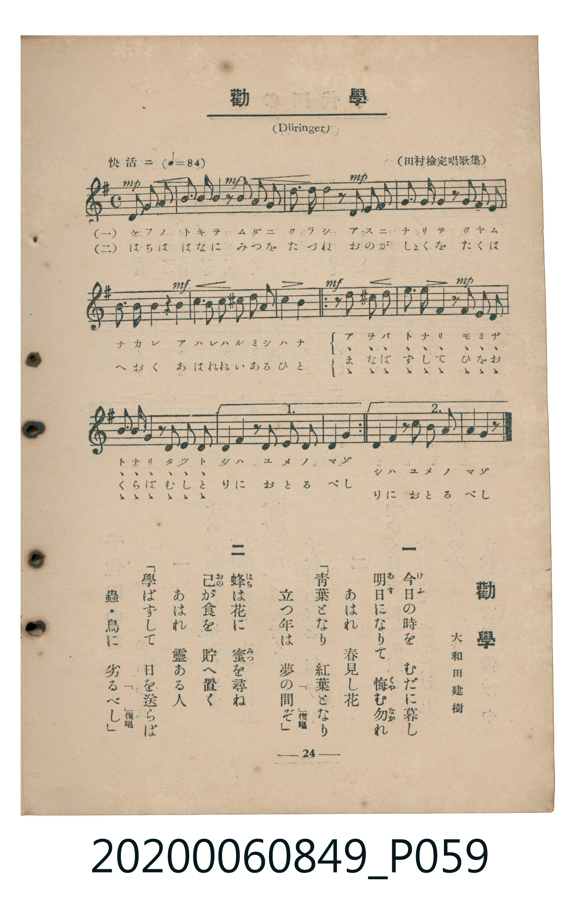

# 勸學

> Re:Shoka 使用 AI 辨識樂譜，可能會有錯誤。歡迎回報。

<audio controls src="kangaku.mp3"></audio>

- 詞：大和田建樹（田村檢定唱歌集）
- 曲：Düringer
- 臺灣教育會公認《新定兒童唱歌》高等科女子用（2020.006.0849）

## 說明

原書資訊與歌詞全文（對應 P059.jpg，書頁 p. 24，高一第二學期第 10 首）：
調性與拍號：ト長調（1 升記號）、4/4 拍（快活ニ ♩=84）

## 歌詞

```text
一
今日（けふ）の時（とき）を　むだに暮（くら）し
明日（あす）になりて　悔（くや）む勿（なか）れ
あはれ　春見（はるみ）し花（はな）
「青葉（あをば）となり　紅葉（もみぢ）となり
立（た）つ年（とし）は　夢（ゆめ）の間（ま）ぞ」復唱

二
蜂（はち）は花に　蜜（みつ）を尋（たづ）ね
己（おの）が食（しよく）を　貯（たくは）へ置（お）く
あはれ　靈（れい）ある人（ひと）
「學（まな）ばずして　日（ひ）を送（おく）らば
蟲（むし）・鳥（とり）に　劣（おと）るべし」復唱
```

## ABC

```abc
X:1
T:勸學
C:曲：Düringer
M:4/4
L:1/16
Q:1/4=84
K:G
V:V1 name="Piano" snm="Pia"
[V:V1]
!mp! D2 D2 G2 G2 A3 B A2 z2 | !mf! B2 B2 c2 d2 d2 c2 B2 z2 | !mp! z2 G2 F2 E2 D2 G2 B2 z2 | z2 A2 F2 D2 G2 E2 A4 |
!mf! z2 F2 G2 A2 B2 ^c2 d2 A2 | d4 A4 z4 z4 | !mf! z2 B2 ^A2 B2 c3 B =A2 z2 | !mp! z2 A2 ^G2 A2 B3 A =G2 z2 |
z2 G2 F2 E2 D3 G B2 z2 | z2 A2 D2 F2 A4 G2 z2 | !mf! z2 B2 ^A2 B2 c3 B =A2 z2 | !mp! z2 A2 ^G2 A2 B3 A =G2 z2 |
z2 G2 F2 E2 D3 G B2 z2 | z2 A2 D2 F2 A4 G2 z2 | !mp! D2 D2 G2 G2 A3 B A2 z2 | !mf! B2 B2 c2 d2 d2 c2 B2 z2 |
!mp! z2 G2 F2 E2 D2 G2 B2 z2 | z2 A2 F2 D2 G2 E2 A4 | !mf! z2 F2 G2 A2 B2 ^c2 d2 A2 | d4 A4 z4 z4 |
!mf! z2 B2 ^A2 B2 c3 B =A2 z2 | !mp! z2 A2 ^G2 A2 B3 A =G2 z2 | z2 G2 F2 E2 D3 G B2 z2 | z2 A2 D2 F2 A4 G2 z2 |
!mf! z2 B2 ^A2 B2 c3 B =A2 z2 | !mp! z2 A2 ^G2 A2 B3 A =G2 z2 | z2 G2 F2 E2 D3 G B2 z2 | z2 A2 D2 F2 A4 G2 z2 |
```

## TMD 檔案連結

- [主旋律 TMD 檔案](kangaku.tmd) [[在 TMD Studio 編輯](https://tmdlang.github.io/Tmd-TS/#tmd=s7IKdvYPcrWy4qpTUCpJTLdSSM7PyUlNLsnMz7MqzsjMK0nNjM_KTMmPL87Iz05Ugisry88pzU21ys4vyY9PzyzKKY43MjAyiDcwMIs3sDCxRCgszi8tSk61Kk7OyM_PiS9JrShJys_PRsgXFOWXpeYl5gHVFBSB7EsBK0IoSC3LTEkFSaemZJbkF2Um5iC5IrWoGOxSsCXxJUWJecXJRZkFIOcjVJVkpAKdCnVBTmZaqhKXlpbC0-4dT9fuUNDS4lK0VbAw4bK3VXDnsjHRN7EDaXyxct77PbOeLln-dFLP8ykbnu7e9WzFzvd7OoDsZ3MnPlu16Om6WU-nbHy2tufl7Lb3ezrBtj2bvQmoyeXwHqBH0lOLwGIv2nc9b1z8bOrMF02bns1pftq65sWq3scNXc-mbQAZ0Trp-eqlEIMeN3S_XD3j-drO58snPl26-enaCc-nrABaCQpYPWDA6oECFmwVl76Wgi21AJeCgsLTvvnPZu94sbn9xYquFx3tQMcA_f-0dcWzae1ABzzd0PusvVMhwMDUUi-rIP39nh6g4pcLGhUK9BSMTIBcoLOf7Gh4vmbNk109wDB9Nmc-kK1gaKDwctk0oIOBYQKy5MWq_c8aloOM7-59MXM-UPRxc8fLqduB4kBLDBWe9gKtnwGW6Xzc0AiMCQWgSpD9-1c_27L7cXO3wqOZK20tgDZ2coEMBNoJpnZ3PZu-FKjucePEx41bQbob1z2b2QQWWfG4EWhE5-OmSY8bGh43NTxuXPC4cfWzWevAsv2Pm4CuA6qfDjLo2Yw-mEFNjxtngiVWP25c9bip63HjMqD-Z01TYNpawIY2PO0GuR2kprEbLNIDMgisfz2QA9IzY-mLZUA5oCKgSPfjRqAGkIUvujZCBRtXgTwE0tbQ83LupBcTgU4COwHo5sYNYNVAX4Bd0dDwfEsrVEET0I79jxsXISsAmfJ8NcQ2cDA2Lnm6cwssIKaDRdYDTXm6BKgNaETb46ZGSHi9nDYZrGwfmDvvcUPv030rgekSEtC7wN56MQcSpkAnL4QYBfQEKIgaGl7MmQOWAjpoCSS4n26AOuNxIzBIgYrXghPadoivgQEKjAGgaM_LxUCHAkWmP24ChSw8rl5sWg_T3w-0Cax4x_O9kHjrAnP70cP65dwOsLd6HjeC4wcUht1Pdu0C69kEDANEQAOTKcS_kOAHBvTjxlkgV0AiGpoMgNkZ5JyXDcBQgrga4kCQenCIzAeqAFoITFbgwG3e_XIzROcKYGxAExAwuLsWw_SDnABOBjtBlsFDGWgW5TkZChS09Lm4woAlY6pVQGZiXr5DjUGNQjXICgUbQzMtOzALWIKA8uuOhhcLe0AaQGJAVbkFtQqm8Qq6EMIQio2AWFfBGEwbADFIYVotUAAkqKtgAlIPxSA2SAysDNlUkADILHOQwWYoVsDVg0mQJWBFcHmwaogbQIYiu39XD9D9Tzt7n_Z2IfsC6DiQUWBjYB4Au1Qd6kyQQA2YBYIws0F6kOkarlourqDUtKLEzDzCYQlxy74eoFve750HDt1OoAioAANH8rN1oLIJizNBLjMCuQwWmOhhDQ0-kJAhSB3MOyAWyHvIgY0jnEGCmOEMlgKrhAUBwjig13XtFMDpSAHIgAYDGpOAtDIXAA)]
- [鋼琴伴奏 TMD 檔案](kangaku_piano.tmd) [[在 TMD Studio 編輯](https://tmdlang.github.io/Tmd-TS/#tmd=s7IKdvYPcrWy4tLSUnjavePp2h3v93S87N7zfMKWJ3u2PF3a_7yz4_2eTgUtLS5FWwULEy57WwV3LhsTfRM7rjoFpRcr573fM-vpkuVPJ_U8n7Lh6e5dz1bsBJoAZD-bO_HZqkVP1816OmXjs7U9L2e3Ac1RAml6NnsTUJPL4T1FmXnpqUVgsRftu543Ln42deaLpk3P5jQ_bV3zYlXv44auZ9M2gIxonfR89VKIQY8bul-unvF8befz5ROfLt38dO2E51NWAK00MjAy0DMwMNMzsDCxBFvFFZZaVJxqFZCZmJcf5OFQY1CjUM2lAAQ2hmZadmCWvpbC8zVrnuxoeLGwR0FLHywGVJVbUKtgGq-gCyEModgIiHUVjMG0ARCDFKbVAgVAgroKJiD1UAxig8TAypBNBQmAzDIHGWyGYgVcPZgEWQJWBJcHq4a4AWQosvt39QDd_7Sz92lvF7IvgI4DGQU2BuYBsEvVoc4ECdSAWSAIMxukB5mu4apFCUsflLA0wRuUhvEK0YaxQE8AadP4WIQIlIIFDohrApSHCSN0mIEYRiCthL0M12QEtw4uZACEYJ8EpaYVJWbmEZMuIJbs6wFa8n7vPLD3OtFSCjSMQcFqBApWWEpATyjQuAcJGYLUweICxALFDXJKwZFIQIKYiQQsBVYJiz-Ecei-xR5z2GIJzkSLJxOc8QQUgQawrp0COLUoABlQ69GYBKSVuQA)]

## 分析

```text
================================================================================
📊 TMD Song Profile: [ 勸學 ]
================================================================================
⏱  Duration:       1:20 (80.0s), 28 measures total
🎼 Key & Tempo:    首調基準 G, != 84.0 BPM, <4/4>
   - 分析範圍：      由實際發聲的音符與和弦推測調性；播放脈絡另行呈現
🎤 人聲音域:    D4 (MIDI 62) – D5 (MIDI 74) [跨度: 12 個半音 / 1.0 個八度, 難度: easy]
   - 最低音:  D4 in [Verse #1 @ m.1, 0:00]
   - 最高音: D5 in [Verse #1 @ m.2, 0:03]
   - 適合: soprano, mezzo-soprano, contralto, tenor, baritone, bass
🏛  結構:      Verse (17.1s) -> Refrain (11.4s) -> Refrain (11.4s) -> Verse (17.1s) -> Refrain (11.4s) -> Refrain (11.4s)
⚡ 編曲密度:        Peak 1 軌道同時演奏
🗝  調性診斷：       D 大調（流行色彩大調，未偵測到可信轉調）
   - 風格氣質:    流行大調（略帶和弦色彩音與裝飾副屬和弦）
   - 轉調歷程:    全曲維持單一推測調性（未偵測到可信轉調）
   - 核心骨幹音:  A, B, D, G, F#
   - 調性數值:    D 大調 [相關度: 0.80, 穩定度: High, 自然音純度: 89.5%]
   - 候選調性 (K-S): D 大調 (0.80), G 大調 (0.65), B 小調 (0.59)
   - 五度圈歷程:   +2 -> +2 -> +2 -> +2 -> +2 -> +2
   - 各段落調性細節:
     • [Verse #1]: D 大調 (r: 0.91, 自然音純度: 94.7%, 調外音: C)
     • [Refrain #1]: D 大調 (r: 0.64, 自然音純度: 85.4%, 調外音: C, G#, A#)
     • [Refrain #2]: D 大調 (r: 0.64, 自然音純度: 85.4%, 調外音: C, G#, A#)
     • [Verse #2]: D 大調 (r: 0.91, 自然音純度: 94.7%, 調外音: C)
     • [Refrain #3]: D 大調 (r: 0.64, 自然音純度: 85.4%, 調外音: C, G#, A#)
     • [Refrain #4]: D 大調 (r: 0.64, 自然音純度: 85.4%, 調外音: C, G#, A#)

  [ 五度圈游移軌跡 ]
               C  
         F            G  
      Bb              [D ]*
      Eb               A  
         Ab           E  
            Db       B  
               F# 
     (* = active key center)

  [ 十二半音累積音高分佈 ]
     C  : █████                      5.8%
     C# : █                          1.2%
     D  : ███████████████           16.3%
     D# :                            0.0%
     E  : ████                       4.7%
     F  :                            0.0%
     F# : ███████                    8.1%
     G  : ██████████████            15.1%
     G# : ██                         2.3%
     A  : ████████████████████████  26.2%
     A# : ██                         2.3%
     B  : █████████████████         18.0%
--------------------------------------------------------------------------------
Assignment 軌道音域：
  - Piano         : D4 – D5 (12 個半音 / 1.0 個八度, 162 個音符)
================================================================================
```


## 原書掃描頁




