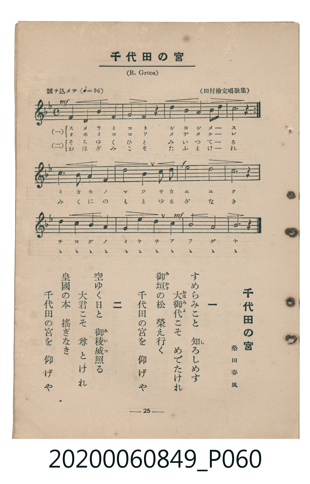

# 千代田の宮

<audio controls src="chiyoda_no_miya.mp3"></audio>

- 詞：桑田春風
- 曲：R. Groos（グロース）
- 臺灣教育會公認《新定兒童唱歌》高等科女子用（2020.006.0849）

- note

原書資訊與歌詞全文（對應 P060.jpg，書頁 p. 25，高一第三學期第 1 首）：
調性與拍號：ヘ長調（1 降記號）、4/4 拍（誠ヲ込メテ ♩=96）
出處註記：（田村檢定唱歌集）

## 歌詞

```text
一
すめらみこと　知（し）ろしめす
大御代（おほみよ）こそ　めでたけれ
御垣（みかき）の松　榮え行く
千代田の宮を　仰げや

二
空ゆく日と　御稜威（みいつ）照る
大君こそ　尊とけれ
皇國の本　搖ぎなき
千代田の宮を　仰げや
```

## 原書掃描頁



## 調性分析

```text
================================================================================
📊 TMD Song Profile: [ 千代田の宮 ]
================================================================================
⏱  Duration:       0:40 (40.0s), 16 measures total
🎼 Key & Tempo:    首調基準 F, != 96.0 BPM, <4/4>
   - 分析範圍：      由實際發聲的音符與和弦推測調性；播放脈絡另行呈現
🎤 人聲音域:    F4 (MIDI 65) – F5 (MIDI 77) [跨度: 12 個半音 / 1.0 個八度, 難度: easy]
   - 最低音:  F4 in [A #1 @ m.1, 0:00]
   - 最高音: F5 in [B #1 @ m.11, 0:25]
   - 適合: soprano, mezzo-soprano, contralto, tenor, baritone, bass
🏛  結構:      A (10.0s) -> A (10.0s) -> B (20.0s)
⚡ 編曲密度:        Peak 1 軌道同時演奏
🗝  調性診斷：       C 調性不明確（流行色彩大調，未偵測到可信轉調）
   - 風格氣質:    流行大調（略帶和弦色彩音與裝飾副屬和弦）
   - 轉調歷程:    全曲維持單一推測調性（未偵測到可信轉調）
   - 核心骨幹音:  C, F, G, A, D
   - 調性數值:    C 調性不明確 [相關度: 0.84, 穩定度: Ambiguous, 自然音純度: 93.1%]
   - 候選調性 (K-S): C 大調 (0.84), F 大調 (0.84), C 小調 (0.57)
   - 五度圈歷程:   +0 -> +0 -> -1
   - 各段落調性細節:
     • [A #1]: C 調性不明確 (r: 0.83, 自然音純度: 92.9%, 調外音: A#)
     • [A #2]: C 調性不明確 (r: 0.83, 自然音純度: 92.9%, 調外音: A#)
     • [B #1]: F 調性不明確 (r: 0.84, 自然音純度: 100.0%)

  [ 五度圈游移軌跡 ]
              [C ]*
        [F ]*          G  
      Bb               D  
      Eb               A  
         Ab           E  
            Db       B  
               F# 
     (* = active key center)

  [ 十二半音累積音高分佈 ]
     C  : ████████████████████████  30.2%
     C# :                            0.0%
     D  : █████                      6.9%
     D# :                            0.0%
     E  :                            0.0%
     F  : █████████████████         21.6%
     F# :                            0.0%
     G  : █████████████████         21.6%
     G# :                            0.0%
     A  : ██████████                12.9%
     A# : █████                      6.9%
     B  :                            0.0%
--------------------------------------------------------------------------------
Assignment 軌道音域：
  - Piano         : F4 – F5 (12 個半音 / 1.0 個八度, 46 個音符)
================================================================================
```

## ABC

```abc
X:1
T:千代田の宮
C:曲：R. Groos（グロース）
M:4/4
L:1/16
Q:1/4=96
K:F

V:V1 name="Piano" snm="Pia"

[V:V1]
!mf! f4 f4 g4 a4 | g8 f4 z4 | a4 b4 c4 d2 c2 | c12 z4 |
!mf! f4 f4 g4 a4 | g8 f4 z4 | a4 b4 c4 d2 c2 | c12 z4 |
b4 a4 g4 f4 | c8 c4 a2 c2 | !f! f8 d8 | c12 z4 |
d4 c4 b4 a4 | g6 f2 c4 a4 | !mf! g8 g8 | f12 z4 |
```

- [主旋律 TMD 檔案](chiyoda_no_miya.tmd)
- [鋼琴伴奏 TMD 檔案](chiyoda_no_miya_piano.tmd)
