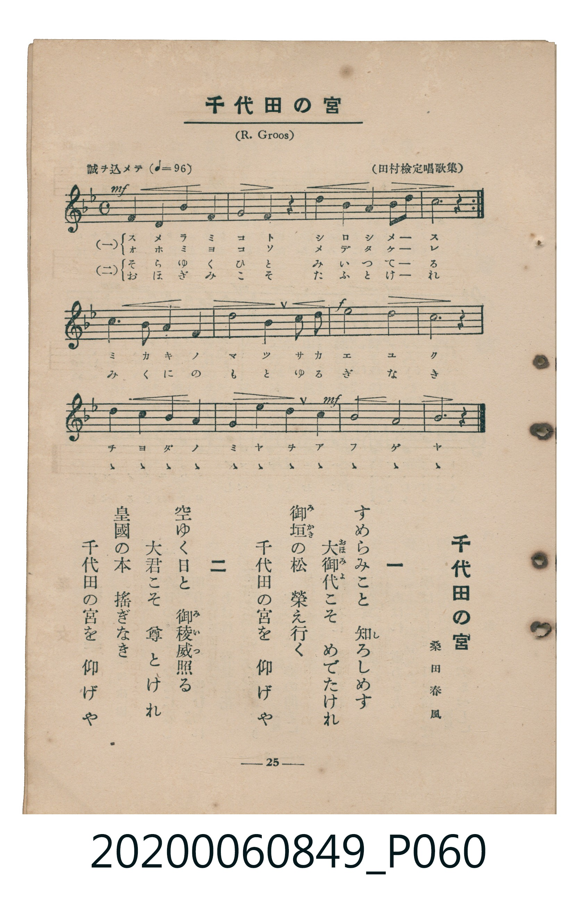

# 千代田の宮

> Re:Shōka 使用 AI 協助辨識與重建樂譜，可能會有錯誤。歡迎回報。

- **鋼琴伴奏版**：<br><audio controls src="chiyoda_no_miya.mp3"></audio>
- **NEUTRINO 歌聲合成版**：<br><audio controls src="chiyoda_no_miya_neutrino.mp3"></audio>

- 詞：桑田春風
- 曲：R. Groos（グロース）
- 臺灣教育會公認《新定兒童唱歌》高等科女子用（2020.006.0849）

## 說明

原書資訊與歌詞全文（對應 P060.jpg，書頁 p. 25，高一第三學期第 1 首）：
調性與拍號：變ロ長調（2 降記號）、4/4 拍（誠ヲ込メテ ♩=96，前 4 小節反覆）
出處註記：（田村檢定唱歌集）


## 歌詞

```text
一
すめらみこと　知（し）ろしめす
大御代（おほみよ）こそ　めでたけれ
御垣（みかき）の松　榮え行く
千代田の宮を　仰げや

二
空ゆく日と　御稜威（みいつ）照る
大君こそ　尊とけれ
皇國の本　搖ぎなき
千代田の宮を　仰げや
```

## ABC

<div class="abc-score" data-abc-src="chiyoda_no_miya.abc" aria-label="五線譜載入中"></div>

[下載 ABC 原始檔](chiyoda_no_miya.abc)

## TMD 檔案連結

- [主旋律 TMD 檔案](chiyoda_no_miya.tmd) [[在 TMD Studio 編輯](https://tmdlang.github.io/Tmd-TS/#tmd=s7IKdvYPcrWy4qpTUCpJTLdSSM7PyUlNLsnMz7MqzsjMK0nNjM_KTMmPL87Iz05Ugisry88pzU21ys4vyY9PzyzKKY43MjAyiDcwMIs3sDCxRCgszi8tSk61Kk7OyM_PiS9JrShJys_PRpePL0hMT7UKMDAzQMgUFOWXpeYl5gF1FxSBXJIC1o5QkFqWmZIKki5OTsyLL0stykzLTE1BcmNqUTHYHxArSooS84qTizILQJ5DqMovKsnITy9KLMiotMrILC7JL8pMTsyJz07MQ_JuSUYq0LeZuQVASxJzkDVnpmfmWeWmZmZlYvEcVLo8tbgktSgvPjc1Jz-lEkO6JDETGLqgEC5PjM9NzMzLScwDekNLS-Fpb_OT3YufT9nwuHHd03XrFLS0uBRtFSzNuOxtFZx0uGxM9E3sQKa9WDnv_Z5ZzxZOBCp9NmPpy0UrwJY8m70JKBykp-BelJ9f_H5Px-OmDY-b1z5u3vO4aef7PZ1gRS_adz1vXPxs6swXTZuezWl-2rrmxarexw1dz6ZteLpu1tPWSc9XL306ZeOztT2PG7pfrp7xfG3n8-UTny7d_HTthOdTVgBNBcW8HjDm9UAxDzaWS19LwZZagEtBQeFp3_xns3e82Nz-YkXXi452oGOAXn7auuLZtHagA55u6H3W3qkASj56WQXp7_f0ABW_XNCoUKCnYGQK5AKd_WRHw_M1a57s6Hy6dsezOfOBbAVDhZfLpgHdCwwjkB0vVu1_1rAcZHp374uZ84GiL9Z1AYPr5dTtQCmQPxVezux9sWIGWLLzcUMjMPgVgIqBUi9WLXjcvOnFvj2Pmxc-bm5TeDRzpa2lGdDmp529CiYKTzf0P1_f8LS_98WyNqBWsI_ad72YOfXFit1AA4FWAc0Axd3cic9WLQIFOzjAX84GqwYpBzofRD1unPm4qfFxU-fjxv2PGyc_blzxuKHh-fyloLhtnA5yVVMvkAFS0zgTbM2S5U_3LQQmIrCKrseNu0E6mzpASkH65wL1g1Uvf9w4_3HjxMdNPWBt-xY-nQfRA7Sn-3Ej0JNADeuezd0H1PBs2brHjR0vFvY8buwHq0ZNpo-bJgEVPdkN5E563NQCcf8usLnPV-563NQG1PZs-lKI44E2PV8x5-mKRphlLY8blwAte966_HFTN8wLE2bDXft0A9AXKxBOfT6r_ekcoAvXPZuzBuS2CdMeN_Y9blwFdDMRbgOqoDyFQoGClj4Xl3NGZmV-SqJfvm9mZaJVQGZiXr5DjUFNNcgmBRsLLTswA1v-UACnzwZgsIJYoNTZ2KugAUs8OvDkrYlFK9BmkLE1CtW5abUKpvEKugrGIMIQiMG8GgUzEAWCYL4BWMwYqsQcotYYKGQEVQWCYEVgg30MaxSAZQaQD0zgYHIlmJwPNuZx02aojsfNHUASYuHjpu1gkbUgEsoG6YWZBINg1RBbjIByjXPB6jvBZBuIbOyH6GrcBLOlcQXClsb9YJEWMLkETC6D2tKNYQuxgQ_M6o29kPxKchTQKvRXgUNwNjzcHzeDQgEl9Jv2IsIFGk_tYHFwGDVthMqswRP6XeAQ3A0m-8AkSC9IZjI89EExBAt9sEsat8JjBZgxoa7qITH0d_WAQp_U0IaEmCEkEKGBDQpYiKguUB4UrtXAXGECFYXJ4g1tcAiDwmw1EINTcDMoNEAy82Dh0AxOc01bwapAPgb5HyIDSoEQOx43rccT2qCwhaTwx42rwax1UF1N8NAGhyowJ4DSM0gPyB0QGVCKgNoCLCpITOud5IQ2KOxAoQZPttCUDQpbkBy4-AEpqAErAUGwMogrYULYwrsRHG5gvzY3oIQ3JK2Dc3YzqAR43LQIKjMVFhJNsJIBJApSiSO8aWpLLReXrp0CSvmvABRQ5gIA)]
- [鋼琴伴奏 TMD 檔案](chiyoda_no_miya_piano.tmd) [[在 TMD Studio 編輯](https://tmdlang.github.io/Tmd-TS/#tmd=s7IKdvYPcrWy4qpTUCpJTLdSSM7PyUlNLsnMz7MqzsjMK0nNjM_KTMmPL87Iz05Ugisry88pzU21ys4vyY9PzyzKKY43MjAyiDcwMIs3sDCxRCgszi8tSk61Kk7OyM_PiS9JrShJys_PRpePL0hMT7UKMDAzQMgUFOWXpeYl5gF1FxSBXJIC1o5QkFqWmZIKki5OTsyLL0stykzLTE1BcmNqUTHYHxArSooS84qTizILQJ5DqMovKsnITy9KLMiotMrILC7JL8pMTsyJz07MQ_JuYhFQc3pqbmpeiVVBZmJefnxicnJ-bkFiXiZIDKGwJAOoyCoztwDomsQcZFsy0zPzrHJTM7MysYQCVLo8tbgktSgvPjc1Jz-lEkO6JDETGA2gqChPjM9NzMzLScwD-ldLS-Fpb_OT3YufT9nwuHHd03Xr3u_peNm95_mELU_2bHm6tP95Z8f7PZ0KWlpcirYKlmZc9rYKTjpcNib6JnYgK16snPd-z6xnCycC9T-bsfTlohVgm5_N3gQUDtJTcC_Kzy8GGvm4acPj5rWPm_c8btoJNA-s6EX7rueNi59NnfmiadOzOc1PW9e8WNX7uKHr2bQNT9fNeto66fnqpU-nbHy2tudxQ_fL1TOer-18vnzi06Wbn66d8HzKCqCpoHSjB0w3eqB0AzaWyzkjszI_JdEv3zezMtEqABTeQR4ONQY11VwKQGBjoWUHZuhrKdiiA4Xna9Y82dHwYmEPiKVgqPCysVdBw0Th6Yb-5-sbdBRAaUwvqyBdE4tWLX2wsTUK1blptQqm8Qq6CsYgwhCIwbwaBTMQBYJgvgFYzBiqxByi1hgoZARVBYJgRWCDfQxrFIBhB-Q_bl4IJleCyflgYx43bYbqeNzcASQhFj5u2g4WWQsioWyQXphJMAhWDbHFCCjXOBesvhNMtoHIxn6IrsZNMFsaVyBsadwPFmkBk0vA5DKoLd0YthAb-EagwH_a3_tiWRvJUUCr0F8FDsHZ8HB_3AwKBZTQb9qLCBdoPLWDxcFh1LQRKrMGT-h3gUNwN5jsA5MgvSCZyfDQB8UQLPTBLmncCo-Vx40Toa7qITH0d_WAQp_U0IaEmCEkEKGBDQpYiKguUB4UrtXAXGECFYXJ4g1tcAiDwmw1EINTcDMoNEAy82Dh0AxOc01bwapAPgb5HyIDSoEQOx43rccT2qCwhaTwx42rwax1UF1N8NAGhyowJ4DSM0gPyB0QGVCKgNoCLCpITOud5IQ2KOxAoQZPttCUDQpbkBy4-AEpqAErAUGwMogrYULYwrsRHG5gvzY3oIQ3JK2Dc3YzqAR43LQIKjMVFhJNsJIBJApSiSO8aWpLLdbi3we5-DeBFv_AoIhXiDaMhVE1CibxQJZJPFjEACFvChIGKwCzTIEKQAygCiqbgyIMZuA3m6CjQKJmIGnj-FwMzUYQMZirsNoJMg4YpLp2CiihGu0DlMYUNAILKnMBAA)]

## 分析

```text
================================================================================
📊 TMD Song Profile: [ 千代田の宮 ]
================================================================================
⏱  Duration:       0:40 (40.0s), 16 measures total
🎼 Key & Tempo:    首調基準 B,, != 96.0 BPM, <4/4>
   - 分析範圍：      由實際發聲的音符與和弦推測調性；播放脈絡另行呈現
🎤 人聲音域:    D4 (MIDI 62) – D#5 (MIDI 75) [跨度: 13 個半音 / 1.1 個八度, 難度: moderate]
   - 最低音:  D4 in [ChiyodaNoMiya #1 @ m.1, 0:00]
   - 最高音: D#5 in [ChiyodaNoMiya #1 @ m.11, 0:25]
   - 適合: soprano, mezzo-soprano, contralto, tenor, baritone, bass
🏛  結構:      ChiyodaNoMiya (40.0s)
⚡ 編曲密度:        Peak 1 軌道同時演奏
🗝  調性診斷：       A# 大調（純淨自然大調，未偵測到可信轉調）
   - 風格氣質:    純淨自然大調（陽光明朗、易唱易記，無明顯調外色彩）
   - 轉調歷程:    全曲維持單一推測調性（未偵測到可信轉調）
   - 核心骨幹音:  C, A#, D, F, A
   - 調性數值:    A# 大調 [相關度: 0.76, 穩定度: Moderate, 自然音純度: 100.0%]
   - 候選調性 (K-S): A# 大調 (0.76), F 大調 (0.71), D 小調 (0.62)
   - 五度圈歷程:   -2
   - 各段落調性細節:
     • [ChiyodaNoMiya #1]: A# 大調 (r: 0.76, 自然音純度: 100.0%)

  [ 五度圈游移軌跡 ]
               C  
         F            G  
     [Bb]*              D  
      Eb               A  
         Ab           E  
            Db       B  
               F# 
     (* = active key center)

  [ 十二半音累積音高分佈 ]
     C  : ████████████████████████  22.4%
     C# :                            0.0%
     D  : █████████████████████     19.8%
     D# : ██████                     5.2%
     E  :                            0.0%
     F  : █████████████             12.1%
     F# :                            0.0%
     G  : █████████                  8.6%
     G# :                            0.0%
     A  : ███████████               10.3%
     A# : ███████████████████████   21.6%
     B  :                            0.0%
--------------------------------------------------------------------------------
Assignment 軌道音域：
  - Piano         : D4 – D#5 (13 個半音 / 1.1 個八度, 46 個音符)
================================================================================
```


## 原書掃描頁




