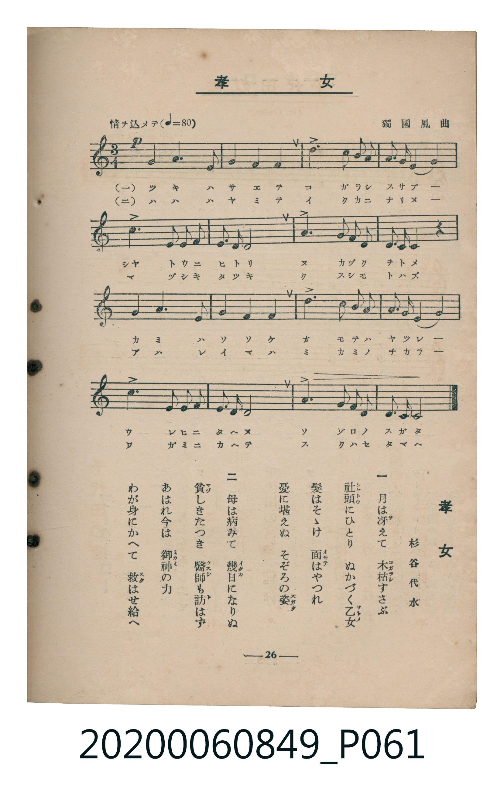

# 孝女

> Re:Shōka 使用 AI 協助辨識與重建樂譜，可能會有錯誤。歡迎回報。

- **鋼琴伴奏版**：<br><audio controls src="kojo.mp3"></audio>

- 詞：杉谷代水
- 曲：獨國風曲
- 臺灣教育會公認《新定兒童唱歌》高等科女子用（2020.006.0849）

## 說明

原書資訊與歌詞全文（對應 P061.jpg，書頁 p. 26，高一第三學期第 2 首）：
調性與拍號：ハ長調（無升降記號）、3/4 拍（情ヲ込メテ ♩=80）


## 歌詞

```text
一
月は冴（さ）えて　木枯（こがらし）すさぶ
社頭（しやとう）にひとり　ぬかづく乙女（をとめ）
髮はそゝけ　面（おもて）はやつれ
憂に堪えぬ　そぞろの姿（すがた）

二
母は病みて　幾日（いくか）になりぬ
貧（まづ）しきたつき　醫師（くすし）も訪（と）はず
あはれ今は　御神（みかみ）の力
わが身にかへて　救（すく）はせ給へ
```

## ABC

<div class="abc-score" data-abc-src="kojo.abc" aria-label="五線譜載入中"></div>

[下載 ABC 原始檔](kojo.abc)

## TMD 檔案連結

- [主旋律 TMD 檔案](kojo.tmd) [[在 TMD Studio 編輯](https://tmdlang.github.io/Tmd-TS/#tmd=s7IKdvYPcrWy4qpTUCpJTLdSSM7PyUlNLsnMz7MqzsjMK0nNjM_KTMmPL87Iz05Ugisry88pzU21ys4vyY9PzyzKKY43MjAyiDcwMIs3sDCxRCgszi8tSk61Kk7OyM_PiS9JrShJys_PRpePL0hMT7UKMDAzRMgUFOWXpeYl5gF1FxSBXJIC1o5QkFqWmZIKki5OTsyLL0stykzLTE1BcmNqUTHYHxArSooS84qTizILQJ5DqMovKsnITy9KLMiotMrILC7JL8pMTsyJz07MQ_JuSUYq0LdpibmZOZXIWjPTM_OsclMzszKxeA0qXZ5aXJJalBefm5qTnwLUraWl8HTt3KdLNytoaXEp2ipYGHDZ2yo4c9kY65vYgTS_WDnv_Z5Zz-Z2vtiw_cnuxc82bAGb-Wz2JqDw894VT-d0v1y0AsgFC79o3_W8cfGzqTNfNG16Nqf5aeuaF6t6Hzd0PZu24em6WU9bJz1fvfTplI3P1vY8buh-uXrG87Wdz5dPBFr_dO2E51NWvN_TAYo5PWDM6YFi7v2eTiUuLn0tBVtqAS4FBYWnffOfzd7xYnP7ixVdLzragY4BevJp64pn09qBDni6ofdZe6cCKPr1sgrS3-_pASp-uaBRoUBPwcgMyAU6-8mOhudr1jzZ0fl07Y5nc-YD2QpGCi-XTQO6FxgqIDterNr_rGE5yPTu3hcz5wNFHzf3v5y6HSgOtON5y8Knve0vZ_a-WDEDLNv5uKERGOIKQNVA6WfNrY-bN73Yt-dx88LHzW0Kj2autLUwAKriAhkNtBxEPZvT8bhx_dO2LUANjxungsxoBDKWPW5oeDZnxbN568Hikx839jxuAkpNByuYCVT5uHEbSP_zJfteLlgLVjT9cVPL48YVjxvbwIpWP27cBOI2dQHNety45nFj9-PGpY8b-5_snAmMKpCWpklgBY0gNwHNerl6HdAtjxvnPm6a-7hxIlDby7mLwEZ3PW5qAjoKbO56sDVLHjf1gN3fBpRY_XTBKrCz14CtAmqe97ip93HjuqfLQeEEdnDP40ZQCEH8vguidz1Qzfrn01sfN-6HePnpzn3Ppi8FawHa0Q90Mswrq0D-aFwDjpRNy8Eq9gG9A5ae_rgRaNB8kKOADKCr21Y_3bEarAZoBNBucKg1Nb1YsQosCEygYH80guP4cSPQB0BP9TzZDbRhPcgV-xY-XwrML0ClQHcBQw3oCaCGdU-7ZoM1NAFN7XmxC-gqIAJK74DG19SJMM_2w2yY_XzrMqACkDbKUz0UKGjpc3H5JgKLgYDMxLx8hxqDmmqQBQo2hmZadmAWMK-BU3bDi4U9IOUgsRqF6oJaBVMFXTA0g9IgaAzENXAZEzS6RsEoDkmxIYhjDjWhBmqOKdgMCAuqC2ynj2GNwuPmFqjY46a1SAYBcxLYhMdNW-HyK-BybXDbHzdtRtbVtAYsvxLM3g5VsRMqtxUoMw1uxh5UtxiB3AKyE2E7hlual8BF5mN1C0weYt96MLkarKobakIXVNcqIO7B4hbkCNrVgxJB4LBFjhUQBsVDDTR8jYAQoQLiJuSYBIU-SD1IFTDewGKGQAiRNYC7AR43TdsRXoY4tAPspWUoXpoElwN5C90BCG9CAgUSHK1gNiiAQCo2IZmwEKoyHtU54OiZh-IWiBmgSIYkHZCD90PlWtCSEyyCQDYi3AJKGFATmhdB3QLyISTKHzftwnALSv7pRImeAcg74MCEOBeWHmGOh3h3L9yrCNZGuO2Pm5CjCxIEkPSMnuLBAdoMylsQHpa80wTSjbAdYSpIF3LeQEQjQiXIJhQfQJMJSOxxcx9URSNcDpLD0d2CFDlPZ8-mZ96B60GKG1AmQQ0FSFaBZxx4Yp2BlklgsQOLM4iv94HVrgWT0BCBl2xr4KZhuAWccVCTPcQtkLCFuQWSkiBugZVoyG6B2AQzAVyygWPvcdNuNN_MA5uC7pZaLi5dOwVQvaQApJW5AA)]
- [鋼琴伴奏 TMD 檔案](kojo_piano.tmd) [[在 TMD Studio 編輯](https://tmdlang.github.io/Tmd-TS/#tmd=s7IKdvYPcrWy4qpTUCpJTLdSSM7PyUlNLsnMz7MqzsjMK0nNjM_KTMmPL87Iz05Ugisry88pzU21ys4vyY9PzyzKKY43MjAyiDcwMIs3sDCxRCgszi8tSk61Kk7OyM_PiS9JrShJys_PRpePL0hMT7UKMDAzRMgUFOWXpeYl5gF1FxSBXJIC1o5QkFqWmZIKki5OTsyLL0stykzLTE1BcmNqUTHYHxArSooS84qTizILQJ5DqMovKsnITy9KLMiotMrILC7JL8pMTsyJz07MQ_JuYhFQc3pqbmpeiVVBZmJefnxicnJ-bkFiXiZIDKGwJAOoyCotMTczpxLZjsz0zDyr3NTMrEwsYQCVLk8tLkktyovPTc3JTwHq1tJSeLp27tOlm9_v6XjZvef5hC1P9mx5urT_eWfH-z2dClpaXIq2ChYGXPa2Cs5cNsb6JnYgE1-snPd-z6xncztfbNj-ZPfiZxu2gC16NnsTUPh574qnc7pfLloB5IKFX7Tvet64-NnUmS-aNj2b0_y0dc2LVb2PG7qeTdvwdN2sp62Tnq9e-nTKxmdrex43dL9cPeP52s7nyycC3fR07YTnU1YAXQaKdz1gvOuB4h3oLiUuLt9EoG8CQMEU5OFQY1BTzaUABDaGZlp2YJa-lsLzNWue7Gh4sbBHQUsfLFajUF1Qq2CqoAuGZlAaBI2BuAYuY4JG1ygYxSEpNgRxzKEm1EDNMQWbAWFBdYHt9DGsUXjc3AIVe9y0Fsmgx839YBMeN22Fy6-Ay7XBbX_ctBlZV9MasPxKMHs7VMVOqNxWoMw0uBl7UN1iBHILyE6E7RhuaV4CF5mP1S0weYh968HkarCqbqgJXVBdq4C4B4tbkCNoVw9KBIHDFjlWQBgUDzXQ8DUCQoQKiJuQYxIU-iD1IFXAeAOLGQIhRNYA7gZ43DRtR3gZ4tAOsJeWoXhpElwO5C10ByC8CQkUSHC0gtmgAAKp2IRkwkKoynhU54CjZx6KWyBmgCIZknRADt4PlWtBS06wCALZiHALKGFATWheBHULyIeQKH_ctAvDLSj5pxMlegYg74ADE-JcWHqEOR7i3b1wryJYG-G2P25Cji5IEEDSM3qKBwdoMyhvQXhY8k4TSDfCdoSpIF3IeQMRjQiVIJtQfABNJiCxx819UBWNcDlIDkd3C1LkPJ09m555B64HKW5AmQQ1FCBZBZ5x4Il1BlomgcUOLM4gvt4HVrsWTEJDBF6yrYGbhuEWcMZBTfYQt0DCFuYWSEqCuAVWoiG7BWITzARwyQaOvcdNu9F8Mw9sCrpbapGrJR_kasmEQK0ErJYM4-MVzIDYGIiBgQ8kTaAiwMwFJI0gAsBohioCCeIvS5EVgklzOA9mNoQHUgliGeDP_ZQ7ESPJkuREeCjr2imAAloBSCtzAQA)]

## 分析

```text
================================================================================
📊 TMD Song Profile: [ 孝女 ]
================================================================================
⏱  Duration:       0:36 (36.0s), 16 measures total
🎼 Key & Tempo:    首調基準 C, != 80.0 BPM, <3/4>
   - 分析範圍：      由實際發聲的音符與和弦推測調性；播放脈絡另行呈現
🎤 人聲音域:    C4 (MIDI 60) – D5 (MIDI 74) [跨度: 14 個半音 / 1.2 個八度, 難度: moderate]
   - 最低音:  C4 in [Main #1 @ m.8, 0:16]
   - 最高音: D5 in [Main #1 @ m.3, 0:04]
   - 適合: soprano, mezzo-soprano, contralto, tenor, baritone, bass
🏛  結構:      Main (36.0s)
⚡ 編曲密度:        Peak 1 軌道同時演奏
🗝  調性診斷：       C 大調（純淨自然大調，未偵測到可信轉調）
   - 風格氣質:    純淨自然大調（陽光明朗、易唱易記，無明顯調外色彩）
   - 轉調歷程:    全曲維持單一推測調性（未偵測到可信轉調）
   - 核心骨幹音:  D, A, C, G, E
   - 調性數值:    C 大調 [相關度: 0.76, 穩定度: Moderate, 自然音純度: 100.0%]
   - 候選調性 (K-S): C 大調 (0.76), D 小調 (0.72), A 小調 (0.72)
   - 五度圈歷程:   +0
   - 各段落調性細節:
     • [Main #1]: C 大調 (r: 0.76, 自然音純度: 100.0%)

  [ 五度圈游移軌跡 ]
              [C ]*
         F            G  
      Bb               D  
      Eb               A  
         Ab           E  
            Db       B  
               F# 
     (* = active key center)

  [ 十二半音累積音高分佈 ]
     C  : ██████████████████        16.0%
     C# :                            0.0%
     D  : ████████████████████████  21.3%
     D# :                            0.0%
     E  : ████████████████          13.8%
     F  : ██████████████            12.8%
     F# :                            0.0%
     G  : ██████████████████        16.0%
     G# :                            0.0%
     A  : ████████████████████      18.1%
     A# :                            0.0%
     B  : ██                         2.1%
--------------------------------------------------------------------------------
Assignment 軌道音域：
  - Piano         : C4 – D5 (14 個半音 / 1.2 個八度, 56 個音符)
================================================================================
```


## 原書掃描頁




