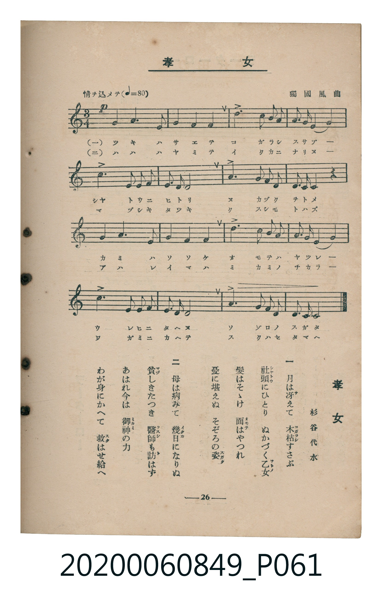

# 孝女

<audio controls src="kojo.mp3"></audio>

- 詞：杉谷代水
- 曲：獨國風曲
- 臺灣教育會公認《新定兒童唱歌》高等科女子用（2020.006.0849）

## 說明

原書資訊與歌詞全文（對應 P061.jpg，書頁 p. 26，高一第三學期第 2 首）：
調性與拍號：イ短調（無升降記號）、3/4 拍（情ヲ込メテ ♩=80）

## 歌詞

```text
一
月は冴（さ）えて　木枯（こがらし）すさぶ
社頭（しやとう）にひとり　ぬかづく乙女（をとめ）
髮はそゝけ　面（おもて）はやつれ
憂に堪えぬ　そぞろの姿（すがた）

二
母は病みて　幾日（いくか）になりぬ
貧（まづ）しきたつき　醫師（くすし）も訪（と）はず
あはれ今は　御神（みかみ）の力
わが身にかへて　救（すく）はせ給へ
```

## 原書掃描頁



## 分析

```text
================================================================================
📊 TMD Song Profile: [ 孝女 ]
================================================================================
⏱  Duration:       1:12 (72.0s), 32 measures total
🎼 Key & Tempo:    首調基準 C, != 80.0 BPM, <3/4>
   - 分析範圍：      由實際發聲的音符與和弦推測調性；播放脈絡另行呈現
🎤 人聲音域:    D3 (MIDI 50) – D4 (MIDI 62) [跨度: 12 個半音 / 1.0 個八度, 難度: easy]
   - 最低音:  D3 in [Main #1 @ m.6, 0:11]
   - 最高音: D4 in [Main #1 @ m.7, 0:15]
   - 適合: contralto, tenor, baritone, bass
🏛  結構:      Main (36.0s) -> Main (36.0s)
⚡ 編曲密度:        Peak 1 軌道同時演奏
🗝  調性診斷：       A 小調（純淨自然小調，未偵測到可信轉調）
   - 風格氣質:    純淨自然小調（陰鬱抒情、旋律集中，無明顯調外色彩）
   - 轉調歷程:    全曲維持單一推測調性（未偵測到可信轉調）
   - 核心骨幹音:  E, A, B, C, D
   - 調性數值:    A 小調 [相關度: 0.82, 穩定度: Moderate, 自然音純度: 95.7%]
   - 候選調性 (K-S): A 小調 (0.82), E 大調 (0.69), A 大調 (0.68)
   - 五度圈歷程:   +3 -> +3
   - 各段落調性細節:
     • [Main #1]: A 小調 (r: 0.82, 自然音純度: 95.7%, 調外音: G#)
     • [Main #2]: A 小調 (r: 0.82, 自然音純度: 95.7%, 調外音: G#)

  [ 五度圈游移軌跡 ]
               C  
         F            G  
      Bb               D  
      Eb              [A ]*
         Ab           E  
            Db       B  
               F# 
     (* = active key center)

  [ 十二半音累積音高分佈 ]
     C  : ███████████               12.8%
     C# :                            0.0%
     D  : ████                       4.3%
     D# :                            0.0%
     E  : ████████████████████████  27.7%
     F  : ████                       4.3%
     F# :                            0.0%
     G  :                            0.0%
     G# : ████                       4.3%
     A  : ████████████████████████  27.7%
     A# :                            0.0%
     B  : █████████████████         19.1%
--------------------------------------------------------------------------------
Assignment 軌道音域：
  - Piano         : D3 – D4 (12 個半音 / 1.0 個八度, 112 個音符)
================================================================================
```

## ABC

```abc
X:1
T:孝女
C:曲：獨國風曲
M:3/4
L:1/16
Q:1/4=80
K:Am
V:V1 name="Piano" snm="Pia"
[V:V1]
!p! E4 A6 E2 | A4 B4 c4 | B6 E2 B2 A2 | ^G2 A2 B4 E4 |
c6 A2 F2 E2 | D2 F2 E8 | A6 B2 c2 d2 | E2 ^G2 A4 z4 |
E4 A6 E2 | A4 B4 c4 | B6 E2 B2 A2 | ^G2 A2 B4 E4 |
c6 A2 F2 E2 | D2 F2 E8 | A6 B2 c2 d2 | E6 ^G2 A4 |
!p! E4 A6 E2 | A4 B4 c4 | B6 E2 B2 A2 | ^G2 A2 B4 E4 |
c6 A2 F2 E2 | D2 F2 E8 | A6 B2 c2 d2 | E2 ^G2 A4 z4 |
E4 A6 E2 | A4 B4 c4 | B6 E2 B2 A2 | ^G2 A2 B4 E4 |
c6 A2 F2 E2 | D2 F2 E8 | A6 B2 c2 d2 | E6 ^G2 A4 |
```

- [主旋律 TMD 檔案](kojo.tmd)
- [鋼琴伴奏 TMD 檔案](kojo_piano.tmd)
