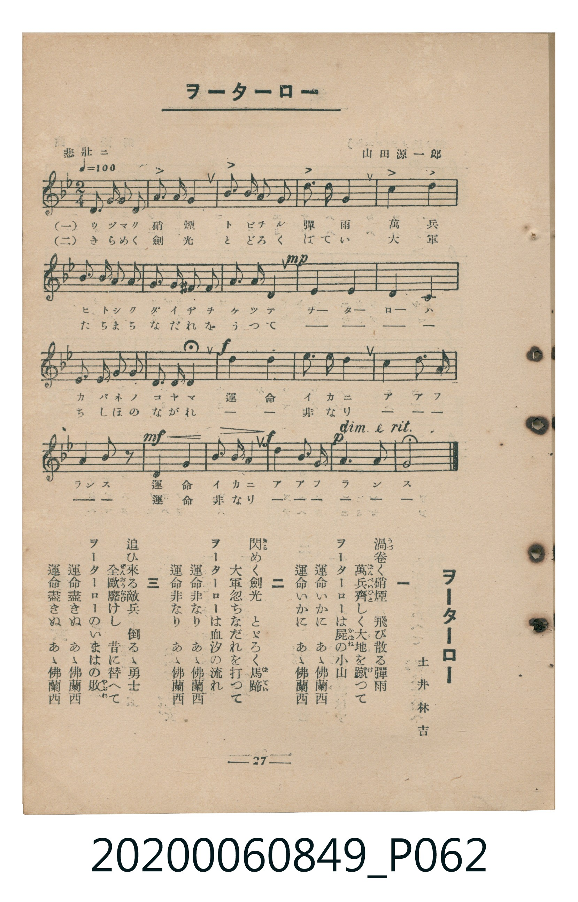

# ヲーターロー

> Re:Shoka 使用 AI 協助辨識與重建樂譜，可能會有錯誤。歡迎回報。

<audio controls src="waterloo.mp3"></audio>

- 詞：土井林吉
- 曲：山田源一郎
- 臺灣教育會公認《新定兒童唱歌》高等科女子用（2020.006.0849）

## 說明

原書資訊與歌詞全文（對應 P062.jpg，書頁 p. 27，高一第三學期第 3 首）：
調性與拍號：ト短調（2 降記號）、2/4 拍（悲壯ニ ♩=100）

## 跨冊／重複收錄參照

> 同曲（《新定兒童唱歌》高等科男、女共用教材，男子用為ト調、女子用移為變ロ調）

- **[同曲]** 《新定兒童唱歌》高等科男子用（2020.006.0848）：[**〈ヲーターロー〉**](../../koto_boys_2020.006.0848/1_3_03_waterloo/index.md)（`G` / `2/4` — [原始 TMD](../../koto_boys_2020.006.0848/1_3_03_waterloo/waterloo.tmd)）
- 總表：[跨冊重複與同名歌曲總索引](../../../duplicate_songs.md)

## 歌詞

```text
一
渦（うづ）卷く硝煙　飛び散る彈雨
萬兵（ばんぺい）齊（ひと）しく大地を蹴つて
ヲーターローは屍（かばね）の小山
運命いかに　あゝ佛蘭西
運命いかに　あゝ佛蘭西

二
閃（きら）めく劍光　とゞろく馬蹄（ばてい）
大軍忽ちなだれを打つて
ヲーターローは血汐の流れ
運命非なり　あゝ佛蘭西
運命非なり　あゝ佛蘭西

三
追ひ來る敵兵　倒るゝ勇士
全歐靡（ぜんおうなび）けし　昔に替へて
ヲーターローのいまはの敗（やぶれ）
運命盡きぬ　あゝ佛蘭西
運命盡きぬ　あゝ佛蘭西
```

## ABC

```abc
X:1
T:ヲーターロー
C:曲：山田源一郎
M:2/4
L:1/16
Q:1/4=100
K:Gm
V:V1 name="Piano" snm="Pia"
[V:V1]
!f! G2 G2 G2 G2 | B6 A2 | B2 A2 B2 c2 | d6 d2 |
d4 d4 | g2 f2 e2 d2 | A2 G2 ^F2 G2 | A2 A2 D4 |
!mp! G4 F4 | E4 D4 | C2 C2 D2 E2 | D3 C D4 |
!f! G4 c4 | e3 d c4 | B4 c3 B | A2 G2 D2 z2 |
!mf! D4 G4 | B3 A G4 | !f! d4 A3 B | !p! c3 A G4 |
!f! G2 G2 G2 G2 | B6 A2 | B2 A2 B2 c2 | d6 d2 |
d4 d4 | g2 f2 e2 d2 | A2 G2 ^F2 G2 | A2 A2 D4 |
!mp! G4 F4 | E4 D4 | C2 C2 D2 E2 | D3 C D4 |
!f! G4 c4 | e3 d c4 | B4 c3 B | A2 G2 D2 z2 |
!mf! D4 G4 | B3 A G4 | !f! d4 A3 B | !p! c3 A G4 |
!f! G2 G2 G2 G2 | B6 A2 | B2 A2 B2 c2 | d6 d2 |
d4 d4 | g2 f2 e2 d2 | A2 G2 ^F2 G2 | A2 A2 D4 |
!mp! G4 F4 | E4 D4 | C2 C2 D2 E2 | D3 C D4 |
!f! G4 c4 | e3 d c4 | B4 c3 B | A2 G2 D2 z2 |
!mf! D4 G4 | B3 A G4 | !f! d4 A3 B | !p! c3 A G4 |
```

## TMD 檔案連結

- [主旋律 TMD 檔案](waterloo.tmd) [[在 TMD Studio 編輯](https://tmdlang.github.io/Tmd-TS/#tmd=s7IKdvYPcrWy4qpTUCpJTLdSSM7PyUlNLsnMz7MqzsjMK0nNjM_KTMmPL87Iz05Ugisry88pzU21ys4vyY9PzyzKKY43MjAyiDcwMIs3sDCxRCgszi8tSk61Kk7OyM_PiS9JrShJys_PRsgXFOWXpeYl5gHVFBSB7EsBK0IoSC3LTEkFSaemZJbkF2Um5iC5IrWoGOxSsCXxJUWJecXJRZkFIOcjVJVkpAKdmpuZk1mSWFSpxKWlpfC4edPj5j2Pm_aDyOa1QFJBS4tL0VbB0MCAy95WwSmJKzu10lbBPZfLxkjfxA5k1ouV897vmfV0zvwnu6Y-mzf96YROsBXPZm8CCW_c-HzKhme7JjzZ0fCyuQ8s86J91_PGxc-mznzRtOnZnOanrWterOp93ND1bNqGp-tmPW2d9Hz10qdTNj5b2_O4ofvl6hnP13Y-Xz7x6dLNT9dOeD5lxfs9HaAw1QOGqR4oTN_vAVrIpa-lYEstwKWgoPC0b_6z2TtebG5_saLrRUc70DFAfz5tXfFsWjvQAU839D5r71QIMDAz0ssqSH-_pweo-OWCRoUCPQUjcyAX6Gygj5-vWfNkR-fTtTuezZkPZCsYK7xcNg3oXmDAgOx4sWr_s4blINO7e1_MnA8Ufdzc8Xz-WqA4yJMKL2f2vlgxAyzT-bihERjgCkCVQKlnTZueLl7_uLlb4dHMlbbAuAEq4AKZCLQTRD3bsQyo6nFj2-PGpUCpp73bHzf2P18493nrzMcNDS8Xz37cuPnZ1MWPm7qf7u14OXsF2DET1jxt3QrWtuFx0-THjbseN7YANb_c2wUW3PS4ERj0nY8bpwPNerpk-dM5QGWTXuzc8rhxyePGZSAjMFPP48b1TzeCXPy4sRtkbuNasBHrnm7oB6YMkJ6Xjd1PJ-4FWgVWsRrovMeNTY-b5j7ZO_vFjLUvlu4nThHY87t6wIqnNYMt7H3cBAzozsdNjSAHd_U-bQUGIlDjisdN8x439QIFXy5b82In0I9gLzcug_gXHPlLlr_Y3ft0P9DKhY8bVz1uXPC4qQfo22edwHDB69sXCxuebZwA9OGzrY1APQjHv5w7D2RSUxc-H-JTBIlesPNegBy26cm-NmAEPpu6FRhtQPVPGyYBuUAtT7vbny5eDfYGMLmunfBy7kKwF-eAY7ULnCqAXtoMjomJoPhsaHg2YwowXJ_N3v-4cQce760DR8E-oD9BPpw6HWRuE1BkG9Cr0KCDeOT5bGC4AYN4DT7fElBEeT6GAgUtfS4u38TMPKuAzMS8fIcagxqFapANCjaGZlp2YBaw-ABn1oYXC3sUNEwVgAn0-foGTZBWkDRQQ1qtglm8gi46UaNgCCRh0BwhBGaCGEZgIWMkVSA2QgRG14CjGOaSXT24XGIGVGsKxCZwk8BWgV1jqo7kMLAwmDAGEWA7FKpzC6AeAUFThIQJjIlQjOKgHZ24HGQE0gAmwFrBBgG9BzEGKI5sOywUwVIIu6EBgRCBBSpExBDVLU9nz8blFkRQgG01gPoZaC3cFXD7YbYA9SCJgZwIixKwaWDrFaqBwQZxDIpyrlouLl07BVDqUsBCK3NxAQA)]
- [鋼琴伴奏 TMD 檔案](waterloo_piano.tmd) [[在 TMD Studio 編輯](https://tmdlang.github.io/Tmd-TS/#tmd=s7IKdvYPcrWy4tLSUnjcvOlx857HTftBZPNaIPl-T8fL7j3PJ2x5smfL06X9zzs73u_pVNDS4lK0VTA0MOCyt1VwSuLKTq20VXDP5bIx0jex46pTUHqxct77PbOezpn_ZNfUZ_OmP53QqQQSfjZ7E0h448bnUzY82zXhyY6Gl819YJkX7bueNy5-NnXmi6ZNz-Y0P21d82JV7-OGrmfTNjxdN-tp66Tnq5c-nbLx2dqexw3dL1fPeL628_nyiU-Xbn66dsLzKSuAzjQyMDLQMzAw0zOwMLEEOlKJi8s3MTPPKiAzMS8_yMOhxqBGoZpLAQhsDM207MAsfS2F52vWAJ3xYmGPgoapwtMN_c_XN2gqaOmDpYEa0moVzOIVdNGJGgVDIAmD5gghMBPEMAILGSOpArERIjC6hgvZJbt6cLnEDKjWFIhN4CaBrQK7xlQdyWFgYTBhDCLAdihU5xZAPQKCpggJExgToRjFQTs6cTnICKQBTIC1gg0Ceg9iDFAc2XZYKIKlEHZDAwIhAgtUiIghqluezp6Nyy2IoADbagD1M9BauCvg9sNsAepBEgM5ERYlYNPA1itUA4MN4hgU5Vy1yInLByVxmUDTFjDK4uMVos3ic2PxsIHuQ2YaxwNZiACONsKuA6wMRdQExEbVjdBuDJeE6IEKI1lgCGQaIjRjtwO7KxA-AIWKrp0CKGAUsNDKXFwA)]

## 分析

```text
================================================================================
📊 TMD Song Profile: [ ヲーターロー ]
================================================================================
⏱  Duration:       1:11 (72.0s), 60 measures total
🎼 Key & Tempo:    首調基準 B,, != 100.0 BPM, <2/4>
   - 分析範圍：      由實際發聲的音符與和弦推測調性；播放脈絡另行呈現
🎤 人聲音域:    C4 (MIDI 60) – G5 (MIDI 79) [跨度: 19 個半音 / 1.6 個八度, 難度: challenging]
   - 最低音:  C4 in [Main #1 @ m.11, 0:12]
   - 最高音: G5 in [Main #1 @ m.6, 0:06]
   - 適合: soprano, mezzo-soprano, tenor, baritone
🏛  結構:      Main (24.0s) -> Main (24.0s) -> Main (24.0s)
⚡ 編曲密度:        Peak 1 軌道同時演奏
🗝  調性診斷：       G 小調（純淨自然小調，未偵測到可信轉調）
   - 風格氣質:    純淨自然小調（陰鬱抒情、旋律集中，無明顯調外色彩）
   - 轉調歷程:    全曲維持單一推測調性（未偵測到可信轉調）
   - 核心骨幹音:  D, G, C, A#, A
   - 調性數值:    G 小調 [相關度: 0.82, 穩定度: High, 自然音純度: 98.7%]
   - 候選調性 (K-S): G 小調 (0.82), G 大調 (0.68), D 小調 (0.62)
   - 五度圈歷程:   +1 -> +1 -> +1
   - 各段落調性細節:
     • [Main #1]: G 小調 (r: 0.82, 自然音純度: 98.7%, 調外音: F#)
     • [Main #2]: G 小調 (r: 0.82, 自然音純度: 98.7%, 調外音: F#)
     • [Main #3]: G 小調 (r: 0.82, 自然音純度: 98.7%, 調外音: F#)

  [ 五度圈游移軌跡 ]
               C  
         F           [G ]*
      Bb               D  
      Eb               A  
         Ab           E  
            Db       B  
               F# 
     (* = active key center)

  [ 十二半音累積音高分佈 ]
     C  : ███████████               13.3%
     C# :                            0.0%
     D  : ████████████████████████  29.1%
     D# : ██████                     7.0%
     E  :                            0.0%
     F  : ███                        3.8%
     F# : █                          1.3%
     G  : ███████████████████       22.8%
     G# :                            0.0%
     A  : █████████                 10.8%
     A# : ██████████                12.0%
     B  :                            0.0%
--------------------------------------------------------------------------------
Assignment 軌道音域：
  - Piano         : C4 – G5 (19 個半音 / 1.6 個八度, 174 個音符)
================================================================================
```


## 原書掃描頁




