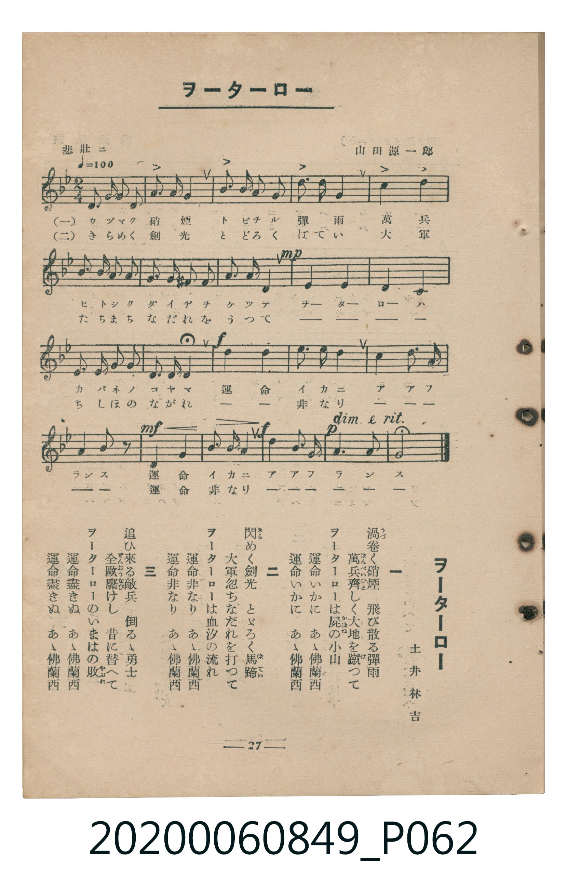

# ヲーターロー

> Re:Shōka 使用 AI 協助辨識與重建樂譜，可能會有錯誤。歡迎回報。

- **鋼琴伴奏版**：<br><audio controls src="waterloo.mp3"></audio>

- 詞：土井林吉
- 曲：山田源一郎
- 臺灣教育會公認《新定兒童唱歌》高等科女子用（2020.006.0849）

## 說明

原書資訊與歌詞全文（對應 P062.jpg，書頁 p. 27，高一第三學期第 3 首）：
調性與拍號：ト短調（2 降記號）、2/4 拍（悲壯ニ ♩=100）


## 歌詞

```text
一
渦（うづ）卷く硝煙　飛び散る彈雨
萬兵（ばんぺい）齊（ひと）しく大地を蹴つて
ヲーターローは屍（かばね）の小山
運命いかに　あゝ佛蘭西
運命いかに　あゝ佛蘭西

二
閃（きら）めく劍光　とゞろく馬蹄（ばてい）
大軍忽ちなだれを打つて
ヲーターローは血汐の流れ
運命非なり　あゝ佛蘭西
運命非なり　あゝ佛蘭西

三
追ひ來る敵兵　倒るゝ勇士
全歐靡（ぜんおうなび）けし　昔に替へて
ヲーターローのいまはの敗（やぶれ）
運命盡きぬ　あゝ佛蘭西
運命盡きぬ　あゝ佛蘭西
```

## ABC

<div class="abc-score" data-abc-src="waterloo.abc" aria-label="五線譜載入中"></div>

[下載 ABC 原始檔](waterloo.abc)

## TMD 檔案連結

- [主旋律 TMD 檔案](waterloo.tmd) [[在 TMD Studio 編輯](https://tmdlang.github.io/Tmd-TS/#tmd=s7IKdvYPcrWy4qpTUCpJTLdSSM7PyUlNLsnMz7MqzsjMK0nNjM_KTMmPL87Iz05Ugisry88pzU21ys4vyY9PzyzKKY43MjAyiDcwMIs3sDCxRCgszi8tSk61Kk7OyM_PiS9JrShJys_PRsgXFOWXpeYl5gHVFBSB7EsBK0IoSC3LTEkFSaemZJbkF2Um5iC5IrWoGOxSsCXxJUWJecXJRZkFIOcjVJVkpAKdmpuZk1mSWFSJEAcalp6ZZ5WbmpmVieQyLS2Fx82bHjfvedy0H0Q2rwWSClpaXIq2CoYGBlz2tgpOSVzZqZW2Cu65XDZG-iZ2ICNfrJz3fs-sp3PmP9k19dm86U8ndIJtejZ7E0h448bnUzY82zXhyY6Gl819YJkX7bueNy5-NnXmi6ZNz-Y0P21d82JV7-OGrmfTNjxdN-tp66Tnq5c-nbLx2dqexw3dL1fPeL628_nyiU-Xbn66dsLzKSve7-kABbkeMMj1QEH-fg_QQi59LQVbagEuBQWFp33zn83e8WJz-4sVXS862oGOAfrzaeuKZ9PagQ54uqH3WXunQoCBmZFeVkH6-z09QMUvFzQqFOgpGJkDuUBnA338fM2aJzs6n67d8WzOfCBbwVjh5bJpQPcCAwZkx4tV-581LAeZ3t37YuZ8oOjj5o7n89cCxUGeVHg5s_fFihlgmc7HDY3AAFcAqgRKPWva9HTx-sfN3QqPZq60BcYNUAEXyESgnSDq2Y5lQFWPG9seNy4FSj3t3f64sf_5wrnPW2c-bmh4uXj248bNz6YuftzU_XRvx8vZK8COmbDmaetWsLYNj5smP27c9bixBaj55d4usOCmx43AoO983DgdaNbTJcufzgEqm_Ri55bHjUseNy4DGYGZeh43rn-6EeTix43dIHMb14KNWPd0Qz8wZYD0vGzsfjpxL9AqsIrVQOc9bmx63DT3yd7ZL2asfbF0P3GKwJ7f1QNWPK0ZbGHv4yZgQHc-bmoEObir92krMBCBGlc8bpr3uKkXKPhy2ZoXO4F-BHu5cRnEv-DIX7L8xe7ep_uBVi583LjqceOCx009QN8-6wSGC17fvljY8GzjBKAPn21tBOpBOP7l3Hkgk5q68PkQnyJI9IKd9wLksE1P9rUBI_DZ1K3AaAOqf9owCcgFanna3f508WqwN4DJde2El3MXgr04BxyrXeBUAfTSZnBMTATFZ0PDsxlTgOH6bPb-x4078HhvHTgK9gH9CfLh1Okgc5uAItuAXoUGHcQjz2cDww0YxGvw-ZaAIsrzMRQoaOlzcfkmAku8gMzEvHyHGoOaapAFCjaGZlp2YBaw9ADn1YYXC3sUNEwVgOnz-foGTZBOkHSNQnVarYJZvIIuOlGjYAgkYdAcIQRmghhGYCFjJFUgNkIERteAYxjmkl09uFxiBlRrCsQmcJPAVoFdY6qO5DCwMJgwBhFgOxSqcwugHgFBU4SECYyJUIzioB2duBxkBNIAJsBawQYBvQcxBiiObDssFMFSCLuhAYEQgQUqRMQQ1S1PZ8_G5RZEUIBtNYD6GWgt3BVw-2G2APUgiYGcCIsSsGlg6xWqgcEGcQyKcq5aLi5dOwVQ4lIA0spcAA)]
- [鋼琴伴奏 TMD 檔案](waterloo_piano.tmd) [[在 TMD Studio 編輯](https://tmdlang.github.io/Tmd-TS/#tmd=s7IKdvYPcrWy4tLSUnjcvOlx857HTftBZPNaIPl-T8fL7j3PJ2x5smfL06X9zzs73u_pVNDS4lK0VTA0MOCyt1VwSuLKTq20VXDP5bIx0jex46pTUHqxct77PbOezpn_ZNfUZ_OmP53QqQQSfjZ7E0h448bnUzY82zXhyY6Gl819YJkX7bueNy5-NnXmi6ZNz-Y0P21d82JV7-OGrmfTNjxdN-tp66Tnq5c-nbLx2dqexw3dL1fPeL628_nyiU-Xbn66dsLzKSuAzjQyMDLQMzAw0zOwMLEEOlKJi8s3MTPPKiAzMS8_yMOhxqCmmksBCGwMzbTswCx9LYXna9YAXfFiYY-ChqnC0w39z9c3aCpo6YOlaxSq02oVzOIVdNGJGgVDIAmD5gghMBPEMAILGSOpArERIjC6hgvZJbt6cLnEDKjWFIhN4CaBrQK7xlQdyWFgYTBhDCLAdihU5xZAPQKCpggJExgToRjFQTs6cTnICKQBTIC1gg0Ceg9iDFAc2XZYKIKlEHZDAwIhAgtUiIghqluezp6Nyy2IoADbagD1M9BauCvg9sNsAepBEgM5ERYlYNPA1itUA4MN4hgU5Vy1yGnLBzltmUCTFjDG4uMVos3ic2PxsIHOQ2YaxwNZiPCNNsKuA6wMRdQExEbVjdBuDJeE6IEKI1lgCGQaIjRjtwO7KxA-AAWKrp0CKFwUsNDKXAA)]

## 分析

```text
================================================================================
📊 TMD Song Profile: [ ヲーターロー ]
================================================================================
⏱  Duration:       0:23 (24.0s), 20 measures total
🎼 Key & Tempo:    首調基準 B,, != 100.0 BPM, <2/4>
   - 分析範圍：      由實際發聲的音符與和弦推測調性；播放脈絡另行呈現
🎤 人聲音域:    C4 (MIDI 60) – G5 (MIDI 79) [跨度: 19 個半音 / 1.6 個八度, 難度: challenging]
   - 最低音:  C4 in [Main #1 @ m.11, 0:12]
   - 最高音: G5 in [Main #1 @ m.6, 0:06]
   - 適合: soprano, mezzo-soprano, tenor, baritone
🏛  結構:      Main (24.0s)
⚡ 編曲密度:        Peak 1 軌道同時演奏
🗝  調性診斷：       G 小調（純淨自然小調，未偵測到可信轉調）
   - 風格氣質:    純淨自然小調（陰鬱抒情、旋律集中，無明顯調外色彩）
   - 轉調歷程:    全曲維持單一推測調性（未偵測到可信轉調）
   - 核心骨幹音:  D, G, C, A#, A
   - 調性數值:    G 小調 [相關度: 0.82, 穩定度: High, 自然音純度: 98.7%]
   - 候選調性 (K-S): G 小調 (0.82), G 大調 (0.68), D 小調 (0.62)
   - 五度圈歷程:   +1
   - 各段落調性細節:
     • [Main #1]: G 小調 (r: 0.82, 自然音純度: 98.7%, 調外音: F#)

  [ 五度圈游移軌跡 ]
               C  
         F           [G ]*
      Bb               D  
      Eb               A  
         Ab           E  
            Db       B  
               F# 
     (* = active key center)

  [ 十二半音累積音高分佈 ]
     C  : ███████████               13.3%
     C# :                            0.0%
     D  : ████████████████████████  29.1%
     D# : ██████                     7.0%
     E  :                            0.0%
     F  : ███                        3.8%
     F# : █                          1.3%
     G  : ███████████████████       22.8%
     G# :                            0.0%
     A  : █████████                 10.8%
     A# : ██████████                12.0%
     B  :                            0.0%
--------------------------------------------------------------------------------
Assignment 軌道音域：
  - Piano         : C4 – G5 (19 個半音 / 1.6 個八度, 58 個音符)
================================================================================
```


## 原書掃描頁




