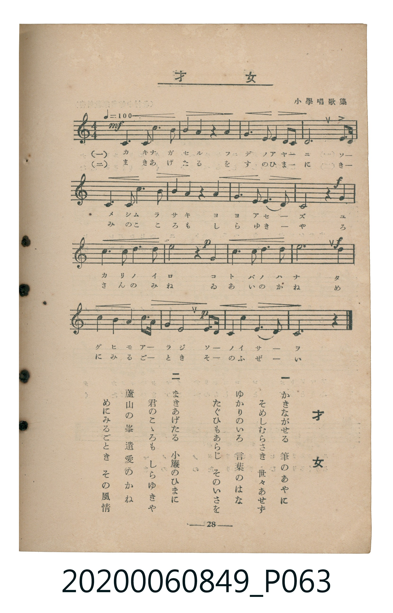

# 才女

<audio controls src="saijo.mp3"></audio>

- 出處：小學唱歌集
- 臺灣教育會公認《新定兒童唱歌》高等科女子用（2020.006.0849）

## 說明

原書資訊與歌詞全文（對應 P063.jpg，書頁 p. 28，高一第三學期第 4 首）：
調性與拍號：ハ調（無升降記號，雅樂風律旋音階）、4/4 拍（♩=100）
出處註記：小學唱歌集

## 歌詞

```text
一
かきながせる　筆のあやに
そめしむらさき　世々あせず
ゆかりのいろ　言葉のはな
たぐひもあらじ　そのいさを

二
まきあげたる　小簾のひまに
君のこゝろも　しらゆきや
蘆山の峯　遺愛のかね
めにみるごとき　その風情
```

## ABC

```abc
X:1
T:才女
C:TMD (Chen, Chih-Han / aguai)
M:4/4
L:1/16
Q:1/4=100
K:C
V:V1 name="Piano" snm="Pia"
[V:V1]
!mf! D4 E3 G A8 | G4 E4 z4 E4 | G6 A2 G4 E2 D2 | D12 c2 A2 |
E4 G3 A c6 d2 | c4 A4 z4 A4 | G6 E2 G4 E2 D2 | !f! C8 z4 d4 |
e6 d2 c4 A4 | !p! d8 z4 c4 | c6 c2 d6 c2 | !f! A12 e4 |
d4 c4 A4 c3 A | !p! G4 E8 G3 A | G4 E4 G6 E2 | D12 z4 |
!mf! D4 E3 G A8 | G4 E4 z4 E4 | G6 A2 G4 E2 D2 | D12 c2 A2 |
E4 G3 A c6 d2 | c4 A4 z4 A4 | G6 E2 G4 E2 D2 | !f! C8 z4 d4 |
e6 d2 c4 A4 | !p! d8 z4 c4 | c6 c2 d6 c2 | !f! A12 e4 |
d4 c4 A4 c3 A | !p! G4 E8 G3 A | G4 E4 G6 E2 | D12 z4 |
```

## TMD 檔案連結

- [主旋律 TMD 檔案](saijo.tmd)
- [鋼琴伴奏 TMD 檔案](saijo_piano.tmd)

## 分析

```text
================================================================================
📊 TMD Song Profile: [ 才女 ]
================================================================================
⏱  Duration:       1:16 (76.8s), 32 measures total
🎼 Key & Tempo:    首調基準 C, != 100.0 BPM, <4/4>
   - 分析範圍：      由實際發聲的音符與和弦推測調性；播放脈絡另行呈現
🎤 人聲音域:    C3 (MIDI 48) – E4 (MIDI 64) [跨度: 16 個半音 / 1.3 個八度, 難度: moderate]
   - 最低音:  C3 in [Main #1 @ m.8, 0:16]
   - 最高音: E4 in [Main #1 @ m.9, 0:19]
   - 適合: tenor, baritone, bass
🏛  結構:      Main (38.4s) -> Main (38.4s)
⚡ 編曲密度:        Peak 1 軌道同時演奏
🗝  調性診斷：       G 調性不明確（純淨自然大調，未偵測到可信轉調）
   - 風格氣質:    純淨自然大調（陽光明朗、易唱易記，無明顯調外色彩）
   - 轉調歷程:    全曲維持單一推測調性（未偵測到可信轉調）
   - 核心骨幹音:  D, C, E, G, A
   - 調性數值:    G 調性不明確 [相關度: 0.74, 穩定度: Ambiguous, 自然音純度: 100.0%]
   - 候選調性 (K-S): G 大調 (0.74), C 大調 (0.71), A 小調 (0.64)
   - 五度圈歷程:   +1 -> +1
   - 各段落調性細節:
     • [Main #1]: G 調性不明確 (r: 0.74, 自然音純度: 100.0%)
     • [Main #2]: G 調性不明確 (r: 0.74, 自然音純度: 100.0%)

  [ 五度圈游移軌跡 ]
               C  
         F           [G ]*
      Bb               D  
      Eb               A  
         Ab           E  
            Db       B  
               F# 
     (* = active key center)

  [ 十二半音累積音高分佈 ]
     C  : ███████████████████       19.1%
     C# :                            0.0%
     D  : ████████████████████████  24.6%
     D# :                            0.0%
     E  : ███████████████████       19.1%
     F  :                            0.0%
     F# :                            0.0%
     G  : ███████████████████       19.1%
     G# :                            0.0%
     A  : ██████████████████        18.2%
     A# :                            0.0%
     B  :                            0.0%
--------------------------------------------------------------------------------
Assignment 軌道音域：
  - Piano         : C3 – E4 (16 個半音 / 1.3 個八度, 112 個音符)
================================================================================
```


## 原書掃描頁




