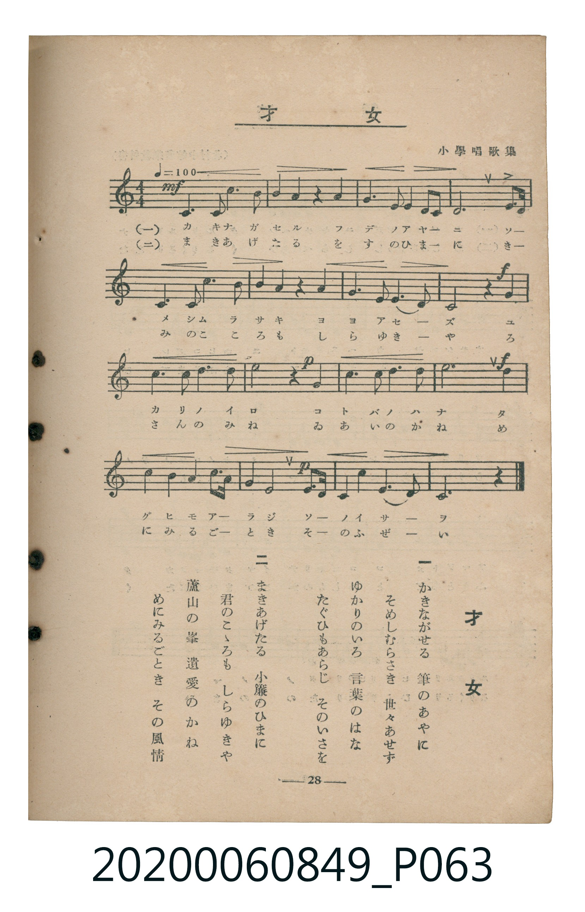

# 才女

> Re:Shōka 使用 AI 協助辨識與重建樂譜，可能會有錯誤。歡迎回報。

- **鋼琴伴奏版**：<br><audio controls src="saijo.mp3"></audio>
- **NEUTRINO 歌聲合成版**：<br><audio controls src="saijo_neutrino.mp3"></audio>

- 出處：小學唱歌集
- 臺灣教育會公認《新定兒童唱歌》高等科女子用（2020.006.0849）

## 說明

原書資訊與歌詞全文（對應 P063.jpg，書頁 p. 28，高一第三學期第 4 首）：
調性與拍號：ハ長調（無升降記號）、4/4 拍（♩=100）
出處註記：小學唱歌集


## 歌詞

```text
一
かきながせる　筆のあやに
そめしむらさき　世々あせず
ゆかりのいろ　言葉のはな
たぐひもあらじ　そのいさを

二
まきあげたる　小簾のひまに
君のこゝろも　しらゆきや
蘆山の峯　遺愛のかね
めにみるごとき　その風情
```

## ABC

<div class="abc-score" data-abc-src="saijo.abc" aria-label="五線譜載入中"></div>

[下載 ABC 原始檔](saijo.abc)

## TMD 檔案連結

- [主旋律 TMD 檔案](saijo.tmd) [[在 TMD Studio 編輯](https://tmdlang.github.io/Tmd-TS/#tmd=s7IKdvYPcrWy4qpTUCpJTLdSSM7PyUlNLsnMz7MqzsjMK0nNjM_KTMmPL87Iz05Ugisry88pzU21ys4vyY9PzyzKKY43MjAyiDcwMIs3sDCxRCgszi8tSk61Kk7OyM_PiS9JrShJys_PRpePL0hMT7UKMDAzRsgUFOWXpeYl5gF1FxSBXJIC1o5QkFqWmZIKki5OTsyLL0stykzLTE1BcmNqUTHYHxArSooS84qTizILQJ5DqMovKsnITy9KLMiotMrILC7JL8pMTsyJz07MQ_JuSUYq0LepufnoejPTM_OscvPzkkqBAaTEpaWl8Kyz9-nSzQpaWlyKtgqGBgZc9rYKzlw2JvomdiB9T9t3vZg59f2eWU839D9du-PplI3P1va8nN0GNvRF-67njYufTZ35omnTsznNT1vXvFjV-7ih69m0DU_XzXraOun56qUQHY8bul-unvF8befz5ROB1j1dO-H5lBXv93SAYkEPGAt6oFh4v6dTiYtLX0vBllqAS0FB4Wnf_Gezd7zY3P5iRdeLjnagY16snPe0dcWzae1ABzzd0PusvVMBFJV6WQXp7_f0ABW_XNCoUKCnYGQB5AKd_WRHw_M1a57s6AQGwLM584FsBROFl8umAd0LDBiQHS9W7X_WsBxkenfvi5nzgaKPm_tfTt0OFAfa8bxl4dPe9pcze1-smAGW7Xzc0AgMYAWgaqD0o5krbYEBDxQGOxcc4C9W7AYqxgx2LpASoHtA1OPG7seNvY8bVz1u7HncOPtxU_fjhobna9seN6573Nj0uKnlceNqiLq5j5saHzdOf9zU8Lip83HjVJC2hoYnO6Y9bmgFKQVqbgT743ETUHf346YusBktj5tA6l6saHgxEagNKLIeaBvEyPmPGyc8btz0uAmoG2gXUHoGUCnIKohOoCVNkyCu3dUD0bIP7Fqg-kkg7WDXAn33fANQHKhlE1gB2MFPJwDdAxSa_LgJ6PJekB0go4Hu7wQ7ECjSAg71GW1PN24EKn26eT1QxcvGXc9aIDqBAbMW4h-gv1c_btwPsq5xyuPGFRCvQ9z5ctGKZ82tIHWUpzQoUNDS5-LyTQRmsoDMxLx8hxqDmmqQBQo2hmZadmAWMH2DU1PDi4U9IOUgsRqF6ty0WgVDBV04BLEN45AEzIG4BkyCoBmUNkDj1yiYIukxhmIQNIIaWgNmYYMQlUYKNWA3-RjWAMNvNZL846a1ILK5C0VsDdjMx027YSLNMD3xcJGpcNc9bm5H1t3cBzZjEZy_BEzugartxuHSx017oer3wFxrBFTfuA9ZTWMvmGxCEZsEMblxPtwkmB1w1zaB1EBd2zgTRfc6MLkJzgfZB3dtI3JYobgW7BKYa5ETwa4elERA0_gHQVDMo1qDbEY1MAnCdCOlgeaFyH5p2g72yQJkseaVYHMfN22Fq1oLZSHSwAq4CxFsiFpQ7CPSDyykICbuQnMrwrxlqC4Fx_9-ZDOgsTUZRQzEA5nbC7cdlj7gJjdOR7i0qRPFpW1geZheVJe24HIp3C7UuN_RiRr3yHEN5hghi4A5NQrGyGIgCI-7AqS4I9cwGAQlBLgGnKVB8yowCcrBiBAC5V9QDK9FMxIRGpvhrnzc3IFi3gRM85r7oSqRyxxk-LgJFufI6WAaigpQnENSA1wMnFJAKnG7E-QaqDvRyhBQTKObBypFsJmHcEUj3J1IqeDp7NnYUwF6PodKmCFlcOSMDYKgJAAvwuGZHG4i4XIABmFpCjnmN8D80QwrHR83w0ttaPkNLt-gpQFEfAeaySjlNlJcQ9INhAUrQ2DqIPEPK3PRISy-kGMflkoR5QGilAe2ApBd0AgriVBzNURkLopKWHw_boSXco1zsLkVnD7wu7WWi0vXTgHUTlAA0spcAA)]
- [鋼琴伴奏 TMD 檔案](saijo_piano.tmd) [[在 TMD Studio 編輯](https://tmdlang.github.io/Tmd-TS/#tmd=s7IKdvYPcrWy4qpTUCpJTLdSSM7PyUlNLsnMz7MqzsjMK0nNjM_KTMmPL87Iz05Ugisry88pzU21ys4vyY9PzyzKKY43MjAyiDcwMIs3sDCxRCgszi8tSk61Kk7OyM_PiS9JrShJys_PRpePL0hMT7UKMDAzRsgUFOWXpeYl5gF1FxSBXJIC1o5QkFqWmZIKki5OTsyLL0stykzLTE1BcmNqUTHYHxArSooS84qTizILQJ5DqMovKsnITy9KLMiotMrILC7JL8pMTsyJz07MQ_JuYhFQc3pqbmpeiVVBZmJefnxicnJ-bkFiXiZIDKGwJAOoyCo1Nx_dksz0zDyr3Py8pFJgSCpxaWkpPOvsfbp08_s9HS-79zyfsOXJni1Pl_Y_7-x4v6dTQUuLS9FWwdDAgMveVsGZy8ZE38QOZNjT9l0vZk59v2fW0w39T9fueDpl47O1PS9nt4FtetG-63nj4mdTZ75o2vRsTvPT1jUvVvU-buh6Nm3D03WznrZOer56KUTH44bul6tnPF_b-Xz5RKAbnq6d8HzKCqBLQHGoB4xDPVAcAt2hxMXlmwh0dwDIy0EeDjUGNdVcCkBgY2imZQdm6WspPF-z5smOhhcLexS09MFiNQrVuWm1CoYKunAIYhvGIQmYA3ENmARBMyhtgMavUTBF0mMMxSBoBDW0BszCBiEqjRRqwG7yMaxReNy0Gkn-cdNaENnchSK2Bmzm46bdMJFmmJ54uMhUuOseN7cj627uA5uxCM5fAib3QNV243Dp46a9UPV7YK41Aqpv3IesprEXTDahiE2CmNw4H24SzA64a5tAaqCubZyJonsdmNwE54Psg7u2ETmsUFwLdgnMtciJYFcPSiKgafyDICjmUa1BNqMamARhupHSQPNCZL80bQf7ZAGyWPNKsLmPm7bCVa2FshBpYAXchQg2RC0o9hHpBxZSEBN3obkVYd4yVJeC438_shnQ2JqMIgbigczthdsOSx9wkxunI1za1Ini0jawPEwvqktbcLkUbhdq3O_oRI175LgGc4yQRcCcGgVjZDEQhMddAVLckWsYDIISAlwDztKgeRWYBOVgRAiB8i8ohteiGYkIjc1wVz5u7kAxbwKmec39UJXIZQ4yfNwEi3PkdDANRQUoziGpAS4GTikglbjdCXIN1J1oZQgoptHNA5Ui2MxDuKIR7k6kVPB09mzsqQA9n0MlzJAyOHLGBkFQEoAX4fBMDjeRcDkAg7A0hRzzG2D-aIaVjo-b4aU2tPwGl2_Q0gAivgPNZJRyGymuIekGwoKVITB1kPiHlbnoEBZfyLEPS6WI8gBRyj9unILsgkZYSYSaqyEic1FUwuL7cSO8lGucg82t4PSB3621yM0EH-Rmggn-VgIwig3j4xVMgRhEGwMxMB8DSTMgNgCTwHjFUAHiGUFFDQjUQSQZD6IRIgYYhqMXclBDIe5B14lbGkSjGY2Rc6B6TaCuxdAMV4HpbpjxwGjRtVMAxYwCkFbmAgA)]

## 分析

```text
================================================================================
📊 TMD Song Profile: [ 才女 ]
================================================================================
⏱  Duration:       0:38 (38.4s), 16 measures total
🎼 Key & Tempo:    首調基準 C, != 100.0 BPM, <4/4>
   - 分析範圍：      由實際發聲的音符與和弦推測調性；播放脈絡另行呈現
🎤 人聲音域:    C4 (MIDI 60) – E5 (MIDI 76) [跨度: 16 個半音 / 1.3 個八度, 難度: moderate]
   - 最低音:  C4 in [Main #1 @ m.1, 0:00]
   - 最高音: E5 in [Main #1 @ m.10, 0:21]
   - 適合: soprano, mezzo-soprano, contralto, tenor, baritone, bass
🏛  結構:      Main (38.4s)
⚡ 編曲密度:        Peak 1 軌道同時演奏
🗝  調性診斷：       C 大調（純淨自然大調，未偵測到可信轉調）
   - 風格氣質:    純淨自然大調（陽光明朗、易唱易記，無明顯調外色彩）
   - 轉調歷程:    全曲維持單一推測調性（未偵測到可信轉調）
   - 核心骨幹音:  C, E, D, G, A
   - 調性數值:    C 大調 [相關度: 0.82, 穩定度: High, 自然音純度: 100.0%]
   - 候選調性 (K-S): C 大調 (0.82), A 小調 (0.65), E 小調 (0.57)
   - 五度圈歷程:   +0
   - 各段落調性細節:
     • [Main #1]: C 大調 (r: 0.82, 自然音純度: 100.0%)

  [ 五度圈游移軌跡 ]
              [C ]*
         F            G  
      Bb               D  
      Eb               A  
         Ab           E  
            Db       B  
               F# 
     (* = active key center)

  [ 十二半音累積音高分佈 ]
     C  : ████████████████████████  34.3%
     C# :                            0.0%
     D  : ████████████              16.9%
     D# :                            0.0%
     E  : ████████████████          22.9%
     F  :                            0.0%
     F# :                            0.0%
     G  : ███████                   10.2%
     G# :                            0.0%
     A  : ██████                     8.9%
     A# :                            0.0%
     B  : █████                      6.8%
--------------------------------------------------------------------------------
Assignment 軌道音域：
  - Piano         : C4 – E5 (16 個半音 / 1.3 個八度, 54 個音符)
================================================================================
```


## 原書掃描頁




