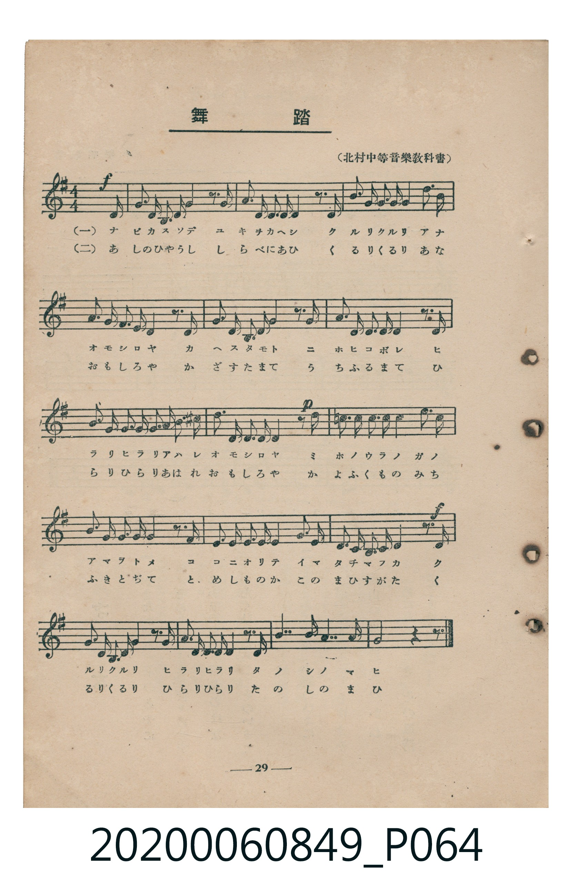
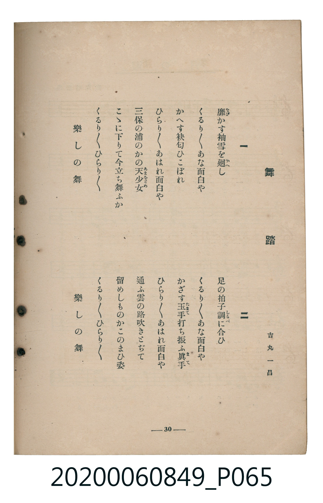

# 舞踏

> Re:Shoka 使用 AI 協助辨識與重建樂譜，可能會有錯誤。歡迎回報。

<audio controls src="buto.mp3"></audio>

- 詞：吉丸一昌
- 出處：（北村中等音樂教科書）
- 臺灣教育會公認《新定兒童唱歌》高等科女子用（2020.006.0849）

## 說明

原書資訊與歌詞全文（對應 P064.jpg – P065.jpg，書頁 pp. 29–30，高一第三學期第 5 首）：
調性與拍號：ト長調（1 升記號）、4/4 拍（弱起十六分音符進入）
出處註記：（北村中等音樂教科書）

## 跨冊／重複收錄參照

> 同曲＋同名異曲（《唱歌帖》P040〈無題・三拍子曲〉與 P171〈舞踏〉為同曲；《新定兒童唱歌》五年級、高女用及《唱歌帖》P230b 為同名異曲）

- **[同名異曲]** 《新定兒童唱歌》尋常科第五學年用（2020.006.0847.0005）：[**〈舞踏〉**](../../grade_5_2020.006.0847.0005/4_02_buto/index.md)（`G` / `3/4` — [原始 TMD](../../grade_5_2020.006.0847.0005/4_02_buto/buto.tmd)）
- **[同名異曲]** 楊金土手抄《唱歌帖》第 3 冊・I（2020.006.0843）：[**〈無題・三拍子曲〉**](../../../shokacho/vol_03/p040_mudai/index.md)（`F` / `3/4` — [原始 TMD](../../../shokacho/vol_03/p040_mudai/mudai.tmd)）
- **[同名異曲]** 楊金土手抄《唱歌帖》第 1 冊（2020.006.0843）：[**〈舞踏〉**](../../../shokacho/vol_01/p171_buto/index.md)（`F` / `3/4` — [原始 TMD](../../../shokacho/vol_01/p171_buto/buto.tmd)）
- **[同名異曲]** 楊金土手抄《唱歌帖》第 7 冊・VII（2020.006.0843）：[**〈舞踏（舞蹈）〉**](../../../shokacho/vol_07/p230b_buto/index.md)（`B,` / `3/4` — [原始 TMD](../../../shokacho/vol_07/p230b_buto/buto.tmd)）
- 總表：[跨冊重複與同名歌曲總索引](../../../duplicate_songs.md)

## 歌詞

```text
一
靡（なび）かす袖雪を廻（かへ）し
くるり〳〵あな面白や
かへす袂匂ひこぼれ
ひらり〳〵あはれ面白や
三保の浦のかの天少女（あまをとめ）
こゝに下りて今立ち舞ふか
くるり〳〵ひらり〳〵
樂しの舞

二
足の拍子調（しらべ）に合ひ
くるり〳〵あな面白や
かざす玉手（たまて）打ち振ふ眞手（まて）
ひらり〳〵あはれ面白や
通ふ雲の路吹きとぢて
留めしものかこのまひ姿
くるり〳〵ひらり〳〵
樂しの舞
```

## ABC

```abc
X:1
T:舞踏
M:4/4
L:1/16
Q:1/4=96
K:G
V:V1 name="Piano" snm="Pia"
[V:V1]
!f! z4 z4 z4 z3 D | B3 A G3 A B4 z3 D | B3 A G3 A B4 z3 D | d3 c B3 c d3 e d3 c |
B3 c B3 A G4 z3 G | B3 A G3 A B4 z3 B | A3 G F3 G A4 z3 A | B3 A G3 A B3 c B3 ^A |
!p! B3 E E3 F G4 z3 B | B3 B B3 B B4 d3 B | A3 G A3 G D4 z3 F | G3 F G3 A B4 B3 B |
!f! A3 G A3 G D4 z3 D | B3 A G3 A B4 z3 D | B3 A G3 A B4 z3 B | d7 B G7 A |
G8 z4 z4 | !f! z4 z4 z4 z3 D | B3 A G3 A B4 z3 D | B3 A G3 A B4 z3 D |
d3 c B3 c d3 e d3 c | B3 c B3 A G4 z3 G | B3 A G3 A B4 z3 B | A3 G F3 G A4 z3 A |
B3 A G3 A B3 c B3 ^A | !p! B3 E E3 F G4 z3 B | B3 B B3 B B4 d3 B | A3 G A3 G D4 z3 F |
G3 F G3 A B4 B3 B | !f! A3 G A3 G D4 z3 D | B3 A G3 A B4 z3 D | B3 A G3 A B4 z3 B |
d7 B G7 A | G8 z4 z4 |
```

## TMD 檔案連結

- [主旋律 TMD 檔案](buto.tmd) [[在 TMD Studio 編輯](https://tmdlang.github.io/Tmd-TS/#tmd=s7IKdvYPcrWy4qpTUCpJTLdSSM7PyUlNLsnMz7MqzsjMK0nNjM_KTMmPL87Iz05Ugisry88pzU21ys4vyY9PzyzKKY43MjAyiDcwMIs3sDCxRCgszi8tSk61Kk7OyM_PiS9JrShJys_PRsgXFOWXpeYl5gHVFBSB7EsBK0IoSC3LTEkFSaemZJbkF2Um5iC5IrWoGOxSsCXxJUWJecXJRZkFIOcjVJVkpAKdmltanJmsxKWlpfCiY96LHf0KWlpcirYKlmZc9rYK7lw2JvomdiAtL1bOe79n1tMJnU927Hiyo-HZjB6wSU_bd72YORUo835Px9Oe6c_mTnyyY-3ztZ0v529-tqLp2dSZz5dPfDZ7x_s9nWDlL9p3PW9cDBR-0bTp2Zzmp61rXqzqfdzQ9WzahqfrZj1tnfR89dKnUzY-W9vzuKH75eoZQJOABjxduvnp2gnPp6wAWgIKTz1geOqBwhNsLJe-loIttQCXgoLC0775QCe_2Nz-YkXXi452oGOAnn_auuLZtHaQLzf0PmvvVAgwMDPRyypIV3jUMBnEMQVx3u_pAep8uaBRoaBAT8HIEihnbAAUBPoEGGbP16x5sqPz6dodz-bMB7IVTBVeLpsG9AIw9EDWvli1_1nDcpCF3b0vZs4Hij5u7ng5dTtQHGitocLTXqCDZoBlOh83NAIjRgGoEuSiPRtfbN3-tLfxaevapx1twKB_vmbZy4ZNT1uXApWCfQSOpRcrdgMNICauuECagC4GUS_nLgSqf9y46nHjZpDNjd2PG2e-WDTt5exVj5smPd29GywLFARpfNw4HaTncWP_46bux01djxs2P27Y-rixCaj_5dxFz2fufdzUAlEB0gE2qelpD1B60-PGyY8b9zxu6oFIb3rc1IlqwHqgHIoZwMB8sn_u48Z1z7YuA5JgI9c9XbLy6QZQigE7C6htH9CVjxtXPG5qhAYGyKImoLbVT3aAndi47MnuruergZoXArPA40agbd1YPYHiJJAKYKgBPQy0FKgPEmS7wK5_sW0zyFXdvcBUC4k9kDKg5sad4DBa_XQCUGQTCSE1DRhSz_s6n3V2gw2bD_JW4zKgYc86gaG28FnPeqC7n8-ZB1MAlSU6KF82zAIa8HI2MBbWvdi-_umEnY8be0Gh1rgIaBJIxfOpM4FBCPYH0ABIYAOtBjKAdm16unw_GUEG5FOeY6FAQUufi8s3MTPPKiAzMS_focagRqEaZIOCjaGZlh2YBSwooHllQ__z9Q0gLSDhGgUDBV0wxE5Xp9UqmMYr1ICjGGQIOCM3vFjYgzDBGKzSSMEQSkP4MBNAuolRYgpmmkClTKB8M7g4qhN29WBxAkwzzB6Y-YYEXWAMVGEEVWseD2VABGBKjNADoZOIQIC7SB2uxCwehEAsoEUwd1YX1CK5BKLQGI0GhhNMBbJDns6ejeIQmDdgNDBwkb0BtLQGai3cfkRowGzEYwwoRSCiDTVSplA3XYDcAfEzDBrDQwwCgZGCJoKZkGu4arm4dO0UQBlEAYlW5uICAA)]
- [鋼琴伴奏 TMD 檔案](buto_piano.tmd) [[在 TMD Studio 編輯](https://tmdlang.github.io/Tmd-TS/#tmd=s7IKdvYPcrWy4tLSUnjRMe_Fjv73ezpedu95PmHLkz1bni7tf97Z8X5Pp4KWFpeirYKlGZe9rYI7l42JvokdV52C0ouV897vmfV0QueTHTue7Gh4NqNHCST8tH3Xi5lTgTJAw572TH82d-KTHWufr-18OX_zsxVNz6bOfL584rPZO4AGg5W_aN_1vHExUPhF06Znc5qftq55sar3cUPXs2kbnq6b9bR10vPVS59O2fhsbc_jhu6Xq2cATQIa8HTp5qdrJzyfsgJoiZGBkYGegYGZnoGFiSXYWC7fxMw8q4DMxLz8IA-HGoMahWouBSCwMTTTsgOz9LUUnu7Z-GLr9qcb-p-vb1DQ0gcL1ygYKOiCIXa6Oq1WwTReoYYLZsjzNWuAXn-xsAdhgjFYpZGCIZSG8GEmgHQTo8QUzDSBSplA-WZwcVQn7OrB4gSYZpg9MPMNCbrAGKjCCKrWPB7KgAjAlBihB0InEYEAd5E6XIlZPAiBWECLYO6sLqhFcglEoTEaDQwnmApkhzydPRvFITBvwGhg4CJ7A2hpDdRauP2I0IDZiMcYUIpARBtqpEyhbroAuQPiZxg0hocYBAIjBU0EMyHXcNUi5w8flPxhAs0eoHwAgTVQvmG8QrRhLIgCiqHxTOOBXNP4WASDGF1GQJ4RRA-GNcZAyhhoDDBtAFlm8blwXQgBmBqoThRHINkGNwqffcR6C6YCEjLAgNS1UwCFpQISrczFBQA)]

## 分析

```text
================================================================================
📊 TMD Song Profile: [ 舞踏 ]
================================================================================
⏱  Duration:       1:25 (85.0s), 34 measures total
🎼 Key & Tempo:    首調基準 G, != 96.0 BPM, <4/4>
   - 分析範圍：      由實際發聲的音符與和弦推測調性；播放脈絡另行呈現
🎤 人聲音域:    D4 (MIDI 62) – E5 (MIDI 76) [跨度: 14 個半音 / 1.2 個八度, 難度: moderate]
   - 最低音:  D4 in [Main #1 @ m.1, 0:02]
   - 最高音: E5 in [Main #1 @ m.4, 0:09]
   - 適合: soprano, mezzo-soprano, contralto, tenor, baritone, bass
🏛  結構:      Main (42.5s) -> Main (42.5s)
⚡ 編曲密度:        Peak 1 軌道同時演奏
🗝  調性診斷：       B 調性不明確（純淨自然大調，未偵測到可信轉調）
   - 風格氣質:    純淨自然大調（陽光明朗、易唱易記，無明顯調外色彩）
   - 轉調歷程:    全曲維持單一推測調性（未偵測到可信轉調）
   - 核心骨幹音:  B, G, A, D, F#
   - 調性數值:    B 調性不明確 [相關度: 0.76, 穩定度: Ambiguous, 自然音純度: 97.3%]
   - 候選調性 (K-S): B 小調 (0.76), G 大調 (0.73), D 大調 (0.51)
   - 五度圈歷程:   +5 -> +5
   - 各段落調性細節:
     • [Main #1]: B 調性不明確 (r: 0.76, 自然音純度: 97.3%, 調外音: C, A#)
     • [Main #2]: B 調性不明確 (r: 0.76, 自然音純度: 97.3%, 調外音: C, A#)

  [ 五度圈游移軌跡 ]
               C  
         F            G  
      Bb               D  
      Eb               A  
         Ab           E  
            Db      [B ]*
               F# 
     (* = active key center)

  [ 十二半音累積音高分佈 ]
     C  : █                          2.3%
     C# :                            0.0%
     D  : █████████                 14.6%
     D# :                            0.0%
     E  : █                          2.3%
     F  :                            0.0%
     F# : ██                         2.7%
     G  : ████████████████          24.7%
     G# :                            0.0%
     A  : ██████████                16.0%
     A# :                            0.5%
     B  : ████████████████████████  37.0%
--------------------------------------------------------------------------------
Assignment 軌道音域：
  - Piano         : D4 – E5 (14 個半音 / 1.2 個八度, 192 個音符)
================================================================================
```


## 原書掃描頁






