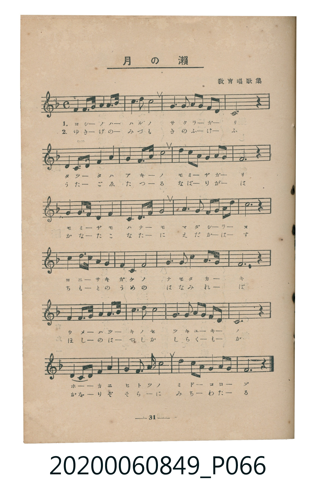
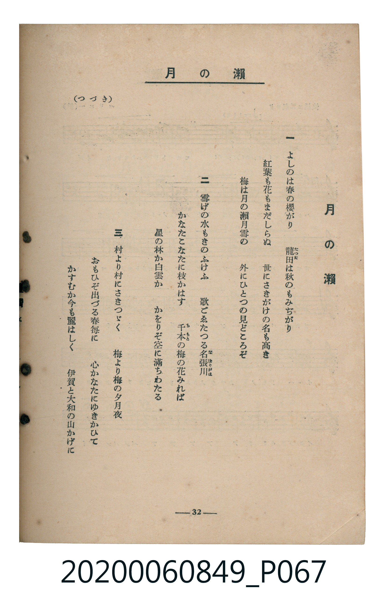

# 月の瀨

<audio controls src="tsuki_no_se.mp3"></audio>

- 出處：教育唱歌集
- 臺灣教育會公認《新定兒童唱歌》高等科女子用（2020.006.0849）

## 說明

原書資訊與歌詞全文（對應 P066.jpg – P067.jpg，書頁 pp. 31–32，高一第三學期第 6 首）：
調性與拍號：ヘ長調（1 降記號）、4/4 拍
出處註記：教育唱歌集

## 歌詞

```text
一
よしのは春の櫻がり　龍田（たつた）は秋のもみぢがり
紅葉も花もまだしらぬ　世にさきがけの名も高き
梅は月の瀨月雪の　外にひとつの見どころぞ

二
雪げの水もきのふけふ　歌ごゑたつる名張川（なばりがは）
かなたこなたに枝かはす　千本（ちもと）の梅の花みれば
星の林か白雲か　かをりぞ空に滿ちわたる

三
村より村にさきつゞく　梅より梅の夕月夜
おもひぞ出づる春毎に　心かなたにゆきかひて
かすむか今も麗はしく　伊賀と大和の山かげに
```

## 原書掃描頁





## 分析

```text
================================================================================
📊 TMD Song Profile: [ 月の瀨 ]
================================================================================
⏱  Duration:       2:52 (172.8s), 72 measures total
🎼 Key & Tempo:    首調基準 F, != 100.0 BPM, <4/4>
   - 分析範圍：      由實際發聲的音符與和弦推測調性；播放脈絡另行呈現
🎤 人聲音域:    C4 (MIDI 60) – D5 (MIDI 74) [跨度: 14 個半音 / 1.2 個八度, 難度: moderate]
   - 最低音:  C4 in [Main #1 @ m.4, 0:07]
   - 最高音: D5 in [Main #1 @ m.2, 0:03]
   - 適合: soprano, mezzo-soprano, contralto, tenor, baritone, bass
🏛  結構:      Main (57.6s) -> Main (57.6s) -> Main (57.6s)
⚡ 編曲密度:        Peak 1 軌道同時演奏
🗝  調性診斷：       F 調性不明確（純淨自然大調，未偵測到可信轉調）
   - 風格氣質:    純淨自然大調（陽光明朗、易唱易記，無明顯調外色彩）
   - 轉調歷程:    全曲維持單一推測調性（未偵測到可信轉調）
   - 核心骨幹音:  C, F, A, G, D
   - 調性數值:    F 調性不明確 [相關度: 0.81, 穩定度: Ambiguous, 自然音純度: 100.0%]
   - 候選調性 (K-S): F 大調 (0.81), C 大調 (0.80), A 小調 (0.64)
   - 五度圈歷程:   -1 -> -1 -> -1
   - 各段落調性細節:
     • [Main #1]: F 調性不明確 (r: 0.81, 自然音純度: 100.0%)
     • [Main #2]: F 調性不明確 (r: 0.81, 自然音純度: 100.0%)
     • [Main #3]: F 調性不明確 (r: 0.81, 自然音純度: 100.0%)

  [ 五度圈游移軌跡 ]
               C  
        [F ]*          G  
      Bb               D  
      Eb               A  
         Ab           E  
            Db       B  
               F# 
     (* = active key center)

  [ 十二半音累積音高分佈 ]
     C  : ████████████████████████  26.9%
     C# :                            0.0%
     D  : ██████████████            15.3%
     D# :                            0.0%
     E  :                            0.0%
     F  : ███████████████████       20.8%
     F# :                            0.0%
     G  : ████████████████          18.1%
     G# :                            0.0%
     A  : █████████████████         18.9%
     A# :                            0.0%
     B  :                            0.0%
--------------------------------------------------------------------------------
Assignment 軌道音域：
  - Piano         : C4 – D5 (14 個半音 / 1.2 個八度, 273 個音符)
================================================================================
```

## ABC

```abc
X:1
T:月の瀨
C:TMD (Chen, Chih-Han / aguai)
M:4/4
L:1/16
Q:1/4=100
K:F
V:V1 name="Piano" snm="Pia"
[V:V1]
!mf! f4 f3 g a4 c4 | a6 c2 d8 | g6 a2 g3 f f2 d2 | c12 z4 |
f4 f3 g a4 a4 | c6 d2 c8 | d6 c2 a3 g f2 g2 | a12 z4 |
g4 g3 a c4 g4 | f4 a3 c d8 | a6 g2 f3 d f2 g2 | c12 z4 |
d4 d3 c a4 c4 | a4 f4 g8 | g6 c2 a3 g f2 g2 | f12 z4 |
f4 f3 g a4 c4 | d6 d2 c8 | g6 a2 g3 f f2 d2 | c12 z4 |
f4 d3 f g4 a4 | c6 d2 c8 | d6 f2 g3 c a2 g2 | f12 z4 |
!mf! f4 f3 g a4 c4 | a6 c2 d8 | g6 a2 g3 f f2 d2 | c12 z4 |
f4 f3 g a4 a4 | c6 d2 c8 | d6 c2 a3 g f2 g2 | a12 z4 |
g4 g3 a c4 g4 | f4 a3 c d8 | a6 g2 f3 d f2 g2 | c12 z4 |
d4 d3 c a4 c4 | a4 f4 g8 | g6 c2 a3 g f2 g2 | f12 z4 |
f4 f3 g a4 c4 | d6 d2 c8 | g6 a2 g3 f f2 d2 | c12 z4 |
f4 d3 f g4 a4 | c6 d2 c8 | d6 f2 g3 c a2 g2 | f12 z4 |
!mf! f4 f3 g a4 c4 | a6 c2 d8 | g6 a2 g3 f f2 d2 | c12 z4 |
f4 f3 g a4 a4 | c6 d2 c8 | d6 c2 a3 g f2 g2 | a12 z4 |
g4 g3 a c4 g4 | f4 a3 c d8 | a6 g2 f3 d f2 g2 | c12 z4 |
d4 d3 c a4 c4 | a4 f4 g8 | g6 c2 a3 g f2 g2 | f12 z4 |
f4 f3 g a4 c4 | d6 d2 c8 | g6 a2 g3 f f2 d2 | c12 z4 |
f4 d3 f g4 a4 | c6 d2 c8 | d6 f2 g3 c a2 g2 | f12 z4 |
```

- [主旋律 TMD 檔案](tsuki_no_se.tmd)
- [鋼琴伴奏 TMD 檔案](tsuki_no_se_piano.tmd)
