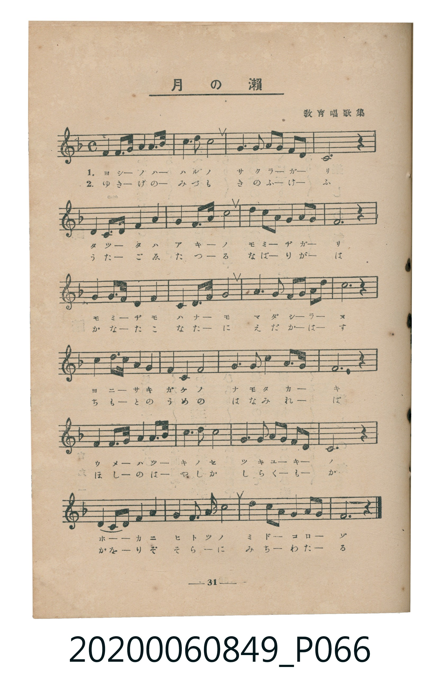
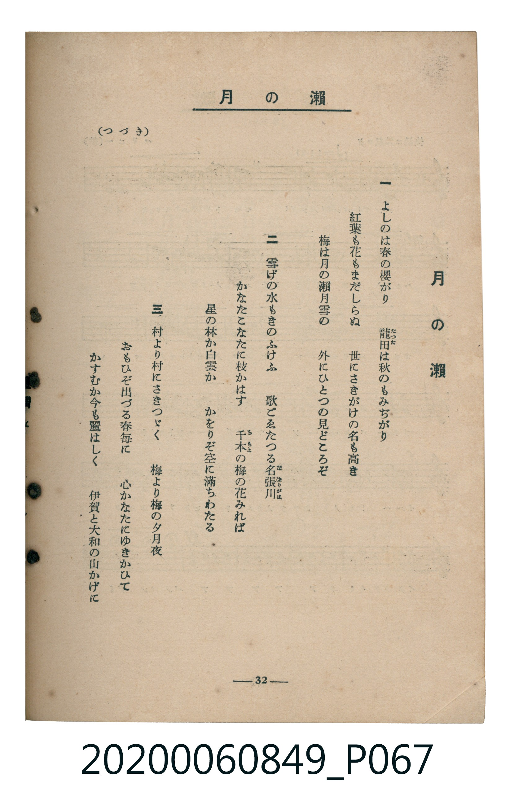

# 月の瀨

> Re:Shōka 使用 AI 協助辨識與重建樂譜，可能會有錯誤。歡迎回報。

- **鋼琴伴奏版**：<br><audio controls src="tsuki_no_se.mp3"></audio>

- 出處：教育唱歌集
- 臺灣教育會公認《新定兒童唱歌》高等科女子用（2020.006.0849）

## 說明

原書資訊與歌詞全文（對應 P066.jpg – P067.jpg，書頁 pp. 31–32，高一第三學期第 6 首）：
調性與拍號：ヘ長調（1 降記號）、4/4 拍
出處註記：教育唱歌集


## 歌詞

```text
一
よしのは春の櫻がり　龍田（たつた）は秋のもみぢがり
紅葉も花もまだしらぬ　世にさきがけの名も高き
梅は月の瀨月雪の　外にひとつの見どころぞ

二
雪げの水もきのふけふ　歌ごゑたつる名張川（なばりがは）
かなたこなたに枝かはす　千本（ちもと）の梅の花みれば
星の林か白雲か　かをりぞ空に滿ちわたる

三
村より村にさきつゞく　梅より梅の夕月夜
おもひぞ出づる春毎に　心かなたにゆきかひて
かすむか今も麗はしく　伊賀と大和の山かげに
```

## ABC

<div class="abc-score" data-abc-src="tsuki_no_se.abc" aria-label="五線譜載入中"></div>

[下載 ABC 原始檔](tsuki_no_se.abc)

## TMD 檔案連結

- [主旋律 TMD 檔案](tsuki_no_se.tmd) [[在 TMD Studio 編輯](https://tmdlang.github.io/Tmd-TS/#tmd=s7IKdvYPcrWy4qpTUCpJTLdSSM7PyUlNLsnMz7MqzsjMK0nNjM_KTMmPL87Iz05Ugisry88pzU21ys4vyY9PzyzKKY43MjAyiDcwMIs3sDCxRCgszi8tSk61Kk7OyM_PiS9JrShJys_PRsgXFOWXpeYl5gHVFBSB7EsBK0IoSC3LTEkFSaemZJbkF2Um5iC5IrWoGOxSsCXxJUWJecXJRZkFIOcjVJVkpAKdmpdYUlqUihAFGpWemWeVm5-XVAr0HKZEamZWJpKDtbQUns3peNy47nnDCgUtLS5FWwVDAwMue1sFNy4bE30TO5ABT9t3vZg59f2eWc-mznzRtOnplI3P1va8nN0GNv1F-67njYshMs_mND9tXfNiVe_jhq5n0zY8XTfraeuk56uXQnQ8buh-uXrG87Wdz5dPfLp089O1E55PWfF-TwcojPWAYawHCuP3ezqVuLj0tRRsqQW4FBQUnvbNfzZ7x4vN7S9WdL3oaAc65sXKeU9bVzyb1g50wNMNvc_aOxUCDMzM9LIK0hUeNUwGccxBnPd7eoA6Xy5oVCgo0FMwNgTKGRsBBYE-ebKj4fmaNU92dD5du-PZnPlAtoKZwstl04BeAIYVyNoXq_Y_a1gOsrC798XM-UDRx80zXk7dDhQHWmuo8HJm74sVM8AynY8bGoHhrQBUCXYwOMhfrNgNlMcMeC6QEqD1IOpxEzD6pgNj8HHj-mczlgIZz1bvftzY87ip63FDw8t9vc-nbABa9rhx_uPGJUASZFXj-ufLu0FampoeN-5_3LgIoh5k3PMtrS8mdgIlXnRtBEvve9y4AGRBE1DbGqCJT3ZMe9y4-nHj1MeNvSBtjROBBj2d0AtUDAwToCDIlGeLWkHOgaUsIOPl7FUgCxsani6B6N_0uHEF2EXrXiwDumXl48bJj5uAJs6DeG5XD4gC65oE8tOGLWDXABUAPboVbOtWoGmgZNU45XETkAv2X1M30ClP92x9un0u2NNA7RtAIQFy6Hqg18Eh1gi0DygB1DAZxlj9bN5csPj6x40zQa7sbX42Zw3YiIVgi4EJFRgA68AeWwcKG2C4NQEN3QD27gygEeuezQNGQ_fzmXtfzgZ6rhtoCohsmgS2f97zlbtA1uwGBjfQxH6QrU3d0IgEO-vZ3ImguGzqAjEQIQz007zHjf0gvwLthigAO-LpkqnAcH26ZA7ET11gZwItngdMO48blwJNByaHZ-v7QGYBPbS_Gcnfqx83tYFNB4oAtSyDB8vMx00gVz_ZDTLu5S6gh4ABAiRB9j_Z0_ViM1B2xdMly59OAvp93dONwHAA6gLG0GqQEZRnVihQ0NLn4vJNBBZYAZmJefkONQY1CtUgGxRsDM207MAsYBkBzn4NLxb2gNSDxICqctNqFQwVdMEQQhspGEP5plC6Bi4CEzVD4oNVQI0zQhID6YHwDcEmm8WDjTIFUdigAdwsZPfu6kFxLy6nwmig-UhGgpyJzEd2KrIXQGogJhiBTQY5G9XThB26oxPFobCQgNDGcGfAxBFegVhjijNMkZ0B0g3RBwxNhEvR_YjXpU9nz0ZxKcxeCG2KJ_ZhLkaOZWSXIotjD1KYCUQ59MmuKUTFPcKhyEGIL-6pnkyftq7F6lSwYSCTYTaSkU6RHQILSVg8ERuqtVxcunYKoBJCAUgrc3EBAA)]
- [鋼琴伴奏 TMD 檔案](tsuki_no_se_piano.tmd) [[在 TMD Studio 編輯](https://tmdlang.github.io/Tmd-TS/#tmd=s7IKdvYPcrWy4tLSUng2p-Nx47rnDSve7-l42b3n-YQtT_Zsebq0_3lnx_s9nQpaWlyKtgqGBgZc9rYKblw2Jvomdlx1CkpP23e9mDn1_Z5Zz6bOfNG06emUjc_W9ryc3aYEknzRvut542KIzLM5zU9b17xY1fu4oevZtA1P18162jrp-eqlEB2PG7pfrp7xfG3n8-UTny7d_HTthOdTQC4xMjAy0DMwMNMzsDCxBLpDiYvLNzEzzyogMzEvP8jDocagRqGaSwEIbAzNtOzALH0thedr1jzZ0fBiYY-Clj5YDKgqN61WwVBBFwwhtJGCMZRvCqVr4CIwUTMkPlgF1DgjJDGQHgjfEGyyWTzYKFMQhQ0awM1Cdu-uHhT34nIqjAaaj2QkyJnIfGSnInsBpAZighHYZJCzUT1N2KE7OlEcCgsJCG0MdwZMHOEViDWmOMMU2Rkg3RB9wNBEuBTdj3hd-nT2bBSXwuyF0KZ4Yh_mYuRYRnYpsjj2IIWZQJRDn-yaQlTcIxyKHIT44p7qyfRp61qsTgUbBjIZZiMZ6RTZIbCQhMUTsaFai1xA-KAUECbQ8gFoDMimaMNYiJlgjgmEYwTmGMXnQrim8WC-aXws0AqYO7HohnJMkDlmEL1mILMQmpFMxLAcWQdO21HsgGiHGYbVbKBKHE5HMYl4j8PVYDEMq9XAKNG1UwDFigIWWpmLCwA)]

## 分析

```text
================================================================================
📊 TMD Song Profile: [ 月の瀨 ]
================================================================================
⏱  Duration:       0:57 (57.6s), 24 measures total
🎼 Key & Tempo:    首調基準 F, != 100.0 BPM, <4/4>
   - 分析範圍：      由實際發聲的音符與和弦推測調性；播放脈絡另行呈現
🎤 人聲音域:    C4 (MIDI 60) – D5 (MIDI 74) [跨度: 14 個半音 / 1.2 個八度, 難度: moderate]
   - 最低音:  C4 in [Main #1 @ m.4, 0:07]
   - 最高音: D5 in [Main #1 @ m.2, 0:03]
   - 適合: soprano, mezzo-soprano, contralto, tenor, baritone, bass
🏛  結構:      Main (57.6s)
⚡ 編曲密度:        Peak 1 軌道同時演奏
🗝  調性診斷：       F 調性不明確（純淨自然大調，未偵測到可信轉調）
   - 風格氣質:    純淨自然大調（陽光明朗、易唱易記，無明顯調外色彩）
   - 轉調歷程:    全曲維持單一推測調性（未偵測到可信轉調）
   - 核心骨幹音:  C, F, A, G, D
   - 調性數值:    F 調性不明確 [相關度: 0.81, 穩定度: Ambiguous, 自然音純度: 100.0%]
   - 候選調性 (K-S): F 大調 (0.81), C 大調 (0.80), A 小調 (0.64)
   - 五度圈歷程:   -1
   - 各段落調性細節:
     • [Main #1]: F 調性不明確 (r: 0.81, 自然音純度: 100.0%)

  [ 五度圈游移軌跡 ]
               C  
        [F ]*          G  
      Bb               D  
      Eb               A  
         Ab           E  
            Db       B  
               F# 
     (* = active key center)

  [ 十二半音累積音高分佈 ]
     C  : ████████████████████████  26.9%
     C# :                            0.0%
     D  : ██████████████            15.3%
     D# :                            0.0%
     E  :                            0.0%
     F  : ███████████████████       20.8%
     F# :                            0.0%
     G  : ████████████████          18.1%
     G# :                            0.0%
     A  : █████████████████         18.9%
     A# :                            0.0%
     B  :                            0.0%
--------------------------------------------------------------------------------
Assignment 軌道音域：
  - Piano         : C4 – D5 (14 個半音 / 1.2 個八度, 91 個音符)
================================================================================
```


## 原書掃描頁






