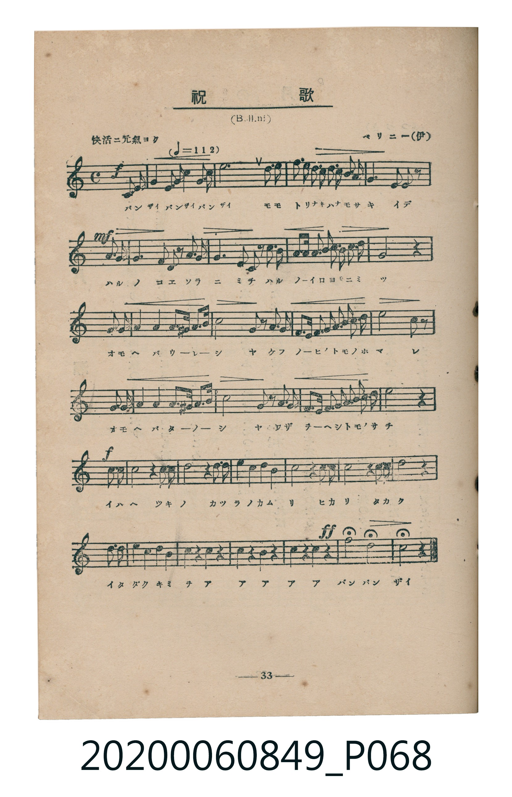
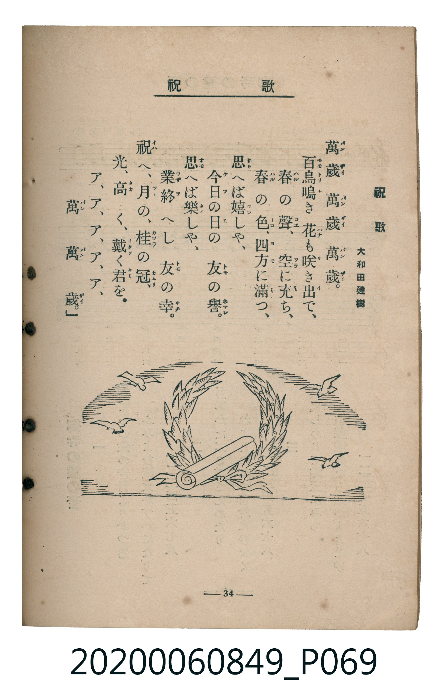

# 祝歌

<audio controls src="shukuka.mp3"></audio>

- 詞：大和田建樹
- 曲：V. Bellini（ベリニー）
- 臺灣教育會公認《新定兒童唱歌》高等科女子用（2020.006.0849）

## 說明

原書資訊與歌詞全文（對應 P068.jpg – P069.jpg，書頁 pp. 33–34，高一第三學期第 7 首）：
調性與拍號：ハ長調（無升降記號）、4/4 拍（快活ニ元氣ヨク ♩=112，弱起第 4 拍進入）

## 歌詞

```text
萬歲（バンザイ）　萬歲（バンザイ）　萬歲（バンザイ）。
百鳥（モモトリ）鳴（ナ）き花（ハナ）も咲（サ）き出（イ）で、
春（ハル）の聲（コエ）、空（ソラ）に充（ミ）ち、
春（ハル）の色（イロ）、四方（ヨモ）に滿（ミ）つ、
思（オモ）へば嬉（ウレ）しや、
今日（ケフ）の日（ヒ）の　友（トモ）の譽（ホマレ）。
思（オモ）へば樂（タノ）しや、
業（ワザ）終（ヲ）へし　友（トモ）の幸（サチ）。
祝（イハ）へ、月（ツキ）の、桂（カツラ）の冠（カムリ）、
光（ヒカリ）、高（タカ）く、戴（イタダ）く君（キミ）を。
ア、ア、ア、ア、ア、
萬（バン）　萬（バン）　歲（ザイ）。
```

## ABC

```abc
X:1
T:祝歌
C:曲：V. Bellini（ベリニー）
M:4/4
L:1/16
Q:1/4=112
K:C
V:V1 name="Piano" snm="Pia"
[V:V1]
!f! z4 z4 z4 G,3 G, | G,4 G,3 G, A,3 B, C3 D | E12 E3 E | D3 C B,3 A, G,3 F, E,3 D, |
!mf! G,8 G,2 G,2 E,3 F, | G,4 G,4 A,3 B, C3 D | E6 D2 C4 C3 C | D3 D E3 D C3 B, A,3 B, |
C8 z4 E,3 F, | G,4 G,4 A,3 B, C3 D | E8 G,2 z2 G,3 G, | F,3 E, F,3 G, A,3 B, C3 D |
E8 D2 z2 E,3 F, | G,4 G,4 A,3 B, C3 D | E8 G,2 z2 G,3 G, | F,3 E, F,3 G, A,3 B, C3 D |
!f! C8 z4 C3 C | C8 z4 C3 C | C8 z4 C3 C | D4 D4 D4 D4 |
B,8 z4 G,3 G, | C8 z4 G,3 G, | E8 z4 E3 E | F4 E4 D4 C4 |
B,4 z4 G,4 z4 | C4 z4 G,4 z4 | E4 z4 C4 z4 | !ff! G8 G,8 |
C8 z4 z4 |
```

## TMD 檔案連結

- [主旋律 TMD 檔案](shukuka.tmd) [[在 TMD Studio 編輯](https://tmdlang.github.io/Tmd-TS/#tmd=s7IKdvYPcrWy4tLSUni-dO6ztT0KWlpcirYKhoZGXPa2Cs5cNib6JnZcdQpKL1bOe79n1tMly59O6nk-ZcPT3buerdipBJJ5NnsTUCZMT8EpNScnMy_z_Z6Ox80zHzevetzc_bh5z_s9nWBlL9p3PW9c_GzqzBdNm57NaX7auubFqt7HDV3Ppm14um7W09ZJz1cvfTplI9ANjxu6X66e8Xxt5_PlE58u3fx07YTnU1YATTUyMDLQMzAw0zOwMLEEG8ulr6VgSy3ApaCg8LRv_rPZO15sbn-xoutFRzvQMUB_P21d8WxaO9ABTzf0PmvvVAgwMLPQyypIV3jUMBnEsQRx3u_pAep8uaBRoaBAT8HYGChnbAIUBPrkyY6G52vWPNnR-XTtjmdz5gPZCuYKL5dNA3oBGHAga1-s2v-sYTnIwu7eFzPnA0UfN_e_nLodKA609nnLwqe97S9n9r5YMQMs2_m4oREYLwpA1SBX7V_9bMtuYGA_bW1-tmHx4-YVj5vWKzyaudIWGItAFzzds_HF1u0gW8E6XjZsetq6FGgIF9jmCWuerQXGHzDKJjxu3vy4advjpiVgGxrIkmoCGfp85r6Xm4FWAKUXgRGQsQoo_XLzFrBgF0hpY--Lro1gbj9UpKnp6SSwoU1bIQqetu8Cc8FGNy4H-hpk-rMZEKOB2laDJda9aIRoAzoEmE5AofN8JUTn3sfNK8FqVj9tbQXrAgdf40LcZnVCzFryuHktxKyns2c_m7YTrGwF0DcQ457tBsUMzLglMOMa5oI1A5M-RN2Ox40bnq4BRjNQcNnj5jVgwemPm1qgGp7s7no2HeyEpo2Pm6dCnAAVaZ4E4QLD-2l_N1gEFKBQZ67dCxaZ_bh5HtRcSNhjdcKzFU1gwf2Pm_vQnfBsKdCfQJPWA2MRKPd8K1hpMzAUIJqnY7X_6c4dkJh63NyIFPFLIZYDA68fqr-h8dmcDrDmlsdN4BAF-ajx2UKIi1aDxKFxtO5p2wKY4AJIioG68WkrOAibJ4HloBLAnAX1VBMk7vpB5naAkxjQBSDPNkDEn06YDRZcC42vpklQ9z5uWgTUg4uE5g94MoenfTQRaFZAywSUF0hQoKClz8Xlm5iZZxWQmZiX71BjUKNQDbJBwcbQTMsOzAKWg5Bs_nRD__P1DSAtIOEaBQMFXTBEp6vTahVM48FMIFUDLgtApoALqoYXC4EVAcwIqDKwQihlBmGZxysYghlGQGXGUFXoECJuDLQDYpwRmG8I0gxiAI2CmmsSr2AMYRkBXYSwFgbBAmCiOhfoeqhaoC5U1-_qwet6sI14HQ9yIEQGRhuiOd4Iqt4IKg80CmFoDVwzDMLCHJeLd3RS6GK4YpBNyLEKMRBoIdR6KIvIGAR5FmQiDncDy8XB4W5c4Q1K44gIREkjU1BcjssAuGbCKlDSByTosNE1sGSPaRSm_3FZiqQSIzjhaQ1KosZY61oUf5ugKEa4EmYxkmvR7EYIoDsWt0K4NaiBh2lUdRqocELzGEZxgDt8EObVcnHp2imAyk4FIK3MxQUA)]
- [鋼琴伴奏 TMD 檔案](shukuka_piano.tmd) [[在 TMD Studio 編輯](https://tmdlang.github.io/Tmd-TS/#tmd=s7IKdvYPcrWy4tLSUni-dO6ztT3v93S87N7zfMKWJ3u2PF3a_7yz4_2eTgUtLS5FWwVDQyMue1sFZy4bE30TO646BaUXK-e93zPr6ZLlTyf1PJ-y4enuXc9W7FQCyTybvQkoE6an4JSak5OZlwk093HzzMfNqx43dz9u3gM0FKzsRfuu542Ln02d-aJp07M5zU9b17xY1fu4oevZtA1P18162jrp-eqlT6dsBDrscUP3y9Uznq_tfL584tOlm5-unfB8ygqgqUYGRgZ6BgZmegYWJpZgY7l8EzPzrAIyE_PygzwcagxqFKq5FIDAxtBMyw7M0tdSeLpn44ut259u6H--vkFBSx8sXKNgoKALhuh0dVqtgmk8mAmkarhgpjxfs-bJjoYXC3sQRkCVgRVCKTMIyzxewRDMMAIqM4aqQocQcWOgHRDjjMB8Q5BmEANoFNRck3gFYwjLCOgihLUwCBYAE9W5QNdD1QJ1obp-Vw9e14NtxOt4kAMhMjDaEM3xRlD1RlB5oFEIQ2vgmmEQFua4XLyjk0IXwxWDbEKOVYiBQAuh1kNZRMYgyLMgE3G4--ns2YPD3bjCG5TGERGIkkamoLgclwFwzYRVoKQPSNBho2tgyR7TKEz_47IUSSVGcMLTGpREjbHWtSj-NkFRjHAlzGIk16LZjRBAdyxuhXBrUAMP06jqNFDhhOYxjOIAd_ggzKtFLjp9UIpOE2jJCSoiIRDuk3iFaMNYUJoDUXA-CCMUmcYDRU3jYxEMiEKYEEHjzED6zOJzgUIEjATbS9A8VEvxmEWU64g2DYvLwEJI_kNWAizZo41AgnAGkuk4zcJiF9TBYL1gh0NcjOE5uBCEAyaQvQVKWCASLA9KOiBpYLLRtVMApRwFIK3MxQUA)]

## 分析

```text
================================================================================
📊 TMD Song Profile: [ 祝歌 ]
================================================================================
⏱  Duration:       1:02 (62.1s), 29 measures total
🎼 Key & Tempo:    首調基準 C, != 112.0 BPM, <4/4>
   - 分析範圍：      由實際發聲的音符與和弦推測調性；播放脈絡另行呈現
🎤 人聲音域:    D3 (MIDI 50) – G4 (MIDI 67) [跨度: 17 個半音 / 1.4 個八度, 難度: challenging]
   - 最低音:  D3 in [Main #1 @ m.4, 0:08]
   - 最高音: G4 in [Main #1 @ m.28, 0:57]
   - 適合: contralto, tenor, baritone, bass
🏛  結構:      Main (62.1s)
⚡ 編曲密度:        Peak 1 軌道同時演奏
🗝  調性診斷：       C 大調（純淨自然大調，未偵測到可信轉調）
   - 風格氣質:    純淨自然大調（陽光明朗、易唱易記，無明顯調外色彩）
   - 轉調歷程:    全曲維持單一推測調性（未偵測到可信轉調）
   - 核心骨幹音:  C, G, E, D, B
   - 調性數值:    C 大調 [相關度: 0.93, 穩定度: High, 自然音純度: 100.0%]
   - 候選調性 (K-S): C 大調 (0.93), E 小調 (0.75), G 大調 (0.73)
   - 五度圈歷程:   +0
   - 各段落調性細節:
     • [Main #1]: C 大調 (r: 0.93, 自然音純度: 100.0%)

  [ 五度圈游移軌跡 ]
              [C ]*
         F            G  
      Bb               D  
      Eb               A  
         Ab           E  
            Db       B  
               F# 
     (* = active key center)

  [ 十二半音累積音高分佈 ]
     C  : ████████████████████████  26.4%
     C# :                            0.0%
     D  : █████████                 10.1%
     D# :                            0.0%
     E  : ████████████████████      21.5%
     F  : █████                      5.2%
     F# :                            0.0%
     G  : ███████████████████████   25.1%
     G# :                            0.0%
     A  : █████                      5.7%
     A# :                            0.0%
     B  : █████                      6.0%
--------------------------------------------------------------------------------
Assignment 軌道音域：
  - Piano         : D3 – G4 (17 個半音 / 1.4 個八度, 122 個音符)
================================================================================
```


## 原書掃描頁






