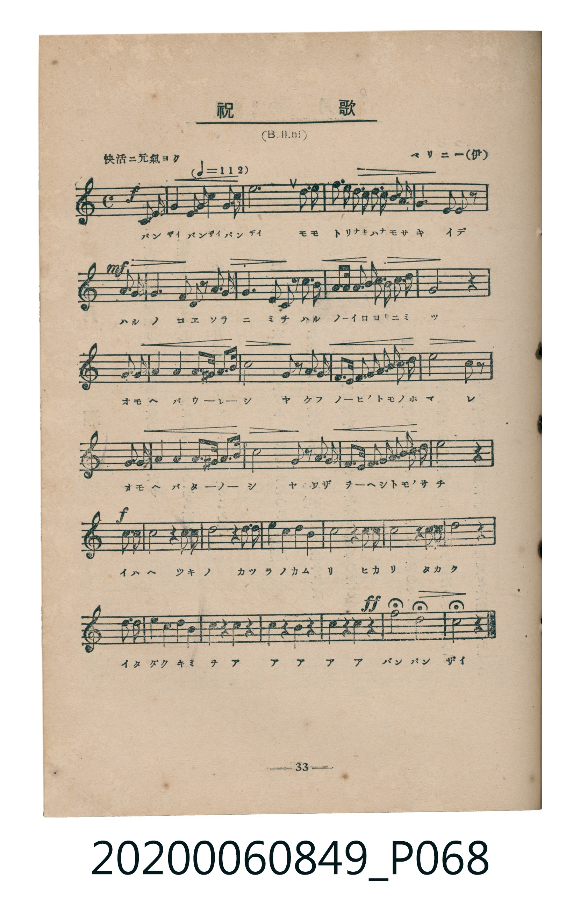
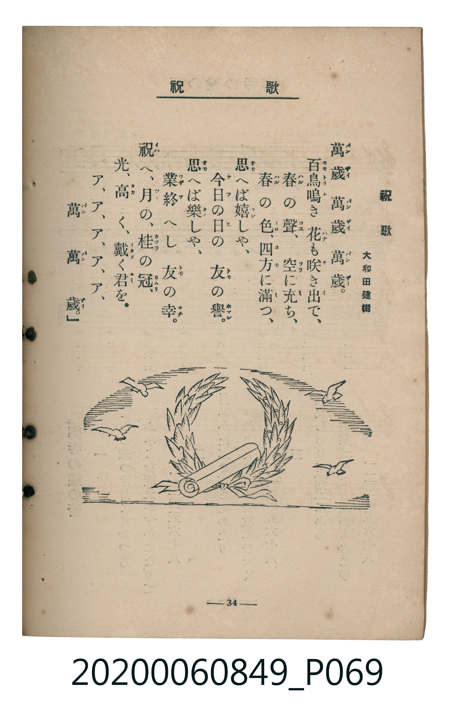

# 祝歌

> Re:Shōka 使用 AI 協助辨識與重建樂譜，可能會有錯誤。歡迎回報。

- **鋼琴伴奏版**：<br><audio controls src="shukuka.mp3"></audio>

- 詞：大和田建樹
- 曲：V. Bellini（ベリニー）
- 臺灣教育會公認《新定兒童唱歌》高等科女子用（2020.006.0849）

## 說明

原書資訊與歌詞全文（對應 P068.jpg – P069.jpg，書頁 pp. 33–34，高一第三學期第 7 首）：
調性與拍號：ハ長調（無升降記號）、4/4 拍（快活ニ元氣ヨク ♩=112，弱起第 4 拍進入）


## 歌詞

```text
萬歲（バンザイ）　萬歲（バンザイ）　萬歲（バンザイ）。
百鳥（モモトリ）鳴（ナ）き花（ハナ）も咲（サ）き出（イ）で、
春（ハル）の聲（コエ）、空（ソラ）に充（ミ）ち、
春（ハル）の色（イロ）、四方（ヨモ）に滿（ミ）つ、
思（オモ）へば嬉（ウレ）しや、
今日（ケフ）の日（ヒ）の　友（トモ）の譽（ホマレ）。
思（オモ）へば樂（タノ）しや、
業（ワザ）終（ヲ）へし　友（トモ）の幸（サチ）。
祝（イハ）へ、月（ツキ）の、桂（カツラ）の冠（カムリ）、
光（ヒカリ）、高（タカ）く、戴（イタダ）く君（キミ）を。
ア、ア、ア、ア、ア、
萬（バン）　萬（バン）　歲（ザイ）。
```

## ABC

<div class="abc-score" data-abc-src="shukuka.abc" aria-label="五線譜載入中"></div>

[下載 ABC 原始檔](shukuka.abc)

## TMD 檔案連結

- [主旋律 TMD 檔案](shukuka.tmd) [[在 TMD Studio 編輯](https://tmdlang.github.io/Tmd-TS/#tmd=s7IKdvYPcrWy4qpTUCpJTLdSSM7PyUlNLsnMz7MqzsjMK0nNjM_KTMmPL87Iz05Ugisry88pzU21ys4vyY9PzyzKKY43MjAyiDcwMIs3sDCxRCgszi8tSk61Kk7OyM_PiS9JrShJys_PRsgXFOWXpeYl5gHVFBSB7EsBK0IoSC3LTEkFSaemZJbkF2Um5iC5IrWoGOxSsCXxJUWJecXJRZkFIOcjVJVkpAKdmpZaXJJZhqwbaFh6Zp5VbmpmViYWl0Gly4H6Uovy4nNTc_JTKpW4tLQUni-d-2xtj4KWFpeirYKhoRGXva2CM5eNib6JHUj3i5Xz3u-Z9XTJ8qeTep5P2fB0965nK3aCzX02exNQJkxPwSk1JyczL_P9no7HzTMfN6963Nz9uHnP-z2dYGUv2nc9b1z8bOrMF02bns1pftq65sWq3scNXc-mbXi6btbT1knPVy99OmUj0A2PG7pfrp7xfG3n8-UTny7d_HTthOdTVgBNBUWGHjAy9ECRATaWS19LwZZagEtBQeFp3_xns3e82Nz-YkXXi452oGOA_n7auuLZtHagA55u6H3W3qkQYGBmoZdVkK7wqGEyiGMJ4rzf0wPU-XJBo0JBgZ6CsTFQztgEKAj0yZMdDc_XrHmyo_Pp2h3P5swHshXMFV4umwb0AjDgQNa-WLX_WcNykIXdvS9mzgeKPm7ufzl1O1AcaO3zloVPe9tfzux9sWIGWLbzcUMjMF4UgKpBrtq_-tmW3cDAftra_GzD4sfNKx43rVd4NHOlLTAWgS54umfji63bQbaCdbxs2PS0dSnQEC6wzRPWPFsLjD9glE143Lz5cdO2x01LwDY0kCXVBDL0-cx9LzcDrQBKLwIjIGMVUPrl5i1gwS6Q0sbeF10bwdx-qEhT09NJYEObtkIUPG3fBeaCjW5cDvQ1yPRnMyBGA7WtBkuse9EI0QZ0CDCdgELn-UqIzr2Pm1eC1ax-2toK1gUOvsaFuM3qhJi15HHzWohZT2fPfjZtJ1jZCqBvIMY92w2KGZhxS2DGNcwFawYmfYi6HY8bNzxdA4xmoOCyx81rwILTHze1QDU82d31bDrYCU0bHzdPhTgBKtI8CcIFhvfT_m6wCChAoc5cuxcsMvtx8zyouZCwx-qEZyuawIL7Hzf3oTvh2VKgP4EmrQfGIlDu-Vaw0mZgKEA0T8dq_9OdOyAx9bi5ESnil0IsBwZeP1R_Q-OzOR1gzS2Pm8AhCvJR47OFEBetBolD42jd07YFMMEFkBQDdePTVnAQNk8Cy0ElgDkL6qkmSNz1g8ztACcxoAtAnm2AiD-dMBssuBYaX02ToO593LQIqAcXCc0f8GQOT_toItCsgJYJKC-QoEBBS5-LyzcRWGoHZCbm5TvUGNQoVINsULAxNNOyA7OA5SAkmz_d0P98fQNIC0i4RsFAQRcM0enqtFoF03gwE0jVgMsCkCnggqrhxUJgRQAzAqoMrBBKmUFY5vEKhmCGEVCZMVQVOoSIGwPtgBhnBOYbgjSDGECjoOaaxCsYQ1hGQBchrIVBsACYqM4Fuh6qFqgL1fW7evC6HmwjXseDHAiRgdGGaI43gqo3gsoDjUIYWgPXDIOwMMfl4h2dFLoYrhhkE3KsQgwEWgi1HsoiMgZBngWZiMPdwHJxcLgbV3iD0jgiAlHSyBQUl-MyAK6ZsAqU9AEJOmx0DSzZYxqF6X9cliKpxAhOeFqDkqgx1roWxd8mKIoRroRZjORaNLsRAuiOxa0Qbg1q4GEaVZ0GKpzQPIZRHOAOH4R5tVxcunYKoLJTAUgrc3EBAA)]
- [鋼琴伴奏 TMD 檔案](shukuka_piano.tmd) [[在 TMD Studio 編輯](https://tmdlang.github.io/Tmd-TS/#tmd=s7IKdvYPcrWy4tLSUni-dO6ztT3v93S87N7zfMKWJ3u2PF3a_7yz4_2eTgUtLS5FWwVDQyMue1sFZy4bE30TO646BaUXK-e93zPr6ZLlTyf1PJ-y4enuXc9W7FQCyTybvQkoE6an4JSak5OZlwk093HzzMfNqx43dz9u3gM0FKzsRfuu542Ln02d-aJp07M5zU9b17xY1fu4oevZtA1P18162jrp-eqlT6dsBDrscUP3y9Uznq_tfL584tOlm5-unfB8ygqgqUYGRgZ6BgZmegYWJpZgY7l8EzPzrAIyE_PygzwcagxqFKq5FIDAxtBMyw7M0tdSeLpn44ut259u6H--vkFBSx8sXKNgoKALhuh0dVqtgmk8mAmkarhgpjxfs-bJjoYXC3sQRkCVgRVCKTMIyzxewRDMMAIqM4aqQocQcWOgHRDjjMB8Q5BmEANoFNRck3gFYwjLCOgihLUwCBYAE9W5QNdD1QJ1obp-Vw9e14NtxOt4kAMhMjDaEM3xRlD1RlB5oFEIQ2vgmmEQFua4XLyjk0IXwxWDbEKOVYiBQAuh1kNZRMYgyLMgE3G4--ns2YPD3bjCG5TGERGIkkamoLgclwFwzYRVoKQPSNBho2tgyR7TKEz_47IUSSVGcMLTGpREjbHWtSj-NkFRjHAlzGIk16LZjRBAdyxuhXBrUAMP06jqNFDhhOYxjOIAd_ggzKtFLjp9UIpOE2jJCSoiIRDuk3iFaMNYUJoDUXA-CCMUmcYDRU3jYxEMiEKYEEHjzED6zOJzgUIEjATbS9A8VEvxmEWU64g2DYvLwEJI_kNWAizZo41AgnAGkuk4zcJiF9TBYL1gh0NcjOE5uBCEAyaQvQVKWCASLA9KOiBpYLLRtVMApRwFIK3MxQUA)]

## 分析

```text
================================================================================
📊 TMD Song Profile: [ 祝歌 ]
================================================================================
⏱  Duration:       1:02 (62.1s), 29 measures total
🎼 Key & Tempo:    首調基準 C, != 112.0 BPM, <4/4>
   - 分析範圍：      由實際發聲的音符與和弦推測調性；播放脈絡另行呈現
🎤 人聲音域:    D3 (MIDI 50) – G4 (MIDI 67) [跨度: 17 個半音 / 1.4 個八度, 難度: challenging]
   - 最低音:  D3 in [Main #1 @ m.4, 0:08]
   - 最高音: G4 in [Main #1 @ m.28, 0:57]
   - 適合: contralto, tenor, baritone, bass
🏛  結構:      Main (62.1s)
⚡ 編曲密度:        Peak 1 軌道同時演奏
🗝  調性診斷：       C 大調（純淨自然大調，未偵測到可信轉調）
   - 風格氣質:    純淨自然大調（陽光明朗、易唱易記，無明顯調外色彩）
   - 轉調歷程:    全曲維持單一推測調性（未偵測到可信轉調）
   - 核心骨幹音:  C, G, E, D, B
   - 調性數值:    C 大調 [相關度: 0.93, 穩定度: High, 自然音純度: 100.0%]
   - 候選調性 (K-S): C 大調 (0.93), E 小調 (0.75), G 大調 (0.73)
   - 五度圈歷程:   +0
   - 各段落調性細節:
     • [Main #1]: C 大調 (r: 0.93, 自然音純度: 100.0%)

  [ 五度圈游移軌跡 ]
              [C ]*
         F            G  
      Bb               D  
      Eb               A  
         Ab           E  
            Db       B  
               F# 
     (* = active key center)

  [ 十二半音累積音高分佈 ]
     C  : ████████████████████████  26.4%
     C# :                            0.0%
     D  : █████████                 10.1%
     D# :                            0.0%
     E  : ████████████████████      21.5%
     F  : █████                      5.2%
     F# :                            0.0%
     G  : ███████████████████████   25.1%
     G# :                            0.0%
     A  : █████                      5.7%
     A# :                            0.0%
     B  : █████                      6.0%
--------------------------------------------------------------------------------
Assignment 軌道音域：
  - Piano         : D3 – G4 (17 個半音 / 1.4 個八度, 122 個音符)
================================================================================
```


## 原書掃描頁






