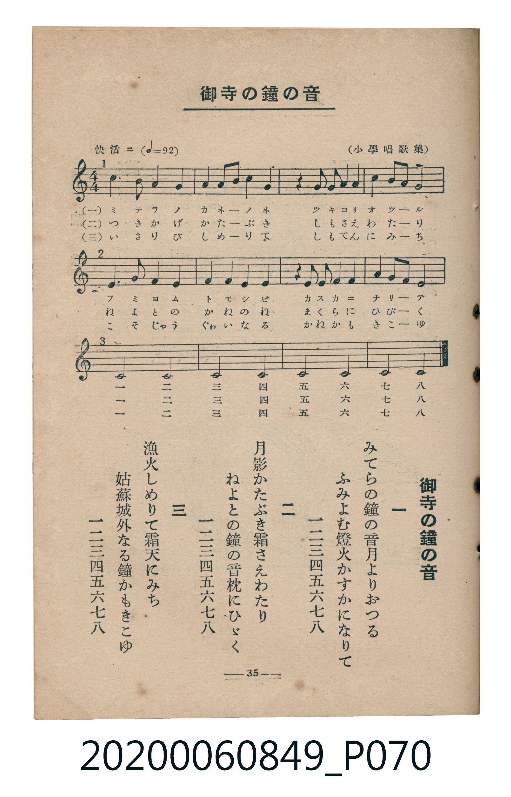

# 御寺の鐘の音

<audio controls src="otera_no_kane.mp3"></audio>

- 出處：（小學唱歌集）
- 臺灣教育會公認《新定兒童唱歌》高等科女子用（2020.006.0849）

## 說明

原書資訊與歌詞全文（對應 P070.jpg，書頁 p. 35，高一輪唱第 1 首）：
調性與拍號：ハ長調（無升降記號）、4/4 拍（三部輪唱，快活ニ ♩=92）
出處註記：（小學唱歌集）

## 歌詞

```text
一
みてらの鐘の音月よりおつる
ふみよむ燈火かすかになりて
一二三四五六七八

二
月影かたぶき霜さえわたり
ねよとの鐘の音枕にひゞく
一二三四五六七八

三
漁火しめりて霜天にみち
姑蘇城外なる鐘かもきこゆ
一二三四五六七八
```

## ABC

```abc
X:1
T:御寺の鐘の音
C:TMD (Chen, Chih-Han / aguai)
M:4/4
L:1/16
Q:1/4=92
K:C
V:V1 name="Part1" snm="Par"
V:V2 name="Part2" snm="Par"
V:V3 name="Part3" snm="Par"
[V:V1]
C4 B,2 A,2 G,8 | G,4 F,2 E,2 D,4 G,4 | z4 G,2 G,2 A,4 G,4 | F,4 E,2 D,2 E,8 |
E,4 D,2 C,2 G,8 | E,4 D,4 G,4 G,4 | z4 E,2 E,2 F,4 E,4 | D,4 C,2 B,,2 C,8 |
C,8 C,8 | C,8 C,8 | C,8 C,8 | C,8 C,8 |
z16 | z16 | z16 | z16 |
z16 | z16 | z16 | z16 |
C4 B,2 A,2 G,8 | G,4 F,2 E,2 D,4 G,4 | z4 G,2 G,2 A,4 G,4 | F,4 E,2 D,2 E,8 |
E,4 D,2 C,2 G,8 | E,4 D,4 G,4 G,4 | z4 E,2 E,2 F,4 E,4 | D,4 C,2 B,,2 C,8 |
C,8 C,8 | C,8 C,8 | C,8 C,8 | C,8 C,8 |
z16 | z16 | z16 | z16 |
z16 | z16 | z16 | z16 |
C4 B,2 A,2 G,8 | G,4 F,2 E,2 D,4 G,4 | z4 G,2 G,2 A,4 G,4 | F,4 E,2 D,2 E,8 |
E,4 D,2 C,2 G,8 | E,4 D,4 G,4 G,4 | z4 E,2 E,2 F,4 E,4 | D,4 C,2 B,,2 C,8 |
C,8 C,8 | C,8 C,8 | C,8 C,8 | C,8 C,8 |
z16 | z16 | z16 | z16 |
z16 | z16 | z16 | z16 |
[V:V2]
z16 | z16 | z16 | z16 |
C4 B,2 A,2 G,8 | G,4 F,2 E,2 D,4 G,4 | z4 G,2 G,2 A,4 G,4 | F,4 E,2 D,2 E,8 |
E,4 D,2 C,2 G,8 | E,4 D,4 G,4 G,4 | z4 E,2 E,2 F,4 E,4 | D,4 C,2 B,,2 C,8 |
C,8 C,8 | C,8 C,8 | C,8 C,8 | C,8 C,8 |
z16 | z16 | z16 | z16 |
z16 | z16 | z16 | z16 |
C4 B,2 A,2 G,8 | G,4 F,2 E,2 D,4 G,4 | z4 G,2 G,2 A,4 G,4 | F,4 E,2 D,2 E,8 |
E,4 D,2 C,2 G,8 | E,4 D,4 G,4 G,4 | z4 E,2 E,2 F,4 E,4 | D,4 C,2 B,,2 C,8 |
C,8 C,8 | C,8 C,8 | C,8 C,8 | C,8 C,8 |
z16 | z16 | z16 | z16 |
z16 | z16 | z16 | z16 |
C4 B,2 A,2 G,8 | G,4 F,2 E,2 D,4 G,4 | z4 G,2 G,2 A,4 G,4 | F,4 E,2 D,2 E,8 |
E,4 D,2 C,2 G,8 | E,4 D,4 G,4 G,4 | z4 E,2 E,2 F,4 E,4 | D,4 C,2 B,,2 C,8 |
C,8 C,8 | C,8 C,8 | C,8 C,8 | C,8 C,8 |
z16 | z16 | z16 | z16 |
[V:V3]
z16 | z16 | z16 | z16 |
z16 | z16 | z16 | z16 |
C4 B,2 A,2 G,8 | G,4 F,2 E,2 D,4 G,4 | z4 G,2 G,2 A,4 G,4 | F,4 E,2 D,2 E,8 |
E,4 D,2 C,2 G,8 | E,4 D,4 G,4 G,4 | z4 E,2 E,2 F,4 E,4 | D,4 C,2 B,,2 C,8 |
C,8 C,8 | C,8 C,8 | C,8 C,8 | C,8 C,8 |
z16 | z16 | z16 | z16 |
z16 | z16 | z16 | z16 |
C4 B,2 A,2 G,8 | G,4 F,2 E,2 D,4 G,4 | z4 G,2 G,2 A,4 G,4 | F,4 E,2 D,2 E,8 |
E,4 D,2 C,2 G,8 | E,4 D,4 G,4 G,4 | z4 E,2 E,2 F,4 E,4 | D,4 C,2 B,,2 C,8 |
C,8 C,8 | C,8 C,8 | C,8 C,8 | C,8 C,8 |
z16 | z16 | z16 | z16 |
z16 | z16 | z16 | z16 |
C4 B,2 A,2 G,8 | G,4 F,2 E,2 D,4 G,4 | z4 G,2 G,2 A,4 G,4 | F,4 E,2 D,2 E,8 |
E,4 D,2 C,2 G,8 | E,4 D,4 G,4 G,4 | z4 E,2 E,2 F,4 E,4 | D,4 C,2 B,,2 C,8 |
C,8 C,8 | C,8 C,8 | C,8 C,8 | C,8 C,8 |
```

## TMD 檔案連結

- [主旋律 TMD 檔案](otera_no_kane.tmd) [[在 TMD Studio 編輯](https://tmdlang.github.io/Tmd-TS/#tmd=s7IKdvYPcrWy4tLSUni6b-HT9bseN657OWEGiJy_WUFLi0vRVsHSiMveVsGZy8ZE38SOq05B6Wn7rhczp77fM-v9no6nG_qfrt3xdMrGZ2t7Xs5ue7-nUwmk5EX7rueNi59NnfmiadOzOc1PW9e8WNX7uKHr2bQNT9fNeto66fnqpRBNjxu6X66e8Xxt5_PlE58u3fx07YTnU1YADTYyMDLQMzAw0zOwMLEEG8ulr6VgSy3ApaCg8LRv_rPZO15sbn-xoutFRzvQMS9WznvauuLZtHawz3qftXcqBBiYG-hlFaS_39MDVPxyQaNCgZ6CsSmQC3T2kx0NL_asAnrk-Zo1CoYKL5dNA7oUGDAg01-s2v-sYTnI3O7eFzPnA0UfN_e_nLodKA40_XnLwqe97S9n9r5YMQMs2_m4oREYwApA1UDpJzs6XzavgJgNtOrp_tXPtux-3Nyt8GjmSltLI6BysAfAEfFixW6gIbiigwukEOhOEPW4cf_jxmWPmzqRY_nZnI7HTUDU9bgRiJY8buqGKN0KUg2SaHje3vG8cfXjxu7HjTPBJJC9CqxhGdTwJ7t6gC5-Onv2k11TnraufbIDGOOrITbv6gFRQEue7t0I1jz_ceO2x429L-fMedw49XEj0IJ-kGBTF8TatSA7G1eguHAeUB3Qzk2Pm-Y9buwnbOcOcOg829MIdvb0x02NENcC7Xy6ZCXYLGBALAQH4fKJL2a0P53f93TJNLCvusHWdj9uagI68nHj5MdNbXgtBMpRnhqhQEFLn4vLNzEzzyogsajE0KHGoEahGmSDgo2Flh2YAcwDwLQGSncLexQ0DDVBWkDiNcDkp6tgHq9gFq9gGg9kgmANhGkSr2Acr2AEYoL5NQoGECYQAZXDRYHqdKEqgSTUCHCIwqzd1QO21gjJWrBKoA5DFHtholCzkawFygARzCqQKFgZULt5PNgUbPbu6ATba4zsXZhKhBZKxBDWre18uq8V4llgloRkxOdbJzybO19Bw0IBmMGer29AcgfIT8iQTBEqm1aLlI6MHGq0TQgmJFDhsXvby8ZNCiZQT75s2PS0dSmwCBlNYzRLYyipCxbwNEhdyOnBGJgeLEhID7BEP5oeqJ0egLGia6cAihgFLLQyFxcA)]
- [鋼琴伴奏 TMD 檔案](otera_no_kane_piano.tmd) [[在 TMD Studio 編輯](https://tmdlang.github.io/Tmd-TS/#tmd=s7IKdvYPcrWy4tLSUni6b-HT9bseN657OWEGiJy_-f2ejpfde55P2PJkz5anS_ufd3a839OpoKXFpWirYGnEZW-r4MxlY6JvYsdVp6D0tH3Xi5lT3--ZBdT1dEP_07U7nk7Z-Gxtz8vZbUBdSiAlL9p3PW9c_GzqzBdNm57NaX7auubFqt7HDV3Ppm14um7W09ZJz1cvhWh63ND9cvWM52s7ny-f-HTp5qdrJzyfsgJosJGBkYGegYGZnoGFiSXYWC7fxMw8q4DEohJDhxqDGoVqLgUgsLHQsgMzahQMFXQVzOMVzOIVTOOBTBCsgTBN4hWM4xWMQEwwv0bBAMIEIqByuChQnS5UJZCEGgE1HSwAlDBEMR4mCjUCyXSgDBDBTASJgpUBtZvHg01BNR4ugJChRAxqKsghyJBMESqbVosUl0YONdomo5FJz8hEDn5jYPBbjAY__uCHB1hmYl6-jwdy6WOCCDGQ-mjDWGhIgXmm8RAuRM4kFiwPl4WoHTbawQRRbFCA6topgMJUAQutzMUFAA)]

## 分析

```text
================================================================================
📊 TMD Song Profile: [ 御寺の鐘の音 ]
================================================================================
⏱  Duration:       2:36 (156.5s), 60 measures total
🎼 Key & Tempo:    首調基準 C, != 92.0 BPM, <4/4>
   - 分析範圍：      由實際發聲的音符與和弦推測調性；播放脈絡另行呈現
🎤 人聲音域:    B2 (MIDI 47) – C4 (MIDI 60) [跨度: 13 個半音 / 1.1 個八度, 難度: moderate]
   - 最低音:  B2 in [Main #1 @ m.8, 0:19]
   - 最高音: C4 in [Main #1 @ m.1, 0:00]
   - 適合: tenor, baritone, bass
🏛  結構:      Main (52.2s) -> Main (52.2s) -> Main (52.2s)
⚡ 編曲密度:        Peak 3 軌道同時演奏
🗝  調性診斷：       C 大調（純淨自然大調，未偵測到可信轉調）
   - 風格氣質:    純淨自然大調（陽光明朗、易唱易記，無明顯調外色彩）
   - 轉調歷程:    全曲維持單一推測調性（未偵測到可信轉調）
   - 核心骨幹音:  C, G, E, D, F
   - 調性數值:    C 大調 [相關度: 0.94, 穩定度: High, 自然音純度: 100.0%]
   - 候選調性 (K-S): C 大調 (0.94), C 小調 (0.65), G 大調 (0.54)
   - 五度圈歷程:   +0 -> +0 -> +0
   - 各段落調性細節:
     • [Main #1]: C 大調 (r: 0.94, 自然音純度: 100.0%)
     • [Main #2]: C 大調 (r: 0.94, 自然音純度: 100.0%)
     • [Main #3]: C 大調 (r: 0.94, 自然音純度: 100.0%)

  [ 五度圈游移軌跡 ]
              [C ]*
         F            G  
      Bb               D  
      Eb               A  
         Ab           E  
            Db       B  
               F# 
     (* = active key center)

  [ 十二半音累積音高分佈 ]
     C  : ████████████████████████  43.5%
     C# :                            0.0%
     D  : █████                      8.7%
     D# :                            0.0%
     E  : ████████                  15.2%
     F  : ███                        5.4%
     F# :                            0.0%
     G  : ████████████              21.7%
     G# :                            0.0%
     A  : ██                         3.3%
     A# :                            0.0%
     B  : █                          2.2%
--------------------------------------------------------------------------------
Assignment 軌道音域：
  - Part1         : B2 – C4 (13 個半音 / 1.1 個八度, 123 個音符)
  - Part2         : B2 – C4 (13 個半音 / 1.1 個八度, 123 個音符)
  - Part3         : B2 – C4 (13 個半音 / 1.1 個八度, 123 個音符)
================================================================================
```


## 原書掃描頁




